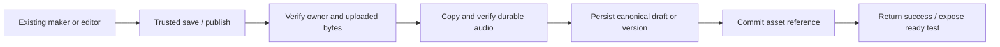

# Listening authoring history and implementation decision

Reviewed 27 October 2026 (Asia/Bangkok). Historical source is distinguished from deployment evidence.

## Finding

The old save path attempted to make temporary audio permanent. The newer authoring workflow bypassed that path without connecting its replacement asset committer to the production backend. The cosmetic design proposal did not call for that behavioral change. Reverting the whole workflow would also restore an older bug: failed audio promotion could still report a successful save.

## Source comparison

| Evidence | Before | After | Implication |
|---|---|---|---|
| June shell changes, including `1c3329a2` | Existing save facade | Same save facade | Styling alone does not establish the regression. |
| `dfe02060bf473fb4d60fbb601eba23aaecf534cf` | Builder calls `saveListeningTestToFirebase`; facade calls `moveToPermanent` | Move failure is caught and temporary URLs can still be persisted | A working promotion attempt existed, but durability was not guaranteed. |
| `288e1007711c194a0aae23a3c517b988fe6063ca` (2 July) | Builder used that facade | Builder creates HTTP authoring workflow; Worker calls repository save/publish without the asset committer | This checkpoint contains the disconnected production path, alongside much broader PRD work. |
| July checkpoint helper/registry | Commit helper, optional facade injection and tests exist | Historical production call graph has no helper caller; publish checks asset ID presence | An implemented helper is not an integrated save-and-publish solution. |
| October reconstruction `7a44284e`, donor snapshots | Registry/publish mutation already have this gap | Same relevant blobs survive | Reconstruction did not first introduce the missing commit connection. |
| October ready-projection changes `26f3aeff`, `487f02fa` | Canonical test may contain uncommitted audio | Lobby/homework can expose readiness without verifying committed audio | Ready projections cannot substitute for a durable asset record. |
| Separate editor fix `792e415b046fbf16334b009508b1806a91f616f7` | Generic editor did not retain native canonical workflow ownership | Existing editor uses canonical draft/version and trusted save/publish | Reuse this fix instead of adding another editor or read endpoint. It does not itself commit audio. |

The June/July checkpoint is a source boundary, not a proven exact deployment date or attribution to a cosmetic change.

## Design and implementation documentation

`documentation/design/listening-testmaker-redesign/PLAN.md` is explicitly a proposal. It specifies compact metadata, mode cards, controlled modal sizing, audio rows and a pinned footer. It says upload, parsing, draft, publish and student playback are unchanged. Those design goals are compatible with one shared backend save path.

The adjacent `mockup.html` encodes the same compact presentation. `documentation/architecture/ielts-reading-v2-listening-unification.md` explicitly records the Task 3.14 shell cleanup as preserving audio/save/persistence ownership and requires saved-reference audio retention. `documentation/architecture/upload-storage-authority.md` likewise defines durability through a successfully saved draft or published record. `documentation/LISTENING_BUILDER_IMPROVEMENTS.md` is an older historical record; its Google Drive preview and HEAD-validation workaround is explicitly obsolete. It is not a reason to weaken verification of current R2 bytes.

`documentation/ielts-reading-v2-listening-unification-implementation-log.md` has conflicting levels of evidence:

- Task 4.8 accurately describes an optional facade committer seam.
- Task 5 Batch A claims Save/Publish were routed through the committer and tests exclude temporary URLs.
- Task 5 Batch C accurately describes replacing the facade with the HTTP workflow and notes remaining durable trusted-backend wiring.
- In consolidated `288e10077`, the HTTP Worker calls the authoring cores with a repository and secret, without a committer. Save clones the document; publish checks asset ID presence. Historical helper callers are tests only. Therefore Batch A's statement does not prove the deployed production connection. An intermediate uncommitted implementation cannot be reconstructed from this checkpoint alone.

## Conversation evidence and limits

The local chat metadata identifies a 30 June Listening workflow review (`019f1516-f82c-7a11-bb91-7620e540e634`), based at `dfe02060`, explicitly requesting the metadata → mode → audio/images/questions → preview/publish workflow. Adjacent Task 5 and local-proof chats also exist in metadata. Their complete historical rollout files are absent and the chat reader cannot load them. These are relevant historical chat candidates, not a verified verbatim record of the exact cosmetic implementation or deployment.

The readable chat **Fix slow IELTS audio uploads** (`01a1696d-0e20-78e3-8d0f-b4bb1dc98aec`) records a successful HTTP 200 Worker/R2 write for a 45,606,680-byte file. That establishes that some audio reached R2 at that time; it does not establish a permanent commit, or correlation with all four currently affected asset IDs. Slow transfer and later missing permanent assets are separate questions.

The readable chat **Complete IELTS Listening hotfix** (`01a1793c-a4e7-75c0-aa9b-ba652ebe6cfd`) and commit `792e415b` supply the existing-editor solution above. Its code can be reused without treating its earlier tests as verification of this branch.

## Differential check

The exact `dfe02060` facade was exported under `source-dfe02060/`; `source-manifest.json` records its hash. `historical-save.test.ts` executes that source with Firebase/R2 boundaries mocked and no remote writes:

1. Successful move saves permanent URLs.
2. Rejected move still returns published success and saves temporary URLs.

Command: canonical `scripts/tooling-where.mjs --exec vitest run --config tmp/listening-history-20261027/vitest.historical-save.config.mjs --passWithNoTests=false`, run from this worktree. Result: 2 tests passed. This proves historical source behavior, not historical remote state.

## Chosen foundation

Reuse the existing immutable asset identity, commit helper, authoring repository, conflict tokens and idempotency. Connect storage once in the backend shared by the maker and editor. Retain temporary bytes until canonical persistence and reference attachment succeed. Retry the same identities after partial failure. Resolve playback against the saved version and committed asset. Preserve existing UI and shared announcements; do not introduce a second authoring API, speculative scheduler or compatibility storage path.

| Option | Benefit | Problem | Decision |
|---|---|---|---|
| Restore old facade | Small-looking client change | Swallows move failures; bypasses canonical version/security architecture | Reject wholesale rollback. |
| New parallel maker/editor/storage workflow | Can encode the intended rules | Duplicates existing interfaces and increases debugging paths | Avoid. |
| Wire existing commit logic into trusted repository | One shared correctness boundary; stable identities and retry behavior | Must verify partial failures and real delivery integration | Implement and test. |

## Remaining verification

Current implementation is uncommitted and under verification. Historical 2/2 proof is complete; it is not acceptance of the new implementation. No production deployment or affected-audio recovery was performed by this historical review. Exact July deployment attribution and missing complete old chat logs remain unproven. Existing missing objects cannot be recreated by a code fix; recovery still needs correctly mapped original files.

## Implementation and verification update

- Connected the existing asset prepare/finalize helper to the real Worker repository. Owner/session/key/size/MIME/magic/full-object checksum verification precedes canonical persistence; reference finalization precedes ready projections. Failed persistence retains temporary bytes; operation replay finishes the same canonical identities.
- Kept asset lifecycle transitions monotonic when concurrent saves race. Added a deterministic competing-commit / canonical-412 regression.
- Interrupted commits can recover a verified durable copy after temporary storage expires. Recovery checks the same key, checksum, size and MIME; it still persists canonical ownership before reference finalization. A regression reproduced the previous `temp_object_missing` rejection before the fix.
- Verified immutable durable metadata is cached only within one request, with no retained full audio body. Existing-asset publish and projection perform one full object read rather than four. Misses are not cached and writes invalidate the cache.
- Reused the existing editor repair from `792e415b` and removed the extra open-editor route and builder branch. Signed preview URLs remain separate from saved canonical URLs. Audio replacement in that editor remains disabled; this change does not add a second uploader there.
- Native playback now checks the exact canonical version/asset reference and current public or protected-homework authority. Native assignment creation persists protected grants and retention references before publishing the Firestore assignment.

Checks completed on this worktree include 53/53 core asset/workflow tests, 45/45 homework assignment tests, and focused editor/helper/Listening lobby checks. The broader UI run had one PDF Book setup failure; this review does not claim the full UI suite passed. Worker authoring and delivery suites passed 41 tests. The combined repository/preview suites passed 31 tests, including actual default Worker publish → independent authenticated student → signed solo URL → HTTP 206 with exact uploaded bytes. After the final interrupted-commit recovery correction, the repository suite was rerun and passed all 14 tests, including concurrency and exact-byte playback. Storage and Firebase IO are local fixtures; this is not a browser or deployed-state claim. Optional canvas import warnings were nonfatal in Worker tests.

### Local acceptance blocker

Browser acceptance and the added RTDB denial test are not verified. Ports 5173, 5174 and 9000 had no local servers. Three focused attempts to start the existing database emulator failed before any product test ran:

1. Existing Windows JDK 21, `-Xms32m -Xmx128m`, existing database emulator JAR, localhost:9000: Netty selector initialization fails with `java.io.IOException: Unable to establish loopback connection`, caused by `java.net.SocketException: Invalid argument: connect` in `UnixDomainSockets.connect0`.
2. Repository-documented WSL Java route, same existing JAR: `execvpe(java) failed: No such file or directory`.
3. Existing Windows JDK with the source-confirmed `sun.nio.ch.WindowsSelectorProvider` override: the same pipe/Unix-domain socket failure remains. No product source was changed for these runtime failures.

No runtime, Java package or dependency was installed. The affected emulator/browser work is paused pending a working supported runtime. The prescribed Astra main-chat escalation target was not identified in the available agent tree; this report preserves the complete reproduction and attempted routes without messaging an unrelated chat. Source implementation and isolated Worker checks continued independently.

### Local acceptance completed after runtime repair

The earlier emulator blocker is resolved. Existing JDK 21 starts successfully with both `-Djava.io.tmpdir=C:/Temp/firebase-assignment` and `-Djdk.net.unixdomain.tmpdir=C:/Temp/firebase-assignment`; no runtime or dependency was installed. The existing Firestore preflight now accepts the valid empty `{}` response while rejecting malformed bodies; six focused Node regressions pass.

Browser verification used this worktree at teacher `http://localhost:5173/login` and student `http://localhost:5174/login`, revealing the settings icon and using dev quick-login. Firebase Auth/RTDB/Firestore and Worker R2 were isolated local emulators. The local Worker adapter uses emulator admin credentials and restricts database requests to localhost. Public temporary-preview requests were redirected to local R2 by the browser harness; no production audio objects or credentials were used.

The browser exposed and verified corrections for two additional real gaps: Publish now saves dirty questions/settings through the existing save path and uses the returned conflict token; selected-record RTDB normalization restores omitted empty required arrays without allowing another tenant's malformed draft to block publication. The already-established `03089c91` student/live launch fix was included as a required dependency, without changing unrelated editor work.

Final local proof:

- Fresh real WAV upload → save an empty draft → add ten questions/answers and public visibility → click Publish without another explicit save: current edits persisted before publication, all responses successful.
- Student independently logs in, opens Public Library, launches the published Listening test, receives `/listening-delivery/solo` HTTP 200 and signed `/listening-delivery/content` HTTP 206. Browser audio reaches readyState 4, duration 1 second, playback time advances beyond 0.1 seconds, and media error is null.
- Owner reopens the existing editor; signed preview decodes. Saving a title edit creates version 2 with the same audio asset identity and preserves version 1. No page exceptions occurred.
- Native homework access denial emulator tests: 2/2 passed. Builder tests: 24/24 passed. StudentPracticePage/TestPageRouter tests: 54/54 passed. Final resumed local-workerd repository tests: 20/20 passed, including empty-array/hash round-trip and unrelated malformed-tenant isolation. Diff whitespace checks passed.

Sanitized browser evidence: `tmp/listening-acceptance-20261027/browser-proof.json`; screenshot: `student-playback-final.png` in the same directory. These are local acceptance artifacts, not deployed-state proof. Private homework browser assignment/playback and a full release build remain unchecked; the earlier separate PDF Book test failure is not claimed fixed. Source remains uncommitted and undeployed. Existing missing remote audio still requires correctly mapped original files.

### Production build and private homework acceptance

The remaining local build and private-homework checks above are now complete. Full Vite production-mode build used the reviewed machine `.env.production` through a temporary isolated env directory, with inherited VITE/emulator values removed. Default minification stayed enabled. Result: 9,518 modules transformed, 454 files / 12,935,733 bytes, 1m30s, exit 0. Bundle budget passed (root entry 257 KB / 500 KB); forbidden-local-marker scan passed across 440 generated text files. This dirty-candidate build does not produce clean-source release qualification or authorize deployment. Log: `tmp/listening-acceptance-20261027/build.log`.

Private homework browser proof used a freshly created private Listening publication and local class containing only the assigned student. The teacher created the assignment through Materials → Assign HW → class/configuration/review → Create Homework. The real assignment handler returned HTTP 201 and the shared success notification appeared. Protected RTDB grant records pinned the exact immutable version and asset IDs; the asset retained the assignment reference.

The assigned student used `/login` quick-login, opened Homework, found the private task and clicked Start Homework. Real solo delivery returned HTTP 200 and signed content returned HTTP 206. Browser audio decoded (readyState 4, one-second duration), time advanced beyond 0.1 seconds, and media/page errors were absent. A different authenticated student replaying the exact homework/version/asset/submission request received HTTP 403 `delivery_not_authorized`.

These checks use the real assignment and delivery business logic with local Firebase/R2. A temporary ignored adapter substitutes only demo-emulator authentication/service credentials and local transport; production JWT verification/IAM is outside this acceptance proof. Harness startup retries were caused by local Workers rejecting `redirect: error`; the adapter now uses manual redirects and rejects 3xx. No product changes were needed during these checks. Sanitized proof and screenshot: `tmp/listening-acceptance-20261027/private-homework-proof.json` and `private-homework-playback.png`.

Independent final source review found no concrete blocker. A proposed editor-tag finding was disproved with the actual request validator and retracted; no speculative normalization was added. The helper tests passed 7/7. Source remains uncommitted and undeployed; the separate earlier PDF Book setup test failure remains outside this fix. Commit scope includes Listening backend/delivery/editor/assignment corrections, their tests, required existing launch fixes from `03089c91`, the minimal empty-Firestore preflight correction, and this report. Generated bundles, emulator state, fixtures and local auth adapters are excluded.
