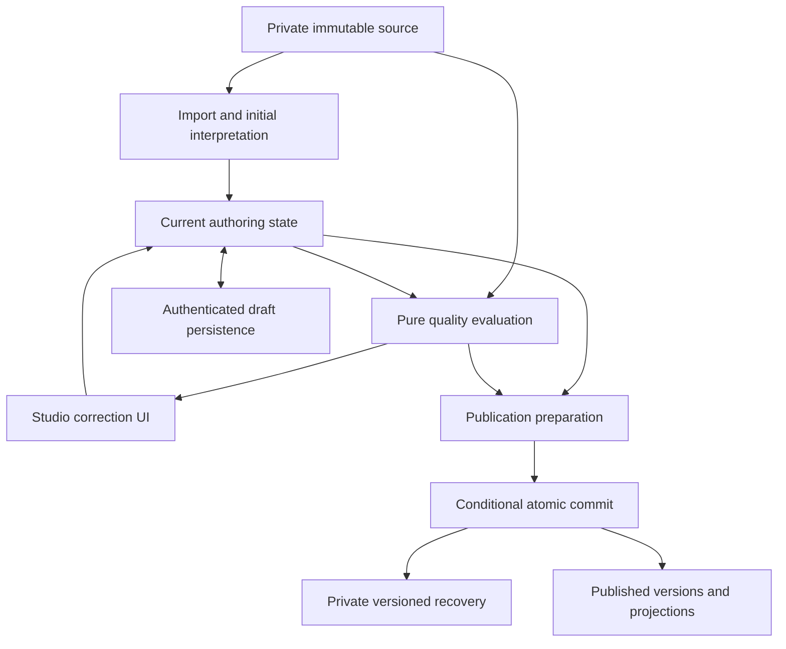

# Reading V2 authoring quality and review resolution: consolidated implementation plan

Date: 2026-11-06. Source baseline: main at 9e66909af91c85860854dc904dce072beb224f6c.

Status: implementation specification amended after the first-principles and design-proportionality reviews of the complete post-AutoV4 authoring journey. Verdict: implement with amendments, removing disproportionate mechanisms. This file remains the single implementation plan; chat assessments are review inputs, not competing plans. This revision changes this document only. No application, rule, runtime, or deployment change is implemented or verified by this plan. Current architecture contracts remain in force until their coordinated code/document amendments land, including the Build Workspace's Review/Validate/blocked-Publish behavior.

## 1. Outcome, ownership and delivery decisions

The primary requirement is:

**Import -> inspect genuine problems -> correct content, source interpretation or association -> automatic reevaluation -> resolved findings disappear -> save -> hard reload/resume -> publish -> reopen for revision.**

Assess and repair the accepting/interpreting/editing/validating/reviewing/persisting/publishing lifecycle as a whole. The Summary List false positive and a warning moving after deletion are illustrative regression cases, not the scope or evidence of a reproduced incident. Review means presenting current actionable quality findings and collecting necessary human judgment; it is not a second authoring state or a mandatory navigation phase.

| Concern | Decision |
| --- | --- |
| Publication requirements | Valid current canonical content, represented required content within declared source scope, coherent teacher-authored requirements, and resolved interpretation where human judgment is legitimately required. Canonical structure/scoring and source completeness cannot be waived by dismissing a diagnostic. |
| Review implementation | One small pure readiness interface over existing validation and focused source comparisons. No stateful Review Engine, event bus, worker, or dependency scheduler. |
| Source authority and authorship | Preserve the evidence actually supplied. Pasted/extracted text is not an unavailable original PDF/DOCX. Distinguish correction of a machine interpretation from an intentional supported teacher edit; neither rewrites immutable evidence. Section 3 defines permitted authored requirement changes and preserves completeness safeguards. |
| Active findings | Derive them from current canonical content, current scoped source requirements/bindings, and applicable teacher decisions. Historical parser/provider observations are not permanent validation authority. |
| Teacher decisions | Persist only the current typed source interpretation needed for a concrete ambiguity. Ordinary edits remain canonical authority. Defer generic content approvals, dependency fingerprints, per-rule versions and edit/revert revival; no irreducible case currently establishes their necessity. |
| Import handoff | Canonical-safe content with uncertain source topology reaches Studio with actionable publication blockers. Unsafe canonical structures fail import. Missing/extra diagnostic names alone do not decide handoff. |
| AI | Add no new AI calls. Keep existing Auto V4 import; the correction/recheck/publish loop works without provider availability. |
| Teacher interface | Keep the combined passage/questions workspace. Automatic checks, one issue entry point and one local marker replace duplicate warnings and prominent Validate. The primary action opens required work while blocked and publishes when ready. Save/conflict recovery stays in the normal workspace. |
| Source storage | Store an immutable, owner-private source artifact once per import attempt; drafts and private recovery records reference it. Do not add a file-ingestion/storage subsystem for this defect. |
| Publication recovery | Save a compact private authoring recovery record per material/version. Reference the version's existing complete canonical snapshot; inline the exact document only where that snapshot is absent, notably composition-first masters. |
| Published identity | Preserve exact version identity and canonical IDs. Stable live composition identity addresses current refresh semantics; generated-child association work is required where a supported writer can change membership/order or overwrite an independently edited child. Keep these publication-owned, not quality dependencies. |
| Publication concurrency | Publish the exact acknowledged Studio revision or explicit frozen direct-operation input. Later draft saves are permitted. Reject stale content/head writes and unsafe lifecycle transitions. Occasional harmless revision conflicts may use ordinary retry; neither global any-mutation invalidation nor fine-grained concurrent merging is a product requirement. |
| Write protocol and retry | Keep atomic publication fanout and guarded draft saves. Use a unique operation ID for one captured request, with read/retry/conflict recovery. Remove per-autosave hashing and mandatory whole-bundle cryptographic receipts. Section 8.5 selects/proves one small conditional protocol for actual writers, not a general concurrency framework. |
| Audit | Preserve established lifecycle/reference-repair audit obligations. Add no review-resolution audit family or atomic draft-plus-audit gate without a demonstrated product requirement; current source choices may record actor/time in the guarded private draft. |
| Delivery scope | Quality/correction UX and durable authoring/recovery are the main delivery. Publication-integrity repairs have a separate workstream and become release dependencies wherever the supported journey or changed grants require them. Do not hide supported paths to manufacture a smaller scope. |
| Compatibility | Replace affected internal interfaces/fixtures atomically under the pre-launch policy. No dual-read paths, revision-token aliases, backfills, or incidental migration-baseline rewrite. |

The chosen design is a pure quality evaluator, compact source coverage/current interpretation, guarded durable authoring and exact recovery. Prefer ordinary manual correction, copy or retry over automatic recovery from every exceptional state. Section 2.2 assigns publication dependencies; section 2.3 records proportionality decisions; section 12 separates delivery ownership. Select the smallest publication guard from actual writer requirements and prove it before switching grants. Earlier reported emulator results support primitive feasibility only; retained artifacts lack client result transcripts. Essential security/concurrency and end-to-end proof remain required.

## 2. Source-inspected baseline and implementation implications

| Current implementation | Required change |
| --- | --- |
| ImportNormalization:3504-3563 converts selected strings to untargeted canonical errors; acceptance strips importEvidenceRefs. | Remove that authority path; persist typed source/context before editable handoff. Removing blanket acceptance markers must neither erase context nor resolve specific conditions. |
| Validation:824-833 seeds checks with stored document/group issues. | Recompute supported current invariants; move necessary import uncertainty into typed authoring context. Neither replay history nor blanket-delete unknown errors. |
| Validation:402 and :472/:483 emit blocking errors from repeated note-heading and summary-overlap heuristics; the common issue builder sets severity error. | Audit individual checks before reuse. Keep actual layout/anchor/slot invariants; repetition/overlap suspicion alone is not a non-waivable structural fact. |
| StudioShell:2273-2355 combines candidate strings and canonical errors. | Use one readiness result, including existing title/passage/prompt/bank requirements. |
| StudioShell:2909-2916 Validate only changes a message/tracking event; BuildWorkspace repeats issues in several places; conflict recovery is inside Developer details at Shell:3349-3370. | Remove no-op Validate and duplicate warnings, make blocked publication actionable, and move conflict recovery into ordinary teacher controls. Amend the owning handoff with implementation. |
| ReviewIssueMapping/BuildWorkspace use numeric ranges. | Use source identities and canonical IDs; calculate current ranges for display only. |
| Source checks use four-line/180-character previews, first-overlap matching, and a 25% passage-length ratio. | Reassess authority: these are not sufficient proof of wrong type or omitted content. |
| SourceLedger:52-67 stores text/line evidence; expectedFullTest is inferred from detected passages/question numbers. Modal Auto V4 passes pasted text; other extraction utilities flatten PDF/DOCX into text. | Retain truthful input provenance. Do not make inferred topology or lost layout an unquestionable source requirement. |
| SourceLedger:1706 and AutoImport:3199-3204 treat source-question-extra as a hard error; strict detection can miss a supplied Q2 label. | Implement section 3.4's safe-handoff classification instead of treating provider-versus-ledger disagreement as proven corruption. |
| ImportReviewPanel:35-53 reanalyzes text by creating a candidate rather than retaining a source-interpretation correction. | Preserve the immutable attempt and make bounded requirement/binding corrections explicit in draft review context. |
| StudioWorkflow uses a process-memory repository; create/import/revise routes lack durable draft address handoff. | Implement authenticated async create/load/save and stable draft URLs, retaining workflow origin. |
| database.rules.json:2933-2937 permits draft writes based on old OR proposed owner, without a teacher-role/unchanged-owner requirement. | Fix role/immutable-owner authorization and prove foreign-owner child/ancestor denial before durable authoring is enabled. This is verified in source, not a live-data exploit claim. |
| useReadingV2StudioAutosave:55 invokes saveDraft before Promise.resolve can catch a synchronous throw. | Invoke the adapter inside a promise callback and release in-flight state on every failure. |
| StudioWorkflow:635-644 duplicate omits metadata and retains the source materialId. | Copy complete local authoring state, acknowledge the new draft, and detach the source publication target so publishing a recovery copy cannot overwrite the original. |
| PublishPipeline:1153 omits the composition-first parent snapshot; StudioFirebaseHydration:99-125 requires it. Passages already have complete versioned documents; TeacherComposition:1179-1190 retains an assembled parent snapshot. | Use private recovery records with an exact snapshot reference or inline missing parent document. Do not duplicate existing complete canonical snapshots. |
| PassageExtraction:122-127 includes the version in compositionId; AssignmentRefreshRepository:50-55 reads the composition ID frozen in homework. Generated passage IDs at Extraction:608-610 depend on position. | Fix live/current-versus-pinned composition semantics in the publication workstream. Positional child IDs are a verified mechanism/risk; qualify actual affected writers before requiring persistent association machinery. Shell:2180 limits passage collection edits to create modes and StudioPage:446-457 exits after create publication, so a synthetic reorder is not proof of an exposed revision flow. |
| ReferenceUpdate:267-278 changes passageRefs without changing publishedVersionId; assignment refresh reads that mutable row and retains its version/path. | Content-changing master reference updates use a new publication version with matching canonical recovery/projections; no unversioned content overlay. |
| ReferenceUpdateRepository:56-61 reads the whole composition collection; rules grant teachers individual owner reads, not that ancestor GET. | Discover current materials through owner summary indexes, then read authorized metadata/current composition individually. Keep collection access private. This is a static ACL finding, not browser proof. |
| MaterialMetadata:207 constructs publication metadata without lifecycle/history fields; FirebasePublishAdapter:185 replaces the whole row. | Merge owned authoring/head fields into an authoritative lifecycle base under explicit transition rules. CAS alone cannot preserve omitted fields. |
| FirebasePublishAdapter:281-320 uses unconditional update and operation-key-only retry matching. | Add qualified conditional guards and captured-operation readback. Identical paths do not establish request/content association; uncertainty may use conflict/inspection. Material-wide CAS is one candidate, not a quality prerequisite. |
| TeacherComposition:1036-1061 has a non-atomic write fallback and adds writes after adapter output. | Assemble/capture and commit the complete publication bundle atomically; forbid per-path fallback. No whole-bundle hash is required. |
| AuditTrail types/rules cover established lifecycle/reference-repair actions, not the proposed review actions. | Preserve existing obligations. No inspected contract establishes new review-resolution events or atomic save/audit coupling; do not introduce them solely for defensive traceability. |

Earlier source-builder measurements reported three checked-in Cambridge samples of about 24.3k characters producing 87.8-91.3 KiB of artifact JSON, equivalent to 20.6-21.4 MiB of repeated source bytes at 240 full-envelope saves/hour. A synthetic input at the configured 120k-character limit produced 444.1 KiB, about 104 MiB/hour. These are earlier serialized payload estimates, not new measurements, network benchmarks or whole-draft sizes. Store source once and reference it; media and canonical-record bounds still require measurement.

### 2.1 Responsibility and authority trace

The current modal hands Auto candidates through route state. AutoImport/SourceLedger capture supplied text and propose topology, constraints and diagnostics. ImportNormalization turns selected observations into canonical errors and acceptance strips evidence references. Studio edits canonical content, while Shell adds its own readiness checks and ReviewIssueMapping infers policy/targets from strings. Repository stores drafts only in process memory. PublishPipeline revalidates and creates versions/projections; FirebasePublishAdapter commits the fanout; StudioFirebaseHydration expects a canonical snapshot that composition-first publication omits.

Preserve canonical editing, structural guards, scoring, source capture and projection builders. Delete the observation-to-error replay and message/range policy instead of extracting it into another module. Import owns evidence acquisition/initial interpretation; authoring owns current requirements and edits; quality owns current comparisons; Studio owns presentation; persistence and publication own their I/O and version semantics.

### 2.2 Scope classification and dependency rule

| Class | Included work | Delivery rule |
| --- | --- | --- |
| A. Essential authoring quality | Blocker-authority audit, safe import classification, stable finding/target identity, current coverage/comparison, bounded requirement changes, necessary human decisions, automatic contextual resolution UX, one final readiness policy. | Main workstream Q; no Firebase/publication mechanics inside quality. |
| B. End-to-end dependencies | Authenticated durable drafts/URLs, source/context retention, guarded saves, exact versioned recovery, frozen publication input/receipt, and adapters for all supported Studio/direct entries. | Main workstream D. Include the minimum publication/security changes needed for these paths to remain correct. |
| C. Separate publication-integrity repairs | Material-wide CAS, lifecycle fanout coordination, composition/current-refresh identity, generated-child association management, reference versioning/discovery and mixed Reading/Book coordination. | Workstream P. Promote a concrete item to a D release dependency when an actual supported path or tightened permission depends on it; do not make all of P an automatic prerequisite to Q. |
| D. Remove or avoid | Stateful/general review engines, duplicated finding state/validators, message/range authority, universal confirmation machinery, async applicability hashes, repeated source envelopes, public editing snapshots, another AI layer and whole-Studio restructuring. | Do not implement. Existing useful presentation/editing code remains reusable. |

Before changing a writer/grant, record the affected caller -> write -> reader path and its concrete Q/D dependency. Reference versioning is a dependency if current reopen must reflect a reference update; an immutable recovery record cannot coexist with changed effective content under the same version. Current-refresh composition identity is a dependency where republishing must be followed by assignment refresh. Stable generated-child mappings are required before any supported membership-changing republication can retarget an existing material, not merely because a future Studio might expose that operation. Do not remove supported actions to evade these obligations. Separating projects never permits partial atomic selections, unsafe publication, stale recovery or false completion claims.

### 2.3 Design proportionality

For a safeguard, persisted field, validation rule, recovery path or UI interaction, identify the supported failure, qualitative likelihood, consequence, existing recovery, implementation/maintenance cost and simpler alternative. Classify it Essential, Lightweight protection, Defer or Remove. An imagined edge case alone is not justification. No production telemetry exists here; likelihood is a qualitative product judgment, not a measured probability. Confidence is high in the inspected mechanisms and lower in incidence estimates. Reassess only when a concrete failure or requirement changes the trade-off.

| Protection | Likelihood and consequence | Recovery and cost | Decision / smallest sufficient design |
| --- | --- | --- | --- |
| Authenticated owner/private data and actual write-boundary rules | Access attempts may be uncommon; disclosure/takeover is severe and not reversible. | No teacher workaround repairs disclosure. Moderate rule/integration cost. | Essential: role/owner/schema and ancestor-boundary checks on affected paths. |
| Canonical structure, scoring, anchors, rendered instructions and safe import hydration | Ordinary authoring/import; failure can publish broken or incorrectly marked content. | Edit detected failures; publication before detection can affect students. Existing validators reduce cost. | Essential: current deterministic checks, with heuristics separated. |
| Current findings, stable target IDs and compact required-source coverage | Ordinary edit/delete/renumber; missing content or wrong targeting is meaningful. | Manual repair is possible only if the issue is detected. Small inventory/mapping cost. | Essential: existing IDs plus required-item associations. Retain obligations after resolution so later omissions are detectable. |
| Durable private drafts, stable URLs, acknowledgement and stale-write rejection | Reload is ordinary; failed saves/multiple tabs are realistic occasional cases. Lost work is meaningful. | Preserve local work; retry or save a copy. Moderate persistence cost; one queue/guard is enough. | Essential outcome with lightweight implementation. |
| Exact immutable published recovery and shared final readiness | Publishing/reopening are ordinary supported workflows; wrong revision/content is serious. | Reimport cannot reconstruct exact authored state. Reuse existing snapshots to contain cost. | Essential: save only missing authoring data and use actual publication output for recovery tests. |
| Conditional atomic publication and relevant lifecycle/child-head guards | Concurrent writes are occasional; stale overwrite or inconsistent student content is serious. | Retry handles rejected writes, not already-corrupted publication. Integration cost may remain substantial. | Essential: protect actual overlapping writer paths, not unrelated records. |
| Source retained once, bounded interpretation correction, input/backend size errors | Source disagreement and rejected saves are realistic; false blockers/inconvenience are usually repairable. | Existing edit, source comparison or separate reimport; retain local work on errors. Low/moderate cost. | Lightweight protection: reuse existing artifact/controls; add no ingestion, size-policy or repair framework. |
| Contextual issues, accessible controls, visible save state and copy/reload recovery | Ordinary interaction; hidden/inaccessible recovery can lose work. | Clear controls and existing feedback suffice. Low cost if reused. | Essential baseline; extra dialogs/diff workbenches are not required. |

#### Over-defensive and disproportionate requirements

| Proposed mechanism | Likelihood / consequence | Existing recovery | Added cost | Decision and simpler alternative |
| --- | --- | --- | --- | --- |
| Generic approval bases, per-rule versions and automatic approval projection | No concrete irreducible case established; an extra human check is usually inconvenience. | Correct a current source fact or choose the current value. | Dependency serialization, schemas, invalidation and mapping tests. | Defer until a specific judgment cannot be represented as a fact; do not build the framework now. |
| Guaranteed approval revival after edit/revert | Uncommon sequence; lost approval costs another check. | Reevaluate/reconfirm where actually needed. | Retained inactive approvals and special semantics. | Remove as a requirement; deterministic findings still clear when valid content is restored. |
| Per-field source warnings and authored-override ledger | Ordinary edits; added state can itself become stale and obstruct work. | Canonical edits already express authored values. | Synchronization through every editor/copy/extract path. | Remove generic bookkeeping; retain only concrete source interpretation facts and coverage. |
| General source topology/range/bank repair workbench | Anomaly incidence unestablished; some individual errors are real. | Ordinary editor, bounded fact correction, source comparison or separate reimport/copy. | Several editors and a second source model. | Defer the workbench. Add a local correction only when ordinary recovery would lose work or leave a genuine permanent blocker. |
| Per-autosave SHA-256/fingerprint receipts | Ambiguous responses are occasional; result uncertainty is recoverable. | Read current revision/operation, retry or keep a copy. | Serialization, async crypto and receipt failure branches. | Remove; use one captured request, revision and small operation ID. |
| Mandatory whole-bundle cryptographic replay and recognition after later publications | Lost response is realistic; historical recognition is less common. | Inspect committed operation/version; conflict/uncertainty is safe with draft retained. | Fanout serialization, digest conventions and elaborate replay cases. | Remove the mandatory crypto protocol; use immutable IDs, conditional writes and ordinary readback. Never infer success from path lists alone. |
| New review audit actions and atomic sibling-audit gate | No inspected product/compliance obligation establishes these events. | Current choice plus actor/time in the guarded private draft. | New types/allowlists/root coupling; audit failure blocks authoring. | Remove; preserve established lifecycle/reference audits. |
| Acknowledged source save before conflict-copy | A stale source save may be impossible in the very conflict being recovered. | Save complete local state into a new draft. | Unnecessary barrier and dead-end recovery. | Remove; acknowledge the destination, leave original untouched. |
| Rich comparison/rebase/merge recovery | Conflicts are occasional; comparison is convenience if a full copy survives. | Keep as a copy or Reload latest. | Content comparison UI and merge expectations. | Defer; do not present current title/issue-count diagnostics as a real comparison tool. |
| Blanket metadata invalidation or guaranteed success for disjoint concurrent edits | Simultaneous benign edits are occasional; rejection costs a retry. | Reload/retry with work retained. | Broad CAS rollout or fine-grained commutativity rules. | Neither is a product requirement. Use the simplest safe guard for affected records; tolerate occasional benign conflicts. |
| Exhaustive race/ABA permutations | Many combinations hypothetical; consequences vary. | Safe conflict handling covers uncommon orderings. | Large brittle fixture matrices. | Remove Cartesian requirements; test actual overlapping high-risk writers and real permission boundaries. |
| Future generalized identity/lineage or issue dependency machinery | Hypothetical until an enabled writer requires it. | New material or a targeted later repair. | Persistent graphs/reconciliation/frameworks. | Defer lineage beyond actual writes; remove generic issue frameworks. Existing IDs and required child-head protection remain. |
| Extra dialogs/status/explanations for unlikely confusion | Usually minor inconvenience; incidence unknown. | Clear labels, one detail surface and shared feedback. | More controls, focus paths and duplicated status. | Remove; show source only when relevant and no confirmation after ordinary edits. |

Total implementation complexity: the former literal design was high because approvals, per-field bookkeeping, hashing, audit coupling, rich recovery and test matrices crossed the same core paths. The selected proportionate design is moderate overall, with a potentially substantial publication/security subset: one current evaluator, compact source inventory/choices, guarded drafts, existing publication fanout and exact recovery. A dismiss-only fix is smaller but loses necessary safeguards. A new trusted publisher adds deployment/auth/writer ownership and remains deferred unless it demonstrably reduces total cost. These are structural estimates, not time/line-count forecasts. Do not implement two complete protocols just to compare estimates.

## 3. Rule policy: requirements before module extraction

Preserve real product safeguards, not every old severity or diagnostic classification. Checks return satisfied, failed on established facts, or uncertain. An uncertain interpretation may require human review, but cannot masquerade as a proven content defect.

Audit checks by the fact they establish, including checks currently inside Validation, before deciding publication effect:

| Authority | Treatment |
| --- | --- |
| Current canonical structure, scoring, anchors, required fields and internally consistent rendered instructions | Recompute deterministic invariants. An actual failure blocks publication and cannot be confirmed away. Incomplete but editor-safe content remains saveable. |
| Required source passage/question/answer-slot coverage within declared scope | Evaluate stable identities and associations. An ordinary edit/delete cannot silently remove an obligation; supported explicit extraction defines a legitimate smaller scope. |
| Source-derived task/instruction/bank interpretation and supported teacher-authored requirements | Compare against current effective requirements under section 3.3. Preserve source evidence and distinguish interpretation correction from intentional authorship. |
| Repetition, fragment overlap, length ratios, diagnostic severity and other suspicions | History/advisory unless current evidence establishes a specific requirement failure or legitimate unresolved human judgment. Validator location and an error code do not confer structural authority. |

In particular, separate Validation's note-heading/summary-overlap heuristics from malformed layout, slot-count and anchor checks. Keep genuine structure checks. Do not blanket-downgrade a shared code such as student-visible-structured-mismatch or carry every existing error forward unchanged. Multiple old diagnostic codes may map to one current check; this plan does not require 22 new rule implementations.

### 3.1 All 22 current review-blocker codes

This matrix covers the exact publishBlockingReviewDiagnosticCodes set in AutoImport:3121-3144. Code names identify old observations; they are not the new publication policy.

| Existing codes | Current check and evidence | Clearing/recovery condition |
| --- | --- | --- |
| answer-key-missing; source-answer-row-unbound | Current scoring answers and required source row/slot bindings. Distinguish no detected source key from an absent required canonical answer. Reuse answer-key normalization and scoring validation. | Enter/bind actual required answers. Preserve explicit teacher-authored scoring authority, including a recorded correction of an inaccurate source-key interpretation. No confirmation waives an absent answer or genuinely unbound required row. |
| question-count-mismatch; source-question-missing; source-question-range-missing; group-coverage-mismatch; groq-output-missing-group; app-normalizer-dropped-group | Required source question identities/slots versus current bindings. Historical counts, range guesses, and earlier provider omission are insufficient. Include multi-answer continuation slots. | Recover required content and bind replacements explicitly. A repaired provider omission becomes history. Repair ambiguous association before deciding content is missing. |
| passage-count-mismatch; source-passage-missing | Required source passage spans versus current passage bindings in the selected scope. Heading/chunk detection alone is not product authority. | Recover established omissions; permit specific boundary interpretation where genuinely uncertain, without excusing a visibly required missing passage. |
| possible-trimmed-passage; source-passage-trim-risk | Complete associated source span versus current passage. The 25% ratio is suspicion; normalized text/line checks may establish specific omissions. | Merge duplicate trim observations. Repair proven missing content; permit evidence-backed interpretation when only the heuristic remains disputed. |
| source-reference-bank-missing; source-reference-bank-mismatch; missing-reference-bank | Associated bank labels AND text, ownership, answer links, and current task requirements. Label counts alone do not establish completeness. | Repair actual missing/incorrect banks or ambiguous ownership. A supported teacher bank edit is authored data, not a claim that extraction was wrong. An unrelated bank or task-type toggle alone cannot hide an unresolved imported bank omission. |
| source-instruction-task-type-mismatch; task-type-conflict | Current type/response shape versus complete associated instructions/bank and a concrete current source interpretation where needed. Generic summary wording does not prove Summary Text. | Correct the contradiction or establish the interpreted task type under section 3.3. Ordinary supported edits are authored values; no separate content approval is needed. Preserve required content/current task coherence. |
| source-instruction-word-limit-mismatch; source-instruction-vocabulary-mismatch; source-instruction-reuse-mismatch | Initial source constraint or explicit supported authored requirement versus current rendered instruction/answer rule/scoring. Use full relevant evidence. | Fix an unintentional mismatch; retain an intentional teacher change as authored authority. No extra confirmation for an explicit edit, and no bypass of a contradiction within the current student-facing task. |
| blank-mismatch | Required source answer slots versus canonical blank/layout/anchor representation, with established associations. | Repair missing/broken slots. Unknown association requires binding repair; matching a total count is insufficient. |
| canonical-validation-blocked | Originating current validator code and target. The wrapper is not a rule. | Remove the historical wrapper as authority; evaluate and display the actual current invariant once. |

Extract lower-level comparisons to accept current canonical facts directly. Do not convert edited documents back into a Gemini-shaped payload merely to reuse the old verifier.

### 3.2 Other conditions

| Condition | Policy |
| --- | --- |
| Current canonical answers/scoring/anchors/options/layout/prompts/media failures | Audit the actual predicate. Established structural/scoring/rendered-task failures require repair; heuristics in the same validator are not automatically non-waivable invariants. |
| Generic import acceptance | Completing import means a canonical-safe editable draft and its source context were durably saved. Do not retain a blanket reviewed/accepted finding or separate mandatory acceptance screen as another quality authority. Specific unresolved conditions remain; remove generic markers without deleting their context. Coordinate current-contract changes. |
| Nonstandard/custom instructions | Wording alone is not a defect. Check current rendered instructions/response/scoring and concrete source requirements where needed. Repair lost rules and actual inconsistencies; an ambiguous source constraint may be established as a current typed fact, not an approval of future content. |
| Historical retry/provider/normalizer observations | History unless an independent current check fails. source-repair-failed is not in the current review-blocker set. |
| Existing advisory quality observations | Do not promote them during refactoring. Examples include group-source-underrepresented/note-heading-missing without a separate required-fact failure. |
| Import handoff | Apply section 3.4. Keep input bounds, unusable provider output, unhydratable canonical data and unsupported structure as explicit import errors. A failed repair attempt or inferred missing/extra/boundary condition is not itself proof of unsafe canonical content. |
| Unknown historical diagnostic | History/advisory by itself; names/severity cannot invent a product invariant. |
| Unknown current safety condition or unusable evidence | Classify incoming diagnostics explicitly at the import boundary; absence from a code set or warning severity is not approval. An unsupported current safety claim requires reason, safe evidence, and supported Repair/Reimport recovery. Refuse editable handoff when no safe actionable Studio path exists. Never create an inert permanent row. |

For every active check, implementation must identify its requirement, input facts, evaluator, target, concrete resolution action, and representative regression. The matrix is the decision, not an instruction to preserve old code wholesale.

### 3.3 Source interpretation and intentional teacher authorship

Keep historical observations, canonical failures, source coverage and human interpretation distinct. Immutable evidence proves what text/input was supplied, not that regex ranges, bank ownership or extracted layout are correct. Imported content is editable authoring, not perpetual literal transcription.

- Retain a compact inventory of required passages/questions/answer slots and required banks, with source evidence and canonical associations. It survives resolution so later accidental omissions remain detectable. Default scope covers supplied material; existing extraction selects an explicit subset. Do not infer a mandatory full test merely from three headings or Q1/Q40.
- Persist a current typed source interpretation only when a concrete check needs it: for example, a disputed task type, slot count or bank association. Store subject/evidence, chosen value and actor/time. A correction changes that fact, not immutable source. No universal previous/new/reason ledger, per-field authoring provenance or repeated raw-ledger reparse is required.
- Normal task/instruction/word-limit/reuse/option/key edits remain canonical authored values and are checked for internal coherence. They create no review record by default. Where a concrete source check exists, a supported explicit edit or Use this task type may update that check's current interpreted choice in the same draft. It is not a generic dismissal, does not claim the source was misread, and cannot resolve unrelated missing content.
- A corrected interpretation remains the current fact until deliberately changed or the source is replaced. Reevaluate canonical content against the needed facts and coverage; do not add expiry, per-rule versions, approval bases or edit/revert revival. A fact such as source task type is not approval of all future content.
- Required passages/questions/slots and unresolved imported bank/structured-content omissions cannot disappear merely because a field/type changed. Correct a mistaken obligation or use an existing supported scope/extraction operation; offer no Ignore requirement action. Newly authored additions need no invented source binding and cannot satisfy an omitted original by matching its display number.
- Teacher-authored marking is canonical authority; retain copied source keys as evidence. No extra confirmation or silent key restoration on normalize/reopen.
- Reuse existing editors and source comparison for ordinary correction. Defer a general topology/range/bank repair workbench. For an uncommon anomaly, offer a bounded fact/association correction or separate reimport with the original draft retained. Add a dedicated control only when ordinary recovery would lose work or leave a genuine unresolved blocker.
- Reanalysis preserves supplied text/attempt; reimport creates a new immutable attempt and reevaluates source associations. Store only the actual input/extractor/reference provenance available, not unavailable original PDF/DOCX bytes or layout.

The guarantee is coverage of current explicit source obligations and a structurally/internally consistent authored task. The software cannot prove fidelity to an unavailable original or the truth of a teacher judgment. Current typed choices, not reusable content approvals, represent necessary human decisions. General source adaptation, new file ingestion and automatic recovery from every parsing anomaly remain excluded.

### 3.4 Safe import handoff

Classify current conditions before converting them into Studio findings. A diagnostic's severity or membership in the old downgrade sets is not the classification algorithm.

| Current condition | Required outcome |
| --- | --- |
| Empty/oversized/unsupported input, unusable provider output, or canonical data that cannot safely hydrate the editor | Fail import with specific repair/reimport recovery. Retain actual supplied evidence where available. Do not fabricate valid structure to force handoff. |
| Inferred passage boundaries/question ranges or incomplete ledger detection, with otherwise usable input | Preserve uncertainty and allow the existing provider lane to interpret the supplied text; do not stop solely on inferred local topology. Add no new provider call. Final handoff still requires safe canonical normalization. |
| source-question-extra/source-passage-extra caused by inferred or ambiguous source topology, with canonical-safe generated content | Open needs-review Studio state. Retain the generated content and explicit unbound-content/source targets; require binding or bounded interpretation correction. No silent dropping, auto-acceptance, number-based matching, or separate quarantine representation. |
| Extra generated content contradicts an established scoped requirement, but the draft is structurally safe | Keep an actionable publication blocker on the actual extra target. Teacher removes unsupported content or explicitly corrects a mistaken source interpretation; no generic dismissal. |
| Established missing questions/passages/answer rows/ranges/banks with a canonical-safe incomplete draft | Hand off with blocking source requirements and restore/create/rebind actions. Missing canonical content is not automatically unsafe editor structure; incomplete prompts/answers may remain editable. |
| Repair failed, or a prior provider/normalizer omission was repaired | Evaluate the current result. The failed-attempt observation is history; current unsatisfied requirements or unsafe canonical structure determine readiness/handoff. |

Retain source-only findings when a required target is absent and canonical-targeted findings when generated content lacks a supported source association. Unsupported current safety conditions without a safe actionable path still fail handoff. Cover alternate Q2-style numbering, uncertain boundaries, extra material, omitted ranges, failed repairs and genuinely unsafe anchors in shared regressions. The old 22-code matrix remains a disposition inventory, not an exhaustive list of handoff conditions.

## 4. Minimum interface and persistent records

### 4.1 Pure interface

Keep a small public readiness interface under src/services/reading-v2, composed from existing canonical validation and a focused pure source-requirement evaluator:

    evaluateReadingV2AuthoringReadiness(authoringState, resolvedSourceEvidence)
      -> findings, blockingFindings, canPublish

A small pure helper may validate a concrete source interpretation or association change, with actor supplied by the workflow. Current source facts remain inspectable/changeable without inventing a finding. Ordinary edits update canonical state; they do not synchronize a second full constraint model. Evaluation has no engine instance, provider/React dependency, storage/audit write, navigation callback, fingerprint cache or approval lifecycle. It consumes current canonical content and the compact needed source facts, not diagnostic strings or a re-created Gemini payload.

Include existing Shell-only metadata/content requirements. Projection builders retain structural guards and never load private evidence.

Source interpretation proposes requirements/bindings; authoring owns their current values and permitted changes; quality compares them with canonical facts. It must not grow into the import parser, save coordinator or publication planner. Organize internal functions/files by that ownership; a fixed file count is not a design requirement. The 22-code inventory is a migration/deletion checklist, not the public interface.

### 4.2 Records

Use existing draft, provenance, metadata and publish-commit namespaces; no new database root. The established audit namespace remains unchanged for review resolution.

| Record | Minimum data |
| --- | --- |
| Immutable import source | Schema/kind, owner UID, unique import-attempt/storage ID, supplied evidence and input/extraction provenance. Reuse existing source digests where useful; they are not authorization or mandatory save receipts. |
| Mutable draft | Draft ID, owner, numeric revision, document, metadata, lifecycle, origin/source material/version, compact review context, timestamps and lastOperationId for ambiguous-save readback. No cryptographic receipt ledger. |
| Review context | Explicit origin, selected scope, compact required-item inventory/associations, immutable source or pinned published-input references and concrete current interpretations. No active-finding array, trusted readiness boolean, per-field authored override table or full parser ledger. These are nested authoring facts, not separate databases. |
| Current source interpretation | Only when a concrete ambiguity needs it: source subject/check kind, chosen value, evidence reference and actor/time. No universal rule versions, historical approval record or before/after/reason ledger. Canonical authored values remain in the document. |
| Binding/association facts | Source requirement/slot ID and canonical target/slot ID; retain source-only obligations and imported targets whose source association is unknown. At least one side exists. Missing association is not proof of manual origin. Deletion produces missing coverage, not transfer to the next display number. |
| Generated-material lineage | Publication-owned associations/expected child heads where the section 2.2 writer qualification requires them. Preserve existing lineage on revisions; add no mapping subsystem solely for a hypothetical future edit. Membership/order comes from canonical content. |
| Private authoring recovery record | Schema/kind, owner/material/version identity, selected draft revision where applicable, exact versioned authoring metadata/workflow lineage, review context/source references, and an exact canonical locator: own published snapshot reference OR inline document where absent. See section 9. |
| Material metadata | Existing metadata/current heads with guarded publication bases. Add numeric materialRevision only if section 8.5 selects that protocol; do not couple it to draft revision or quality state. |
| Publication marker | Reuse existing commit namespace for unique operation/material/version/owner and captured authoring identity (Studio revision or direct-input identity). One ID identifies one frozen request. No mandatory full-bundle digest or historical retry ledger; path lists alone never prove success. |

Use one numeric revision for the guarded draft save contract and update internal revisionToken callers/tests atomically; no dual representation. Numeric revisions are a storage-protocol choice because rules can express old+1 directly, not a prerequisite for quality evaluation. Existing string tokens already compare exact values in memory, but do not supply shared durable CAS. Private envelope changes alone do not require a delivery schema change. Persisted draft lifecycle must not be another readiness authority.

Store import-source records through readingV2StoragePaths.provenance with non-guessable IDs per import attempt. Existing content-derived artifactId remains content metadata, not storage/attempt identity. Identical fresh imports remain independent; deliberate draft duplication may reuse an immutable record under a new review scope.

Store recovery records under explicit authoring-recovery kind and the existing material/version composite-key convention, e.g. authoring-recovery:{materialId}:{snapshotVersionId}. Validate key components and stored identity with a small feature-owned builder; do not add a generic repository hierarchy or arbitrary storage-path references.

The dependency direction is import/source interpretation -> draft authoring state -> pure readiness -> Studio/publication. Draft persistence and publication commits own their I/O; delivery/projection modules retain structural guards and do not import private review storage. A future Studio refactor should replace the presentation/workflow adapters without moving rule policy into React or Firebase.



## 5. Identity, coverage and simple teacher decisions

- Source keys identify passages/groups/question-answer slots within an immutable source attempt and selected scope. Source numbers/line IDs are original coordinates, not current display positions.
- Source finding keys use the existing authoring/source scope, check code and source identity. Keep canonical target separate so association repair does not leave competing logical findings. No per-rule version registry is required.
- Canonical finding keys use rule and canonical target within authoring scope. Never parse messages to recover identity.
- Reuse existing canonical IDs and draft/material-version identity for authoring scope. Add another scope ID only where distinct import scopes within one document require it; do not create a generic identity subsystem.
- Bind during normalization using a unique supported association: passage/scope and exact source identity. No first-overlap fallback. No candidate means source-only; multiple candidates require association repair.
- Map required source question identities to canonical interactions/answer slots. One interaction may represent multiple slots; duplicates or equal totals cannot automatically satisfy a missing original.
- Declare scope explicitly: full source test, selected passage/partial extract, or pinned published inputs. Existing extraction can select a legitimate subset; deletion cannot silently shrink scope.
- Manual drafts have explicit manual origin. Paste/Auto/other supported input retains the actual supplied source. External structured input can be evidence of that input, not an unavailable earlier original. Missing evidence never silently changes origin to manual.
- Public composition uses pinned, authorized published inputs. It does not require another owner's private provenance or decisions. Published input is explicit origin, not a skip-review flag.
- An uncertain association needs a corrected binding; a mistaken required item/source fact needs a bounded correction. Normal canonical edits need no per-field override record. None silently waives source coverage.

Current interpreted facts survive ordinary edits; evaluation compares the needed facts/coverage with current canonical content. New authored targets need no invented source association. Unresolved imported-target facts persist until repaired or the unsupported imported target is removed. Do not keep only open findings: resolved required-item coverage must remain capable of detecting later accidental deletion.

Do not implement content-approval bases, retained inactive approvals, exact edit/revert revival, automatic approval projection or per-rule migration/version policy. No concrete irreducible case currently justifies them. If one is demonstrated later, add the smallest subject-specific decision and ordinary recheck behavior then. Deterministic checks already clear after edit/revert restores valid content; no approval history is needed for that behavior.

Duplication/extraction recomputes findings in the destination's existing draft/material scope, reuses same-owner source references and projects required items/associations using actual copied content. Preserve relevant current source facts, not another owner's private context or reusable content approval. Generated children need only the mappings/facts required by their actual publication/reopen paths. Do not add a generalized identity/lineage or approval-transfer graph for future features.

Reuse the existing immutable source builder/hash where it already serves source identity. Use a unique storage/attempt ID and authorization independently of that digest. Add no per-autosave crypto, document copies for approval bases, async readiness state or new hash scheme solely as another safety layer.

## 6. Durable authenticated authoring

1. Derive actor UID/role from the authenticated session/profile. Remove current-teacher defaults from real save/publish paths. Route state and editable metadata are not authorization.
2. Ordinary drafts belong to the authenticated owner. Keep actor separate from target owner for existing explicitly authorized super-admin workflows. No ownership-transfer feature is introduced; even admin edits preserve owner identity.
3. Persist source once and acknowledge it before attaching it to a durable draft. Capture one unique attempt ID and its input; do not overwrite an existing different attempt. On uncertain creation, read back that owned record or report uncertainty with input retained. Reuse existing source digests if helpful, but add no fingerprint/replay protocol. An unused source after failed draft creation is acceptable; no orphan-management subsystem is needed.
4. Perform async create/load outside render-time useMemo. Render loading/missing/denied/error inside the teacher surface.
5. After durable create/import/revision creation, replace the URL through registered TEACHER_READING_V2_DRAFT and existing buildRoute/useNavigation. Resume uses draft ID and auth UID, not location.state.
6. Persist workflow origin/source version separately from route mode. Resumed published revisions retain single-passage reference discovery, correct publication exit behavior, and expected material base.
7. A non-owner opening a public passage uses the existing clone/duplicate-material flow into an actor-owned draft with published-input lineage; never save as the original owner or read private context.
8. Source/recovery records are private authoring data, absent from summary discovery and all student/session/result projections.
9. Reuse one source artifact type rather than narrower inconsistent copies. Raw source/index stay in the immutable record; autosave carries references and compact context.
10. Measure supported authoring-record sizes, including embedded media/data URLs, against existing backend/upload constraints. The 120k source-text cap does not bound the whole record. Refused/oversized saves retain local edits and report a recoverable error; this fix introduces no arbitrary new material-size limit.
11. Duplicate/extract captures complete intended local state, including unsaved edits, metadata and needed private source context. Create a new actor-owned draft and acknowledge that destination before navigation; no source save is required. Keep as a copy must also use a new material identity/publish-as-new state, retaining the original material only as origin, so later publication cannot overwrite it. This differs from a deliberate same-material revision. An unsaved local snapshot is not an acknowledged source revision or published version. Preserve only destination-relevant associations; fix the current duplicate's omitted metadata and retained source publication target before relying on it as recovery.

Use one small per-draft save coordinator for manual save, existing 15-second autosave, source-context changes and pre-publication flush. Coalesce queued edits, serialize writes and advance revision only from applicable acknowledgements. Invoke potentially synchronous adapters inside a promise callback so throws cannot bypass catch/finally. Context-only changes queue a save. Copy/extract freezes its local input and saves the destination without forcing a source flush.

Ignore obsolete callbacks after draft/auth-session changes. On navigation/logout, flush where possible or use existing unsaved-work protection. Never announce success before acknowledgement, retry old ownership under a new account, or silently discard queued edits.

## 7. Guarded draft saves and proportionate retry

Use one atomic guarded operation at the owned draft record. Reuse the existing Firebase pattern: a revision-checked write or a draft-node transaction, not both. No sibling audit transaction, database-root client transaction or broad private/audit read is required.

1. Capture one normalized serializable envelope, operation ID, expected revision r, resulting revision r+1 and timestamp. Preserve incomplete but editor-safe content. Reject unsafe data without discarding edits. One operation ID is never reused for changed content; retries retain the captured request rather than rebuilding from live state.
2. Create revision 1 only at an absent draft; updates require the server-recognized teacher/authorized admin role, current owner and unchanged ownership, valid IDs/schema/source ownership and a positive safe-integer revision exactly old+1. Discard is a guarded lifecycle change, not hard deletion. Apply eligible-role/owner protection to source/recovery records too.
3. Two clients prepared from r cannot both overwrite that draft: one succeeds and the stale operation is rejected. Read current state on conflict; never adopt its newer revision and blindly replay older content.
4. Keep only lastOperationId with the draft revision for uncertain-result readback. If the owned record still identifies the captured operation/resulting revision, acknowledge that save. If it advanced, differs or remains uncertain, retain local work and return conflict/retry/copy recovery. Do not build a historical acknowledgement ledger or infer failure merely from timeout.
5. No per-autosave SHA-256, payload fingerprint, body receipt or additional document copy is required. Operation identity is an ordinary-client request invariant, not cryptographic content proof. If its association cannot be established, do not announce success; ordinary inspection/conflict recovery is acceptable.
6. Prove actual ownerId-child, full-record and ancestor takeover/deletion denial before enabling persistence. Session/draft changes ignore obsolete callbacks; failed saves preserve local edits and clear in-flight state. These few guards prevent meaningful data loss without a general recovery state machine.

Current typed source choices and their actor/time are saved inside the same private draft envelope. Do not add reading_review_* audit actions, a reading-draft audit entity or atomic save-plus-audit coupling for this feature. No inspected current contract establishes that extra obligation. Existing required archive/restore/remove/reference-repair/duplicate-decision audits and shared action tracking remain in force, with safe fields and existing services. If an independent audit requirement is later established, design that integration explicitly rather than making ordinary review correction depend on it now.

These guards protect ownership, structure and concurrent writes. They do not claim server-authoritative semantic review of a deliberately modified owner client.

## 8. Publication integration and separately gated integrity repairs

### 8.1 Guarantee

Studio publication uses the exact selected acknowledged draft revision and matching private recovery record. A newer draft save after selection is allowed. Reject stale content/child-head overwrites and unsafe lifecycle transitions without partial fanout. Neither rejection of every intervening mutation nor guaranteed concurrent success for harmless disjoint edits is required. A simple aggregate revision may cause an occasional benign conflict; retain work and use ordinary retry instead of adding fine-grained merging or ABA machinery.

Do not promise latest-draft-at-commit semantics. No global publish lock, claim-then-unconditional-update protocol or new trusted backend is introduced by the main authoring work. Workstream P qualifies guards before the affected writer/grant switch; its required subset is a D release dependency. Existing unconditional publication is not evidence that the new concurrency guarantee is satisfied.

This selected-revision/content guarantee is enforced by the owning workflow capturing the acknowledged normalized state and the planner checking it. A mutable draft does not retain older bodies after later saves, and RTDB rules cannot recompute canonical SHA-256/quality or attest that historical body. Do not add immutable copies of every autosave to imply server-authoritative content verification. The published recovery record retains the selected exact state.

Existing direct selected-passage create/edit/reference-update operations need not create a Studio draft solely to publish. Capture explicit canonical content, required source context, authorized pinned inputs and material bases under one operation identity, evaluate shared readiness and atomically persist recovery plus existing commit marker. Record direct-input identity rather than invent a saved draft revision. Direct import cannot drop source context or declare itself manual to bypass review. Opening Studio first persists its complete canonical draft, not just composition refs.

### 8.2 Published identity, references and lifecycle

- Where republish/current-refresh is supported, allocate one stable live compositionId per full-test material and reuse it on revision. Immutable full_test_composition_versions/{compositionId}/{versionId} retains history; current metadata selects the live version. Keep selected-composition identity stable and align imported compositions when repairing that path. A per-version composition identity is not intrinsically invalid, but preserving it would require changing current-refresh readers to resolve current metadata; do not implement both schemes. Recreate disposable fixtures rather than add dual readers.
- Qualify actual extracting-parent writers before adding lineage. Where membership/order can change across republication, retain a parent-scoped stable canonical passage -> generated material association and expected child heads in draft/recovery. Use stable passage identity, not position/display number/lossy labels; validate uniqueness/ownership, preserve associations on edits and allocate new ones for new/duplicated passages. Reimport/ambiguous replacement needs explicit association or a new material. Do not claim the synthetic reorder is an exposed teacher flow or add a new reorder feature. Even fixed-membership revision must not overwrite an independently advanced child.
- Canonical membership/order determines which children the parent publishes. Deletion removes membership without reassigning the old child's identity to another passage. Preserve existing child/history for other uses; archive/removal remains an explicit existing lifecycle operation. Retained lineage must support conflict detection against independently edited children, not just matching IDs.
- A master reference change affecting passage/version inputs is content authoring. Load exact parent recovery, apply changes preserving unrelated canonical IDs, reevaluate current coverage/source facts and publish a coherent new version/recovery/projections. Replace direct same-head passageRefs mutation; no unversioned content overlay. If correction is needed, preserve it in a revision draft and leave publication unchanged. This is an actual version-integrity dependency where the reference path is affected, not a general provenance framework.
- Annotation/lifecycle-only changes may retain the head if their actual fanout is guarded and preserves current content. Increment materialRevision only under option A. Option B instead needs enforced expected-head/lifecycle preconditions wherever an earlier read influences those writes; child patching alone is insufficient. No generic repair flag makes content-changing reference repair annotation-only or bypasses readiness/version creation.
- New launches and explicit refresh-from-latest resolve the stable live composition/current metadata head. Frozen assignments/results retain their exact composition and passage versions/payloads. Reopening a pinned authoring version uses its immutable recovery record. Reference update -> refresh -> reopen must agree on version meaning; a new effective input set cannot reuse an existing composition-version/payload identity.
- Teacher discovery uses approved owner MaterialSummary indexes to obtain relevant material IDs, then authorized metadata and current composition reads. Verify complete indexing for all supported master paths, filter current eligible rows and handle stale/unavailable index entries explicitly. Do not scan the private composition collection, grant broad reads, or use retired legacy indexes as an unverified substitute. Fetch authoritative current bases again before mutation.
- Define field ownership and build metadata from the authoritative existing base. Prefer patching publisher-owned authoring/head fields; replacement requires an appropriately guarded complete base. Preserve applicable lifecycle/history fields; archived material needs existing restore, and removed material cannot be implicitly resurrected. Initial creation sets its intended state explicitly. Recompute broken-reference facts from resolved inputs. A guard cannot preserve a field omitted from a replacement or make an index derived from a stale read correct.

### 8.3 Prepare and commit

1. Apply existing canonical publication normalization, reevaluate current quality and capture that state. Studio awaits its acknowledged selected revision; direct operations capture section 8.1's explicit inputs. Stop for genuine quality, source-association or save conflicts.
2. For Studio, freeze editing during the publication attempt and disable duplicate Publish. Retain the captured draft; never auto-exit while newer local edits could be lost. Direct operations also prevent duplicate dispatch and retain the same captured inputs on retry.
3. Resolve the required version/identity associations and read authoritative bases for every mutable parent/child head advanced: expected head, owner, lifecycle and relevant owned fields; include materialRevision only under option A. Read only required lineage, not hypothetical future mappings. Never reassign an existing material by a changed position.
4. Where the parent republishes existing children, check their captured expected heads. An independently advanced child is a conflict: retain the draft, reload/inspect or use existing copy/new-material recovery. No automatic compare/rebase feature is required, and expected heads must not be silently refreshed to overwrite independent work.
5. Allocate collision-resistant publication/version identity once; reuse it across planner, recovery record, composition version, child versions, projections, bridge, catalog and marker. Keep stable material/live composition identities separate from that version identity.
6. At publication entry, document/context match the captured acknowledged Studio revision or direct input. Normalization must not silently change the reviewed state; reevaluate and, for Studio, save any changed authoring input before publication. Reuse structural guards; no approval-applicability check is involved.
7. Build the complete atomic update once: private recovery, immutable versions/projections, metadata/current heads, summaries/bridge/where-used and commit marker. Choose section 9's canonical locator from that actual output. Retry this captured request; do not rebuild different contents under the same operation/version ID.
8. Commit one atomic root update using the single protocol qualified in section 8.5. Both options require create-only initial identity, guarded expected old head -> unique new head, eligible current lifecycle, immutable owner, and correct version/recovery association. Option A creates materialRevision 1 and advances valid positive safe-integer revisions exactly once; option B carries an enforceable expected-head/lifecycle basis at each affected operation boundary without an all-mutations revision. Two first publishers cannot both create the same material. Reject malformed bases under the pre-launch reset policy; add no draft-metadata placeholder or missing-as-zero compatibility. Head changes retain an enforceable previous-head association. Whole-record replacement and child-patch grants must match actual field ownership and caller shapes.
9. Enforce metadata -> row coupling: metadata creation/head advancement must inspect the merged post-write matching reading_passage_materials or full_test_compositions row, according to the actual material kind/composition identity. Require correct material/composition/owner identity, matching new head, and the lifecycle relationship required by that operation. Existing bases must already agree; reject malformed inconsistent rows instead of repairing them through a publication retry. A metadata-only head advance leaving the mutable row at an older head must fail. Referencing only an immutable version/recovery record does not enforce this relationship.
10. Enforce row -> metadata coupling: published currentSnapshotVersionId/publishedVersionId matches post-write metadata. A head-advancing row write requires the paired conditional metadata/head operation. Grant whole-record publication replacement only for initial publication or a qualified head advance. Same-head lifecycle/annotation uses named child paths and the selected guard, never a general content/refs/numbering or encompassing-row grant. A client-declared hash cannot prove arbitrary unchanged content. Draft composition grants apply only to absent/draft schema; no published -> draft downgrade bypasses these checks.
11. Inventory and migrate every writer of the paths protected by the selected protocol. Under A, affected metadata writers participate in materialRevision. Under B, guard each lifecycle/index/summary/audit fanout that depends on an earlier head/state and preserve truly disjoint fields; no unconditional cached full-row remove/restore is allowed. Current lifecycle eligibility alone does not prove a stale lifecycle writer used the current head. Content-changing reference/repair writers advance head with new immutable versions/recovery. Reject legacy same-head passageRefs mutation under either option. Fetch authoritative bases; cached UI metadata is insufficient. Previous immutable records remain intact.
12. Test actual granted boundaries: direct child updates, publication whole-record writes, root multipath updates, and ancestor replacements/deletions. Deny same-head whole-record writes and unsupported shapes; narrow descendant grants do not authorize an ancestor replacement. Amend the existing master-remove full-row caller/contract to permitted lifecycle child paths with valid merged parent data. A child denial cannot revoke a granted ancestor, and .validate is not deletion protection. Do not retain an old broad owner/admin grant that bypasses these conditions.
13. Reject the whole bundle on conflict. Preserve pinned snapshots/attempts and local draft; use ordinary inspect/reload/copy recovery. Do not require a comparison or merge workbench.

The pure planner can remain synchronous with resolved evidence and captured bases. The owning workflow performs async reads/save/commit. Do not report a memory-store publication as durable success before RTDB acknowledgement.

### 8.4 Retry and trust limits

Allocate operation/version IDs once and retain one captured request, timestamps and expected bases. Revisions retain their material ID; only new/copy publication allocates a new material identity. Immutable versions/markers and conditional heads prevent overwrite on retry. Keep the existing marker with owner/version/authoring identity; no mandatory whole-bundle SHA-256, digest convention or historical receipt-recognition subsystem is required.

On ambiguous acknowledgement, read the owned operation/version marker and current head. A marker associated with the same captured request can establish its commit; matching path/key lists alone cannot. If identity/content association is uncertain or another publication intervened, retain the draft and return an honest inspect/retry/conflict outcome. Automatic recognition of every older commit is not required, and a retry must never roll current pointers back or reuse an ID for changed content. An accidental identity mismatch is an error, not already-committed success.

Rules still enforce ownership/schema/selected conditional bases/immutability and necessary head/recovery relationships for allowed clients. Planner/integration checks establish complete fanout. Neither an operation ID nor a self-declared digest proves semantic quality against a modified owner client; adding crypto does not create that trust boundary.

### 8.5 Protocol choice and proof gate

| Option | Decision and implementation impact |
| --- | --- |
| A. Revision on the actual affected publication aggregate | One uniform stale-base rule can be simpler than several operation-specific preconditions. Migrate writers of the protected records, not every related subsystem. Occasional benign conflicts may use retry. Do not add the counter solely to reject every harmless annotation or to detect exotic state histories. |
| B. Existing immutable versions/heads plus owned-field conditional writes | Retain fanout/heads; guard expected heads and eligible lifecycle, patch owned fields and protect stale lifecycle fanout. Use only if smaller than A for actual writers. No new activation-pointer hierarchy, guaranteed disjoint-write concurrency or merge machinery is required. |
| C. Narrow trusted publication operation | Could centralize semantic evaluation and authorization, but no Reading publisher exists. Existing Worker auth/receipt patterns do not supply conditional commit automatically. Adds deployment ownership and requires narrowing direct writers. Do not add unless evidence shows a smaller correct total design or server-authoritative semantics become required. |

Use a short static writer/field inventory to select the smaller correct A or B before implementing the guard. Costs include changed callers/rules, persisted guard fields and maintenance; fewer theoretical conflicts is not itself a reason to choose B. Do not build both complete protocols to estimate cost.

Proof P1 then tests the selected implementation against full rules and real planner-shaped records: successful initial/version publication, one stale draft/publication conflict, publication versus an actual overlapping lifecycle writer in both orders, and independent-child conflict where that writer exists. Include identity/owner/private-read and direct/ancestor boundary denials. Add reference or other writer cases only where they change protected content/fanout. No exhaustive Cartesian/ABA matrix or zero-benign-conflict proof is required.

For B, intended expected head/state must be enforced at each actual write boundary through an appropriate captured-operation basis or small guard field. Merged unchanged newData values do not prove a stale caller's expected head. Archive/restore/remove can have stale index/visibility/full-row fanout even when using child patches; guard those actual dependencies. If one uniform revision is simpler, use A. Preserve work and allow ordinary retry on harmless conflicts rather than engineering automatic merging.

Record the selected protocol, affected writers and exact rule/client outcomes before the switch. Both options retain conditional publication, ownership, bidirectional heads, immutable recovery and truthful retry results. A failure requires a focused fix; add C only if concrete evidence justifies it. A wholesale prepare/activate pointer redesign remains excluded because it changes readers, activation and partial-preparation recovery.

The earlier reported counterexample allowed metadata-only head advancement when only row -> metadata was checked. It motivates both coupling directions but proves neither proposed full protocol. Settle version meaning before interpreting a guard success as correctness.

Platform facts used by this protocol: [multi-location updates are atomic](https://firebase.google.com/docs/database/web/read-and-write); [data/root describe existing state and newData is proposed merged state; validation skips deletion](https://firebase.google.com/docs/database/security/rules-conditions); [ancestor write grants cascade and RuleDataSnapshot supports parent access](https://firebase.google.com/docs/reference/security/database). [REST ETag conditional requests](https://firebase.google.com/docs/database/rest/save-data#section-conditional-requests) apply to a location using PUT/DELETE, not arbitrary conditional multipath PATCH. A pre-read plus unconditional update remains unsafe even inside a trusted Worker.

## 9. Private recovery records and exact published revision recovery

Create one immutable compact private authoring recovery record per material/version, including generated editable children and alternate/direct publication paths. It retains exact versioned authoring metadata/workflow lineage, selected draft revision where applicable, review context/interpretation/bindings/decisions, and source references. It does not automatically contain another full canonical document.

| Actual publication output | Canonical locator in private recovery record |
| --- | --- |
| Composition-first full-test parent omits its canonical published snapshot | Inline exact normalized parent document. This includes manual/source-import parents taking that branch. Child recombination is not an exact recovery method. |
| Standalone or generated passage has a complete published snapshot | Reference that material/version's own published snapshot; do not add another document copy. Existing passage-version storage remains unchanged in this feature. |
| Published teacher-selected composition has an assembled parent snapshot via skipReadingPassageExtraction | Reference that own assembled parent snapshot, preserving its prefixed IDs. Pinned input refs alone are not substituted for the assembled document. |

Use a discriminated locator with exactly two supported shapes:

    canonical: { kind: 'published-snapshot', materialId, snapshotVersionId }
             | { kind: 'inline', document }

- Choose the locator from the final planned storage writes and exact normalized document, not merely a UI label. Referenced snapshot material/version/owner must match the recovery record, contain the complete intended canonical document, and be immutable. Do not accept arbitrary paths or foreign snapshot references.
- A selected-passage composition draft currently stores refs/version identity, not its assembled authoring document. Opening it into Studio must create/save the actual canonical draft before editable handoff. Its later published recovery uses the own assembled snapshot; do not assume refs alone provide exact saved editing state.
- Keep authoring metadata versioned in the recovery record. Loading an old version must not substitute current mutable metadata for its title/settings/lineage or reconstruct canonical IDs through extraction/recomposition.
- Retain the exact composition identity/input versions and required generated-child associations/expected bases in versioned lineage. Apply section 8.2's live-identity/mapping repair where its actual path is qualified. Reference publications get a new recovery record for the new effective inputs; an old authoring version cannot acquire changed refs through a live-row overlay.
- Use owner-private provenance with explicit authoring-recovery kind/schema/identity. Recovery records and raw evidence are absent from public metadata, ref-only composition records, summaries and delivery projections. Preserve composition-first delivery; add no public monolithic parent snapshot.
- Owner hydration loads current or pinned recovery, validates identity/ownership/locator/source references and canonical structure, resolves the exact immutable document and creates a durable revision draft. Existing Firebase shape normalization preserves canonical IDs. Compare actual publication/hydration content in integration tests; add no mandatory document-fingerprint protocol.
- Generated children retain the required projected source items/associations/current facts and actual parent/input versions. Reuse existing extraction mappings; no content approval projection, generic historical reconciliation or repeated raw source is needed.
- Cross-owner reuse uses authorized published inputs and creates actor-owned canonical draft/publication state. Recovery thereafter depends on the actor's own assembled snapshot/inline document, not another owner's private context or continued public visibility. Do not change existing source availability/retention policy incidentally.
- Share immutable source records by reference across an owner's versions. Missing/corrupt records or inaccessible/mismatched locators produce clear recovery errors; never silently approve without evidence. Recreate affected disposable fixtures/materials rather than add old-checkpoint fallback readers.

## 10. Teacher interaction and shared integrations

Follow DESIGN.md and UI standards. Preserve TeacherHeader at the shell edge, the passage/questions workspace, existing editor primitives and preview. Add no Mantine or whole-Studio visual rewrite. Amend the Build Workspace handoff and Review contract with implementation: their current mandatory Review/Validate/disabled-Publish behavior is not the target interaction specified here. Do not treat this plan-only revision as a live contract change.

### 10.1 Workspace and action model

- Keep test setup and the combined authoring workspace; do not require a separate Review step, review checklist or import-acceptance screen. Parsing progress/terminal import failure remains before editable handoff. Once a safe draft exists, imported and manual work share the same correction interaction.
- Remove prominent Validate and its message-only handler. Evaluation already runs automatically. Add no replacement Recheck unless a distinct nonautomatic operation is actually introduced and justified.
- Show save state with secondary Save Draft/keyboard-save and existing unsaved-work protection; retain Preview and Exit. Keep one global issue entry and one concise local marker per affected field/group, not chips plus repeated prose plus another checklist.
- While required findings exist, the primary action is Review N issues and opens the first unresolved item in the single issue surface. When ready it becomes Publish. Do not leave a disabled dead-end Publish control. Optional actionable suggestions may use one quiet issues entry while Publish remains available; parser history stays in Developer details.
- Treat an unfinished field during ordinary construction calmly; use a concise label such as Answer needed, not a repeated red import-failure explanation. All counts, local markers and publication effect come from the same evaluator.

```text
Test title                 Saved   Save Draft   Preview   [Review 3 issues]
                                                           -> [Publish] when ready

Passage selector           Passage text | Question groups
Passage 1                              | Question 12  * Answer needed
Passage 2 *                            | [normal editor]

Issue detail, only when opened:
Question 12 needs an answer                            [Edit answer]

Source discrepancy, only when relevant:
Check the question type
[relevant supplied excerpt] | [current task]
[Edit question]  [Use this task type]

Source-only missing content:
[relevant supplied excerpt]
[Add questions]  [Link existing questions]
```

### 10.2 Resolution details and recovery

1. Each finding states the current problem or uncertainty, its actual target, publication effect and concrete action. Use teacher language, not diagnostic codes, canonical, scope or Rebind. Edit navigates by canonical IDs; source-only findings open source recovery, never inert rows or guessed question numbers.
2. Open one contextual detail next to the work. Show only relevant source/current content when a discrepancy requires comparison; do not open another source modal for ordinary missing answers. Reuse the accessible panel/dialog primitives. On narrow layouts stack comparisons or use the same detail as an accessible sheet; do not add parallel mobile navigation.
3. Prefer Edit answer/question, Add questions and Link existing questions. Association repair selects an explicit existing target and reevaluates; it never selects the next renumbered group. Missing evidence or an unsupported condition gets a concrete repair/reimport recovery explaining what is unavailable.
4. Only where necessary expose a bounded source-interpretation correction or specific current choice. Preserve section 3.3's distinction without storage terminology or a false extraction-error claim. Defer generic content confirmations; ordinary edits need no second approval. Uncommon anomalies may use ordinary correction or separate reimport with current work retained rather than a new repair dialog.
5. Local edits immediately reevaluate. Satisfied rows/markers disappear and readiness updates together. Keep focus in the edited field or move predictably to the next item/detail trigger when its row disappears; do not steal focus after each keystroke. Provide a concise accessible resolved status.
6. Put save failure/conflict recovery in the normal workspace with unsaved state and two clear actions: Keep as a copy or Reload latest. A short message explains that another save exists and reloading replaces local edits. Copy captures complete local content/metadata/context without first saving the stale source; acknowledge the new draft before navigation. Defer Compare changes/rebase/merge UI. Existing title/issue-count diagnostics are not a teacher comparison tool. Preserve local work until an explicit choice; use shared outcome announcements rather than new banners/dialogs for every failure.

### 10.3 Shared integrations and accessibility

User-invoked save/source-choice/link/publish outcomes use the shared toast and announce durable success only after acknowledgement. Persistent issue/recovery controls describe current working state, not duplicate outcome banners. Local reevaluation is not a save announcement; preserve existing autosave feedback without flooding notices. Register/track changed actions in the Reading V2 entry and retire obsolete Validate/acceptance/teacher-comparison actions with their callers. Section 7 adds no review audit family; established lifecycle/reference audits remain. No recipient inbox notice is needed for one's own edits.

Verify keyboard opening/closing, focus placement/restoration, field labels, error association and live-region behavior. Use text as well as color for markers, maintain 44px mobile touch targets and verify narrow layouts without horizontal overflow. Manual answer-key entry remains actual authored marking authority, not generic confirmation.

## 11. Integration inventory and deletion

| Area | Required reach |
| --- | --- |
| Import/handoff | AutoImport, SourceLedger, AutoTextGuards, ImportNormalization, ImportReviewPanel and actual modal paste/Auto entries; retain supported external-input provenance without inventing new upload capability. Persist actual supplied source before durable route handoff. |
| Evaluation | Validation, ContractGuards, canonical types, instruction/task contracts, focused readiness/types modules. Reuse fact comparisons directly; keep private evidence out of delivery modules. |
| Persistence/routing | Repository, StudioWorkflow, StudioPage, auth, autosave and route helpers; create/load/save/reload/duplicate/discard/extract. Update revisionToken/recovery-option callers atomically. Keep copy independent of source save; no new teacher comparison implementation. |
| Presentation | StudioShell, BuildWorkspace, ReviewIssuesPanel, ReviewIssueMapping, parsing diagnostics. Separate history from current findings; remove text-derived policy/range ownership. |
| Publication/recovery (D) | PublishPipeline, FirebasePublishAdapter, StudioFirebaseHydration, MaterialMetadata/storage paths and actual modal/TeacherComposition/clone entries. Pass shared quality input, captured operation identity, exact recovery and the existing atomic commit marker; no cryptographic receipt subsystem. |
| Publication integrity (P, promote dependencies explicitly) | PassageExtraction identity/child bases, current composition/AssignmentRefresh consumers, clone/archive/restore/remove writers, ReferenceUpdate/discovery and mixed Book selection. Trace actual callers/readers before deciding required migration. |
| Alternate writers | Modal adapter, selected-passage create/edit/repair, smoke/vertical-loop fixtures, scripts/backfill paths/tests. Explicit authoring origin/context and guarded writes, without an optional review bypass. |
| Permissions/tracking | database.rules.json; feature registry/actions for actual source choice/link/recovery; teacher-role/owner and actual ancestor-boundary tests; existing backup coverage. Existing audit types/rules/services change only when an established audited P writer needs it, not for ordinary review resolution. |
| Contracts | Review/Auto V4 authority/handoff, Build Workspace Review/Validate/blocked-publication behavior, publish/recovery and affected authoring/navigation rules. Preserve existing audit obligations. Amend master-removal full-node rules only with the owning caller/grant switch. |

TeacherComposition extends adapter output with composition/version/catalog writes. Capture all substantive writes before atomic commit and reuse that request on retry. Remove the Promise.all per-path publication fallback; an adapter without atomic update cannot publish. No full-bundle hashing is needed to enforce this transaction boundary. Keep unrelated capabilities unchanged.

Inventory every writer of metadata and published passage/composition heads before tightening rules. Migrate required writers to guarded atomic updates; retire obsolete pre-launch backfill execution paths rather than add a compatibility bypass or retain broken sequential publication. Archive/restore need authoritative metadata reads, including restore paths that currently lack them.

The reference-update action can combine master and Book-node writes. If D depends on that path, bring forward the P integration: assemble Reading and Book-owned writes before commit, reject incompatible/overlapping plans and preserve the declared atomic selection. Otherwise preserve its contract and name the separate repair obligation without claiming it fixed. Reading guards do not prove Book concurrency; this is not a Book publication redesign.

Mutable draft-state composition rows retain their own explicit schema and authorization; do not mistake the existing draft publishedVersionId field for a live head. This exception must not become a bypass for rows transitioning to published.

Amend the teacher-lobby master-removal full-node write instruction alongside the narrower lifecycle grants/caller. Keep current contracts authoritative until their coordinated implementation amendments land; changing this plan alone changes no live permission or workflow.

Retain structural-only checks in preview/projection/extraction helpers where appropriate. Authoring readiness belongs before publish snapshot/derived material construction; projections must not acquire private source dependencies.

Delete old candidate-string authority, source-warning-to-canonical-error conversion, message-based severity policy, and range-based review ownership when callers switch. Keep useful history, safe canonical checks, source capture, and editing infrastructure. Do not retain old gates as another authority or defer deletion until a later Studio refactor.

## 12. Three workstreams, prerequisite proofs and release gates

Use separately reviewable changes with clear ownership, not a single cross-domain rewrite. Q can proceed independently of publication infrastructure; D integrates the complete requested lifecycle; P owns adjacent integrity work and its explicitly promoted dependencies. No generic feature-flag/protocol framework, compatibility path or future edit feature is needed. A smaller Studio file or a pure evaluator alone is not completion.

### Prerequisites and bounded proofs

- **P0 — authority and path inventory:** apply sections 3-5's invariant/heuristic/authorship policy. Trace every supported page/modal/direct create/import/revise/duplicate/extract entry to its actual save/publish/reopen reader. Assign Q/D/P ownership and promote concrete P dependencies using section 2.2. Do not hide a supported entry or require a new feature to justify identity work.
- **S1 — durable ownership:** fix eligible-role/immutable-owner grants for affected private records and prove direct child, ownerId-only, complete-record and ancestor takeover/deletion denial with actual rules before durable authoring is enabled.
- **P1 — conditional publication proof:** select the smallest correct guard from the actual writer inventory, then test that implementation with section 8.5's focused real-record cases before D switches grants. Do not build both protocols or an exhaustive race matrix. Migrate writers whose old grants bypass protection; missing proof is not permission to keep unconditional publication and claim completion.

### Workstream Q: current quality and contextual correction UX

Audit/reuse canonical checks, separate heuristic suspicion and implement focused source coverage/comparisons, typed safe handoff, stable targets and small current interpretation choices. No generic approvals or per-field authored ledger. Integrate section 10's single issue surface and existing editors. Delete string/range authority, generic acceptance blockers and redundant Validate controls with callers/tracking/contracts; preserve useful history/projections.

Acceptance:

- Ordinary structural/answer/instruction corrections clear through the shared evaluator. Source uncertainty and layout suspicions do not masquerade as proven structural defects; genuine omissions remain blocked.
- Supported explicit teacher edits remain authored authority without an extra confirmation or false extraction-error claim; unrelated edits do not waive other requirements. Deleted source questions/slots retain coverage obligations, while new authored questions require no invented source binding.
- Canonical-safe ambiguous extras/boundaries/incomplete content reach actionable review; unsafe structure fails import. Delete/renumber/reorder/duplicate cannot relocate ownership or satisfy coverage through an unrelated copy.
- Current typed source facts persist and deterministic checks reevaluate after edits, including restored valid content. No confirmation bases, inactive approval retention, approval transfer, per-rule version registry or special edit/revert restoration is implemented.
- Each old code has a current-check/history/handoff disposition. Source-only issues have Add/Link/repair actions, counts and primary publication action agree, no duplicate issue prose/checklist or dead disabled Publish remains, and keyboard/narrow-layout behavior meets section 10.

### Workstream D: durable authoring, publication integration and exact recovery

After S1, implement source-once storage, async draft create/load/save, numeric revisions, stable URLs and one save coordinator. Preserve compact context/metadata/workflow and actually needed lineage. Add exact private recovery to existing atomic publication, captured shared readiness, unique operation identity and ordinary marker readback/conflict recovery. Remove per-path publication fallbacks; add no routine hashing/new audit subsystem. Bring in P1 and actual P dependencies; quality remains independent of them.

Acceptance:

- Save -> hard reload/new tab/direct URL restores exact canonical content, metadata, private context and origin without route state. Two stale draft writers cannot overwrite one another; errors/timeouts/obsolete callbacks preserve local work and show normal-workspace recovery.
- Keep as a copy works while the source is stale: capture complete unsaved state/metadata/context, acknowledge the actor-owned destination and leave the original draft/material untouched even on later copy publication. Ordinary duplicate/extract uses the same capture rule and stable URL; no false committed-source identity, lost metadata or foreign-private dependency. Autosaves create no event ledger.
- Studio publishes the selected acknowledged normalized revision; direct operations use explicit frozen authoring/input identity. Shared readiness cannot be bypassed by dropping import context or inventing manual origin. Later draft saves need not block the selected publication.
- Actual publication output -> hydration works for composition-first full test, generated passage, standalone passage and selected-passage composition. v1 -> revise -> v2 and pinned v1 reopen restore exact IDs/versioned metadata/context. Reference existing own canonical snapshots; inline only a missing parent document.
- The selected conditional commit, privacy/ownership and actual dependencies pass focused real-rule tests. Invalid identity/locators or stale protected inputs reject the whole bundle. Retry reuses one captured request/ID; uncertain association never reports false success or rolls back the head. Inspection/conflict is acceptable when a later publication intervened.
- The complete section 13 teacher-browser journey passes, including source interpretation, supported authored change, source-only recovery and save conflict. No supported path is silently disabled or left with old warning authority.

### Workstream P: separately owned publication-integrity repairs

Use section 8.5's chosen protocol to repair actual affected lifecycle/head writers. Scope individual changes by their protected paths and readers: current/live composition identity, generated-child associations/expected bases, reference new-version publication/discovery, lifecycle/history/field ownership and mixed Reading/Book atomic reference actions. P0 identifies which must precede D release. Do not add stable mapping machinery for hypothetical future passage reordering, rewrite unrelated Book publication, or make every P refinement an automatic Q prerequisite.

Acceptance for each changed path:

- Current versus pinned identity/version meaning agrees across publish, refresh and reopen; historical assignments/results stay pinned. Independent generated-child edits conflict rather than being overwritten; supported membership changes cannot retarget IDs.
- Current eligible owner discovery uses approved summaries plus individual reads; no broad private collection grant or stale index assumption is introduced.
- Archive/restore/remove and publication preserve required fields and guard stale derived fanout in both race orders. Removed material cannot resurrect and archived material needs restore. Broad ancestor/same-head content writes cannot bypass conditional protection.
- Reference changes produce coherent new versions/recovery and retain unrelated canonical IDs; mixed master/Book selection remains atomic where that existing action is changed. Reading proof does not claim Book concurrency.

Main delivery is complete only after Q, D and their concrete promoted P dependencies pass. Remaining independent P repairs must be named with their affected behavior and cannot be claimed fixed. Do not release the promised journey with a known unresolved defect that can corrupt it, and do not make unrelated platform cleanup a reason to withhold the quality implementation.

## 13. Focused verification

Use table-driven cases for genuinely different invariants and a few cross-module journeys, not one test per historical code/wrapper or every imaginable ordering. Each old code needs a disposition; it need not have a dedicated regression if another case proves the same current rule. Q/D include their actual P dependencies; unrelated platform permutations are not quality-module prerequisites.

| Area | Smallest meaningful proof |
| --- | --- |
| Current quality and safe handoff | Representative structure/anchor/scoring/instruction errors resolve after correction; proven source question/bank/slot omissions remain blocked. Heuristic layout/trim suspicion is not a structural fact. Canonical-safe ambiguous/incomplete input reaches actionable review; genuinely unsafe input fails. |
| Source facts and stable targets | One interpretation correction persists; ordinary authored edits need no second approval. Delete/renumber/replace/reorder cannot move a finding to another target. Resolved inventory still detects later accidental omission; unrelated copies do not fill it. Cover existing multi-slot behavior where affected, not a new dependency graph. |
| Durable saves and copy recovery | Save -> stable URL -> hard reload/new tab restores content/metadata/context. One two-client stale-draft case retains local work and successfully saves it as a complete new copy without source-save acknowledgement. Add focused sync-error/in-flight cleanup, context-only save and obsolete-session callback checks for changed code. Rejected/oversized saves retain edits through existing error handling. |
| Actual Firebase security | Teacher/admin authorization, foreign/student private-read/write denial, immutable owner, stale revision, source/recovery/version identity and create-only update/delete denial. Exercise actual ownerId-child/full-record/ancestor boundaries and any draft -> published grant transition. These trust-boundary negatives remain essential, not hypothetical edge cases. No new review-audit test family. |
| Exact publication/reopen | Feed actual planned writes into hydration for the four distinct storage forms: composition-first full test, generated passage, standalone passage, selected-passage composition. Assert v1/v2 canonical IDs, metadata/private facts and pinned recovery; reuse existing snapshots and inline only missing parents. One malformed/foreign locator case covers fail-closed identity. No artificial parent-snapshot fixture or refs-only recomposition. |
| Actual publication conflicts | Real rules and two clients: publication/publication, publication versus an actual overlapping lifecycle writer in both orders, and independently edited child where parent writes it. Reject partial/stale fanout and invalid head coupling. Test relevant direct/ancestor bypasses, not just helpers. No Cartesian/ABA matrix or requirement that harmless disjoint writes always succeed. |
| Ordinary retry | A captured operation retains identity/content on retry; marker readback never infers success from path lists alone. If state advanced or remains uncertain, keep the draft and allow inspect/conflict recovery. Current pointers never roll back. No digest/fingerprint or exhaustive historical receipt branches. |
| Changed P paths and privacy | Where changed, reference publication/current refresh/reopen agrees on new version while frozen assignments/results remain pinned; owner discovery uses authorized summary/individual reads. Preserve mixed Book selection atomicity. Check actual projection/summary/bridge outputs for private source/context leakage and public reuse without foreign private reads. Preserve existing lifecycle audits when their writers change. |
| Teacher browser | http://localhost:5173/login -> settings -> Teacher quick-login -> import/manual content -> inspect/correct -> flag clears -> save/reload -> publish -> revise/reopen. Include a source interpretation, source-only Add/Link and stale-copy recovery. Verify one issue surface, actionable blocked primary, no extra confirmation after edits, keyboard/focus/narrow layout and shared announcements. No new live AI request is needed. |

P1 uses full rules and actual planner-shaped records, roles and the selected guard. Retain exact client outcomes. Add another writer/order only when it has a distinct protected dependency, a concrete failure or changed code warrants it. An old synthetic counter does not qualify application rules, but qualifying the actual paths does not require implementing/proving every competing protocol or hypothetical future edit.

Run focused touched suites, broader Reading V2 and relevant modal/entry suites required by owning contracts, UTF-8 checks, and a production build after application changes. Run targeted emulator security/concurrency tests with existing tooling before claiming protocol proof. Browser/emulator prerequisites must actually be available; unit tests do not substitute.

Full Auto V4 qualification with the user's original material is separate from the deterministic fixture lifecycle. Explicit live-provider work is needed only if investigating that import behavior; this feature adds no provider workflow.

## 14. Evidence and completion limits

The proportionality amendment removes generic approval/history, per-field override ledgers, routine crypto receipts, new review-audit coupling, a source-save prerequisite for copying and rich comparison recovery. It retains source inventory, ownership, work preservation, exact published recovery and actual high-risk write protection. No new tests, emulator/provider calls or browser journey ran for that assessment or this document-only update; likelihood/cost classifications are qualitative judgments, not measured probabilities or implementation estimates in days/lines.

The latest first-principles review inspected the whole post-AutoV4 source/contract flow and consulted official Firebase documentation. It identified validator heuristics and current Validate/duplicate-warning/developer-only conflict behavior by source inspection. It ran no new application tests, emulator, provider calls or browser journey. At its browser check no teacher server listened on 5173 and browser access was unavailable; this is an environment limitation, not proof of a UI failure. This plan-only update adds no runtime verification.

Earlier baseline investigation ran 130 ledger/normalization/validation tests, 40 mapper/panel/Shell tests, and a synthetic sticky-blocker reproduction. Later review ran isolated in-memory resolver/hydration checks and artifact measurements. These describe the baseline, not verification of this unimplemented specification.

The second-opinion review freshly ran the existing SourceLedger and AutoImport Vitest suites: 2 files, 70 tests passed. This overlaps baseline coverage and is not an additional feature-proof count. It also executed current pure helpers in memory with synthetic fixtures (environment flags stubbed, no source-file/provider/browser/Firebase mutation):

| Example | Observed current behavior |
| --- | --- |
| Supplied Question 1 plus Q2 label, generated questions 1 and 2 | Ledger detected only [1], then verifier returned source-question-extra/error for supplied Q2. This establishes a heuristic false-extra case, not the real incident. |
| Reorder two canonical fixture sections | master-1-passage-1/2 swapped their stimulus associations with no extraction errors. CAS cannot correct this positional identity mechanism. |
| Reference update plus homework-set helpers | Passage input changed passage-v1 -> passage-v2 while compositionVersionId stayed master-v1 and payload path stayed hw-1:master-v1. This exposes version semantics, not an observed live assignment overwrite. |

An earlier independent challenge reported a disposable authenticated Auth/RTDB emulator experiment with cached firebase-tools 15.11.0, RTDB emulator v4.11.2 and Java 21.0.12. Its reported ordinary-client results were:

- newData.parent() could see proposed sibling values during a multipath update; root remained pre-write.
- A stale numeric revision was rejected. Two concurrent clients prepared from one base produced exactly one success and one denial with the successful metadata/head values aligned.
- A lifecycle revision increment invalidated stale publication; create-only records denied update/delete.
- An unsupported ancestor-shaped payload was denied rather than inheriting a descendant grant.
- A one-direction prototype allowed metadata-only head advancement and left the child head stale, while head-only mutation without metadata CAS was denied. This reported counterexample motivated section 8's reverse check; it does not qualify revised application rules, record identities or version semantics.

The initial rules-unit-testing attempt using a mismatched/unruled namespace was discarded from evidence. Successful outcomes were reported for probes using Auth emulator tokens in the configured isolated namespace. Temp rules/config/probes/startup logs were retained outside the repository under %TEMP%/codex-rtdb-cas-c98c21d93af942fa88265b702a3c95cd. The second review inspected those retained artifacts but found no client result transcripts; it did not rerun the emulator or independently reproduce the reported race outcomes. Scripts from different grant/seed states are not blanket proof of ancestor behavior. Task processes/ports 19001/19099 were reported stopped/clear at the original experiment's end; no real application or production data was touched.

Official platform semantics and reported experiments support primitive feasibility only. Neither section 8.5 protocol has passed the proposed actual-writer proof. Complete new rules, narrow grants, required identity/reference repairs, application multi-tab flows and the teacher-browser lifecycle remain unimplemented/unqualified. The original Q24-27 source/candidate/draft was not supplied and its exact incident remains unreproduced; it is one illustration of a larger lifecycle problem. Earlier tests and environment limitations establish no current app-browser readiness.

Inputs: the user's whole post-AutoV4 authoring/UX mandate, correction lifecycle, strict AI-benefit constraint and mandatory proportionality assessment; Analyze Reading Architecture exports 2026-11-06 0231, 0238, 0317, 0338 and 0423; source/persistence/recovery/publication reviews; earlier reported tests/examples above; and first-principles/proportionality reviews. Verdict remains implement with amendments: preserve the correctness core, use compact facts and ordinary fallback, remove disproportionate mechanisms and qualify the smallest actual-write guard. No application implementation starts through this document edit.

Owning references:

- [Review contract](../../architecture/reading-v2-studio-review-issues-contract.md)
- [Auto V4 contract](../../architecture/reading-v2-auto-v4-provider-review-contract.md)
- [Publish/passage-library contract](../../architecture/reading-v2-material-publish-and-passage-library.md)
- [Audit contract](../../architecture/reading-v2-audit-trail.md)
- [Infrastructure rules](../../rules/infrastructure.md)
- [Navigation rules](../../rules/navigation.md)
- [Announcement rules](../../rules/announcements.md)
- [Observability rules](../../rules/observability.md)
- [Build Workspace handoff](design/reading-v2-build-workspace-handoff.md)
- [Teacher authoring/navigation and master removal](../../architecture/teacher-lobby-authoring-and-navigation.md)

Out of scope/deferred: whole-Studio restructuring, generic review/approval/dependency/protocol frameworks, per-rule approval versions/edit-revert revival/automatic approval projection, per-field source override ledgers, per-autosave or mandatory full-bundle crypto receipts, new review-audit families/atomic audit gates, rich diff/rebase/merge recovery, general topology-repair workbenches, exhaustive Cartesian/ABA races, incremental evaluation, another AI/provider layer, universal dismissal, general adaptation/new file ingestion, unversioned content overlays, new trusted publisher without evidence, wholesale activation-pointer/Book redesign, compatibility/backfills, unrelated ownership sweeps, deployment and migration consolidation. Compact source facts/coverage, ordinary authoring, safe copy/retry and exact recovery are main scope. Actual identity/reference/lifecycle dependencies remain P-owned and must not be omitted where they protect the supported journey.

Implementation is complete only when Q, D and their identified P release dependencies establish the complete teacher journey with the relevant source, ownership, persistence, publication, recovery, privacy and browser proofs. Identify remaining independent platform repairs honestly; passing quality unit tests is neither end-to-end completion nor proof of unrelated platform correctness.
