# PRD0062 Component-PDF Decision and Recovery Plan

## 1. Purpose, decision, and authority

This document records the 2026-09-14 user decisions and the approved execution
plan for recovering Component-PDF behavior without discarding sound PRD0062
work. The user approved this reviewed plan on 2026-09-14; at that historical
point, it changed the then-Luna task from implementor to execution orchestrator.
That historical model label is superseded by the role-based authority in §2 and
§9. It covers the complete
Book-PDF chain: source authoring, Assembly,
publication, delivery, Runtime, Homework, submission, student and teacher
results, replacement, selective updates, Course, Class, and Public Library.

The current user decisions are:

1. Component mode accepts two or more PDF files; one picker action may select
   several files.
2. The teacher may reopen **Add PDFs** and append files from other folders.
3. Each component remains an immutable private authoring Source Version with
   stable identity, ownership, order, and local page numbering.
4. Component mode remains `component_pdfs`; it is never silently converted to
   `full_pdf`.
5. The teacher browser may use the existing `pdf-lib` Web Worker to combine
   component bytes for authoring preparation. This is not Browser Run,
   rasterization, page splitting, or a per-page rendition pipeline.
6. Trusted code revalidates the combined bytes, checksum, size, page count,
   component identities, and page ranges before publication.
7. The combined output becomes one separately classified, immutable,
   student-safe Source Version with purpose `student-document`.
8. A student receives exactly one opaque resource for that complete combined
   document. Private component objects and provider identities are never
   student-facing.
9. Reorder or replacement creates a new combined student document while
   preserving old pinned publications, assignments, attempts, saved answers,
   and results.

This component-mode decision is a narrow additive exception to the 2026-07-17
full-document approval. For `full_pdf`, streamed bytes remain the exact
original Source Version. For `component_pdfs`, the immutable combined document
is the approved complete student document. The existing privacy, entitlement,
one-document, immutable-version, no-rendition, and no-Browser-Run decisions
remain binding.

### Recovery basis

**2026-10-03 user-selected Runtime design override:** The Student Book Runtime
visual and interaction amendment in §2 is current user authority. Its supplied
clean-room mockup supersedes conflicting student visual/composition rules for
this surface. PRD0062 domain contracts and non-conflicting correctness,
accessibility, portability and integration safeguards remain binding.

The initial reachable-history-only archaeology omitted preserved worktrees,
reflogs/stashes and relevant unreachable objects. The corrected census recovered
the trusted private-R2 range counter, Source completion/CAS/lifecycle, full-document
Delivery/viewer proof and Component-PDF seams. Those mechanisms are RESTORE/ADAPT
targets; current HEAD alone cannot establish absence or infeasibility. The existing
student-document descriptor integration still requires its own current proof.

Use [the donor/evidence index](component-pdf-recovery-past-evidence-index.md) and
§9 recovery preflight. Old reopened states and tooling diagnoses are in the
snapshot; §2 and the ledger determine current acceptance. Historical evidence is
qualified against current source, target and its owned proof class.

The product decisions and execution sequence below are
authorized by the user. Apply authority in this order:

1. the dated current user decision record and its canonical overrides;
2. `documentation/tasks/PRD0062b/approval-record-2026-07-17-student-safe-full-pdf-streaming.md`;
3. the non-conflicting amendment and canonical Components 01–08/recovered
   hierarchy;
4. the reconciliation ledger, packet pointer, and accepted implementation
   audit layers named by the PRD0062b README;
5. current live source, tests, browser behavior, rules, and deployed readback
   for factual state only. Fresh facts do not replace planning authority.

Requirement anchors are the preserved
`documentation/tasks/PRD0062b/prd-book-based-interactive-activity-runtime-and-assembly.md`
(acceptance §33 and Definition of Done §36), its non-conflicting July amendment,
and the dated overrides above. The accepted
`documentation/tasks/PRD0062/PRD0062-architecture-and-delivery-amendment-2026-08-15.md`
also governs ordinary Homework integration, recipient identity versus derived
progress, rule-enforced default composition and user browser handoff. The sole
Full-V1 case matrix is `supporting/prd0062-v1-acceptance-matrix.json`; its
historical source-conformance status is not execution proof. Apply current
component/full-document and pre-launch decisions to older wording; do not revive
rendition, rights-attestation or compatibility-shim requirements.

### Authority and execution procedure

Latest user instructions govern. The planner owns necessary product-level
architecture, requirement/dependency and PlanMD adjustments. One direct
implementor holds full standing authority and approval to execute the governing
plan: implementation, sequencing, proof, corrections, independent reviewer
requests, completion reconciliation and dependency-ready next lanes. Live source/runtime
establish factual state. A report, old acceptance or reviewer PASS is evidence
to examine. Preserve scoped acceptance; reopen only a demonstrated contradiction.

**2026-10-03 user-directed autonomy override:** Resolve routine bugs, caller
mismatches, tooling issues, implementation choices and reviewer findings locally
and proceed through the plan without per-defect permission. Contact the planner
only when plan instructions/content/context are incoherent or insufficient,
findings contradict the plan, execution would contradict the user's end goal/
intents/requirements, or two to three materially different approaches fail
without meaningful progress. Send one complete state report at that boundary;
pause only dependent work and continue independent planned work. The planner
adjusts the plan level; it is not the routine debugging endpoint.

This override supersedes earlier procedural instructions in this document and
handoffs requiring a new planner release for each unrelated defect, treating
historical 3/3 as a lifetime correction cap, or holding otherwise dependency-ready
planned lanes/actions solely for renewed approval. Preserve attempt history as
evidence; apply the two-to-three-approach escalation rule per unresolved issue.
Required proof, independent review, product/security invariants, substantive
dependency gates and honest acceptance/completion claims remain mandatory.
After those criteria pass, record the evidence and advance; routine milestone
reports do not require planner acknowledgment to continue.

Standing authority includes actions within the governing production-normal
plan's operating charter: source/tests, local proof, exact remote validation,
bounded deployment/activation/reconciliation/rollback/cleanup, commit/push/PR
where applicable. Execute only identified PRD0062 targets and retain its artifact
freeze, inactive validation, rollback and live-readback safeguards. Repository/
platform controls, credential limits, protected-main and destructive-target
safeguards remain applicable; this grants no unrelated operation. A missing
required resource pauses its dependent action rather than the whole plan.

Use the single execution procedure in §9. Ordinary writer/test/reviewer and
dependency-ready lane transitions belong to the implementor.

At those decision boundaries, the planner independently derives the required
user outcome, identifies the assumption most likely to be wrong, and checks the
smallest live source/runtime/adversarial evidence capable of falsifying the
execution conclusion. It verifies semantic dependencies and write scope against
the complete caller boundary before releasing work. It records one disposition:
invariants, allowed scope, exclusions, proof/review boundary and automatic next
states. Confirm delivery in the implementor's visible acknowledgment or session
log. Review the complete corrected boundary; further proof with no new defect
belongs to its owning downstream/Q gate. Settings changes require direct user
authorization; one-time controls belong in the current disposition.

### Notification upgrade coordination — 2026-10-03

The user requires coordination with notification planner
`01a0ce28-2c56-7c52-b758-340e83143402`; its current implementor is recorded in
`documentation/tasks/notification-system-upgrade-plan.md`. Consult that plan,
its technical reference and `notification-canonical-integration-2026-10-03.md`
before overlapping Homework/results/Course/Class/inbox/rules/config changes.
Book PDF retains its existing action/Worker notification route; ordinary
notification migration does not imply migrating Book to `/events`. Teacher
grading and sessions are excluded from that upgrade, while PRD0062 retains
its own grading/release/runtime requirements. Preserve exact committed event,
recipient, immutable pin and release authority through their owning contracts.
Sequence overlapping shared-file writes by exact path/section with that owner;
continue disjoint work autonomously. Shared role-server restarts/configuration
also require coordinated ownership. Vite's shared `.luyentap/env` precedence
and the integration note's latest continuation govern local endpoint evidence;
old missing-config claims are superseded. The notification planner confirmed
this ownership split on 2026-10-03. Its implementor is
`01a0f750-d006-7fd1-896a-419270736ff3`; notification owns shared transport/inbox/
ordinary producers, while PRD0062 owns Book domain facts and its Book adapter.
The ordinary port is `notifyCommittedEvent` in `notificationProducerClient.ts`:
committed source/occurrence determines recipients, notice success is independent
from product save, delivery status is truthful, and there is no queue/retry.

Current notification mutation ownership includes `writingSubmissionService.ts`,
`writingProgress.service.ts`, `WritingPracticeView.tsx`, their affected tests,
optional Course identity normalization in result sharing/ownership, and manual
reminder predicates in `firestore.rules` plus corresponding tests. Obtain exact
path/section handover before overlapping writes, including shared result
authority/resolvers/Rules; its next checkpoint will refine that inventory.
No shared transport/inbox interface change is currently planned. Manual reminder
Firestore permission failure and Homework Writing student self-notice remain
its open runtime gaps; teacher grading/manual release remain PRD0062 obligations.
Its local continuation authorizes no new remote deployment/key/Rules mutation;
coordinate any shared remote target separately under each task's scope. Preserve
the current role-server configuration and latest qualified endpoint evidence.

### Reading and history

At startup read §2, the active ledger, and §9. Read the applicable product/lane
requirements and repository safety rules when that scope is reached. Reuse the
existing evidence/donor index; consult history only for a concrete unresolved
recovery or authority question.

The exact pre-optimization plan is preserved in
[the historical snapshot](archive/component-pdf-recovery-execution-plan-before-procedure-optimization-2026-10-02.md),
SHA-256 `70B848C5C6F17C3EF8CA838352E49E4BC5CBA94C263F1C2C6BA8F5A14FC1B8B6`.
It retains old releases, acceptance packets, retry history and tooling diagnoses.
Read it when recovering one of those decisions; it grants no current assignment.
The 2026-10-02 user-authorized revision consolidates procedure and reconciles
superseded instructions; it preserves product decisions and release/acceptance
holds. New implementation acceptance still requires its existing gate.

`documentation/tasks/PRD0062b` remains `DORMANT_AFTER_CODE_RESET`. Its design
decisions guide this recovery, but its old taskboxes, statuses, proof,
deployment, remote-state, cleanup, and closure claims are historical. This
plan does not reactivate those historical taskboxes or evidence claims. Current
execution authorization is the autonomy override above; deployment, remote
mutation, cleanup, commit, push and formal closure still require the governing
plan's substantive safety and fresh-evidence criteria.

`documentation/tasks/PRD0062/PRD0062-production-normal-recovery-and-completion-plan.md`
continues to control any production-normal recovery, remote mutation,
activation, rollback, or closure work. Preserve its identity/hash freeze,
inactive-version validation, rollback, durable partial-state, and append-only
evidence requirements.

- Planner/independent reviewer: task `01a0fcfc-cf6a-7691-b9ee-c8970a5db9ce`.
  Its initial turn hit the account usage limit on 2026-10-02. Live ownership
  acknowledgment completed on 2026-10-02 after inspecting this plan, the active
  ledger, current HEAD and authoring/publication source. Existing releases,
  acceptance holds and spent budgets remain unchanged.
- Retired planner: task `01a0be18-e589-79e2-a2c8-b07653f7c52f`;
  read-only historical evidence after this ownership handoff.
  - Historical session JSONL: `C:\Users\The Lord\.codex\sessions\2026\09\20\rollout-2026-09-20T16-14-58-01a0be18-e589-79e2-a2c8-b07653f7c52f.jsonl`
- Retired planner `01a0abc9-4d5a-7753-8565-1738deb30e48` is read-only historical evidence and must not receive future planning or execution traffic.
- Direct implementor: task `01a10010-cbcb-79b0-9690-af5a9a27a957`
  (user-selected GPT-6.1 Sol/Medium; fresh task, existing scope and spent budget).
  Editing authority transferred on 2026-10-03 after the predecessor completed
  its stopped handoff and the successor verified delegate custody. Planner's
  live process check found no matching fixture/test/Worker runner or listeners
  on 8790/8791/9000; unrelated role servers on 5173/5174 were preserved.
  Live HEAD is `407fc610581ccb273fe442d44067b129794576d4` after notification
  integration; requalify historical evidence whose inputs changed. The two
  consolidated Unit-coverage/browser-handoff corrections remain the released
  frontier. Product requirements, acceptance holds and budgets are unchanged.
- Retired implementor: task `01a0fcf6-0a5e-7902-91d2-aca0eb5f929b`;
  stopped, read-only historical evidence; no further execution authority.
- Retired execution orchestrator: task `01a0d297-0e26-7f83-a2d6-2ea3e918e344`;
  its final handoff is evidence, not current execution authority.
- Retired execution orchestrators: tasks `01a0c61b-eaec-7aa2-a58b-c1dbd27fb52a` and `01a0bd5c-97a8-7b91-b043-341cd26e4a95`; read-only history, no current execution authority.
  - Historical session JSONL: `C:\Users\The Lord\.codex\sessions\2026\09\20\rollout-2026-09-20T12-49-17-01a0bd5c-97a8-7b91-b043-341cd26e4a95.jsonl`
- Prior execution orchestrators are read-only history and must not be resumed unless the planner explicitly reassigns ownership.

Model and reasoning settings belong to the user's instructions for each task.
Neither planner nor implementor may request, influence, or change another
task's settings. Task rotation changes execution ownership, not this lock.

Planner rotation is a cost-control mechanism for this recovery. At a major lane
or parent-milestone boundary, or when planner context growth causes repeated
reconstruction, slow decisions, or loss of the higher-level view, prepare a
compact planner handoff and recommend a fresh planner task rather than carrying
all historical conversation forward. The handoff must contain only current
PlanMD/ledger anchors, accepted invariants, open architecture questions,
relevant donor decisions, and the current implementor autonomy boundary. The
ledger and PlanMD remain the durable control plane; conversational history is
supporting evidence, not the state store.
- Historical comparison anchor: `f7e95d48c7f9b88f0c618f5ed0ec1491e2580069`
  (diff evidence only; never current authority or completion proof)

### Completed initialization

The decision/override synchronization for Components 02–08 and their architecture,
traceability and packet references is historical and complete. Its record is in
the snapshot; it is not a startup task.

## 2. Current operation decision

### Student Book Runtime mockup implementation — 2026-10-03

The user identified the current Runtime UX/UI as below PRD0062 intent and
explicitly selected `C:/Users/The Lord/Downloads/prd0062-student-book-runtime-cleanroom-prd0063.html`.
The repository reference is
[`../../mockups/prd0062-student-book-runtime-cleanroom-prd0063.html`](../../mockups/prd0062-student-book-runtime-cleanroom-prd0063.html),
verified byte-identical on this date: SHA256
`866420F2B7830515678F2EE0E96EA9D896C427EAF6AF125C30FC6710C2956F24`.
Preserve that reference; implement its appearance and usable interactions in
the existing production Book Runtime rather than importing its simulated data.

**Authority and scope.** This is an explicit exception to conflicting parts of
`DESIGN.md`, `documentation/design/student-view-design-standard.md`,
`documentation/rules/student-mobile-design.md`, and global student CSS where
they prevent the selected Runtime composition, typography, palette, borders,
shadows or responsive presentation. The mockup is the direct Runtime target;
PRD0063 is supporting inspiration, not a prerequisite migration. Its authority
pack was located read-only at
`C:/Users/The Lord/repos/luyentap/documentation/tasks/PRD0063/design/`:
`source-authority-and-change-policy.md`, `tokens/student-study-os.tokens.css`,
`responsive-composition-matrix.md`, and `accessibility-contract.md`.
The older PRD0063 exclusion of specialist runtimes does not cancel this newer
explicit Book Runtime instruction. Do not restyle unrelated student pages,
Reading/Listening/Writing/THCS runtimes or teacher shells. Record a narrow
Runtime exception/pointer in the touched design/architecture authority so
future reviewers do not dilute it back into the older visual system.

**Source findings, not browser acceptance.** The current `BookRuntimeShell`
renders one active Activity in a three-region layout; `BookPlacementRuntimeHost`
binds its genuine draft/terminal/submission hook to that active Activity and
places submit/return controls outside the work. `BookPdfViewer` independently
owns page controls, with no page-change callback in its current public props.
These contradict PRD §14.1–14.7 and this plan's one-page-owner invariant; a
palette-only change cannot complete the request. The local `file://` browser
preview was blocked by browser policy. Do not circumvent that rejection;
reference-source review is available and live app proof remains required.

**Required result.** Use native React/CSS and the existing renderer, PDF.js,
navigation, persistence, terminal, timer, integrity and shared feedback seams.

1. Follow the mockup's compact context/return toolbar, PDF on the left, mapped
   Activity cards in one independently scrolling right column, and sticky
   Activity/question footer. Apply warm canvas/paper, exact ink and orange/
   yellow/teal/blue/pink tokens, Inter body/Fredoka display, 2px outlines,
   hard offset shadows, rounded controls and tactile/reduced-motion states.
   Scope tokens/CSS to Book Runtime; do not import global `:root`/`body` rules
   from either prototype. Reuse existing font loading or obtain the official
   font through the existing asset route; keep readable fallback and report
   unverified font parity rather than silently accepting another display face.
2. Render every Activity mapped to the successful current page/Page Group in
   canonical app order, with its instruction, source-context cue, question
   controls, answered progress and own submit/status footer. Support all five
   V1 interaction families through the existing generic renderer. Display safe
   titles, real launch context/deadline and source citations; internal Book,
   node or publication identifiers are not title fallbacks. Render structured
   stimulus as well as controls; derive answered completeness through the
   registered response codec, not truthiness. Prototype `4.1`/`Q4` are fixtures
   and must not introduce a competing source numbering or expose hidden IDs.
3. Give each exact placement/Activity/version/context its own retained draft,
   validation, save/terminal and submit state. Reuse `useBookActivityRuntime`
   with one owner per tuple; the selected/focused card is navigation state,
   not the sole persistence owner. Tab/collapse/page changes must not discard
   another card's answers or pending save. Flush all affected dirty scopes
   through the existing bounded contract; retain actionable per-card failures.
   Avoid duplicate subscriptions, eager whole-Book hydration or repeated reads
   on every tab/focus change. Complete the same real lifecycle in Solo,
   Homework, Course and Class; in-memory answers are not persistence proof.
4. Route Previous/Next/direct input/Enter/outline/Activity navigation through
   one shell-owned `combinedPhysicalPage`. Keep labels student-safe and use
   existing local-to-combined mapping internally. Validate against qualified
   allowed pages before navigation, flush before leaving, and advance the
   mapped Activity set only after successful viewer navigation. A PDF toolbar
   may not bypass the shell contract. Preserve one document/transport and
   zoom/scroll across tab, split and focus changes; do not remount/refetch the
   PDF solely to synchronize controls. Retain stale-route refresh/cancellation.
5. Add the mockup's bounded pointer/keyboard-resizable split (initial 46% Book),
   desktop/tablet Only book and accessible edge restore. Reference-only pages
   expand that same viewer automatically and retain the Unit/Page Group
   navigator; returning restores the mapped cards and their state. The footer
   pills focus/scroll to the actual Activity/question and expose current,
   answered, flagged and committed submitted/review-required states as
   applicable. Flags are per-question review aids scoped by exact runtime
   identity, retained across navigation; reuse existing local UI state/storage
   abstractions without creating backend progress/attempt authority.
6. Submit confirmation belongs to the selected card and states that other
   Activities stay open. Cancel commits nothing. Confirm flushes and uses the
   real existing submit operation; disable only according to that tuple's
   schedule/attempt/terminal authority. Unknown/replayed/failed outcomes must
   remain truthful; reload reads terminal authority. Use shared announcements
   for outcomes, not the mockup's page-local toast or timeout-based fake Saved.
   Preserve >=1.5s autosave debounce, <=6 writes/Activity/minute, bounded flush,
   conflict/offline/error recovery, feedback release and no whole-Book submit.
7. At the mockup's <=760px composition, use Book Page/Activity tabs rather than
   squeezing panes; adapt <=980px and <=390px spacing as in the reference.
   Keep required-source cues, phone footer/navigation, safe-area spacing and
   accessible controls reachable on short screens. Preserve 44px touch targets,
   focus visibility, modal focus trap/return/Escape, non-color status meaning,
   enlarged-text containment and reduced motion. PDF pan/zoom may overflow its
   contained viewer, never the page. Use existing responsive/navigation helpers.
8. Adapt `PersonalTimer` to the mockup's voluntary personal countdown (20-minute
   initial duration), reusing its existing state/storage/lifecycle and SVG seams.
   Start/pause/resume/finish preserve state across navigation and never submit,
   alter schedules or create telemetry. A stopwatch-only control does not
   establish the mockup's countdown/finish behavior. Keep capture truthful and
   attributable to the focused Activity/attempt; stacking cards must not mount
   duplicate global capture listeners or charge one event to every Activity.
   Teacher preview reuses the resulting presentation while remaining read-only.

**Execution and acceptance.** This is the required D2 UX/UI correction, not a
new backend lane or approval loop. The implementor retains full authority to
sequence it alongside current H/evaluation work using one UI writer and exact
shared-path handovers. Continue independent work; share browser/server leases
directly with the notification implementor. Do not wait for PRD0063 completion.
Reuse H/default-producer fixtures for meaningful Runtime data once available;
do not replace product producers with seeded success-shaped attempts/results.

Before accepting this slice, independently review the current diff against the
reference source and PRD §14, run focused affected/shared checks, and prove the
real student app at `http://localhost:5174` (dev Student quick-login) at 1440,
980/820, 760, 375 and 320px, plus a short viewport and enlarged text. Capture
screenshots and a finite visual/behavior discrepancy list; resolve deviations
or identify an actual product/accessibility reason. Prove actual PDF canvas,
two mapped Activities saving/submitting independently, same-group/multi-page
retention, reference-only/focus/restore, divider pointer/keyboard operation,
flags and question focus, mobile tab state, timer, failed navigation/unsaved
recovery, reload/terminal truth and ordinary return routing. Reuse existing
security/range/refresh proof with affected regression checks; styling cannot
weaken those contracts. Record source/check/browser/remote evidence separately
in the implementor ledger. This amendment grants implementation authority and
does not claim this UI or any broader milestone complete.

### Evaluation immutable append Rules correction — 2026-10-03

**Immutable evaluation target representation — 2026-10-03:** Actual malicious-
service probes advanced the evaluation on each forged successor `bindingId`,
`bindingRevision`, `activityVersion`, `activityVersionId` and complex
`sourceProvenance`. Preserve that failing proof; five scope-path claims alone
do not bind the complete immutable attempt target. Deep snapshot equality,
sentinel fields, array truncation or invented bounds cannot close this gap.

Use the existing immutable first history row `history/r000001` as the sole
persisted full target for this evaluation scope. The initial revision retains
its complete target, created by the existing trusted service after exact
terminal-attempt/authority validation. Each later raw history row carries
`targetRevisionKey: 'r000001'` and omits the duplicate `target` entirely. This
normalizes repeated immutable facts within the existing history store; it adds
no target node/store, lifecycle, counter or second authority. Public/domain
evaluation revisions continue to expose the same full validated target.

Rules must enforce mutually exclusive shapes: full `target` only on r1;
fixed target reference only on later revisions; unknown/duplicate target fields
deny, including child writes through an otherwise allowed row create. A later
append requires the existing complete r1 anchor inside the same exact tuple
scope, not a caller-selected key/path or cross-scope reference. Preserve r1
create-only/write/delete protection at leaf, collection, parent and root paths,
all initial target shape/claim checks and the atomic consecutive-current fence.
An injected successor target, alternate/missing reference, orphan anchor or
anchor mutation/deletion must deny the entire write with no state movement.

Separate raw storage encoding/decoding from domain revisions in the existing
repository. Hydrate every current/history/operation/replay result from the exact
r1 anchor; validate the complete hydrated target against the requested target
and existing terminal/authority contract before returning. Never fill missing
facts from request input or accept a partly hydrated revision. Bounded recent-
history queries may omit r1: obtain it through at most one exact scoped anchor
read (coalesced where existing call scope permits), retaining bounded history
and exact generated credentials. Extend only the existing repository's narrow
path-to-tuple matcher if required for that exact history read. Missing, corrupt,
unreadable or mismatched anchor fails closed; retain one uncertain-write exact
readback, with no resend/new operation identity. Update repository, raw codec,
Rules, callers and affected tests atomically; disposable pre-launch fixtures
are reset rather than adding a legacy reader/backfill.

The existing owning delegate may implement this representation under its
repository/fragment36/evaluation-subtree scope without renewed approval.
Independent actual-engine review must prove all target-field/array drift
denials (including page-group/provenance additions, changes and removals),
anchor substitution/mutation/deletion, explicit target injection, late bounded
history hydration with r1 outside the selected window, valid first/successive
revision/replay/non-redo regrade, competing append and uncertain readback.
Preserve all previously required partial/mixed/orphan/extra-row, ordinary-user
and crossed-tuple negatives. Outside-owned canonical Rules and shared helper
deltas remain unchanged. No remote activation or acceptance follows this
representation disposition alone.

**Shared-helper identifier correction — 2026-10-03:** Independent review found
a reachable native-append incompatibility: `book-updates/non-redo-update.ts`
creates stable colon-delimited operation IDs, and its evaluation adapter passes
them unchanged. `listening-authoring/rtdb.ts`'s `PATCH_PATH` rejects colons before
any write. Preserve these original operation identities. After exact shared
writer handover, allow literal colon in the existing otherwise unchanged
bounded path-segment alphabet; do not broaden to arbitrary keys, encode/remap
IDs, change producers or introduce another transport. Ownership is limited to
that validator and directly related `rtdb-multi-location-patch.test.ts` cases.
Snapshot the live dirty helper and preserve every other delta, auth guard,
duplicate/ancestor-overlap check, length bound and uncertain-response behavior.
Prove a real producer-derived colon ID reaches one native PATCH unchanged;
invalid Firebase key characters, empty/leading/trailing segments, duplicate/
overlapping and overlong paths still deny before transport. Rerun affected
evaluation/non-redo and shared-helper consumers; no unrelated Rules or deploy
authority follows. Pending ownership pauses only that helper edit.

Exact handover is now confirmed by notification planner
`01a0ce28-2c56-7c52-b758-340e83143402` to sole implementor
`01a10010-cbcb-79b0-9690-af5a9a27a957` for the validator definition and those
focused tests only. Its implementor is idle with no competing helper writer;
the helper's existing 13 added shared lines must be preserved. The narrow local
correction may proceed without another planner release. This handover grants
no remote mutation and leaves notification/inbox/Rules interfaces untouched.

**2026-10-03 actual-engine amendment:** Object snapshot equality does not
compare retained complex rows structurally, and this RTDB Rules engine offers
no usable collection iteration/count mechanism to secure arbitrary retained
arrays in a whole-scope write. Stop that approach; preserve the failed candidate
as evidence, not canonical Rules. Replace the repository's broad whole-scope
PUT with one atomic multi-location append through the existing
`FirebaseRtdbRestClient.patchMultiLocation` pattern already used by Course/Class/
Library. This is a native atomic mutation, not a new transport, saga or lifecycle.

Deny writes at the evaluation scope and its collection parents. Grant exact
tuple-scoped create-only writes at each new immutable history/correction/
scored aggregate/operation row, with no broad descendant write escape. Existing
row changes and deletes deny at the effective `.write` boundary even inside
parent/root patches. Grant only consecutive nondeleting current advancement;
bind every new row's key/revision/operation/target to the same post-write current
revision and bind current back to its required new rows. A partial patch, stale
expected revision, orphan/future row, missing or extra operation/revision and
mixed target must fail atomically. Use actual merged `newData` behavior and
emulator proof for these cross-location checks; never assume atomicity from an
HTTP status. Rules-enforced expected-current revision is the CAS fence when
native PATCH does not support ETags. No compare-then-write race, broad fallback,
automatic resend or blind permission-denial retry. An uncertain response gets
one exact state/operation readback and preserves the original operation;
unreadable/inconsistent outcome remains unknown/rejected, never a second ID.

To avoid requiring deep equality between duplicated current/history payloads,
the existing `current` leaf may become a minimal revision/key/operation pointer
to the immutable history row. This replaces the duplicate current payload,
not its ownership or meaning, and adds no second pointer/store/authority.
Hydrate the domain's full current revision from the exact referenced history
row; validate key/revision/operation/target and immutable auxiliary facts before
returning. Adapt repository callers, integrity checks, Rules and tests atomically.
Keep history and operation identities stable, bounded queries and consecutive
revision semantics. Under pre-launch policy use disposable evaluation baseline
reset where affected, not dual readers/backfills or a compatibility shim.

The atomic append has bounded paths for one target only, uses the already
generated target-scoped Firebase token, and preserves its actual service/issuer
checks. A root PATCH endpoint is not a root permission grant. Reuse the existing
helper without editing its dirty shared implementation; if a real identifier/
helper incompatibility is demonstrated, obtain precise ownership before its
smallest correction rather than introduce a transport framework. Keep outside-
subtree canonical Rules unchanged. Confirm two competing distinct operations
with one expected revision have exactly one winner, exact response-loss replay,
unchanged retained rows and denied service-tuple leaf/PATCH/parent/root deletion/
forgery, plus all existing ordinary-user and crossed-tuple negatives. Do not add
new collection limits or silently truncate correction facts to fit Rules.

Default generated evaluation claims and real domain commands now reach the
Rules engine: first revision/replay/history and crossed user/tuple/ancestor
denials pass, but revision 2 whole-scope CAS rejects retained immutable r1 rows.
Fragment 36 uses create-only child validators while the owning repository
retains history/corrections/aggregate-score/operation rows during append. This
is a demonstrated Rules/repository contract mismatch, not an OAuth transport
or inbound-scorer issue. Authorize the smallest coherent correction of fragment
36 and its generated `book_activity_evaluations` subtree plus affected checks,
subject to exact shared Rules writer handover. Preserve every other fragment,
notification/ordinary Rule clause, credential and current working delta.

The allowed mutation is one consecutive revision with its exact matching new
history/correction/scored aggregate/operation facts; existing immutable facts
remain byte/semantically identical and undeletable. Retained-row equality must
be proved with the actual emulator-supported Rules behavior, not assumed from
expression text. Do not change all create-only checks to unconditional update
permission. Enforce deletion protection at the effective scope/parent grant:
RTDB ignores descendant `.validate` on deletion and ancestor grants win over
child `.write` denial. Bind append shape/count/identity to the current successor
where necessary so remove-and-add, missing/extra/new-forged row and mixed target/
operation mutations cannot pass a successful append. Keep exact service tuple,
normal user/root/parent denials, bounded history and immutable release/answer/
credential exclusions. No store, lifecycle, broad service grant or Rule bypass.

Generate/reconcile through the existing composer, but preserve live canonical
Rules. The current whole-file generator starts from a historical rollback base
and overwrites `database.rules.json`; do not run that overwrite against this
shared dirty checkout. Generate to an isolated/in-memory candidate and apply
only the owner-approved evaluation subtree, then compare it to fragment output
and prove all nonowned canonical clauses unchanged. Use existing temporary-
closure/infrastructure instructions for exact-path reconciliation. No remote
Rules deployment follows from this local handover/correction; later planned
release uses exact overlay qualification and shared target coordination.

Extend the current real default-producer emulator test: r1→r2→exact replay and
bounded retained history; wrong tuple/user create/update/delete/root/parent;
with valid service tuple, mutate/delete retained history/correction/aggregate/
operation by direct leaf, parent PATCH and whole-scope PUT; forge/omit/swap rows
or operation/current identity while appending and prove denial/no movement.
Repository guards and tests must also retain CAS conflict/replay invariants.
Diagnose any RTDB empty-array/null serialization discrepancy through actual
persisted facts before adapting the existing representation; do not waive a
required immutable field by hypothesis. Reuse cumulative H security review,
record actual discovered/executed tests and current input hashes; absent
emulator or deployment proof blocks only the corresponding claim.

### Evaluation outbound service-claim alignment — 2026-10-03

The default evaluation repository currently uses dedicated-key Google OAuth,
whereas generated RTDB fragment 36 requires the exact existing evaluation
service tuple for recipient/context/placement/Activity/attempt. An injected
test token or emulator's rejection of OAuth transport cannot prove default
Rules-enforced composition. Resolve this contract mismatch in the existing
outbound repository and shared Firebase token provider, not by changing the
proof class to broad OAuth or weakening Rules.

Use `createFirebaseClaimTokenProvider` with the already dedicated evaluation
service identity/key and existing project/API-key configuration. Extend its
strict `BookFirebaseClaimTuple` validation/custom-claim mapping/UID selection
to represent the already-defined `book_activity_evaluation_service` plus exact
recipientId/contextId/placementId/activityId/attemptId fields. Derive each tuple
from the repository's validated target after the existing domain authorization;
claims never come from an unqualified user payload. Bind reads, bounded history
queries and revision CAS writes to that same target; changing targets must not
reuse a wider or stale cached token. Cache/exchange uses the existing complete
tuple key, strict identity/email match and current credential checks. Use the
service identity for token UID, not a claimed student as trusted evaluator.

Adapt all actual repository factory/caller/test seams atomically, including
Results/history and non-redo evaluation, without maintaining a broad OAuth
fallback or adding credentials, token brokers, stores or auth lifecycles.
Replace an unscoped injected token test seam with a tuple-aware seam if needed;
proof must exercise the real default token creator and token claims, not merely
inject expected claims at the endpoint. Preserve revision/history/operation
integrity, bounded queries, CAS/conflict/replay and no-write denials. Shared
token-provider edits are limited to this existing evaluation claim contract;
preserve all other claim families and affected checks. Shared notification
Rules/helper ownership remains unchanged; no Rules or credential rotation is
needed for this alignment. Any newly demonstrated Rule defect is a separate
exact shared-boundary issue, not permission to bypass the Rules engine.

This outbound capability does not authenticate an inbound objective scorer.
Firebase user `evaluate_objective`/`regrade_objective` still deny without writes;
H's real Runtime initial objective scoring and exact teacher subjective/manual
release remain their established producers. No new terminal-triggered grading
side effect or public scorer route. Keep student history/Results release-filtered.

Prove dedicated identity mismatch/missing credential failure, exact produced
tuple and target-separated token use, default authenticated Rules reads/writes/
bounded history and wrong tuple/user/ancestor denials through the existing
rules-engine bridge. Production-created evaluation/current/history and genuine
manual release must agree; transport emulation replaces external services, not
claim/authority generation. Classify startup/OAuth599 as environment/transport
evidence only. Missing emulator proof blocks its dependent readiness claim, not
local integration. For actual Google project/key/auth diagnostics, apply the
repo's gcloud-first procedure; source alignment requires no remote mutation.
Remote eligibility/cold exchange cost/config/Rules/readback stay under the
governing release gates. Implement this bounded seam autonomously and include
it in cumulative H proof; no renewed routine planner approval is required.

### H classroom environment prerequisite — 2026-10-03

H assumes an existing active teacher-owned Class with an eligible active roster;
Class creation/enrollment is an upstream environment prerequisite, not an
artifact created by Book Homework. The local
`scripts/qa/prd0062-homework-production-fixture.ts` may expose that canonical
Class/roster through its disclosed external RTDB transport before H begins.
Use a genuine provisioned Class snapshot with provenance, or provision it through
the existing owning Class create/join/enroll/approve services with external SDK
storage/auth substituted. The latter may run as isolated fixture setup using
existing tooling; it requires no shared production-service refactor/injectable
port. Choose the smallest available path. Do not hand-build a success-shaped
Class/roster merely to satisfy Homework recipient checks or resurrect the old
ticket-90 fixture's seeded downstream authority. Preserve actual owner/member
identity and canonical Class shape; no permission bypass, invented membership
or synthetic identity translation presented as authentic class evidence.

Record baseline origin, exact Class/roster paths and sanitized identity/hash,
owner/status/active/pending/removed membership facts, provisioning method and
its evidence class before the first Homework preview. Treat it as provisioned
external context, not proof of real Class enrollment, SDK Rules enforcement
or a deployed classroom flow. Rules/CC/browser claims require their own actual
owning-producer/authorization proof. Maintain missing Class, foreign owner,
inactive Class, pending/removed/nonmember recipient denials and current roster
rereads so changes invalidate stale previews before commit.

Keep Homework/recipient manifests, Delivery bindings, Runtime attempts/terminal
facts, evaluation revisions/history, feedback release and notices empty at this
baseline. Create every H artifact through its actual production owner thereafter.
Reuse the already production-created Book publication/document; never seed or
inject assignment/terminal/evaluation/release authority. This clarifies the
environment only, adds no product architecture or lifecycle, and holds only
proof claims requiring an unavailable upstream prerequisite. Continue independent
notification corrections and other dependency-ready work under §1 autonomy.

### Book-PDF notification completion slice — 2026-10-03

The user assigned all remaining intended Book-PDF notification gaps to this
PRD0062 plan through notification planner `01a0ce28-2c56-7c52-b758-340e83143402`.
Its ordinary upgrade preserved Book; that preservation is not Book completion.
The sole PRD0062 implementor owns this finite slice under standing authority,
sequenced with H/E-core/U/CC/L and the shared-file/runtime ownership in §1.
Use the existing ledger packet for event coverage, current proof and limits;
do not create another journal or parallel notification checklist.

**Finite event/authority coverage.** Inventory actual producer → committed
source/occurrence → recipient qualification → configured route → inbox record
→ recipient destination/read/reload for every row. Classify requirement-backed,
already covered, missing producer/integration/proof, or justified N/A. Audit
normal Homework submission/results/manual release, publication, Course/Class
and Library callers as part of this inventory; absence alone is not a missing
notice. Ground positive obligations in the PRD or an existing intended producer.

| Event boundary | Required authority/recipient | Current source and required disposition |
| --- | --- | --- |
| New Book Homework ready | Fully committed assignment saga and every exact committed recipient, operation/assignment identity and pinned publication/document | Existing `book-homework/notification.ts`, Worker post-commit hook and `notifications/book-emitter.ts`; preserve and prove actual recipient inbox/destination. Projection-pending/rejected actions send nothing. |
| Selected student update/checkpoint | Durable committed update, explicit selected contexts/students, canonical classifier, exact previous/current pins, checkpoint and deadline facts | Existing `book-updates/update-finalizer.ts`, `update-notification-emitter.ts` and `bookUpdateNotification.types.ts`; one case-specific notice per student/update (§22), aggregate mixed cases. Reorder-only/unchanged/unselected contexts send nothing. Audit removal/addition/redo/regrade classifications against requirements rather than assuming current filters are correct. |
| Published score changed | Exact committed evaluation revision/history, unchanged answer/attempt identity, authoritative affected student and released/published-score qualification | PRD §18.2 and §22.6 explicitly require persistent regrade-only notice; current `activityEvaluation.service.ts`, grading repository and non-redo update evaluation paths commit revisions without a notice dispatch. Repair this missing integration. No action-required wording when no redo is required, and no score/feedback disclosure before release. This remains PRD0062 work despite ordinary upgrade's grading exclusion. |
| Other Homework/result/manual-release, publication, Course/Class/Library events | Existing committed domain event and exact entitled recipient only where requirements/current intended behavior establish a notice | Reuse already qualified ordinary events where they actually cover the same event; prove correspondence. Do not invent fanout for every save, publication, projection, membership read or Library listing. Record N/A with requirement/source rationale; product/release proof still required. |

**Shared seams and minimal changes.** Start from existing Book Worker producer,
deterministic notice identity, post-commit hook, update classifier/finalizer,
shared notification metadata/destination resolver and one RTDB inbox/history.
The ordinary external boundary is `notifyCommittedEvent` and its event registry/
`NotificationDeliveryResult` in `notificationProducerClient.ts`. Reuse this
contract/dispatch where feasible with a thin Book domain adapter; inspect all
callers first and coordinate any real event-kind/interface extension with the
notification owner. Keep necessary trusted Book Worker transport/auth/source
re-reads; never import server authority into browser code or move Book into
ordinary `/events` merely for uniformity. Exactly one owning emitter attempts
each event; no second client notice after an already-emitting Worker command.
No generic authority mirror, caller-selected recipient/URL or second inbox.
If a published score changes within a selected update action, aggregate it in
that student's single case notice rather than independently emitting a grade
notice and an update notice. Standalone regrade uses its exact evaluation
occurrence. Qualify old/new published score from retained canonical history and
current release authority; ordinary legacy `test_results` feedback events are
not proof of Book evaluation/source/recipient correspondence.

Product commit/result remains authoritative and independent from notice delivery.
The live `notifications/post-commit.ts` currently prechecks notification setup
before the product commit and awaits emission afterward; reconcile its failure
semantics and all affected callers so missing/failed notice delivery cannot
block, reverse or misreport an otherwise successful product action. Likewise
audit `update-finalizer.ts`'s notification-pending completion coupling: preserve
committed product/checkpoint facts and report separate delivery disposition.
Remove obsolete notification-only coupling when needed under pre-launch policy;
do not add a new lifecycle, ledger, outbox, queue, automatic retry or scheduler.
Explicit product operation replay/recovery must remain exact and safe, and may
find an already-present notice without creating another one. Recovery fanout
stays suppressed until its existing reconciliation/explicit release fence.

Map written/already-present/failed/unknown/skipped/unattempted honestly at the
existing shared boundary; skipped/misconfigured is not delivered. Preserve
recipient read flags and immutable notice content/time on identical replay.
Reuse insert-only conditional creation and bounded collision classification;
no overwrite or resend loop. The current Book repository CAS loop is an audit
target, not a new-delivery template. Follow shared bounded payload/fanout/time
limits and account for actual recipients without silent truncation. Extend only
real Book metadata types/allowlists/templates needed for requirement-backed
events. Use exact safe existing destinations with current entitlement/revocation
checks; notices contain no answers, private PDF/provider coordinates, raw diffs
or unreleased grading details.

Use shared toast for the actor's true product/delivery outcome and existing
admin reporting for best-effort notice failures/unknowns. Reporting failure
cannot reverse product success; closure has no guaranteed background delivery.
Keep feature registry/action reporting synchronized. Ordinary producer/inbox/
Writing/reminder shared files and Rules remain with their current owner until
exact path/section handover; Book domain facts/adapter remain with PRD0062.

**Finite proof and release gates.** Reuse exact corresponding proof, rerunning
only affected boundaries. Required evidence includes committed vs pending/
rejected/no-op actions, current exact recipients/owner/revocation, forged source/
actor/recipient/URL and stale mixed pin/score denials, create/replay/conflict,
read-flag preservation, recovery suppression, failure/unknown delivery with
unchanged product state and truthful reporting. Test changed published score
and unchanged/unreleased score separately. Real teacher/student browser proof
must reach the existing bell/history, correct Homework/previous-version/result
destination and persisted read state after reload; use default production-created
authority and genuine release/update actions, never fixture-authored receipts.
Respect the shared role-browser lease and frozen Rule/source inputs. Independent
cumulative H/E-core/U and Q review includes this slice rather than a redundant
notification review cycle. A gap holds only its dependent acceptance/claim.

Budget Book incremental product/notice cost separately and add it to whole-
account forecasts under the notification technical reference: routine operation
below 70% of relevant Free quotas, intervention before 80%, unknown usage is not
zero. Include authentic cold/refresh and rejected/replay/collision/fanout paths,
preflight, source/Rules reads, RTDB connections/bytes/storage, Worker CPU/requests,
and any existing DO/Firestore cost actually used. Start one finite qualification
envelope (up to 12 delivery requests per required event family); extend only for
a named missing boundary. Local mocked timings do not prove remote CPU or Free
eligibility. No paid rescue, new credentials/namespace, prewarming or new delivery
infrastructure. Before planned remote activation require fresh account usage/
eligibility and combined headroom, exact shared artifact/config/Rules freeze,
inactive validation, original-route preservation, compatible rollback and live
role/inbox readback. No deployment of an unrelated task's mutable Rules file.
Missing remote/cost evidence blocks only that release claim, not local repair.

The §1 **2026-10-03 user-directed autonomy override** controls every disposition
below and the lane/checklist tables. Earlier named corrections preserve technical
decisions and evidence history; their per-defect permission, spent-budget and
renewed-release wording is superseded. Substantive requirements and unmet
dependencies still control execution and acceptance claims.

### 2026-09-24 planner gate: first Component-PDF authoring before activation

**Disposition: MODIFY the authoring integration map; H acceptance remains held.**
An ordinary new PDF Book must be able to retain two or more verified component
uploads, validate an Assembly proposal, save Activity candidates against its
exact Unit/page contract, then invoke A0 once. Before the final Material Book
CAS, owner-only authoring may inspect its own draft candidate. Book-current,
composition, learner preview, publication and Delivery must still treat every
prepared candidate, descriptor and Activity as absent. The final Material
receipt remains the only setup activation fence.

The 2026-09-24 diagnosis exposed an initial-authoring cycle: the editor relied on
an activated Source Set/current candidate and invoked A0 before saving the
Activities A0 requires. First-draft reload also lacked discoverable Unit keys.
The owner-draft qualification, discovery and provenance contract below resolves
that dependency; a seeded full-PDF Book cannot prove it.

Release one sequenced authoring integration owner through focused proof,
same-scope corrections (up to three materially distinct attempts for this new
boundary), one independent cumulative authoring reviewer, and one report.
First initialize new PDF draft revisions to 0/0 with no Source Set or receipt;
the first complete setup advances them in the existing Material CAS. For
owner-only pre-activation candidate/Activity writes, derive a temporary read
context from the canonical Material Book owner/status/revisions, the exact
proposed Source Set, and existing verified Source Upload projection leaves.
The proposal is input to validation, never an independent current authority or
new durable lifecycle. Recheck its Book revision, owner, source identities,
page counts, verified state, and candidate identity at each write boundary.
Use the existing Assembly candidate store and Activity authoring store;
qualify Activity contract/page refs from one exact validated draft candidate,
not merely its mutable `scope.current` index. Server-seal that candidate's
Book/Unit identity, revision and immutable manifest fingerprint (including
the complete proposed Source Set and `sourceVersionId`s) on the bound Activity
candidate at stage. Validate/save must compare the seal with a freshly
qualified draft and fail closed if the draft changes; do not combine a
contract read from one draft with page refs from another. The client may
echo candidate identity to detect a stale editor, but its claim is never
authority. A0 creates new activation candidate IDs, so at final preparation
compare each saved Activity's server-sealed manifest fingerprint to the exact
final manifest rather than requiring equality with the new candidate ID.
Revalidate saved Activity schema, slot contract, mapped pages and evidence
refs against that final manifest; recheck the same facts before final CAS.
This provenance is Activity authoring metadata, not a binding activation
state, parallel current pointer or independent lifecycle. A draft swap with
identical Unit/page labels but different source bytes/version must be denied
by the full fingerprint. Recheck source validity at the final CAS. A changed
proposal, stale Book, changed
source, wrong owner, forged pointer, or mismatched Unit/page context must fail
without activating anything. Draft reads must be explicitly authoring-only;
`loadCurrent` and every existing receipt-qualified current/preview reader stay
receipt-qualified. First-draft reload cannot use candidate-by-ID or the current
Shell's Unit-key list: both require a Unit key that an unactivated Book does
not have. Authorize one owner-only `GET` draft-discovery route in the existing
Assembly family. It may enumerate **keys only** at the existing
`book_assembly/books/{bookId}/units` parent, then dereference bounded per-Unit
scopes and return only exact qualified authoring draft projections. Use a
dedicated book/owner-scoped, read-only Assembly service claim from
the existing service identity; the RTDB `13A` rule may grant that claim `.read`
at `units` only when the canonical Material Book owner matches. Keep parent
`.write` denied and existing per-Unit claims unchanged. Do not use broad OAuth,
expose the claim to the browser, return raw scope trees, treat `scope.current`
as authority, or add a durable Unit-key index/parallel pointer. Cap enumeration
and fail closed on malformed, divergent, stale or over-limit drafts. Firebase
REST `shallow=true` is the intended key-only adapter; prove it with the actual
authenticated emulator path before relying on it. The RTDB rule grants the
dedicated service claim Book-wide read capability at `units`; it cannot itself
enforce a shallow response. Keep that claim server-only and the route's output
bounded to validated draft projections. If key-only discovery cannot be made to
work within this boundary, return that exact contradiction to the planner.

Sequence the normal caller as validated draft Assembly -> saved exact
Activities -> A0 descriptor/candidate preparation -> final Material CAS ->
qualified current/preview. Preserve immutable successor/replay behavior and
the receipt-only remount correction. The existing authoring receipt-only
independent re-review returned PASS on its exact three-path client scope. The
planner inspected the live Shell loader, matching-receipt gate and real
unmount/remount test and accepts that narrow retry code contract. Its mocked
persistence and pre-existing Source Set do not prove first activation or grant
overall authoring acceptance. Sequence new shared caller edits after that
review; do not run competing writers on those files.

Primary scope is existing `materialBooks.service.ts` draft initialization;
`book-source-authority-reader.ts` proposed-source qualification;
`book-assembly/{worker,production-composition,repository}.ts` candidate and
draft-only context; `book-activity-authoring/worker.ts` only if its existing
hooks cannot carry the qualified draft; `book-activity-authoring/repository.ts`,
the existing Activity candidate record/parser/types and their exact tests are
also released only to persist and verify the server-sealed draft provenance.
The existing `activityAuthoring.service.ts`, `activityAuthoring.repository.ts`
and browser import contract may carry an optional stale-editor identity if
needed, but no client-supplied fingerprint may establish authority. Prefer a
single server hook returning the candidate and Activity-relevant contract/page
refs from one qualified snapshot. `componentPdfActivation.service.ts` and
`materialBookSourceAttachment.service.ts` only for the exact final validation;
and the normal `BookAssemblyWorkspace`, `BookMode2EditorShell`,
`BookPdfFlowWorkspace` caller sequence plus direct tests. For the demonstrated
draft-discovery need, also release the exact Assembly GET route/manifest/router
registration, browser client/repository contract, `book-assembly/repository.ts`
read-only key adapter, existing token tuple in
`book-activity-authoring/firebase-token.ts`, RTDB fragment `13A` plus generated
rules and exact emulator security tests, and the shared RTDB REST adapter only
if `shallow=true` cannot be expressed through its current read API. This narrow
exception supersedes the earlier no-new-route/rule condition only for owner
draft recovery. The live generated Material validators at
`database.rules.json:1015,1047` and their `118A` source fragment require both
revisions `>= 1`, so they reject the authorized new 0/0 unactivated PDF draft.
That exact source contradiction is sufficient to release a bounded `118A`
validator correction and generated-rule/emulator tests; no failed emulator
assertion is needed before editing. Admit zero only for an unactivated PDF
draft with no Source Set/receipt; activated setup revisions stay positive.
Fragment `44` is conditional only if its closed allow-list independently
rejects those exact draft fields. Preserve ordinary-write receipt/tuple
protection. For this prerequisite, the approved emulator route uses the existing official
RTDB emulator JAR under the installed WSL JDK, bound only to the current WSL eth0
private IPv4. Verify Windows HTTP reachability, then run the canonical Windows
Vitest/rules-unit-testing file against that exact address via
FIREBASE_DATABASE_EMULATOR_HOST. Use the assembled rules/current test source,
one collected file, expected authenticated assertions and zero accidental skips.
The ledger holds actual run results; startup failure establishes no rules verdict.
Use no duplicate checkout/dependency tree, extra runtime installation, firewall/
system network change, LAN/public bind or 0.0.0.0. The prior Windows Java and
localhost-forwarding diagnoses remain in the snapshot. A new blocked layer is
evidence-blocked pending a separately approved compatible runner, not permission
to weaken code/rules/test expectations or repeat host retries without a new
bounded hypothesis.

The ledger records the completed authenticated suite: 8 collected, zero skipped,
8 passed, including actual shallow claim reads and denials. Reuse that scoped
evidence while its rules/test inputs remain unchanged; changed inputs require
affected reruns. Overall authoring acceptance remains held for default production
composition, normal-editor browser proof and cumulative review/disposition.
Other Source Upload/rules changes require a new planner decision if the
existing projection/claim seams prove insufficient.
Do not let A0 change publication `current`, add an activation object/counter/store,
add a binding activation state, or relax learner/current visibility.

The 2026-10-02 direct-implementor transition keeps this first-authoring release
and its spent correction budget. Named files above are primary coordinates, not
a closed allowlist. The implementor may make the smallest same-behavior change
in an existing caller, repository, adapter, route or direct test when a normal
first-Component path exposes a defect; record the path and reason in the ledger.
This includes the observed post-commit publication binding reconciliation in
the existing publication route and its direct test. The binding's candidate
identity is an Activity-authoring candidate; the publication request Unit
candidate is an Assembly candidate. Reconciliation must preserve the exact
saved Activity identity (receipt-pinned for Component mode), committed Activity
version, CAS/replay and conflict protections. A committed publication followed
by reconciliation failure must recover by exact replay, without moving
publication `current` a second
time. The implementor must test this hypothesis against live source and a
production-created distinct-ID scenario; matching fixture IDs are insufficient.
New authority, schema, security-rule or claim changes, held successor work,
remote/protected actions, or changed acceptance/dependency semantics still
require a separate planner decision. No authoring or H acceptance follows from this
procedural release.

**2026-10-02 exhausted-budget disposition — Source safety readback:** Preserve
the first-authoring `3/3` history (normalized content, publication identity/lineage,
and first-Book Firebase fallback options). Live Source Worker decision handling
already binds both purposes to the exact original completed operation before and
after persistence; `control-host.ts` alone hardcodes `book-source` on response
validation. Authorize one additional focused correction to that existing host and
its paired test, not a fresh three-attempt envelope. Invoke the actual combined
upload's safety decision using its original operation ID; validate the returned
canonical purpose through the existing shared safety parser, retaining all exact
reservation/source/checksum/actor/status/reason checks and the Worker's original
purpose binding. No client-supplied purpose or seeded ready state. Prove both
purposes, malformed response denial and exact replay after persisted decision /
failed response without duplicate mutation, then rerun the default first-Book
chain and remaining normal-editor browser proof under the existing release.
Unreviewed combined output must still block A0; Material activation and publication
current remain unmoved on denial. This corrects a demonstrated shared-path
contradiction, not a K1 redesign or broad reopening. A new unrelated product
correction requires another consolidated planner decision; diagnostic reruns and
required affected verification do not reset the spent budget. The one cumulative
authoring review and planner acceptance remain required.

**2026-10-03 one-pass disposition — saved Activity representations:** The safety
readback correction has reported actual ready/replay proof; it does not accept
authoring. The next direct-chain failure demonstrates an incomplete normalized-
content caller audit: `savedActivityMatchesFinalManifest` applies the editable
schema validator to the exact normalized draft returned by
`readExactSavedActivityContent`. Authorize one targeted correction in that existing
shared helper and its direct/default-chain proof, preserving original `3/3` and
the separate safety correction. Revalidate schema and final mapped-page refs on
the hydrated saved candidate's editable `content`, which the exact reader binds
to persisted `editableDraft`. Keep Assembly context qualification, server-sealed
final-manifest provenance, evidence-ref checks and both preparation/pre-CAS calls.
Keep the exact persisted normalized draft as activation payload/fingerprint and
Runtime content; do not strip generated fields, normalize again, regenerate IDs,
accept raw RTDB JSON or add a second schema/codec. Cover malformed/changed editable
content, wrong mapped page/source/final manifest and the unchanged normalized
payload in default composition, including pre-CAS reread and exact replay. Audit
all callers of the existing exact-reader/final-manifest helper for this same
representation boundary once. Resume the remaining released chain/browser and
cumulative review after affected checks pass. Any further unrelated product
correction returns to the planner with consolidated state; no budget reset or
successor/remote release follows.

**2026-10-03 one-pass disposition — Component publication profile reader:** The
direct default chain has reported A0/reload/preview/approval success and now
exposes `publication_auth_reader_missing`. Component publication requires
`env.readDatabaseValue`; deployable Worker bindings cannot supply that function.
Full-PDF already uses a constructor `readUser` port backed by the existing
`FirebaseRestBookActivityAuthoringRepository.readValue(users/{actorId})` adapter.
Authorize one targeted alignment of Component Worker options, Component route
ports/wiring and default composition with that existing pattern, plus all direct
callers/tests. Remove the Component function-valued environment dependency without
a fallback; retain Full-PDF behavior and existing credentials/claims/rules. The
authenticated UID selects the profile; current active teacher/admin qualification
still precedes repository/authority access, including replay. Prove missing/failed/
inactive/revoked-profile denial with zero publication writes and default Component
publication/replay without any environment/fixture profile-reader injection.
Continue remaining browser and cumulative review inside the existing envelope.
Preserve original `3/3` and both prior explicit corrections; this permits one
additional composition correction, not a renewed budget, new auth boundary or
successor/remote action. Dormant generic publication adapters are outside scope
unless an active caller is demonstrated.

**2026-10-03 consolidated disposition — Unit coverage and browser file handoff:**
Two or more components may belong to one Unit. Authorize the Component HTTP
parser's nonempty-Unit correction and direct/default-chain proof; retain 2–20
components and exact all-activated-Unit approval coverage, duplicate/missing/extra
denials and immutable replay. Keep the one-Unit/two-component scenario; existing
multi-Unit proof remains complementary.

Authorize one coherent browser inspection -> composition -> upload handoff
correction in the existing inspection service, Flow caller and upload workflow,
with affected direct/browser tests. Successful repeat inspection of the same
File may retain its prior immutable claim object only when every canonical claim
fact matches after actual byte/hash/PDF inspection. In-flight, failed, canceled
or explicitly invalidated inspection must retain existing invalidation behavior;
different File objects or changed facts do not qualify. Preserve the WeakMap
identity guard. Inspect/bind the newly composed File through the same service,
compare its actual hash/size/pages to the composition result, and retain that exact
selection before exposing upload handoff. Remove the synthetic output claim.
Reuse existing state/cancellation/generation guards; no claim registry bypass,
third component inspection, new composition-result interface or extra lifecycle
is required. Complete the earlier safety correction's browser consumer by comparing
returned purpose to the exact persisted upload state's purpose, never hardcoded
`book-source` or an unchecked response claim. The existing browser inspection and
direct-upload byte guards must consume the established purpose limits (50 MiB
original/component, 100 MiB student document); carry purpose from the owning
workflow and use canonical constants, without relaxing the original-source limit.
This bounded caller correction needs no new durable authority/schema/rules.

Prove real two-component/one-Unit browser uploads, actual combined-file claim,
ready decision and default publication/replay; retain changed-file/facts,
cancel/failure, forged/cloned-claim and wrong-purpose/byte-limit denials. Preserve
all prior budgets/corrections, adding only these two targeted corrections; new
unrelated product defects return one consolidated decision report. Sequence one
source owner, with the existing browser agent limited to proof/smoke adapters.
Complete the existing cumulative authoring review and planner gate; no acceptance,
successor, remote/protected/deployment/commit/cleanup release follows.

**2026-10-03 normal Flow Unit ownership disposition:**
The normal Flow passes the mockup guided variant, whose component outline
creates a fresh section/Unit for each PDF and hides the existing source-owner
selector. This prevents normal authors from placing two components in one Unit.
Authorize one bounded UI correction in `BookAssemblyWorkspace` and affected
proof: expose an accessible existing-Unit choice on component rows before
creating structure, retaining the explicit new-structure action. Reuse existing
`updateSourceOwner` for bound sources and `setSource` with explicit owner for
an unbound verified source; use real current Unit identities and existing
normalization, selection and tracking. Do not create an unused second Unit
merely to reassign its source, or manufacture mappings/content on reassignment.
Preserve source identity/order, local pages, exact Activity provenance and
canonical mapping validation; stale saved content must still require the
existing restage/revalidate/save flow. Reconcile the touched copy/readiness
with shared Units and the single combined student document. Shared toast and
registered action reporting apply; persistent recipient notification is N/A
for this local draft choice. Follow the design gate and owning Book editor
architecture. No new schema, authority, lifecycle or parallel ownership state.

Prove the real normal Flow two-component/one-Unit selection, explicit page
mapping, draft save/reload, qualified content and A0/publication/replay through
default composition, with no harness-created owner/Unit/Activity authority.
Retain complementary multi-Unit behavior and relevant mapping/provenance
denials. Extend the existing focused checks/browser scenario rather than adding
a redundant suite. This is one additional targeted correction; original 3/3
and all earlier extensions remain recorded. One cumulative authoring review
and separate planner dispositions remain required; downstream/external holds
are unchanged.

**2026-10-03 validated replacement consumer disposition:**
The existing Worker returns `replaced` with a validated successor, while first-
Component editor save/import consumers accept only `validated`/`replayed` and
therefore retain stale state after a successful write. Authorize one shared
editor persistence correction: accept `replaced` only with an actual validated
candidate, adopt its exact identity/revision in both save and import, and keep
conflict/invalid/unavailable results denied. Before replacing an unchanged
selected Unit draft, reuse the live validated current candidate when Book/Unit,
authority revisions and complete canonical manifest facts match exactly, using
the existing fingerprint comparison and draft discovery/current-read path.
Extend the existing sibling-Unit unchanged check to the selected Unit; never
let a stale local candidate override a newer discovered current candidate or
fabricate a trusted mutation/activation receipt. If current authority cannot be
confirmed, use the existing trusted save/CAS path. A changed manifest still
creates the validated successor and requires Activity restage/validate/save.
Do not weaken saved-Activity provenance to make activation accept a successor.

Disable setup during save/import and guard its handler against the same busy
state, so an old candidate cannot be activated while persistence is pending.
Retain the existing validation, cancellation and conflict handling. Prove normal
visible Save after Activity import preserves an exactly unchanged current draft
and completes A0; separately prove real manifest change adopts the replacement
and denies stale Activity activation until restaged. Check both consumers and
the pending-save activation guard through affected focused/browser evidence.
This is one additional targeted correction in the existing authoring envelope;
all original budgets, prior extensions, review gates and external holds remain.

**2026-10-03 activation operation-ID caller disposition:**
Both existing editor activation branches generate a prefixed fingerprint that
the browser client's UUID operation-ID guard rejects before HTTP. Authorize
one targeted caller correction in both branches: derive the same stable,
UUID-shaped operation ID from the existing canonical activation inputs, using
the established domain-separated fingerprint/UUID formatting approach in
`componentPdfStaging.service.ts`. Its fingerprint is 16 hex digits; produce
the required full width and valid version/variant, rather than slicing a short
hash into an invalid UUID. A small local shared helper is sufficient; retain
the client's UUID guard, all trusted fingerprint/conflict checks and stable
`activatedAt`. Recovery must reuse its actual receipt operation ID and time,
not derive a new request identity. No registry, schema, lifecycle or claim
of cryptographic UUID generation is needed. Verify both caller requests pass
the real client guard, unchanged input keeps identity, changed input conflicts
or creates a distinct request as appropriate, and lost-response recovery
replays the original operation without a second Material movement.

For unchanged current-draft reuse in the preceding persistence disposition,
an editor-local result type omitting the mandatory mutation receipt is allowed;
retain diagnostic fields consumed by existing error handling. `loaded` is
successful only on the explicit live validated/exact-match read branch, never
a blanket acceptance of unvalidated load results. No fabricated receipt.
These are bounded caller adaptations; prior budgets/extensions and the
cumulative authoring review/acceptance/external holds remain unchanged.

Proof must start with a real new PDF draft with no `full_pdf` seed or fabricated
receipt: two trusted completed component operations, exact proposed Source Set,
validated owner draft, Activity stage/validate/save against that draft,
descriptor prepared by A0, one final Material receipt, then reload and
qualified preview/publication. Include first-draft reload, pre-CAS failure,
source/Book mutation race, forged/stale draft pointer, cross-owner and
wrong-source claims, changed-input replay conflict, lost-response exact replay,
draft switch between Activity stage/validate/save (including identical
Unit/page labels with a different `sourceVersionId`), final-manifest mismatch
against saved Activity provenance, and a contract/page-ref mixed-read race,
read-only draft-key discovery on a true first-Book reload, ordinary-user and
wrong-book claim denial, over-limit enumeration, and zero publication-current
movement. Use default production composition;
fixtures may replace external storage/auth but must not create the authority
being proved. The configured Source Upload account is an environment prerequisite,
not a first-Book artifact: the default Worker reads an existing account, and
`SourceUploadRtdbRepository.reserve` intentionally rejects an unprovisioned root.
The named local fixture may initialize only that existing account's empty capacity
baseline before the scenario. Derive observed zero bytes/objects from the empty
emulated provider, use existing `reconcileProviderTotals` and
`validateBookSourceUploadAccountState`, and start with no operations, Source
Versions, Assembly projections, lifecycle events or receipts. Assert this baseline
and a 0/0 Book with no Source Set/receipt before the first Source Upload request; every reservation,
completion, projection, candidate, descriptor, activation and publication must then
come from default composition. Retain existing missing/stale/drift capacity denials;
never refresh a healthy snapshot by assertion while ignoring provider objects.
This proves new-Book behavior in a provisioned local environment, not production
account provisioning or private-R2 readiness. At the later production-normal
preflight, verify the actual account/provider reconciliation prerequisite; missing
provisioning needs a bounded owning-seam decision, never a silent zero-state reset.
For this proof only, the existing
`BookAssemblyWorkspaceSmokePage.tsx` may add one first-Component mode and
`e2e/prd0062-pdf-book-flow-browser.spec.ts` may exercise it. The mode must call
real `createBookDraft`, mount the normal editor shell with configured browser
clients, and let default Worker composition create Source Upload, Assembly,
Activity, A0 and publication authority. Up to two narrowly named
`scripts/qa/prd0062-first-component-authoring-*` local harness files may
substitute external auth/storage and expose read-only assertion diagnostics;
they may not seed the Book Source Set, candidates, receipt or approval. Record
their exact paths and disclosed boundaries in the ledger. This is local normal
editor-shell proof, not full teacher-lobby or deployed proof. H's honest
objective/subjective browser proof resumes only after
this prerequisite works. H, E-core, P0, M1, U/CC/L/Q and all external or
protected actions remain separately held unless an existing release explicitly
covers their disjoint work.

### Planner release: existing evaluation composition as an H prerequisite

**Objective invocation boundary disposition:** Continue the released subjective
grading/release lifecycle proof and verify the existing Runtime-scored objective
terminal result through the same Homework release policies. Runtime already
calls `scoreActivity` on submit and persists its score in the immutable result;
the Results projection derives the initial graded view from that result. H may
use that established path without a #89 `evaluate_objective` command. Objective
production invocation through the #89 evaluation history remains held;
the Firebase user command endpoint must reject `evaluate_objective` and
`regrade_objective` without writes. A configured outbound service identity or
credential is not evidence of an inbound trusted scorer. Do not derive that
actor from user command fields or authenticated UID alone. No new service-auth
boundary or terminal-triggered scoring side effect is released here. Preserve
the existing objective scorer donor for a later narrow E-core ownership gate,
which must establish its invocation, replay, failure and recovery contract.
This deferral concerns evaluation-history invocation and objective regrade, not
the existing initial objective score. It is an explicit remaining product
dependency, not a waiver of overall PRD0062 evaluation behavior. H acceptance
must prove that an actual objective Runtime terminal score survives projection
and obeys immediate, after-completion, after-deadline, never, and manual
student visibility; teacher and student detail must remain distinct. The H
report must distinguish that initial score path, proven subjective
grade/regrade/release behavior, and held objective history/regrade invocation.
H acceptance itself remains a planner gate.

Release the missing production connection of existing #89 evaluation authority
and #90 presentation as a narrow H prerequisite owned by the implementor's
Runtime/Results execution owner. This supersedes the H exclusion only for this
connection; general E-core execution and all successor releases remain held.
H feedback acceptance requires actual evaluated content, not merely a released
flag on an immutable pending-review submission. Evaluation current/history
remain the grading authority; Homework retains release authorization; Runtime
terminal records and their late/policy facts remain immutable. No new authority,
store, transport, aggregate Book grade, or evaluation lifecycle is released.

Primary scope: existing `book-activity-grading/{command,repository,immutable-history,route}.ts`
and a production-composition factory in that directory; canonical
`book-route-handlers.ts` and `book-routes/manifest.ts`; trusted read-time exact
evaluation overlay in `book-results/production-composition.ts`; directly paired
tests. Replace the dormant duplicate history descriptor with the existing donor
descriptor. Conditional scope is the actual default router/Worker composition
injection site after tracing it, existing evaluation/browser/shared Results
contracts and adapter for current revision/correction presentation, and their
direct tests. Record exact conditional paths before editing and sequence shared
owners. Changes to credentials, remote gates, security rules, new paths outside
this seam, or broader grading/attempt scope require a planner decision.

Use existing immutable evaluation history, bounded exact-target validation,
teacher authorization and CAS/replay. Both history and Results endpoints must
apply the same trusted Homework release semantics; direct history requests must
not bypass never/manual/deadline policy. Current role, recipient and retained
authorization/revocation remain independent from historical provenance. Compose
the latest exact evaluation before filtering release; do not infer freshness
from `status: graded`, merge stale feedback, or mutate terminal projections to
carry grades. Preserve correction visibility and revision identity using donor
mechanisms. Missing evaluation differs from failed evaluation reads.

Finite envelope: writer, authentic terminal -> teacher grade -> existing
history/current -> manual release -> student read, then regrade/correction and
revocation/privacy/replay checks, real teacher/student browser verification,
same-scope corrections, one independent cumulative H reviewer, consolidated
acceptance report. Preserve existing substantive-attempt history; up to three
materially different attempts for new problems. Routine execution stays with
the implementor. H acceptance requires a subsequent independent planner audit;
this release grants neither H acceptance nor general E-core resumption.

### Preserved integration boundaries

Current release and acceptance come from this section and the active ledger.
The historical snapshot preserves old scopes/budgets; they do not launch writers.

- Accepted/frozen boundaries include Lane 0, M0, K1, D0, D1 and D2 at their
  recorded scopes. C1/C2-core, K2, S0/A0 code contracts and the local Vertical
  Slice retain their scoped evidence. The reopened normal-editor boundary does
  not erase proven work or imply production-normal acceptance.
- Reopened/unaccepted: S0/A0 normal-editor integration, M1 choice validity after
  proposal changes, P0 whole-publication confirmation, and H cumulative proof.
  E-core work is preserved and held; U/CC/L/Q and all external/protected actions
  remain held. The narrow receipt-only remount client contract is accepted;
  it does not close first-authoring or browser/Worker authority proof.
- Authoring retains combined bytes and stable upload/activation operation identity
  through retries. Existing Source Upload recovery may require exact File
  reselect for unfinished bytes; it must not duplicate completed uploads. No
  separate operation journal, preparation route, store or lifecycle is introduced.
  A0 derives the descriptor from exact trusted completed operations and existing
  builder/repository seams; target descriptor revision is expected Source Set
  revision + 1. Immutable descriptor replay must match exactly. Component
  attachment without the trusted activation path is rejected; full-PDF semantics
  remain intact. Source safety uses canonical completed purposes `book-source`
  or `student-document`, with exact purpose/version/checksum readback and existing
  authorization/CAS/replay. Readiness alone never attaches or publishes.
- M1 decisions qualify actual current/proposed values and become unresolved if
  either changes. Keep-current remains an unsaved edit, preserves the authoritative
  saved baseline and unrelated choices, and issues no write. Failed persistence
  retains dirty state; only authoritative load, successful persistence or explicit
  discard resets the saved baseline. P0 confirmation describes every approved Unit; full-PDF
  wording is retained only where accurate. These corrections share the authoring
  caller files and have one sequenced owner under the existing §2 envelope.
- H preserves immutable terminal schedule/effective deadline, late, frozen feedback
  policy and provenance facts. After-deadline visibility uses that terminal deadline;
  immediate/after-completion use exact Activity terminal completion, and never/manual
  stay withheld without authorized release. Current authorization/revocation and
  Homework release authority remain independent. Manual release is an exact
  terminal-target CAS fact. Integrity
  capture uses the existing trusted binding/recipient/context/placement/Activity
  version and next complete terminal ordinal, never a new counter or shell prop
  as authority. Ready notification requires a successful committed result;
  projection-pending emits nothing and successful retry emits once. Schedule UI
  displays timezone/offset, rejects nonexistent local times and requires explicit
  disambiguation for ambiguous times. No silent DST normalization or new store.
- H proof observes the real assignmentId/Worker result through existing recovery
  callbacks; a pending identity is not a commit receipt. The ordinary modal uses
  its real handoff and clients without a preselected trusted result or confirmation
  override. Fixtures replace declared external boundaries, never completion,
  descriptor, activation, publication, preview or launch authority.

The existing initial-authoring correction scope remains the three normal Book
workspaces and paired tests; `componentPdfStaging.service.ts`,
`componentPdfActivation.service.ts`, `assemblyClient.browser.ts`,
`reconciliation.service.ts`; Assembly Worker/production composition and tests;
`materialBookSourceAttachment.service.ts` and Source Worker/tests for exact
component-bypass denial and safety; and
`e2e/prd0062-pdf-book-flow-browser.spec.ts`. The first-authoring additions above
extend that scope only as explicitly stated. Other interface/path expansions
still require exact evidence and planner disposition. Preserve spent budgets;
this consolidation grants no additional correction wave.

### Preserved authority decisions

These decisions remain binding; their old writer releases are archived.

1. **A0 activation.** The canonical Material Book row and its
   `(bookRevision, sourceSetRevision, sourceSet)` tuple are the sole setup fence.
   Bounded `setupActivations` history (at most 32 receipts) selects the last
   matching tuple. Source Upload, Assembly, Activity, descriptor and publication
   retain their own roles. Prepare one fresh validated Assembly candidate per
   Unit, one create-once descriptor and exact saved Activity candidate references;
   then one Material ETag CAS advances the tuple and appends the receipt. No
   required write follows activation. Assembly and Activity IDs belong to separate
   domains joined by Unit/Activity keys. Activated identities are immutable;
   mutable current/binding rows are repairable indexes only. The fingerprint
   covers operation, owner/Book, expected revisions, canonical Source Set, ordered
   Unit candidates/manifests, descriptor content, and sorted Activity references/
   payloads. Identical retained replay returns the stored result, changed input
   conflicts, and evicted ancient operations stale-conflict. Ordinary teacher and
   super-admin writes preserve receipts byte-for-byte; existing trusted persistence
   owns the CAS. Descriptor preparation never moves publication `current`.
2. **D0 document authority.** Reuse authenticated GET/HEAD/single-range/416,
   expected ETag/length, refresh, revocation and deny-before-provider transport.
   Its shared projection qualifies the Material receipt, exact descriptor
   revision/fingerprint, trusted ready `student-document` operation and exact
   context/binding. Missing, stale, mismatched or revoked facts fail closed.
   Return one descriptor-bound storage identity internally and one opaque resource
   to learners. Preserve teacher/historical authorization; introduce no document
   copy, store, route family, counter or transport.
3. **D1 page/preview authority.** The existing Delivery resolver/Worker qualifies
   activated Unit candidates and exact Activity placements against descriptor
   ranges and canonical scopes. Project only source-free Page Group keys and
   combined physical pages; reject missing, duplicate, stale, extra or divergent
   facts. The Runtime shell owns `combinedPhysicalPage` and keeps rendering,
   navigation, in-memory answers and flush-before-navigation. Teacher preview uses
   the existing owner-scoped `teacher-assembly/student-document` terminal with
   profile/owner/A0/candidate/ready-upload qualification, the unchanged transport
   and viewer. It grants no teacher-as-student entitlement. Course/Class adapters
   remain separately held.
4. **P0 approval/publication.** Existing create-only per-Unit approval rows carry
   a server-computed `wholeActivationFingerprint` independent of approval IDs
   and lifecycle metadata. Preview displays exact Unit/whole fingerprints;
   approval compares them to freshly reconstructed facts. Require explicit review
   and exactly one same-actor/same-Book approval per activated Unit/candidate/
   revision, all matching the recomputed whole digest. Reject missing, extra,
   duplicate, mixed, revoked, expired, stale or malformed approvals and reread
   qualifications immediately before publication. Partial approval failure
   publishes nothing and does not roll back valid rows. Preserve create/replay/
   conflict semantics; network retry requires stable existing request identity.
   Retain pre-CAS authorization without claiming atomic cross-store revocation.
   Publication retains its existing repository transaction/expected-current CAS:
   immutable successor write set and pointer commit together, preserving predecessor
   visibility. Response/readback loss recovers the committed successor by identical
   operation replay without rollback; A0 receipt is qualification, never publication
   current. Reject missing/extra/duplicate source/Unit/Activity/Page Group coverage,
   sparse/overlapping/out-of-order ranges, immutable ID collisions, changed replay
   and unprovable post-CAS correspondence.
   Stable preview content identity covers owner/Book/Unit, Book/Source Set
   revisions, ordered Source Set, exact A0 receipt, every candidate/manifest,
   source identities/order/ranges/checksums, descriptor identity/content,
   Page Groups/combined pages, registry version, Activity revisions/payloads and
   placement/slot relationships. It excludes routes/URLs, request/operation/approval
   IDs/timestamps, bearer/header identity, ETag, expiry/refresh, transport object
   and UI state. Keep it
   distinct from the immutable operation-replay fingerprint, which also binds
   operation and approval request identity. Component publication denies digest-less
   approvals; valid full-PDF behavior remains intact. Publication alone owns current.

### 2.1 Recovery milestones and ready frontier

The product dependency map in §9 includes the draft-authoring prerequisite.
Historical accepted contracts are reused, not rerun wholesale. Current ready work
is the remaining §2 first-authoring implementation/default-composition and
normal-editor browser proof, corrections and independent cumulative review,
followed by planner disposition. The completed authenticated rules evidence is
reused unless changed or contradicted. Its sequenced caller corrections include
M1/P0 where already released; their acceptance boundaries remain distinct.

After authoring disposition, continue the already released honest H objective/
subjective production/browser proof, cumulative H review and independent planner
acceptance. H acceptance does not automatically release E-core. Obtain one
complete successor-frontier disposition; a blocked branch holds only dependents.

Use one cumulative authoring review/packet and one planner disposition for the
complete released first-authoring boundary, including its same-scope M1 choice and
P0 whole-publication corrections. Record separate results for S0/A0 integration,
M1 choice validity and P0 confirmation; a passing slice does not accept untested
Assembly breadth. Once the first-authoring prerequisite is accepted, resume the
existing H envelope without another routine assignment. H owns authentic policy,
late/integrity and feedback proof using the existing Runtime terminal producer;
general E-core completion remains a later gate, so it is not an H prerequisite.
If that producer demonstrably needs an excluded correction, escalate that exact
seam rather than requiring the whole E-core lane first.

At that authoring/H boundary, also assess the representative production-normal
path under the production-normal plan and August amendment. Prepare only the
remaining local safety/proof delta needed for source -> publication -> assignment
-> ordinary teacher/student Homework -> Runtime/results. Its readiness and user
handoff need not wait for all U/CC/L breadth or Full-V1 pilot proof. Q's all-lane
dependency applies to Full-V1 reconciliation, not this bounded readiness assessment.
Remote/protected/deployment actions remain held until separately authorized;
required rule-enforced composition, identity freeze, inactive-version validation,
rollback and live readback remain mandatory. After safe authorized recovery, hand
the real site to the user before the broad remaining-acceptance audit.

The local vertical slice proves picker → trusted staging → A0 → one opaque
Delivery document → actual teacher Runtime preview/publication readback. Its
recorded mocks limit that claim. All-context local recovery, production-normal
recovery and Full V1 are separately defined in §11; downstream behavior remains
required. Consult the donor index and historical snapshot when an affected
mechanism cannot be found in current code.

## 3. Product boundary

```mermaid
flowchart LR
    A[Add one or more component PDFs] --> B[Inspect every file]
    B --> C[Upload immutable private components]
    C --> D[Keep source owners, order, local pages]
    D --> E[Combine in existing browser Worker]
    E --> F[Trusted verification and student-safe decision]
    F --> G[Upload one immutable student document]
    G --> H[Preview and publish exact composition]
    H --> I[Issue one opaque document resource]
    I --> J[Student reads one PDF]
    D --> K[Replace or reorder selected components]
    K --> E
```



The component Source Set is authoring authority. The derived student document
is delivery authority. The publication joins them immutably. Student-visible
provenance may describe the component, local page, printed label, and Book
path, but document access always resolves to the one combined document.

Target production storage remains private R2 behind the governed no-cost
Cloudflare Worker, as approved on 2026-07-17. Live Backblaze B2 code/config is
implementation evidence only and cannot satisfy R2 deployment proof. The local
recovery slice stays provider-neutral; the separate production-normal recovery
plan owns the approved R2 adapter and its remote proof. A provider change
requires a dated user-approved amendment. Never label B2 as R2, add paid
compute, or create a second document authority.

The R2 target is not a blank design space. Historical commit `3eda4700` and
PRD0062b row R-069 are the primary restoration donors for trusted completion:
private-R2 integrity reread -> bounded legacy-PDF.js range count -> immutable
Source Version CAS. The current B2 adapter must not redefine that architecture
or turn a current-provider limitation into a product infeasibility claim.
Existing provider-neutral ports may be retained for local fakes and contract
tests, but the accepted production implementation and remote proof bind directly
to approved private R2. V1 needs no new generic storage framework, and B2 is not
an alternate production binding without a dated user amendment.

K1-R therefore restores the bounded legacy-PDF.js algorithm over the existing
`SourceProviderPort.readBounded` seam for local implementation/integration proof;
it does not add or change a Wrangler provider binding. The later
production-normal R2 owner binds that same counter to `BOOK_SOURCE_R2` and owns
remote proof. The July `book-source-r2-quarantine` test predates R-069: K1-R may
narrow it only enough to allow the provider-neutral bounded-count modules while
retaining its bans on rendition/splitting, Browser Run, Durable Object PDF
processing, paid compute, and unapproved R2 binding. Do not restore the donor's
rendition, page-image, job, quota, or whole production-worker architecture.

The donor contract includes deterministic cleanup ownership, not only counting.
In `3eda4700`, Cloudflare `ExecutionContext` supplied
`deferCleanup: promise => ctx.waitUntil(promise)` through the Worker/control and
request-session paths into the direct counter; focused tests captured and awaited
the deferred cleanup. K1-R classifies this as **RESTORE/ADAPT**, not new design.
The current production entrypoint is `cloudflare/worker.js`, whose
`fetch(request, env)` currently drops the native `ctx` before calling
`canonicalBookRouter.fetch`. Include that real entrypoint in the recovery caller
matrix. Thread the native request lifecycle through the current single BookRouter
path and register unsettled PDF.js/provider cleanup exactly once with `waitUntil`.
Reuse the
current `SourceUploadCompletionContext.deferCleanup` and provider-neutral counter
seams. If no request lifecycle owner is supplied, completion must fail
closed/retryable rather than silently lose cleanup or report a trustworthy complete
state. Restore this invariant only; do not import the donor's Durable Object jobs,
parallel lifecycle state, rendition pipeline, or obsolete production-worker shape.

Current browser-returned provider file/version IDs are B2-specific locator
input, not product authority. K1-R removes them from the completion request:
browser completion carries only operation/reservation identity, while the
immutable reservation supplies Book/source, bucket, object key, checksum, and
byte-size authority. The trusted provider adapter resolves/verifies the exact
stored object and returns canonical storage identity; the bounded counter reads
only through that verified identity; and one account revision CAS commits the
trusted count plus provider-free Assembly projection. Reuse and minimally extend
`SourceProviderPort`; do not add a second completion protocol or import the
donor's parallel state machine. The current B2 adapter may be adapted to resolve
the reserved object for local compatibility, but remains implementation evidence
only. Neither browser page count nor browser provider identity can establish a
trusted Source fact.

## 4. Non-negotiable invariants

### 4.1 Source and composition

1. A component has stable `sourceKey`, immutable `sourceVersionId`, dense
   `sourceOrder`, `ownerNodeKey`, trusted physical page count, and explicit
   student-safe state.
2. Replacement retains `sourceKey` and creates a new `sourceVersionId`.
3. Reorder changes order and combined offsets, not source or Activity identity.
4. Filenames and printed labels are display/provenance only, never identity.
5. Duplicate filenames are valid; duplicate file selection is detected by
   content/input identity and explained without losing valid rows.
6. Browser claims are untrusted. Trusted code verifies bytes, checksum, size,
   page count, ownership, purpose, and composition before attachment.
7. No rights attestation, rights metadata, permission checkbox, or
   rights-specific revalidation is requested or persisted. Current Book
   management authorization and explicit student-safe classification are the
   gates.
8. The combined output is a complete PDF. There are no page renditions,
   screenshots, rasterized pages, or promises to prevent screenshots.

### 4.2 Assembly and publication

1. Source Set order is dense and validated at source, manifest, candidate, and
   publication boundaries.
2. Each Page Group belongs to one component source and uses source-qualified
   local physical pages. It supports one page to many Activities, one Activity
   linked to multiple Page Groups/pages across components, and reference-only
   pages.
3. Printed labels, rotation, one-based physical pages, Page Groups, Activity
   revisions, placements, and `presentationMode` are explicit candidate data.
4. Unresolved or uncertain `presentationMode`, mapping, source, label, page,
   rotation, or owner state blocks publication.
5. Manifest and Unit Activity JSON import fully parse, validate, and stage
   before one commit. Failure or cancellation changes no candidate or Activity
   binding.
6. Reconciliation classifies added, removed, renamed, reordered, moved,
   page-changed, mapping-changed, and unresolved items. Exact stable keys are
   authority; fuzzy matches are suggestions requiring an explicit choice.
7. Preview uses the actual one-document student Runtime. Teacher preview is
   role-scoped and read-only and does not mint a student entitlement.
8. Preview approval fingerprints stable content and mapping inputs, including
   immutable combined-document content identity (`sourceVersionId` and SHA).
   It excludes transient URLs, route keys, request IDs, and transport-resource
   identity.
9. Current publication remains authoritative until an atomic successor CAS and
   exact readback succeed.

### 4.3 Delivery and Runtime

1. A component publication pins one `studentDocument` descriptor and issues
   exactly one cryptographically opaque document route/resource.
2. URLs never encode source keys, Source Version IDs, provider paths, object
   keys, checksums, or storage identity.
3. Every full GET, HEAD, range request, refresh, and resume rechecks identity,
   current context binding, entitlement, membership, schedule, revocation, and
   expiry before provider access.
4. Denied requests cause zero private-object reads.
5. Expired or stale routes trigger projection reload and reauthorization; the
   same stale route is not retried indefinitely.
6. One shell-owned `combinedPhysicalPage` controls viewer, Page Group, outline,
   and Activities. Activity context changes only after navigation succeeds.
7. Combined page equals `combinedStartPage + localPhysicalPage - 1`.
8. Previous, Next, direct page input, zoom, fit, outline, Activity navigation,
   PDF focus, and mobile tabs preserve answers and the current document.
9. PDF focus retains an accessible Unit/Page Group navigator. Collapsing panes
   preserves page, zoom, scroll, and answers.
10. Students see safe labels and citations, never delivery internals.

### 4.4 Persistence, submission, and results

1. Draft authority is scoped by student, surface/context, placement, Book,
   Activity, Activity Version, publication, and binding revision.
2. Autosave waits at least 1.5 seconds after edits, stays within six writes per
   Activity per minute, permits one in-flight write per Activity draft across
   all its interactions, uses expected revision,
   bounded retry, and a deadline for flush-before-navigation.
3. Visible states include `saving`, `saved`, `offline`, `retrying`, `conflict`,
   `error`, and `unsafe-to-leave`; local answers survive failure.
4. Each Activity submits independently. There is no whole-Book submit.
5. Submission produces an immutable globally unique attempt and terminal
   receipt. Same-operation replay cannot create a duplicate attempt.
6. Reload consults terminal authority before lagging result projections.
7. Result identity includes exact surface, placement, binding revision,
   publication, student document, Activity, Activity Version, and attempt.
8. The same Activity in two placements or surfaces never shares draft,
   completion, attempt, or result authority.
9. Book and Unit summaries show progress only. They never create an aggregate
   Book grade or legacy score write.
10. Result review opens the pinned combined document at the combined page while
    retaining safe component-local provenance.

### 4.5 Replacement, updates, and recovery

1. Staging never advances live Source Set, candidate, publication, assignment,
   or Delivery before the atomic successor commit.
2. Unselected assignments/contexts remain pinned to the predecessor. Selected
   contexts adopt the successor. Revocation happens only when explicitly
   chosen and authorized.
3. Retired versions are exactly `oldSourceVersionIds - nextSourceVersionIds`;
   unchanged siblings are never scheduled for deletion.
4. Deletion re-reads canonical references and completes only after exact
   provider deletion or absence is proven.
5. Reorder-only Activity changes do not require redo, checkpoint, grade
   action, or notification. Every adapter uses one classification contract.
6. Selective updates preserve unchanged valid work and affect only selected
   targets/Activities.
7. Recovery suppresses checkpoint, notification, revocation, and audit fan-out
   until operation completion, approved final reconciliation, and explicit
   family release.
8. Restore never recreates missing source bytes from metadata. Deliveries stay
   held/read-denied until external availability is proven.

### 4.6 Platform and product limits

1. Firebase stays on Spark.
2. Processing uses existing no-cost Cloudflare capabilities and installed
   JavaScript libraries only.
3. No paid Firebase Functions, Cloud Run, containers, QPDF server, scheduled
   paid compute, or second document authority.
4. The canonical `book-source` original/component limit is 50 MiB where
   supported. The derived `student-document` Source/output limit is 100 MiB.
   Split the current generic byte guard by `purpose`. The 500-page value is the
   composition aggregate, not the trusted counter's parser-safety ceiling. The
   donor's 2,000-page parser guard may be retained only as an implementation
   safety bound pending fresh K1-R/Q capacity evidence; it does not authorize a
   2,000-page Book or weaken the 500-page composition contract.
   The live `BOOK_SOURCE_MAX_PDF_BYTES = 500 MiB` constant and its tests are
   recovery drift that K1-R must correct across every ingress/capacity/version
   caller and every duplicate Delivery guard. The known caller set includes
   `src/types/bookSource.types.ts`,
   `src/services/book-source-delivery/sourceVersion.service.ts`,
   `src/services/book-source-delivery/sourceCapacity.service.ts`,
   `src/services/book-source-delivery/sourcePdfInspection.browser.ts`,
   `src/services/book-source-delivery/sourceUpload.browser.ts`,
   `cloudflare/src/book-source-worker/capacity-ledger.ts`,
   `src/services/book-delivery/bookDocumentTransport.browser.ts`,
   `cloudflare/src/upload-worker/book-delivery/document-worker.ts`,
   `cloudflare/src/upload-worker/book-delivery/documentAuthorization.ts`,
   `cloudflare/src/upload-worker/book-delivery/teacher-assembly-authority.ts`,
   `cloudflare/src/upload-worker/book-delivery/route.ts`, and
   `cloudflare/src/upload-worker/book-routes/manifest.ts`; the writer must search
   again before editing. K1-R owns the canonical Source constant and
   Source ingress/capacity callers; D0 owns the duplicate Delivery guards and
   must consume the canonical limit rather than retain a second value. The
   500-MiB value is not product authority or a Q proof target.
5. Browser composition remains limited to 20 files, 50 MiB input, 500 pages,
   100 MiB output, and the existing bounded timeout unless new capacity proof
   justifies a change.
6. Representative proof includes edge PDFs and 20–500 page documents, 100–200
   uploads/day, 2–5 simultaneous uploads or deliveries, and zero billed usage.
7. The Windows checkout is authoritative. Ordinary native repo tools use
   Windows ARM64 first; the `run-windows-arm64-tools` PRD0062 exception makes
   Cloudflare Worker/Vitest start with the approved Windows x64 Node adapter
   because the ARM64 Rolldown binding is unavailable. Use ARM64 for Worker
   tests only after an explicit preflight proves that binding; WSL remains an
   adapter only after a concrete startup compatibility failure.

## 5. Protected state and preservation

The following identities are read-only. Do not resubmit, republish, reset,
delete, duplicate, migrate, or replay assignment commands:

- Book `book-mtvlqjte`
- Homework `a6a7b001-31a3-421f-adc3-c0df4e52e8c5`
- Student `x3hDfjYVN7cJtSbwq0ChIjl1Bk62`
- Saved option `3e17a452-de80-46ca-bd97-ffb3014c4e78`

Historical evidence disagrees about terminal submission, so any terminal
receipt or completed state is final. Lane 0 must reconcile these IDs with the
separate production-normal fixture and classify both identity sets before any
mutation. Browser mutation uses only disposable local fixtures created by
`e2e/prd0062-acceptance-fixtures.mjs`, aligned to
`documentation/tasks/PRD0062/supporting/prd0062-v1-acceptance-matrix.json`.
Record environment, created IDs, protected-ID hashes, and cleanup root in
before/after sidecars under `artifacts/prd0062_acceptance/`; validate them with
`scripts/harness/validate-evidence.mjs` and prove exact cleanup by readback.

Preserve unless a focused failing check proves a defect in the owning seam:

| Area | Preserve | Required correction or limit |
| --- | --- | --- |
| Browser composition | Existing `pdf-lib` Worker, validation, order, ranges, SHA-256, cancellation, timeout, termination, cleanup, capacity tests | Bind output to stable uploaded source identities and trusted verification. |
| Picker | Additive batches, per-file status, Retry, Remove, reorder, partial-failure survival | Add duplicate handling, inspection cancellation/generation guards, accessible names, and durable handoff. |
| Source Upload | Immutable versions, retry identity, revision pairs, CAS, lifecycle cleanup, version-keyed projections | Add purpose and student-safe state through trusted request, operation, rules, list, recovery, and deletion boundaries. |
| Assembly | Owner/order, stable Activity/Placement/Unit data, source-qualified Page Groups, many-to-many/reference-only service | Stop silent ownerless-row filtering/renumbering; fix mapping edit to replace the old group; add labels/rotation/reconciliation/presentationMode. |
| Publication | Current-publication load/error lock, stable operation ID, CAS, immutable receipt/readback | Restore component dispatch only behind a verified student-document descriptor. |
| Delivery/Runtime | Existing entitlement, range/HEAD, transport, autosave/recovery, attempt/result services | Convert student projection to one resource; fix page ownership, expiry refresh, Solo/Course/Class ports, and terminal read. |
| Replacement | Fingerprints, immutable successor intent, exact-CAS concepts | Make Source Set/candidate/publication atomic; select contexts; retire exact set; prove deletion completion. |
| Homework/results | Canonical retry identities, progress/result projections, ETag CAS, source review | Complete policies, context isolation, terminal facts, visibility, combined-page review, Course/Class results. |
| UI foundations | `TeacherHeader`, student shell, shared toast, tracking registry, mobile/data-loading patterns | No new Mantine, page-local action notices, broad reads, write-on-read, or shell redesign. |
| Governance/ops | Generated rules, adversarial tests, recovery/backup work, traceability | Treat old green counts as historical; rerun exact applicable proof and reconcile failures. |

Historical green counts are regression clues, not final proof: 93 focused
component/source/publication/replacement tests, 111 runtime/results/class tests,
59 component/capacity tests, 36 source/CAS tests, and 46 standards tests.

## 6. Data contract

### 6.1 Source Version purpose and safety

Extend the existing Source Upload contract atomically with:

```text
purpose: "book-source" | "student-document"
studentSafeStatus: "unreviewed" | "review-required" | "ready" | "rejected"
studentSafeDecision: {
  decidedBy
  decidedAt
  sourceVersionId
  sha256Hex
  reasonCode
}
```

`purpose` is separate from initial/replacement lifecycle kind. It travels
through begin, reserve, upload, complete, projection, listing, recovery,
retention, backup, and exact deletion. Trusted code derives owner/Book/version
facts and validates client claims. The teacher component list excludes
`student-document`; publication can reference it only through the descriptor.

Only trusted Source/Publication authority may set or transition
`studentSafeStatus`. The reason is a bounded code such as `teacher-reviewed`,
`teacher-only-content`, `invalid-document`, or `superseded`, never free-form
PDF content. `ready` must match the immutable `sourceVersionId` and SHA,
requires an authorized Book owner/admin and canonical server timestamp, and is
immutable once pinned. A changed safety decision or changed bytes creates a new
Source Version. Browser claims cannot set `ready`, clear `rejected`, or alter
the decision record.

`assemblyBooks` remains keyed by `sourceVersionId`. The value separately
retains logical `sourceKey`. Do not add dual-read or fallback aliases.

### 6.2 Component student document

```text
ComponentStudentDocument {
  schemaVersion: 1
  logicalSourceKey
  sourceVersionId
  descriptorRevision
  descriptorCasOwner
  sha256Hex
  byteSize
  physicalPageCount
  studentSafeStatus: "ready"
  compositionFingerprint
  components: [
    {
      sourceKey
      sourceVersionId
      sourceOrder
      ownerNodeKey
      localPageCount
      combinedStartPage
      combinedEndPage
    }
  ]
}
```

The combined bytes remain a `student-document` Source Version owned by the
existing Source Upload authority. The accepted descriptor contract is one
canonical Assembly-publication record at
`book_assembly_publications/books/{bookId}/student_documents/{sourceVersionId}`,
keyed by immutable `sourceVersionId`, with logical key `student-document` and
`descriptorRevision = sourceSetRevision` under the existing publication
repository transaction/current-pointer CAS. The bounded R0/current-source
comparison found no competing historical owner, byte authority, or revision
counter. Publication, Delivery, attempts, and results then store only immutable
references to that record. S0, A0, P0, and D0 must not create parallel
descriptor copies, alternate logical-key policies, or an independent revision
counter.

Trusted staging joins browser mapping indexes to the completed upload
operations' `sourceKey`, `sourceVersionId`, and `ownerNodeKey`; filenames are
display only. Validate exact component equality, Book ownership, current
verified lifecycle, dense order, one-based contiguous ranges, trusted page
 counts, output checksum/size/pages, purpose, safety state, and descriptor
 fingerprint. Before S0 implementation, restore/adapt the historical direct
 private-R2 legacy-PDF.js range counter and mature completion seam, then prove
 their current contract integration and measured capacity. Do not substitute
 whole-file buffering or the browser's page count. Candidate, approval,
 immutable publication, Delivery Plan,
attempt provenance, and result provenance pin this descriptor.

### 6.3 Student delivery projection

Replace per-component student document requests with:

```text
studentDocument: {
  routeKey
  sourceVersionId
  physicalPageCount
  expectedByteLength
  expectedEtag
  expiresAt
  bindingRevision
}
```

The route key is random or HMAC-derived trusted authority and reveals no source
identity. Safe mapping metadata may include component display label,
source-qualified local page, combined page, printed label, Page Group, Book
path/title snapshot, and Activity identity. It never grants component access.
The browser rejects bytes whose length/ETag does not match the trusted
projection. An explicit Delivery refresh port re-resolves the complete current
projection and returns a replacement route only after fresh context,
entitlement, schedule, expiry, and binding checks. It invalidates the old route
and coalesces concurrent page requests behind one refresh.

### 6.4 Context and result identity

Every Delivery, draft, terminal, and result address uses an explicit context:

```text
surface: "solo" | "homework" | "course" | "class" | "public"
contextId
placementId
bindingRevision
publicationId
studentDocumentSourceVersionId
activityId
activityVersionId
attemptId
```

Never authorize or join by bare `materialId`, `studentId + activityId`, or a
display grouping key. Attempt dropdowns group only for display and do not
merge result authority.

## 7. User flow and visible states

### 7.1 Teacher setup and Add PDFs

Use one clear mode choice: **One complete PDF** or **Component PDFs**. Merely
selecting a mode does not mutate the current draft. Full↔component migration is
outside this recovery unless separately staged, reviewed, and committed
atomically; do not expose a half-implemented **Change PDF setup** action.

Component mode uses one **Add PDFs** control:

- native picker accepts multiple files in one folder;
- reopening the same control appends files from another folder;
- each row has an accessible filename-based name, page count, order, status,
  Retry when failed, Remove, Move up, and Move down;
- states are **Checking PDF…**, **Ready to upload**, **Needs attention**,
  **Uploading 42%**, **Uploaded**, and **Cleanup pending**;
- one failed row never resets ready/uploaded rows;
- duplicate filenames remain distinct; duplicate bytes/selections get a clear
  keep/remove decision;
- canceling inspection/composition keeps the selection; canceling upload
  requests cleanup and may hold capacity until deletion proof;
- dirty close protects selected, uploaded, or staged unpublished work.

Primary action: **Continue with these component PDFs**. It means local
selection handoff only; it does not imply upload or publication. With one
selected file, keep the row and **Add PDFs** available but disable Continue
with the plain message “Add at least one more PDF, or choose One complete
PDF.” Both UI and trusted validation enforce 2–20 components.

### 7.2 Prepare the student copy

Show actual component titles and combined ranges, never a hardcoded `Unit 1`:

```text
Growing Up.pdf                         combined pages 1–12
Mental and Physical Development.pdf   combined pages 13–24
```

Primary action: **Prepare student copy**.

Show per-row and overall stages: inspecting, uploading original, validating,
counting pages, combining, uploading student copy, verifying student-safe
readiness, cleanup, and complete. Retry only the failed stage with the same
operation identity. Local browser `File` objects do not survive reload. Before
all bytes are durably accepted, dirty-close explains that the teacher must keep
the tab open or reselect the same files; reselected hashes reconcile with
already accepted operations instead of duplicating them. After durable upload
begins, reload resumes trusted pending/cleanup state. Conflict offers **Reload
current state** or **Discard my local changes** when safe. Completion label is
**Student copy ready**, not a generic Ready.

### 7.3 Assembly and mapping

The Content Tree supports placeholders and Section/Chapter/Unit/Test nodes.
Manifest import reports path-specific validation errors before any write. Unit
Activity JSON validates the complete bundle, hidden IDs, one-family/one-answer
rules, Task Profile, context, answer controls, `presentationMode`, and
source-assisted metadata before staging.

Optional Copy Prompt actions remain available for Unit and revision workflows,
with a plain manual clipboard fallback. Import and mapping are independent: a
JSON edit does not silently rewrite Page Groups.

The reconciliation view shows Current, Proposed, Resolution, filters by change
class, and offers exact source/page previews. Cross-Unit moves and fuzzy
suggestions require explicit teacher choice. Save states are **Unsaved**,
**Saving**, **Saved**, **Conflict**, and **Needs review**.

Capability coverage must include all PRD0062 matrix rows: Reading text entry,
choice, matching, table, flowchart, and diagram interactions; Listening
choice, matching, form, note, summary, sentence, short-answer, map, diagram,
table, and flowchart interactions. Each uses the declared presentation mode,
answer control, word/count rule, source/audio correspondence, and accessible
metadata.

### 7.4 Preview and publish

Label local combined-byte preview separately from **Preview as student**.
Student preview loads the trusted one-document Runtime, is read-only, and uses
no student entitlement. Preview approval is **Preview approved** and
invalidates when source version, order, label, page count, physical page,
rotation, mapping, Activity, presentation mode, or combined byte identity
changes.

Publish shows student-copy readiness, component/page totals, included and
excluded Activities, blocking issues, and predecessor status. States are
loading, blocked, ready, publishing, published, refresh pending, refresh
failed, and retry. Success offers context-neutral next actions such as
**Assign**, **Add to Course**, or **Add to Class**; it does not imply Homework
is the only access path.

### 7.5 Assignment

The teacher selects the whole Book or an eligible structural subtree. Preview
lists every included Activity and every excluded Activity with persisted reason
codes: not published, missing student-safe readiness, unavailable document,
invalid Activity, unresolved mapping, placeholder/not assignable, duplicate,
or outside selected subtree. Row totals and summary totals must reconcile.

The form makes the simple path obvious:

- select recipients and exact placement;
- default access is open, with optional release/final due date;
- show timezone and DST-safe interpretation;
- nested dates inherit the nearest ancestor and cannot exceed final due date;
- extensions can only move later unless an explicit safe shortening flow is
  approved;
- choose **Accountable** or **Practice** before integrity settings;
- persist integrity default, override, and effective value;
- explain that integrity captures limited signals, is not proof/proctoring,
  does not inspect unrelated browsing, and never auto-submits, locks, zeros,
  or blocks work;
- configure per-Activity max attempts, feedback release, and late policy.

Assignment and entitlement/current-pointer commit atomically. Cancel changes
nothing. Retry uses the same identity. Duplicate/cross-context placement warns
without merging contexts.

### 7.6 Student Runtime

Visible states include loading, scheduled, available, unavailable, expired,
wrong context, offline, conflict, and terminal. The student sees one viewer,
one document, a Unit/Page Group outline, mapped Activities, reference-only PDF
focus, and responsive mobile tabs/drawers. Previous/Next/page input/zoom/fit
update the shared page only after success. All Activities mapped to the page
stack together; selecting an Activity from another page opens its configured
default page.

Mobile provides an explicit Page Group selector; changing it navigates the one
combined document, updates the mapped Activity set, and preserves page, zoom,
answers, and pending-save state. An Activity associated with Page Groups from
different components moves through their distinct source-qualified groups;
one Page Group itself never spans multiple sources.

Solo, Homework, Course, Class, and Public contexts use their own authority.
Authenticated save-enabled contexts share autosave, flush-before-page/tab/
Activity/unmount, submission, terminal, and result contracts. Teacher preview
is read-only. The optional student-controlled personal timer is academically
inert, invisible to teachers, and produces no telemetry.

### 7.7 Submission and results

The student submits one Activity at a time. After acceptance, reload uses the
terminal receipt even if the result projection lags. Status taxonomy includes
not started, in progress, submitted, review required, excluded, overdue,
scheduled, unavailable, and complete.

Student and teacher result detail includes a keyboard-accessible attempt
selector, immutable answers/corrections/score/feedback/regrade history,
placement, publication, Activity Version, Book path/title, Page Group, printed
label, component-local page, combined page, and pinned student document.
Separate Activities remain separate pages/records. Summary surfaces contain
progress and links only, never an aggregate Book grade.

Students see only their permitted attempts and released feedback. Teachers see
only teacher-owned Homework/Course/Class contexts. Private Solo results remain
hidden from teachers. Integrity details are teacher-only after submission;
students never see severity/count logs.

### 7.8 Replacement and selective update

Replacement stages a new immutable component version and new combined student
document. Review shows old/new page counts, page/label/rotation/mapping changes,
affected Activities, affected assignments, and selected context choices.
Actions are **Cancel**, **Prepare replacement**, **Reopen review**, **Confirm**,
and **Discard staged replacement** when compensation is safe.

Affected Homework Review defaults all targets unselected and distinguishes not
started, in progress, submitted, and mixed cases. The teacher chooses affected
Activities and targets, regrade versus redo where allowed, and supplies a
reason only when changing student work or scope. Unchanged answers, attempts,
grades, and deadlines remain valid. Removed Activities become historical/
excluded rather than disappearing.

Each selected student/update creates at most one read-only checkpoint with safe
old source links, answers, release metadata, reason, and audit provenance. Old
document authority remains in the trusted attempt/result record, not in the
checkpoint projection. Finalization creates one persistent, case-specific,
safe Notification Bell record per student/update action. Retries do not
duplicate checkpoints or notifications.

### 7.9 Course, Class, and Public Library

Course places a subtree or single Activity with exact placement, publication,
document, Activity Version, Page Group/page mapping, title snapshot, enrollment,
module release, and explicit completion policy. Optional Course-Homework credit
is enabled only by an explicit policy. Class copies use explicit revision-
checked Book sync; generic bare-material sync must not process Book Delivery.

Course and Class need context-aware schedule/authorization adapters for launch,
draft read, autosave, submit, terminal, and result. Successful launch alone is
not completion. Class attempts must use the canonical attempt/result path.

Archiving a Book blocks new Solo/assignment/placement/public issuance but
preserves existing pinned authorized deliveries. Update happens only through
explicit sync/replacement.

Public Library lists only active public projections whose complete combined
student document is ready. Launch uses an authenticated public entitlement,
one opaque document, refresh reauthorization, and a practice-only public
Runtime: autosave, per-Activity submit, and results are private to the student,
produce no grade, and are never visible to a teacher unless later assigned in
a separate teacher-owned context. Metadata-only catalog display is not Public
Delivery completion.

## 8. UI, accessibility, observability, and reads

Before UI edits, read `DESIGN.md` if present,
`documentation/architecture/ui-design-standards.md`, and the matching teacher
or student architecture/rule documents. `TeacherHeader` stays attached to the
top edge; spacing belongs inside `main`. Do not add Mantine, AppShell,
gradients, glass effects, emoji navigation, or a new shell.

Student shell pages retain `StudentLayout`, `student-view-root`, v2 tokens,
flexible layout, and right-rail/drawer semantics unless the Runtime route has a
documented existing exception. Validate teacher widths 1208/768/375 and
student widths 1440/1025/375/320, 200% zoom, 44×44 touch targets, keyboard
operation, visible focus, screen-reader names/status, modal focus trap/Escape/
restore focus, reduced motion, short viewports, drawer mutual exclusion, and no
unintended horizontal overflow.

Persistent validation/progress callouts may remain inline. Create, save,
upload, publish, assign, replace, update, submit, feedback, schedule, and result
outcomes use the shared bottom-right announcement system with `role="status"`
for success/info/warning and `role="alert"` for failure, readable duration, and
accessible dismiss control.

Track authoring as `FEATURE_IDS.readingV2Studio`, assignment/update as
`FEATURE_IDS.homework`, Runtime as `FEATURE_IDS.testTaking`, and results as
`FEATURE_IDS.results`. Every user action belongs in the registry and calls the
shared tracker. Metadata excludes answers, PDF content, unnecessary filenames,
checksums, object/provider keys, URLs, and raw operation identities.

Student data has one owner per page/shell. Use bounded bulk reads and
stale-while-revalidate on revisits. Prohibit broad `classes/tests` scans,
per-card/per-Activity enrichment loops, mount-time repair, and write-on-read.

## 9. Direct implementation model and execution lanes

### One execution loop

1. **Reconstruct once.** At startup/resume, scope change or material interruption,
   read §2, active ledger, current source/diff/HEAD and relevant runtime facts.
   Record missing evidence honestly. Reuse proven current/historical mechanisms
   before new design: KEEP → RESTORE → ADAPT → genuinely NEW.
2. **Define the boundary.** Trace producer, authority, direct callers and the
   smallest real user scenario. Identify artifact creators and dependencies;
   an upstream acceptance cannot require a downstream-created artifact. Record
   the outcome, trust boundary, primary paths, exclusions, closing evidence
   and existing retry budget in one assignment. The released behavior includes
   minimal changes to its existing callers, repositories, adapters, routes and
   direct proof files; a newly named existing file is not a new planner gate.
   Planned authority/rule implementation and dependency-ready lane work remain
   within standing authority. Escalate only under the autonomy override above;
   a changed product/trust/dependency requirement is a plan-level contradiction.
3. **Implement and prove early.** Exercise the smallest normal scenario through
   default production composition as soon as the boundary is runnable, then
   complete its required negatives/races/replays and relevant lane checks.
   Fixtures may replace explicit external storage/auth/context boundaries;
   production code must create the authority being accepted. This early proof
   does not replace final real browser or authenticated rules proof.
4. **Correct locally.** A failed check returns to the owning scope. Test a new
   root-cause hypothesis, repair the shared path and rerun affected checks. Retain
   completed independent work and proven predecessor contracts.
5. **Review once cumulatively.** Once the implementation and required evidence
   are inspectable, use an independent reviewer for the complete released boundary.
   The reviewer examines requirements, security, affected callers and evidence
   limits and chooses checks capable of falsifying the claim. Same-scope defects
   return to the writer and affected re-review; do not restart an unchanged matrix.
6. **Advance the full frontier.** Reconcile the ledger on a material transition,
   close completed assignments and compute every released dependency-ready branch.
   Continue dependency-ready planned successors automatically after required
   evidence/review criteria pass. Report at a genuine plan decision or meaningful
   completion boundary; routine reports do not block progress awaiting approval.
   Writer, test and reviewer returns are transitions, not stopping points.

### Ownership, parallelism and waiting

The planner owns necessary plan-level architecture/requirement/dependency
adjustments. The direct implementor owns execution and advancement under the
standing authority above, including required independent review and the execution loop,
shared integration/browser/server operation, protected fixture custody and
evidence claims. Give each shared write path one owner. Delegate independent work
only when it materially improves speed, quality or context use; small shared
corrections remain local. Preserve existing task settings and the planner's
settings. Every subagent starts with
`fork_turns: "none"`, returns through collaboration to its parent, has no nested
delegation or cross-task messaging authority, and receives the relevant current
requirements/scope. Writer and independent reviewer use separate agents.

Use event-driven agent returns and bounded supported waits. Avoid unchanged
status polling and fixed idle grace periods. A wait timeout is not agent failure.
For an interrupted idle handle, try supported same-handle continuation; retain
its scope/work when it resumes. Replace only after live status confirms it is
stopped and attribution is preserved. Never launch overlapping replacement work.
Long external waits use an authorized supported heartbeat recorded in the ledger;
reuse it, check once per run, stay quiet on unchanged state and disable it at end.
Without one, report the pending state honestly. Pause-all immediately stops work
and preserves state; resume starts with live reconstruction.

### One acceptance and evidence matrix

For each released boundary keep one compact ledger packet mapping requirement →
artifact/owner → required proof class → result/limitation → next action. Lane
checklists and §10 are views of that matrix, not extra approval cycles. Use its
existing evidence before launching more tests. Implementor proof validates the
change and authentic integration/browser/runtime behavior; independent reviewer
proof challenges the claim. Assign every required proof an owner once.
Rerun for changed inputs/code, a failure, invalid/stale evidence, a concrete risk
or an explicit gate. Do not rerun unchanged predecessor suites or duplicate
packets merely because another agent returned. Security, trust boundaries,
accessibility, adversarial cases and authorized browser/rules gates remain required.

Record code-contract, caller/integration, environment runtime and Q/release proof
separately. Test title/assertions must exercise the authority being claimed;
mock smoke, zero collected tests or accidental skips cannot establish it. A green
test or reviewer packet never creates production authority or planner acceptance.
The implementor inspects current source/diff and decisive evidence before claims.

### Escalation and planner decisions

Classify failures as implementation defect, proof/environment gap, ownership/scope
ambiguity or plan/design defect. Maintain one hypothesis table per unresolved
problem: hypothesis, bounded change, check/result and ruled-out cause. Use at most
three materially different substantive attempts under the existing budget; stop
earlier when no optimistic next step remains or a map/authority/scope conflict is
already demonstrated. There is no automatic planner checkpoint after attempt two.
A new label or agent does not reset a spent budget. Read-only diagnosis, repeated
commands, quoting/tool startup and capacity failures are not substantive attempts.
They also do not authorize unlimited tooling retries: use the existing approved
runner route, bound recovery, and report the exact blocked layer.

Routine tests, fixtures, tools and same-scope bugs stay with execution. Escalate
only a genuine architecture/ownership/recovery/dependency or user/PlanMD conflict,
invalid proof strategy, held-lane/new-authority need, exhausted attempts or planner-owned
acceptance/release. Send one concise state report: reproduction/error, relevant
live source/data/config/deployment facts (only if applicable), attempts and evidence,
touched paths/side effects, remaining uncertainty and smallest requested decision.
Keep independent released branches moving. A persisted ledger report/reference
suffices; create an extra immutable snapshot only for a material decision/handoff
or explicit request. The planner follows the independent decision audit in §1.

### Canonical dependency map

This table defines product dependencies, not current assignments. §2 and the
active ledger define releases/acceptance; accepted contracts are reused at their
recorded scopes. Draft-only authoring qualifies saved Activities before A0,
while all learner/current readers remain behind its final receipt.

| Lane | Owner and disjoint scope | Depends on | Done evidence | Stop condition |
| --- | --- | --- | --- | --- |
| 0 — reconcile | Direct implementor; delegate inventory/authority reads only if useful, retain ownership decision | none | HEAD/status, exact dirty allowlist, owners, both fixture identity sets, executable disposable-fixture manifest, decision/override entry, C07 one-page correction, canonical validator result | docs/source/task disagreement, unknown writer, or failing canonical validator |
| R0 — recovery archaeology correction | Planner owns disposition; implementor may delegate disjoint read-only source/upload, Assembly/publication, Delivery/Runtime, and downstream donor maps | 0 | reachable + reflog/stash + preserved-worktree + unreachable-object census; evidence/user-decision anchors; path-level donor/current/target classifications; checked-lane retrospective; exact owners/dependencies | any affected mechanism is called new/infeasible/accepted before its donor comparison, or a donor is treated as current proof |
| K1-R — trusted Source restoration | One Source/Worker integration owner; historical R2 range count, Source Upload completion/lease/CAS/cleanup, current projection and create/replace lifecycle seams | R0 | provider-byte page count replaces browser attestation in trusted Assembly facts; mature operation/CAS/cleanup semantics reconciled; `private_ready`/`private_replaced` rows implemented in the existing account CAS; focused current regression and measured capacity | whole-file buffering, Browser Run, parallel upload state machine, second provider authority, retirement/publication work, or unknown shared caller |
| K1 — source authority parent gate | Existing K owner; five contract slices below | K1-R + K1-retirement fence/bridge correction | all K1 subcontracts accepted with direct-caller matrix, trusted fact provenance, current focused proof, and no unresolved authority/lifecycle conflict | any child contract, trusted fact origin, lifecycle semantic, or shared-caller matrix remains unresolved |
| K2 — exposure containment | Security owner; enabled teacher authoring/homework authority callers and enabled student projection caller/tests | 0 | strict active teacher/admin fence; component student routes fail closed before completion/provider/response exposure; full-PDF behavior remains covered | requires a durable student-document descriptor or changes Delivery architecture |
| C1 — picker | Existing UI owner; `BookPdfFlowWorkspace` focused UI/test | 0 | additive batches, 2–20 trusted/UI parity, partial failure, retry/remove/reorder/duplicate/cancel/dirty-close, accessible state, removal of publish permission checkbox/`publishRights` and rights tracking | needs K/shared service write |
| C2-core — composition | Existing composition owner; composition types/browser Worker/tests | C1 contract | deterministic order/ranges/hash, cancellation, stale fingerprint cleanup, bounded limits; PDF-validity/count edges go to K1-R and durable composition edges to S0, with Q aggregation | capacity/CPU ceiling or new dependency |
| S0 — staged uploads | One source integration owner | K1+C1+C2-core+accepted descriptor/CAS decision | sequential per-Book row uploads through restored existing operation/CAS/cleanup semantics; per-component operation IDs, aggregate/row progress, retry one failed row, trusted page facts, combined purpose/safety, descriptor readback, no live attachment | concurrent reservation semantics, a parallel upload/descriptor authority, or restored counter exceeds freshly measured limits |
| M0 — pure manifest/reconciliation preparation | One Assembly owner; source-qualified mapping, citation and Page Group preparation only | K1 + Lane 0 disposable-fixture manifest | pure parse/validate/prepare artifact for the disposable fixture; mapping replace/delete semantics; normalized display filename; citation-only printed-label map; rotation/presentationMode validation; no durable candidate, Source Set, or Activity write | fixture authority is missing, or any durable write, workspace commit orchestration, or K1 fixture repair is required |
| M1 — Assembly breadth | One Assembly owner; full manifest/capability/reconciliation scope | M0 | all remaining capability-matrix rows, full reconciliation change classes, explicit fuzzy/cross-Unit resolution, complete rotation/presentationMode validation, Copy Prompt/manual fallback, and broad import proof; may run beside D0/D1/P0 on disjoint files | broad Assembly work reaches into S0/A0 or changes the one-document authority |
| Draft authoring — S0/A0 caller prerequisite | One sequenced authoring integration owner | S0+M0+trusted Source projections | true 0/0 Book draft, qualified owner-only Assembly draft/discovery, exact saved Activities and sealed provenance; no current/learner visibility | unqualified source, mutable draft pointer as authority, source/Book race, or new authority |
| A0 — logically atomic setup | One trusted Source/Assembly owner | S0+M0+qualified draft and saved Activities | one orchestration command prepares immutable records, then one final canonical Material Book ETag CAS selects the exact per-Unit candidates, descriptor, and Activity candidates; all readers share the Material-qualified resolver; explicit replay/readback/fault proof; no distributed transaction or second authority | any prepared row is visible before activation, any activated identity remains mutable, publication `current` moves, or a second store/counter/state machine appears |
| D0 — restored/adapted document Delivery contract | One delivery owner; existing authenticated full-document projection/route/range transport and authorization tests | A0+K2 | adapt the proven full-document route to one `studentDocument` projection/request, expected length/ETag, refresh/revocation, zero private reads on denial; no second transport or Runtime-shell claim | descriptor or route requires a second document authority or discards proven GET/HEAD/range behavior |
| D1 — restored/adapted minimal one-document Runtime | One runtime adapter owner; existing viewer, learner Runtime preview shell, and page-state seam | D0 | actual learner shell in read-only/in-memory mode; one `combinedPhysicalPage`; safe component-local provenance; revision invalidation; no per-source selector/request; no persistence claim | requires publication/full context adapters or reimplements the existing viewer/shell |
| P0 — restored/adapted preview/publication slice | One publication owner | A0+D0+D1 | adapt proven component preview/publication CAS semantics to actual one-document Runtime preview, stable approval fingerprint, immutable descriptor and predecessor CAS | preview uses component/private route, transient identity, or bypasses existing publication CAS/readback |
| D2 — Delivery/Runtime completion | One delivery/runtime owner; viewer, page state, context adapters | P0+D1+Vertical Slice Acceptance | full ranges/refresh, mobile Page Group selector, no private reads/routes, Solo persistence, one viewer over the pinned document | more than one document or context adapter missing |
| H — Homework | Homework owner | D2+normal first-authoring integration | target preview/reasons, atomic entitlement, policies/schedules/integrity, launch, progress/status | protected fixture or legacy submission path would mutate |
| E-core — attempts/results authority | Runtime/results owner | D2+H | generic context-keyed draft/attempt/terminal/result authority with Solo/Homework proof, accepted-submit→delayed-result→reload replay, no Book grade | bare ID or lagging result is authority |
| U — replacement/updates | Replacement/update owner | A0+P0+D2+H+E-core | selected contexts only, exact retired set/deletion proof, classification agreement, checkpoints, notifications, recovery release | unselected predecessor changes or deletion unproven |
| CC — Course/Class | Course/Class owners with disjoint files | D2+E-core | exact placement, schedule policy, autosave/submit/results, explicit sync, archive fence, negative membership tests | generic bare-material sync or canonical result port absent |
| L — Public Library | Catalog/public Delivery owner | D2+E-core | active public readiness, public entitlement, one resource, launch/refresh/result privacy, bounded reads | metadata-only implementation or private projection exposure |
| Q — proof/closure | Direct implementor; delegate proof runs and independent audit only if useful, retain reconciliation/final claim | all required lanes | local/unit, emulator/rules, Worker, real browser, quality, recovery, quota, protected-state, docs agreement | any required proof class missing/skipped/stale |

K1 is a parent acceptance gate, not one implementation assignment. Its child
contracts are independently owned and reviewed. All five child dispositions
must be recorded, and the trusted-shape row must prove both structural validity
and trusted fact origin. A parser that accepts a positive page-count field does
not prove that the field came from trusted provider bytes. Downstream/runtime
proof marked deferred does not reopen an otherwise accepted child, but missing
upstream fact provenance does.

| K1 child contract | Complete boundary | Required direct callers and proof | Stop condition |
| --- | --- | --- | --- |
| K1-identity | `sourceKey`/`sourceVersionId`/Book/owner identity, version-keyed projection, and source-set equality | Source Set, Page Authority, Assembly authority reader, attachment repository, migration, successor, reconciliation, mapping revision, full/component publication adapters and commands; focused malformed/owner/sibling tests | any caller still derives identity from provider key or accepts mismatched source identity |
| K1-trusted-shape | exact provider-free projection keys, checksum, purpose, safety decision/status, verified usability, and page count derived from trusted stored bytes | shared parser/validator plus restored trusted Source completion used by authority reader and attachment adapter; all direct fixtures updated; unknown/missing-field rejection; browser attestation cannot populate trusted Assembly bounds | duplicate parsers, browser-attested count becomes trusted, or a caller strips/ignores unknown raw fields before validation |
| K1-retirement | the safe single-version primitive plus reconciled semantic lifecycle: an explicitly authorized `sourceVersionId` is re-read from canonical authority, protected siblings/pins are preserved, provider deletion/absence receipt is exact/replay-safe, and authoritative lifecycle/audit state is updated | compare historical `private_ready`/`private_replaced`/`published`/`retired` CAS/audit model with current cleanup/deletion/recovery; **U owns old-minus-next selection and production replacement orchestration**, Q owns remote/provider proof | primitive lacks exact reference/absence, sibling/pin, authorization, replay, or the lifecycle comparison is unresolved |
| K1-provenance | normalized upload display filename, identity separation, and exclusion of provider/storage coordinates from source/Assembly authority; the citation map is explicitly outside this child | source upload/list/projection and source-qualified Assembly authority; **M0 separately owns creation/validation of the Assembly citation-only printed-label map**; **D0 owns the final student projection/transport leakage contract**, while P0 and D1/D2 supply their boundary-specific caller evidence and Q aggregates it | display metadata is used as identity or provider coordinates enter the trusted source projection |
| K1-authorization/rules | owner/parent/sibling/ancestor-shaped denial, purpose/safety authorization, and generated-rule contract at the source/document authority boundary | source attachment and document-authorization code/tests plus static generated-fragment contract; **D0 owns direct document-worker zero-provider-read behavior**, and Q owns emulator/runtime/generated-output proof | a source/document predicate is missing, or static ancestor-shaped denial is untested; verified environment startup failure is evidence-blocked only |

#### K1 closure disposition (current authority)

This table is the finite closure boundary for K1. A child disposition is not a
release or runtime claim. The five rows together are required for parent
acceptance; proof explicitly deferred to U, D0, or Q remains tracked there,
while accepted K1-R and K1-retirement code-contract work remains closed unless
a new concrete defect is found.

| Child | Current disposition | Remaining blocker | Owner and next action |
| --- | --- | --- | --- |
| Identity | **ACCEPTED** from the cumulative Euler/Newton/Archimedes/Mencius matrix and corrected version-keyed caller fixtures; no current identity defect is identified | Provisional dirty-worktree attribution only; no new identity implementation | Orchestrator records the accepted child boundary and current status hash; do not commission another identity writer |
| Trusted-shape | **ACCEPTED**. K1-R restored/adapted `3eda4700`'s bounded provider-byte PDF.js counter, trusted completion/CAS, deterministic cleanup ownership, and complete producer-to-Assembly caller contract; browser-attested count cannot establish trusted Assembly bounds | No K1 blocker. Canonical-envelope workload/concurrency evidence remains Q-owned and does not reopen the trusted-fact code contract | Preserve the accepted K1-R boundary; reopen only for a new concrete trusted-fact or direct-caller defect |
| Retirement | **CODE CONTRACT ACCEPTED / EVIDENCE DEFERRED**. The reviewed 216-line boundary now supplies the pre-effect `retirement_pending` Source fence, exact immutable Source/storage/deletion/publication identity, immediate pre-delete guard reread, exact absence ordering, final `retireVerifiedSource` CAS/audits/capacity replay, and pending-reader exclusion without a parallel authority | Production `createRetiredByteDeletionOwner` composition, P0/U publication-guard and capacity adapters, old-minus-next selection/context revocation/invocation, and remote/provider/runtime proof remain outside this child | U/P0 later compose and invoke the accepted primitive; Q owns remote/provider proof. Reopen only for a new concrete invariant defect, not missing downstream composition or the unrelated Firebase-key test failure |
| Provenance | **ACCEPTED** for the safe-boundary subset; the prior plan ownership/dependency error is resolved by excluding citation-map creation from this child | No K1 blocker. M0 separately owns citation-only Assembly map creation/validation after K1 | Preserve the accepted source boundary; no K1 provenance writer for the Assembly map and no dependency from K1 back to M0 |
| Authorization/rules | **CODE CONTRACT ACCEPTED / EVIDENCE DEFERRED** | D0 must prove document-worker denial before provider reads; Q must complete generated-rule, emulator, and runtime recovery evidence | Preserve the accepted code scope; do not make downstream runtime proof a K1-R implementation prerequisite |

#### Source lifecycle path and transition ownership (R0 disposition)

The historical `/book_source` lifecycle store is a donor, not a second live
authority. Restore its useful CAS/audit semantics into the existing
`book_source_upload_accounts/{accountId}` account transaction. The canonical
Source lifecycle record is the upload operation itself; do not add a parallel
`lifecycle_records` projection. Deterministic Source lifecycle audit events live
at `book_source_upload_accounts/{accountId}/lifecycleAuditEvents/{eventId}` and
are written in the same account revision CAS as their transition; use the donor
identity shape `${sourceVersionId}-${revision}-${transition}` so replay cannot
duplicate an event. The current
`sourceLifecycle.service.ts` remains cleanup/version reconciliation and must not
be silently repurposed as this semantic state machine.

| Historical name | Current canonical representation and transition | Writer / CAS owner | Retirement and proof boundary |
| --- | --- | --- | --- |
| `private_ready` | `operations/{reservationId}` becomes `verified_completed` for `kind: initial`, and the provider-free `assemblyBooks/{bookId}/{sourceVersionId}` projection receives the Worker-derived page count in the same account revision CAS | K1-R through `sourceUpload.rtdbRepository.ts`; completion and its deterministic audit are atomic | No deletion or publication effect |
| `private_replaced` | A successor operation becomes `verified_completed` for `kind: replacement` with an explicit immutable `replacesSourceVersionId`; its projection and deterministic replace audit share the same account revision CAS. The predecessor remains readable and is not implicitly retired | K1-R owns successor provenance/completion only | U later selects exact old-minus-next; replacement alone never authorizes deletion |
| `published` | **DROP as a Source lifecycle state.** `book_assembly_publications` version/current pointer/operation result already own immutable publication and publication audit | P0/Assembly publication CAS; K1-R must not write publication state or audit | Publication is not entitlement; D0/Q separately prove authorized opaque delivery |
| `retirement_pending` (current orchestration state) | Before irreversible deletion, `operations/{reservationId}` becomes `retirement_pending` and its `assemblyBooks` projection is removed in the existing account CAS after a fresh zero-reference/pin read; attachment/list readers must reject the fenced operation. Do not fence an existing published pin | K1-retirement owns the Source fence and deterministic audit; U owns old-minus-next selection/invocation | The existing `book_retired_byte_deletions` saga owns exact provider-version preflight/delete/absence states. If the fence CAS loses a race or any active pin remains, stop before provider effect |
| `retired` | Only after exact deletion/provider-absence proof, `retireVerifiedSource` (or its minimal corrected successor) rereads canonical references, marks the operation `retired`, strips provider identity/removes the Assembly projection, settles capacity, and appends the retirement audit in one account revision CAS | K1-retirement owns the final Source CAS bridge; it does not own selection or provider proof | U owns selection/context revocation; the deletion service owns provider effect; Q owns remote/provider proof |

This matrix is the preserved lifecycle ownership contract. R0 planning evidence,
K1 code contracts and the exact deletion primitive retain their recorded scoped
acceptance. The pre-delete Source fence/final CAS bridge belongs to retirement,
not trusted page counting; production selection and remote/provider proof stay
U/Q-owned. M0 is accepted and S0/A0 code contracts are preserved. Their reopened
normal-editor integration follows §2; historical Unlock 1 holds do not relaunch
accepted work. Missing downstream proof alone does not reopen K1.

The canonical Source Set policy is one contract: `maxSources:128` is the generic
validator ceiling; canonical `component_pdfs` authoring/publication accepts
2–20 sources and dense submitted `sourceOrder` values 1..n. A migration or
replacement may read a historical predecessor, but its target must satisfy the
canonical 2–20/dense contract before candidate/publication authority; do not
silently pass a one-component or sparse target through the shared validator.
Update the complete direct-caller fixture matrix when this contract changes;
do not weaken the trusted projection guard to preserve stale fixtures.
Before another K1 write, the direct implementor must publish a read-only changed-file
ownership manifest separating the K1 delta from the adjacent dirty worktree and
give the writer the complete current caller matrix. At minimum that matrix
includes `sourceStrategyMigration.service.test.ts`,
`reconciliation.service.test.ts`, `sourceStrategySuccessor.service.test.ts`,
`fullPdfPublication.adapter.test.ts`, `componentPdfPublication.adapter.test.ts`,
`mappingRevision.service.test.ts`, and both publication-command fixture sets,
plus the Cloudflare attachment/authority-reader production fixtures. The same
matrix is the independent review boundary; a green narrow slice alone cannot
accept K1.

The removed revision-zero fallback for a revisionless legacy PDF Book remains a
fail-closed, intentional pre-launch contract decision: missing canonical
revisions must reject attachment rather than be synthesized. Add one focused
regression proving rejection/no write and record the change as adjacent
correction context; do not restore a compatibility shim unless a fresh
authority decision changes the pre-launch policy.

R0 read-only donor maps may run in parallel where scopes are disjoint. K1-R
follows their consolidated disposition; the K1-retirement fence/bridge
correction follows K1-R review because both touch Source account state. C1 and
C2-core require no new writer; K2 requires no rewrite. M0 and S0 may run in
parallel only after K1 parent acceptance
and the descriptor/CAS decision is accepted; A0 waits for M0+S0. M1 may start
after M0 and does not block D0/D1/P0 when its files remain disjoint. D0 restores
and adapts the one-document Delivery contract, D1 adapts the existing viewer
and actual Runtime preview shell, P0 adapts preview/publication on A0+D0+D1,
and D2 owns complete Runtime behavior. The critical dependency chain is
D2 → H → E-core; after E-core is accepted, U, CC, and L may run in parallel
when their file scopes are disjoint. A blocker pauses only its dependent lane;
continue unrelated work.

This split is deliberate. K1 proves the source/version authority needed to
stage components. K2 prevents currently enabled routes from leaking component
delivery while the combined document does not yet exist. Neither K1 nor K2
owns the `studentDocument` descriptor, publication successor, or one-document
transport; those belong to S0, A0, D0, D1, P0, and D2. The three-attempt rule applies
to a failed implementation seam, not to an arbitrary number of K waves or
reviewer replacements.

File imports do not make one feature lane own another feature's contract. K1
owns source authority, M0/M1 own Assembly mapping, A0 owns the cross-seam commit,
D0 owns the student-document projection/transport boundary, P0 owns publication,
and D1/D2 own the Runtime seam. When a shared caller crosses those boundaries, assign one
small integration seam with one owner after both contracts are stable; do not
pull the caller into K as a new K wave.

### Recovery preflight

Before a substantial release, reuse the existing donor/current/target map and
record only its material delta. Classify current reuse, RESTORE/ADAPT and genuinely
new behavior; use semantic restoration rather than broad rollback/cherry-pick.
An incomplete current implementation does not establish product infeasibility.

When a mechanism appears missing or a proposed change would create a new provider,
transport/state machine or reopen accepted architecture, run a bounded lost-work
check: current source/direct callers → evidence index/known donors → relevant
history, all refs, reflogs/stashes, preserved worktrees/dirty snapshots and relevant
unreachable objects → prior conversation only if still ambiguous. Stop when the
question is answered. The initial census must cover every relevant history class;
later releases reuse it unless new evidence invalidates it. Historical proof is
input, not current acceptance. Missing donor or conflicting recovery authority is
a planner decision; every ordinary bug does not require a new archaeology packet.

The original requirements and recovered durable decisions guide architecture;
the current PlanMD directs execution, and the ledger records factual control
state. When recovery evidence changes architecture/dependencies, the planner
corrects the map before another writer proceeds. Escalation follows the single
rule above.

### 9.1 Ledger, evidence and recovery records

The direct implementor alone edits the compact active ledger; agents return facts.
Keep a dashboard (current anchor, complete ready frontier, owners/holds/next
actions), one current lane packet (scope/budget/evidence/review), and concise
decision references. Update only material changes in assignment, scope, blocker,
proof/review, acceptance or release. Checkboxes in this plan denote requirements,
never live completion. Preserve accepted evidence and stale/missing qualifiers.

Store required reports, handoffs, decision records and the current sparse journal
durably under `documentation/tasks/PRD0062/evidence/` (or an established durable
artifact path). Use OS Temp for disposable scratch. An old Temp-only record that
is missing stays unavailable until recovered or replaced by fresh proof; never
reconstruct its contents or claim its historical hash proves availability.
The journal records a dated outcome/reference only when useful for recovery;
the ledger is the sole current dashboard. Avoid duplicating the same full report
in message, ledger, journal and a separate packet. Reconcile taskboxes/findings/
traceability and remote readback only at their authorized formal closure gate.

### 9.2 Rotation and transitions

Rotate at a clean boundary when accumulated context raises coordination cost.
Preserve one current ledger and one durable journal. A compact handoff carries
current authority coordinates, scope/budget, accepted invariants, active owners,
complete ready frontier, decisive evidence/limitations and restrictions. Archive
superseded chronology; load it only for a specific unresolved question.

Product path: R0 → K1-R → K1-retirement/K1 → (M0 ∥ S0) → qualified draft and
saved Activities → A0+K2 → D0 → D1 → P0 → Vertical Slice → D2 → H → E-core →
(U ∥ CC ∥ L where disjoint/ready) → Q. C1/C2-core and each lane's additional
prerequisites still apply. Current recovery reuses accepted contracts and resolves
the reopened first-authoring/M1/P0/H boundaries in §2. H acceptance alone grants
no E-core release. Every material return recomputes all released ready work;
a blocked branch holds its dependents only.

#### Cross-cutting product checks

Apply these only to affected surfaces; record proof in the existing lane matrix.

- Preserve teacher header/shell and student responsive boundaries; meet applicable
  design, keyboard/focus/touch/zoom/reduced-motion/overflow requirements. Mantine,
  extra shells, compatibility shims and unneeded dependencies remain excluded.
- Register/track user actions without answers, PDF content or sensitive identities;
  use shared announcements with status/alert semantics.
- Student loading has one shell/page owner, bounded bulk reads and
  stale-while-revalidate; avoid broad scans, per-row enrichment, write-on-read
  and mount-time repair.
- Preserve paid-compute, Browser Run, rendition, private-component exposure and
  second-document-authority prohibitions. Use applicable repo safety rules.
- Procedure, tools, delegation and retries follow §9/§10 once; lane checklists
  below add their specific required behavior and evidence.

#### Lane 0 — authority, live-state, and ownership freeze

- [x] Initial full-plan reconstruction completed; startup/resume now follows §1/§9.
- [x] Record the approval in the dated decision record without reactivating
  dormant PRD0062b execution status.
- [x] Update exact canonical override rows for Components 02–08 plus required
  architecture, traceability, reconciliation, and packet-exit references.
- [x] Correct or annotate stale C07 one-page wording to the one-complete-document
  decision.
- [x] Record the canonical validator's live result and retained historical-origin
  qualifier; a historical failure is not the current verdict.
- [x] Capture HEAD, branch, full status, changed/untracked files, and a hashed
  dirty allowlist; the implementor re-anchors these live values per envelope.
- [x] Inventory existing subagents and active writers; reuse useful work and
  stop duplicate or overlapping ownership.
- [ ] Before any separately authorized protected mutation, classify both
  protected identity sets and record immutable before-state sidecars. This is
  a Q/closure prerequisite, not a local Unlock 1 implementation prerequisite.
- [ ] Define the executable disposable fixture manifest, environment, cleanup
  owner, and cleanup readback.
- [x] Reconcile approved private R2 target, current B2 code/config, historical
  R2 completion/count/Delivery donors, and current production-normal ownership;
  the restored private-R2 counter does not authorize another provider change.
- [x] Record that deployment, remote/protected mutation, cleanup, commit/push,
  and closure remain separately gated.
- [x] Complete the R0 donor census across ordinary refs, non-ancestor refs,
  reflogs/stashes, preserved-worktree commits, unreachable objects, canonical
  evidence, and user decisions. Record path-level donor/current/target
  classification and retrospective status of every already-checked lane.
- [x] Independent authority/state reviewer returns no unresolved contradiction
  after the R0 census. The earlier review is superseded because it omitted
  R-069 and unreachable/preserved donors.

#### Lane K1 — immutable source identity and safety authority

- [x] K1-identity child contract is accepted with its complete direct-caller
  matrix and focused identity/ownership evidence.
- [x] K1-trusted-shape child is accepted through K1-R: trusted page facts come
  from stored provider bytes through the restored completion/CAS rather than
  browser attestation. K1-R also restores/adapts `3eda4700`'s deterministic cleanup-owner
  chain (`cloudflare/worker.js` ExecutionContext.waitUntil -> `deferCleanup` ->
  current BookRouter/SourceUpload/counter path) with focused sink-handoff proof;
  Durable Object/job generations remain excluded.
- [x] K1-retirement code contract is accepted: it preserves the exact
  provider-deletion primitive, canonical rereads, sibling/pinned protection,
  replay-safe deletion/absence receipt, projection consistency, pre-delete
  Source fence, final deletion-to-Source CAS/audits, one-time capacity
  settlement, and pending-reader exclusion. Production composition,
  old-minus-next selection, and replacement orchestration remain U/P0 scope,
  with remote/provider proof at Q.
- [x] K1-provenance safe-boundary child is accepted for normalized upload filename,
  identity separation, and provider/storage exclusion. Citation-map creation is
  outside K1 and separately owned by M0. D0 owns final student projection/
  transport leakage; P0 and D1/D2 provide their boundary-specific caller proof.
- [x] K1-authorization/rules code contract is accepted with source/document
  owner/recipient/purpose/safety and ancestor-shaped denial evidence. Direct
  document-worker provider-read ordering belongs to D0; generated-rule equality,
  emulator, and runtime recovery proof may remain explicit Q evidence blockers.
  A verified toolchain startup failure must not invalidate the accepted code
  contract or block M0/S0; complete it before the relevant release/Q claim.
- [x] Parent K1 code-contract gate is accepted after trusted page-fact origin,
  lifecycle semantics, the complete direct-caller matrices, and all five child
  dispositions passed cumulative review. Deferred U/P0/D0/Q evidence remains
  downstream-owned and does not reopen this parent gate.
- [x] `assemblyBooks/{bookId}` children are keyed only by immutable
  `sourceVersionId` across writer, reader, list, rules, recovery, and deletion.
- [x] Logical `sourceKey` remains a separately validated value and survives
  replacement; no dual-read/fallback alias exists.
- [x] `purpose` and trusted `studentSafeStatus/Decision` cross begin, reserve,
  complete, projection, list, backup, recovery, retention, and exact deletion.
- [x] Only trusted owner/admin authority over verified stored bytes can make a
  hash/version/page-count fact `ready`; K1-R removed browser-attested page-count
  promotion from trusted completion and stale decisions fail closed.
- [x] Display filename normalization is preserved without becoming identity;
  M0 creates and validates citation-only printed-label data.
- [x] The exact single-version retirement primitive preserves siblings and
  pinned versions; U owns selection and invocation for replacement/update.
- [x] Student-document rows are excluded from component selection/listing.
- [x] Focused owner, other-teacher, student, parent, sibling, malformed, and
  ancestor-shaped authorization code-contract tests pass with zero skips;
  emulator/runtime proof remains Q scope.
- [x] Source lifecycle/recovery/backup/restore semantics are reconciled with
  the `3eda4700` lifecycle/audit donor and current September retention target;
  the accepted primitive keeps no-byte-recreation while exact old-minus-next
  selection remains deferred to A0/P0/U.
- [ ] Generated-rule equality is linked; emulator/security proof is recorded at
  Gate Q. If the approved emulator/Worker toolchain has a verified startup
  failure, record that runtime proof as BLOCKED without invalidating the K1 code
  contract or preventing M0/S0; complete it before the relevant release/Q claim.
- [x] The active planner's fresh cumulative parent review records all five
  corrected child dispositions after accepted K1-R and K1-retirement; accepted
  children reopen only for a new concrete defect.
- [x] Lane K1 evidence bundle is linked, independently reviewed, and accepted
  at the code-contract boundary; downstream runtime/release evidence remains
  with its named owners.

If encrypted-input tests encounter PDF.js PasswordRequest unhandled-rejection
diagnostics, that stack is harness evidence only. The accepted substitute must
include the current stable book_source_processor_pdf_password_required response,
current Worker/Workerd execution with successful cleanup ownership, and the
historical 3eda4700 Workerd result reconciled to current lifecycle deltas. The
Source owner owns this local proof; Q aggregates remote/release evidence. Reuse
existing accepted proof until a changed path or contradiction requires rerun.

#### Lane K2 — enabled-route exposure containment

- [x] Bounded K2 code-contract containment is accepted from the prior review:
  active teacher/admin guard and early component student-route rejection remain
  in place. Do not rewrite this accepted guard without a new production defect.
- [ ] Enabled teacher authoring and homework routes require the shared strict
  active teacher/super-admin profile before Book, candidate, source, or
  provider reads.
- [ ] Enabled student projection routes reject component bindings before
  completion enrichment, document-request serialization, or provider access.
- [ ] The rejection is a clear recoverable not-ready state; it does not mint a
  fake combined token or expose source keys, Source Version IDs, or provider
  identity.
- [ ] Full-PDF student behavior and teacher result paths remain covered by
  focused regression tests.
- [ ] Native/x64 harness failures are recorded as an evidence-class blocker,
  never converted into a product PASS or counted as an implementation attempt.
- [x] Independent K2 reviewer accepted the bounded live guard scope; current
  Worker/runtime proof and full-document identity/route work remain D0/Q-owned.

#### Lane C1 — simple additive picker and recovery UX

- [x] One native picker action accepts several PDFs from one folder.
- [x] Reopening **Add PDFs** appends files from other folders without replacing
  ready/uploaded rows.
- [x] UI and trusted validation both enforce 2–20 components.
- [x] One invalid/unreadable/password-protected file fails only its own row.
- [x] Retry rechecks only the failed row; Remove/reorder do not reinspect
  unaffected rows.
- [x] Duplicate filenames remain distinct and duplicate selections receive a
  clear keep/remove choice.
- [x] Inspection cancellation/generation guards prevent stale completion from
  overwriting newer selections.
- [x] Dirty-close protects selected, uploaded, or staged unpublished work.
- [x] Component mode remains `component_pdfs`; Continue never switches to
  `full_pdf`.
- [x] Obsolete permission checkbox, `publishRights`, rights-specific tracking,
  and rights payload fields are removed.
- [x] Rows, controls, errors, progress, and batch summary have accessible names,
  roles, keyboard operation, and shared announcements where applicable.
- [x] Focused component test proves every state above with nonzero collection.
- [x] Independent C1 reviewer accepts the live diff and proof.
- [x] Lane C1 evidence bundle is linked and accepted by the orchestrator.

#### Lane C2 — bounded browser composition

- [x] Existing `pdf-lib` Worker remains the single composition implementation;
  no PDF dependency or server binary is added.
- [x] Component order, local counts, one-based contiguous combined ranges,
  output SHA-256, bytes, and pages are deterministic.
- [x] Output is bound to the exact input fingerprint and invalidates on add,
  remove, reorder, replacement, or changed bytes.
- [x] Cancellation, timeout, Worker termination, and object-URL cleanup leave no
  stale success state.
- [ ] Invalid/corrupt/encrypted/scanned/rotated/landscape/mixed-size/large PDFs
  have the PRD-defined behavior and clear recovery.
- [x] 20 files, 50 MiB input, 500 pages, 100 MiB output, and timeout ceilings
  pass or remain explicitly blocked by fresh evidence.
- [ ] Local browser `File` loss on reload is represented honestly; reselecting
  identical hashes resumes without duplicate durable operations.
- [x] C2-core reviewer accepts deterministic composition, fingerprint
  invalidation, cancellation, cleanup, and bounded limits. Malformed,
  encrypted, rotated, mixed-size, reload-loss, and other edge fixtures remain
  explicitly unchecked: K1-R owns trusted PDF validity/page-count cases, S0
  owns durable combined-document integration, and Q aggregates workload proof.
  D0 owns transport ranges only.
- [x] Lane C2-core evidence bundle is linked and accepted by the orchestrator;
  this does not claim durable upload or publication.

#### Historical durable-authoring unlock

The old Unlock 1 record is preserved in the historical snapshot. Current
prerequisites are the dependency map above; §2 and the ledger control actual
release/acceptance. Completed planner rotations create no additional launch gate.

#### Lane S0 — staged components and one student document

- [ ] V1 deliberately serializes per-Book rows through the existing one-active-
  reservation/cleanup-pending CAS seam; a durable queue/lock is out of scope
  unless a reproduced race proves the seam insufficient.
- [ ] Reuse/adapt the historical ingress/completion attempt identities, bounded
  leases/reclaim, HMAC-derived identities, exact object/integrity inspection,
  CAS completion, cancellation, and durable `cleanup_pending` recovery. Do not
  create a parallel component/document upload state machine.
- [ ] Every component has a stable upload operation identity and trusted page
  count; failed-row retry does not repeat successful uploads.
- [ ] Overall and row progress cover upload, validation, page count, composition,
  student-copy upload, safety decision, cleanup, and readback.
- [ ] Browser mapping indexes join to trusted `sourceKey`, `sourceVersionId`,
  owner, and completed operation; filenames remain display only.
- [ ] Combined bytes upload as one immutable `student-document` Source Version
  with verified SHA, byte length, page count, purpose, and safety decision.
- [ ] The canonical descriptor store, `logicalSourceKey`, `descriptorRevision`,
  and CAS owner are proven before S0 writes; downstream records keep immutable
  references only.
- [ ] The restored/adapted direct private-R2 legacy-PDF.js range counter is
  integrated with current trusted completion and proven against malformed,
  encrypted, timeout, cancellation, range/request/aggregate budget, integrity,
  policy-ceiling guards, and bounded 50-MiB/500-page composition cases. Browser
  attestation and whole-file buffering cannot satisfy this gate. Q owns
  measured canonical-envelope/workload/concurrency/quota/billing proof and does not block
  this local correctness gate.
- [ ] The complete descriptor is durably persisted and read back.
- [ ] No component, document, or partial Source Set attaches live before the
  complete staged batch is ready.
- [ ] Cancel/stale retry/cleanup-pending/capacity-held states are durable and
  recoverable without false completion.

#### Lane M0 — pure manifest, Activity import, mapping, and reconciliation preparation

- [ ] The disposable two-PDF vertical-slice fixture supports the required
  Content Tree placeholders and structural node types.
- [ ] Manifest and Unit Activity JSON fully parse and validate into one
  side-effect-free prepared artifact before any candidate, Source Set, or
  Activity write. M0 cancellation/failure changes nothing; A0 owns durable
  commit/rollback and workspace orchestration.
- [ ] The vertical slice validates the mapping fields needed for publication;
  the full capability-matrix breadth remains a post-slice M1 expansion.
- [ ] Page Groups remain source-qualified and support page→many Activities,
  Activity→multiple groups/pages, and reference-only pages.
- [ ] Editing/deleting a mapping replaces/removes its exact identity and leaves
  no stale Page Group.
- [ ] Printed labels, one-based physical pages, rotation, owner, provenance,
  and configured default pages persist and validate.
- [ ] The slice blocks unresolved source, mapping, owner, and page inputs needed
  for its publication fixture; broader reconciliation policy remains M1.
- [ ] K1 `sourceKey` smoke/test fixture fallout is repaired by K1-R/K1, not
  hidden in M0. `BookAssemblyWorkspace` durable sequencing belongs to A0 unless
  a pure-preparation caller change is strictly required and separately owned.

#### Lane M1 — Assembly breadth

M1 owns canonical reconciliation services/panel and normal Assembly workspace
callers. Keep Current/Proposed/Resolution for every change class, explicit fuzzy/
cross-Unit decisions, Copy Prompt/manual fallback and canonical validation.
Choice qualification and honest dirty/saved baseline requirements are in §2.
Draft save must not require the preview approval that saving prepares. Sequence
shared authoring files under one owner; frozen activation/publication contracts
remain intact. Required browser proof uses teacher localhost:5173 at 1208/768/375,
with capabilities, blockers, keyboard/clipboard, reload and unchanged publication.
The reopened choice boundary remains held for its §2 disposition.

- [ ] All capability-matrix rows validate declared interaction,
  `presentationMode`, answer controls, counts/word limits, and accessibility.
- [ ] Reconciliation displays Current/Proposed/Resolution and all change
  classes; fuzzy/cross-Unit suggestions require explicit choice.
- [ ] Unresolved source, mapping, label, page, rotation, owner, or
  `presentationMode` blocks save/publish as required.
- [ ] Copy Prompt capability and manual clipboard fallback remain available.
- [ ] M1 changes remain disjoint from S0, A0, D0, D1, and P0 ownership.

#### Lane A0 — atomic setup and successor staging

- [ ] S0/M0 contracts, qualified owner-only draft Assembly and saved exact
  Activities precede A0 preparation/final activation in the normal first-Book flow.
- [ ] One orchestration command prepares exact immutable Source, descriptor,
  per-Unit Assembly-candidate, and Activity-candidate records through existing
  CAS seams; do not add a cross-provider distributed transaction.
- [ ] One final ETag CAS on the canonical Material Book row advances the Source
  Set tuple and appends the exact activation receipt. This is the sole visibility
  fence; every prepared record is hidden from Book-current/composition/preview
  reads until the active receipt selects it.
- [ ] The active receipt contains the complete ordered Unit-candidate set, exact
  descriptor reference/fingerprint, and exact sorted Activity-authoring candidate
  references/fingerprints. Do not equate Assembly and Activity candidate IDs.
- [ ] Activated candidate identities are immutable; later edits allocate fresh
  successors. Mutable Assembly-current and Activity-binding rows remain derived
  indexes and cannot select activated truth.
- [ ] One shared Material-qualified resolver gates every Book-current,
  composition, activated-authoring, preview and publication-preparation reader.
  Owner-only prospective draft reads follow §2 qualification and remain invisible
  to current/learner readers; direct candidate-by-ID reads are draft-only.
- [ ] S0 descriptor preparation never advances Assembly-publication `current`;
  publication `current` remains P0-only. Rules allow exact create-once descriptor
  preparation and prevent ordinary clients from changing activation receipts.
- [ ] Fault injection before preparation, before/failing final CAS, after commit,
  and during readback preserves or recovers one coherent visible authority.
  Retained same-operation replay returns the stored post-CAS result; changed
  inputs conflict and evicted ancient operations stale-conflict without mutation.
- [ ] Strategy migration never maps every Page Group to the first source;
  unresolved mappings require explicit teacher review.

#### Lane D0 — one-document Delivery contract

- [ ] A0 is accepted before D0 begins; K2 containment is accepted or its
  enabled routes remain explicitly fail-closed. This is the D0 release gate;
  K2 is not an Unlock 1 prerequisite for M0 or S0.
- [ ] Restore/adapt the authenticated full-document route and transport proven
  by `126-production-browser-proof-2026-08-24.md` and donor `28efe1ce`:
  authenticated HEAD/full GET/range, exact 200/206/416 headers, expected
  length/ETag, refresh, and zero provider reads on denial. Do not build a
  second transport.
- [ ] The trusted projection contains one `studentDocument` descriptor, not
  per-component requests; no student response exposes source/storage identity.
- [ ] The opaque route binds expected byte length, ETag, expiry, context,
  placement, and binding revision and performs zero provider reads on denial.
- [ ] GET/HEAD/range/refresh authorization and stale-route replacement are
  tested at the transport boundary without claiming Runtime shell behavior.

#### Lane D1 — minimal one-document Runtime adapter

- [ ] D0 is accepted before D1 begins.
- [ ] Preserve the existing `BookPdfViewer` native PDF.js authorized-URL path
  and fallback range transport, plus `e6b78d91`'s actual learner Runtime shell,
  in-memory preview responses, and revision invalidation. Adapt document/page
  authority; do not rewrite the viewer or shell.
- [ ] Read-only preview opens one `studentDocument` through the real Runtime
  viewer seam and exposes one `combinedPhysicalPage` state owner.
- [ ] Component selectors, per-source document requests, provider keys, and
  student persistence writes are absent from this adapter.
- [ ] Safe component-local provenance and Page Group navigation translate to
  combined pages without granting component access.

#### Lane P0 — actual preview and immutable publication

- [ ] A0, D0, and D1 are accepted before P0 begins.
- [ ] Compare the historical component/full publication CAS/readback donors
  named in the evidence index with the current publication repository before
  changing its authority. Preserve proven atomic predecessor/successor
  semantics and adapt only the combined descriptor/page mapping.
- [ ] Component publish dispatch is restored only behind a verified descriptor.
- [ ] Teacher preview uses the actual one-document student Runtime, remains
  read-only, and mints no student entitlement.
- [ ] Approval fingerprint includes stable source/document/content/mapping/
  Activity inputs and excludes transient routes/URLs/request IDs.
- [ ] Every required source/page/label/rotation/mapping/Activity change
  invalidates approval.
- [ ] Publication rejects stale, other-Book, unsafe, malformed, noncontiguous,
  differently fingerprinted, or unresolved input.
- [ ] Immutable publication and Delivery Plan pin the exact descriptor.
- [ ] Predecessor stays current/resolvable until successor CAS and exact
  readback complete.
- [ ] Publish UI states, blockers, actions, announcements, and next-context
  choices satisfy the UX contract.

#### Vertical Slice Acceptance — post-P0 gate

Its earlier accepted scope is local correlated service-chain/browser proof over
explicit in-memory repository, Source Upload/provider mocks and local endpoints.
The snapshot preserves its packet/hash. This does not close reopened normal-editor
integration or establish remote production state. Reuse that accepted evidence;
check missing cross-seam behavior with the same Book/activation/candidate/document/
publication identities. Multiple ranges over one opaque resource remain one
document. Independently fabricated successes at each seam cannot prove integration.
No current writer or successor release follows from this historical acceptance.

- [ ] M0, S0, A0, D0, D1, and P0 are each accepted with fresh evidence.
- [ ] The disposable fixture proves additive multi-folder selection, trusted
  combined-document staging, one opaque student resource, the actual
  one-document Runtime preview, immutable publication readback, and no private
  component request or identity leakage.
- [ ] This gate unlocks D2 and later Full V1 expansion; it is not an Unlock 1
  prerequisite for M0 or S0.
- [ ] The implementor records the fixture, commands, hashes, browser role/port,
  and evidence class before marking the gate accepted.

#### Lane D2 — one-document Delivery and Runtime completion

The 2026-10-03 Student Book Runtime mockup amendment in §2 is mandatory D2
scope and supersedes conflicting older visual guidance. Existing D2 acceptance
does not establish acceptance of this newly selected UX/UI contract.

StudentPracticePage owns one coalesced current-projection refresh; the viewer
reports expiry. Replace routes only after exact-context reauthorization, ignore
late superseded results, bound retries and preserve answers/pending saves/view
state. Token refresh is distinct. Reuse PDF.js, worker loading, cancellation and
the existing transport. Browser evidence includes stale route → successful
qualified refresh → actual document fetch and rendered canvas, mobile state
retention, Solo terminal/persistence and teacher read-only behavior. Capture
underlying viewer/import/worker errors before causal corrections.

- [ ] P0 and D1 are accepted before D2 implementation begins.
- [ ] The post-P0 Vertical Slice Acceptance gate is accepted before D2 begins;
  this integrated fixture proof is in addition to the individual P0/D1 checks.
- [ ] Student projection contains exactly one `studentDocument`; component
  document requests and selectors are absent.
- [ ] Opaque route keys reveal no source/storage identity and bind expected
  byte length, ETag, expiry, context, placement, and binding revision.
- [ ] Full GET/HEAD/range/resume/refresh paths reauthorize before provider
  access; denial proves zero private-object reads.
- [ ] Expiry/stale binding invokes one coalesced projection refresh, replaces
  the route, and stops retrying stale authority.
- [ ] Shell owns one `combinedPhysicalPage`; viewer, outline, Page Group, and
  Activities change only after successful navigation.
- [ ] Local→combined translation, repeated local page 1, multi-page mapping,
  one page→many Activities, Activity→multiple Page Groups, and unmapped pages
  work.
- [ ] Desktop PDF focus and mobile Page Group selection preserve page, zoom,
  scroll, answers, and pending saves.
- [ ] Solo persistence uses the shared save/submit/terminal contract; teacher
  preview remains read-only.
- [ ] No Source Version, route, provider key, byte internals, or private
  component link appears in student UI.
- [ ] The §2 mockup amendment has current implementation, independent visual/
  functional review and real student browser proof, including all mapped
  Activities with independent persistence/submission and one page owner.

#### Lane H — Homework assignment and progress

H acceptance is held behind §2 first-authoring and honest cumulative proof;
historical acceptance/release statements are archived. Existing H scopes/budgets
are preserved. The active release covers its existing grading/results connection
and demonstrated notification/schedule/integrity corrections; no general E-core
writer or new authority is implied.

Preserve the existing saga's logical commit fence: deterministic prepared children
remain unreachable until the root commit, with CAS/replay/compensation, exact
readback/final qualification and derivative retry. Persist preview target rows,
reasons/counts and fingerprint in existing intent/root/frozen records; preview
need not write durable state. Confirmation reconstructs trusted facts and rejects
drift. Cancel writes nothing; unknown-outcome retry retains identity, and committed
derivative failure does not roll back the assignment. This is not cross-store
atomicity and adds no saga, descriptor/preview store, entitlement or progress
authority.

`outside-selected-target` is nonblocking only when trusted traversal proves it
outside the selected subtree, it grants no entitlement and an eligible selected
Activity remains. Persist/display reasons and reconcile counts. Selected
`not-published`, `unsupported-activity`, `missing-source`,
`unresolved-mapping`, `duplicate-placement`, unknown reasons or empty targets
block confirmation; no silent identity deduplication or checkbox waiver. Target
changes invalidate confirmation; late old previews cannot restore eligibility.
The existing BookHomeworkPreviewPanel carries the exact trusted document pin and
preview identity through the normal assignment handoff.

Pin the publication's exact descriptor identity/revision/content hash and expose
student-safe policy only. H owns assignment/policy/schedule/context and derived
progress; consume existing immutable terminal facts. §2 defines schedule/DST,
notification, integrity, grading/release/privacy requirements. Required focused
proof covers target/pin/policy, saga crash/replay/CAS/compensation/readback,
schedule/DST, progress, emulator authorization and real teacher/student browser
behavior with disclosed external boundaries. Reuse accepted predecessor proof.
The planner independently accepts H and decides the complete successor frontier.

H's authentic browser proof must exercise the existing teacher manual-release
action for the exact attempt, then fresh student Results/history reads; a fixture
release flag cannot satisfy it. Prove immutable terminal late/policy facts and
Accountable integrity capture through the real `BookPlacementRuntimeHost`.
Reuse one production-created immutable publication across policy cases where
inputs are unchanged; create each disposable assignment, terminal result,
evaluation and release through its owning producer, with isolated contexts.
The August amendment also requires the ordinary Homework -> Book -> Runtime/
results round trip, distinct authoritative recipient rows when derived progress
is unavailable, and unchanged ordinary Homework behavior. Transport-fake local
proof remains qualified; production-normal readiness requires actual rules-engine
evaluation of generated service claims for the protected RTDB/Firestore reads.

- [ ] D2 is accepted before H begins.
- [ ] Preserve/adapt the existing Homework saga/repository/CAS, frozen policy,
  nested schedule/late policy, context completion, trusted Runtime, and
  committed-notification donors (`bd1edeb8`, `a76c27c5`, `5853b5ea`,
  `415c5dcf`, `7b89d431`, `026c401e`). Do not rebuild Homework; replace its
  component-source gate/model with the exact combined-document pin.
- [ ] Whole Book and eligible subtree targets produce exact included/excluded
  rows, persisted reason codes, and reconciled counts.
- [ ] Assignment atomically pins publication, combined document, mapping,
  Activity versions, recipients, placement, and entitlement pointer.
- [ ] Release/final due, nearest-ancestor inheritance, extensions, timezone,
  DST, post-deadline access, late policy, and immutable terminal late facts
  pass.
- [ ] Accountable/Practice, integrity default/override/effective values,
  feedback release, and max attempts persist through Runtime/results.
- [ ] Integrity UX states limitations and never auto-submits, locks, zeros, or
  blocks work.
- [ ] Canonical Book Homework launches without legacy submission writes.
- [ ] Full progress/status taxonomy and row/summary counts reconcile for
  student and teacher views.
- [ ] Cancel changes nothing; same-operation retry does not duplicate authority.

#### Lane E-core — autosave, attempts, and results authority

E-core is dependency-held behind H acceptance and a new complete frontier
disposition. Preserve its implementation and recorded scope/budget; earlier
read-only/writer releases and the thirteen-path recovery packet are archived
historical coordinates, not a current launch instruction.

Terminal status comes from the committed Runtime tuple, never lagging results.
The existing Runtime readTerminal route/handler exposes only authorized immutable
attempt identity/status and has no submit/replay/write side effects; prove actual
router/factory parameters and exact scope. Missing/unavailable/corrupt qualification
is not absence. Same-operation replay and an authorized later new attempt remain
distinct.

Historical detail uses immutable attempt/context identity plus current/retained
authorization. Archive alone does not erase facts; ownership provenance does not
grant perpetual access after transfer/revocation. Teacher detail needs active role
and explicit trusted retained/current authorization. Student self-history needs
exact recipient and release/privacy qualification. Missing authorization fails
closed; unavailable historical bytes do not erase readable result facts.

Count every issued draft mutation (failed/unknown writes, retries and flushes)
toward six per trailing 60 seconds per Activity. Use >=1500 ms debounce, one
in-flight coordinator and a budget preserved across same-Activity remounts/scope
changes. Flush cancels debounce but cannot bypass the budget. Retry retains
operation/revision identity and newer pending answers. Flush deadline leaves
recoverable answers and unsafe-to-leave; browser termination promises no awaited
flush. Verify existing local recovery and honest UI states.

The deferred objective #89 invocation/regrade boundary remains a required E-core
planner gate: establish trusted inbound scorer ownership, invocation, replay,
failure and recovery proof using existing donors. Until separately released,
public Firebase user objective commands deny without writes; an outbound service
credential/user-supplied identity cannot establish inbound authority. Preserve the
existing Runtime initial objective score path and §2 H release-policy proof.

When released, use focused scheduler/CAS/fault/replay/attempt-limit,
delayed-result/reload, privacy/history/release, combined-page review, emulator and
real Solo/Homework role proof. Shared conditional paths require exact evidence
and one owner; H producers, D2 transport redesign, new stores/counters/authorities/
rules and CC/L/U breadth stay excluded. Its release determines automatic
acceptance or planner disposition; U/CC/L/Q remain a separate frontier decision.

- [ ] D2 and H are accepted before E-core completion.
- [ ] Preserve/adapt existing context-bound draft/attempt CAS, replay, terminal
  submission, attempt limits, and historical review donors (`e9f32676`,
  `ed3cd7f6`, `01868c19`, `570b1d2c`). Drop per-component request/selector
  authority; current 600 ms debounce is a known correction, not a new runtime.
- [ ] Autosave uses ≥1.5 s debounce, ≤6 writes/Activity/minute, one in-flight
  Activity draft, expected revision, bounded retry, and flush deadline.
- [ ] Saving/saved/offline/retrying/conflict/error/unsafe-to-leave states retain
  local answers and offer safe reload/discard choices.
- [ ] Page/Activity/Page Group/tab/unmount navigation flushes every save-enabled
  context without N+1 authority reads.
- [ ] Each Activity submits independently with immutable global attempt ID,
  attempt limit, and idempotent replay; there is no whole-Book submit.
- [ ] Accepted-submit→delayed-result→reload reads terminal authority and cannot
  create a second attempt.
- [ ] The generic context key isolates Solo/Homework drafts, attempts,
  completion, results, and feedback; Course/Class/Public adapters are proved by
  CC/L after E-core and before Q's full matrix.
- [ ] Student/teacher visibility, Solo privacy, ownership, release gates, stale
  denial, and historical readability pass.
- [ ] Attempt selector preserves independent answers, corrections, score,
  feedback, regrade, and source context.
- [ ] Result source review opens the pinned combined document at the combined
  page with safe component-local provenance.
- [ ] Book/Unit summaries contain progress and links only; no aggregate Book or
  legacy grade write exists.

#### Lane U — replacement, selective updates, checkpoints, and notifications

- [ ] A0, P0, D2, H, and E-core are accepted before U completion.
- [ ] Preserve/adapt the durable action ledger, classifier, checkpoints/
  receipts, selected add/remove, recovery gate, and post-commit notification
  donors (`63b9981c`, `1c30bf19`, `23cfb948`, `eb416cfc`, `4d8b9e57`,
  `7e8bc4a6`, `4f6a5d73`, `b4d95e30`). Drop automatic all-context revoke/delete.
- [ ] Replacement stages one new component version and combined document without
  changing current authority.
- [ ] Review shows exact source/page/label/rotation/mapping/Activity/context
  changes and defaults affected targets unselected.
- [ ] Unselected contexts retain predecessor access; selected contexts adopt;
  only explicitly retired contexts revoke.
- [ ] Retired set equals old-minus-next; unchanged siblings are never deleted.
- [ ] Completion requires final reference reread and exact provider
  deletion/absence receipt.
- [ ] One canonical change classifier makes reorder-only require no redo,
  checkpoint, grade action, or notification.
- [ ] Not-started/in-progress/submitted/mixed choices preserve unaffected work;
  reason is required only when student work/scope changes.
- [ ] At most one safe read-only checkpoint and one persistent case-specific
  notification are produced per selected student/update; retry deduplicates.
- [ ] Recovery suppresses fan-out until completed reconciliation and explicit
  release; held deliveries remain read-denied.
- [ ] Cancel, Reopen, Confirm, safe Discard, partial failure, retry-failed-only,
  and notification navigation pass in browser.

#### Lane CC — Course and Class

- [ ] D2 and E-core are accepted before CC completion.
- [ ] Preserve/adapt the exact placement/pin, membership, archive/lock,
  completion, and derived-credit donors (`76d8a4d9`, `3cec0996`, `e6bd7970`,
  `b0d2de8b`, `17731c53`, `81194bd8`, `72c1b753`, `4196c03f`). Drop
  bare-material sync and standalone Class result authority; shared Delivery
  currently supports only Solo/Preview/Homework and must be extended once.
- [ ] Course pins exact subtree/Activity placement, publication, document,
  Activity Version, Page Group/page mapping, title snapshot, release, and
  completion policy.
- [ ] Optional Course-Homework credit is active only by explicit policy.
- [ ] Course and Class context adapters authorize enrollment/membership,
  schedule, draft read, autosave, submit, terminal, results, and refresh.
- [ ] Wrong member, teacher, placement, copy, revision, context, or expired
  binding fails closed.
- [ ] Class attempts/results use canonical attempt/result authority.
- [ ] Class Book copy sync is explicit and revision checked; generic
  bare-material sync excludes Book Delivery.
- [ ] Archiving blocks new issuance while preserving existing pinned authorized
  deliveries.
- [ ] Duplicate placements of the same Activity remain isolated.

#### Lane L — Public Library

- [ ] D2 and E-core are accepted before L completion.
- [ ] Preserve/adapt public reference/fork, canonical fork writer, impact,
  catalog, readiness, and invalidation donors (`a92c8158`, `8457f35a`,
  `17a42a0a`, `b5c33438`, `26fe6ee9`, `9e6811f8`). Drop bare-material
  self-study launch and metadata-only playable claims.
- [ ] Only active public projections with a ready complete student document are
  listed as playable.
- [ ] Launch creates an authenticated public-context entitlement and one opaque
  combined-document resource with refresh reauthorization.
- [ ] Public practice autosave/submission/results are private to the student,
  produce no grade, and are not teacher-visible.
- [ ] Archived/revoked/stale/wrong-user resources fail closed without private
  projection or component leakage.
- [ ] Library/catalog uses bounded bulk readiness/entitlement reads, no broad
  scans, per-card enrichment, write-on-read, or mount-time repair.
- [ ] Metadata-only catalog display is not counted as playable Public Delivery.

#### Lane Q — proof reconciliation and completion

- [ ] Reuse historical proof harnesses and fixtures only as regression inputs;
  adapt `28efe1ce`, `e6b78d91`, `4196c03f`, `b17b4ae7`, `fcc89c69`, and the
  preserved workspaces to the current one-document target. Historical green
  results never close a current proof row.
- [ ] Every required lane is accepted or has an explicit user-approved
  deferral; no implicit `N/A` exists.
- [ ] Focused native tests collected expected files/tests with zero accidental
  skips; WSL use has recorded native compatibility evidence.
- [ ] Generated rules match approved fragments; emulator security/adversarial
  suites pass inside a real emulator.
- [ ] Worker transport, authorization, replacement, recovery, backup, audit,
  checkpoint, notification, and denial tests pass.
- [ ] Real role-specific localhost browser flows pass on teacher `5173` and
  student `5174`; mock/smoke evidence is labeled UI-only.
- [ ] Required teacher/student widths, 200% zoom, keyboard/focus/screen reader,
  touch targets, reduced motion, short viewport, and overflow checks pass.
- [ ] ESLint exact paths, explicit UTF-8 paths, typecheck with baseline
  separation, Mantine boundary, and `git diff --check` pass.
- [ ] One Q/release evidence row records capacity: edge PDFs, 20–500 pages,
  100–200 uploads/day, 2–5 simultaneous uploads/deliveries, p50/p95, peak
  CPU/memory, quotas, and zero billed use; this is not repeated as a local
  recovery gate.
- [ ] Protected-state after sidecar equals before state; disposable fixtures and
  objects have exact cleanup readback.
- [ ] The protected original assignment, pinned publication, terminal state,
  and saved option remain byte-for-byte/identity-equivalent to the recorded
  before state.
- [ ] Live source, diff, rules, browser, docs, findings, traceability, packet
  exits, dormant status, and any authorized remote evidence agree.
- [ ] The implementor records separate outcomes for local Component-PDF
  recovery, production-normal recovery, and Full V1 closure.
- [ ] Final evidence register is complete and the implementor may make the
  corresponding bounded completion claim.

## 10. Testing and evidence

### 10.1 Tool and evidence rules

Read `documentation/system/local-tooling-layout.md` and resolve the existing
canonical tool/config; use no dependency-installing copied harness. Ordinary
native repo commands use their configured Windows runtime. Cloudflare
Worker/Vitest/Wrangler and retained Wrangler audits run from the Windows shell
with the approved Windows x64 Node adapter and existing package dependencies.
WSL may inspect the mapped checkout but does not execute those JavaScript commands
or install Linux dependencies. The specific §2 WSL Java Firebase emulator route
remains approved; its rules tests use canonical Windows Vitest. Preserve the
selected source/CWD/config and avoid duplicate dependency trees.

Run direct repo-owned executables or verified current package scripts. Vitest
uses --passWithNoTests=false; record command/CWD/runtime, collected/passed/failed/
skipped counts and any intentional filter. A mock smoke, stale server, zero tests
or accidental skip is not product proof. Report startup/tool failures separately
from runtime behavior, and recover only through the approved bounded route.

Rules generation captures the before hash, exact output diff/hash and assembled
database.rules.json. Use an approved reachable emulator (the §2 WSL-private route
is available) with canonical Windows rules-unit-testing or a confirmed compatible
Firebase emulators:exec route. Run
src/__tests__/security/prd0062-118-production-normal-rules.emulator.test.ts from
the repo root with one file, expected authenticated assertions and zero skips;
a standalone run without FIREBASE_DATABASE_EMULATOR_HOST skips and proves nothing.
Generated local rules are not deployed proof. Required real shallow=true claim
reads and adversarial ancestor writes remain part of their owned matrix.

Tool/environment failure holds only the dependent proof/claim. Accepted static/
code-contract evidence may support explicitly released design work; unavailable
runtime proof cannot be substituted or silently accepted. §9 bounds recovery.

### 10.2 Proof gates

| Gate | Required proof |
| --- | --- |
| 0 Governance | Reconstruct current scope under §1/§9; capture HEAD/status/dirty allowlist/owners/protected IDs and run `node documentation/tasks/PRD0062b/check-canonical-plan.mjs` when its inputs/claim require it. The planner's 2026-10-02 run exited 0 and verified dormant recovery integrity; `HISTORICAL_ORIGIN_UNVERIFIED` remains a provenance qualifier, not current product proof. Any new failure blocks its dependent reconciliation claim. |
| 1 Source/picker/composition | Focused source inspection/upload/lifecycle/recovery/repository tests; picker test; browser/Worker composition tests; additive batches, duplicate handling, cancellation, partial failure, purpose/safety, stable versions, no partial attach. |
| 2 Assembly/publication | Manifest/Unit import, Page Group, reconciliation, presentationMode, component publication command/adapter/Worker, approval fingerprint, atomic fault injection, replay/conflict/predecessor proof. |
| 3 Rules/Worker/storage | Approved Windows x64 Cloudflare Vitest adapter first under the PRD0062 ARM64 exception; authority, attachment, document authorization, GET/HEAD/range/resume/malformed-range, route token, replacement saga/context, retired deletion, recovery/backup/audit tests. Generate rules after before-hash capture, compare exact output and run authenticated assembled rules through the approved reachable emulator route with zero accidental skips and adversarial ancestor-shaped writes. Generated local rules are not deployed proof. |
| 4 Delivery/Runtime | Delivery schema/one-document projection, transport refresh, no provider read on denial, page translation, multi-page/many-to-many/reference-only mapping, viewer state owner, Solo/Homework persistence, autosave budgets, offline/conflict/flush, terminal replay, integrity limits. |
| 5A Homework | Manifest preview/reasons/counts, schedule/timezone/DST/extensions/late terminal fact, intent/integrity/feedback/max-attempt persistence, canonical launch, status reconciliation. Stop with the Homework owner. |
| 5B Results | Run after 5A: exact context/terminal isolation, attempt selector, student/teacher visibility, combined-page source review, delayed-projection reload, no aggregate grade. Stop with the Runtime/results owner. |
| 5C Updates | Run after 5B: replacement context selection, exact retired set/deletion, classification agreement, checkpoint/notification dedup, recovery suppression/release. Stop with the replacement/update owner. |
| 6A Course/Class | Run after 5B: context schedule/authorization, enrollment/membership/teacher denial, autosave/submit/result continuity, duplicate placements, explicit sync/stale revision/archive. It may run in parallel with 6B after D2+E-core when scopes are disjoint. |
| 6B Public | Run after 5B, independently after D2+E-core where code scopes are disjoint: public entitlement/readiness/launch/refresh/private practice result, archive, and bounded-read counts. It need not wait for 6A. |
| 7 Browser/accessibility | Real role-specific specs and disposable fixture lifecycle. Teacher `http://localhost:5173`; student `http://localhost:5174`; login settings icon then quick-login. Required widths/zoom/keyboard/focus/touch/overflow/reduced-motion/short viewport and exact-context negative flows. Mock `__smoke` specs count only as local UI proof. |
| 8 Quality/closure | ESLint exact changed paths; explicit UTF-8 changed paths; `tsc --noEmit` separated from fixed baseline; Mantine boundary; `git diff --check`; status; taskbox/findings/traceability only if formal closure is authorized. |
| 9 Capacity/remote | One Q/release evidence row covers representative edge PDFs, 20–500 pages, p50/p95 time, peak memory/CPU, 100–200 uploads/day, 2–5 simultaneous uploads/deliveries, quota counters, and zero billed use. Write one JSON sidecar per run under `artifacts/prd0062-capacity/` with commit, command, runtime, fixture/hash, sample count, concurrency, timings, memory/CPU, bytes/pages, errors, quota/billing snapshot, and environment class. Until measured, classify `DEFINED_NOT_EXECUTED`; do not block local recovery lanes on this release-only measurement. Remote/deploy claims additionally require exact artifact/config/rules hashes, inactive version, rollback, activation readback, live browser/network proof, backup/restore, and cleanup. |

Gate 7 must update and run the relevant real role-specific specs, including
`e2e/prd0062-pdf-book-flow-browser.spec.ts`,
`e2e/prd0062-teacher-authoring-assignment.spec.ts`,
`e2e/prd0062-student-runtime-persistence.spec.ts`,
`e2e/prd0062-student-accessibility-device.spec.ts`,
`e2e/prd0062-teacher-updates-replacement-results.spec.ts`,
`e2e/prd0062-ticket104-course-class-launch.spec.ts`, and the applicable
course/class/library spec. Convert their current component/smoke fixtures to
the one-document contract before treating them as durable proof. Authority-injected
smoke fixtures remain UI-only. The specifically authorized §2 first-Component
mode can prove local editor-shell/default-composition integration when production
creates its authority; it does not prove ordinary teacher routing, enforced rules
or deployed behavior. Gate 7 also records the required design-rule reads,
shared announcement roles, action tracking, and bounded data-loading evidence.

Required transport cases are full GET, full HEAD, single closed/open/suffix range,
range HEAD, malformed/multiple range rejection, correct 206/416 headers,
ETag/length binding, authentication on every request, resume after disconnect,
expiry refresh, stale binding, and direct private-object denial.

### 10.3 Reuse and authentic browser acceptance

The historical donor/current/target comparison is in the archived snapshot and
the donor evidence index. Its 2026-09 worktree descriptions are historical.
Use §9 recovery preflight and live source for a new absence/drift claim. Durable
lane requirements below remain controlling; a proof-class deferral holds only
its dependent claim. The post-P0 Vertical Slice is independently required.

Browser acceptance must cover:

1. choose several valid PDFs together, append from another folder, add an
   invalid file, preserve valid rows, retry/remove/reorder, and verify ranges;
2. upload private components and one student document, reload durable state,
   map repeated local page 1, reference-only pages, and many-to-many groups;
3. preview the actual one-document Runtime, invalidate/reapprove after a real
   mapping change, publish, and read back the immutable descriptor;
4. create only a disposable local whole-Book/subtree assignment, verify
   inclusion/exclusion reasons and policy/schedule UI, and keep protected state
   byte-for-byte unchanged;
5. student opens one viewer/resource, crosses component boundaries, saves,
   goes offline/retries/conflicts, reloads, submits one Activity once, reloads
   terminal state, and opens combined-page result review;
6. teacher opens canonical results in the teacher shell, changes attempt,
   verifies feedback/provenance/integrity visibility, and sees no aggregate
   Book grade;
7. replace/reorder/cancel/reopen/confirm with selected and unselected contexts,
   prove old assignment predecessor access, exact retired set, checkpoint,
   notification, retry dedup, and deletion completion;
8. repeat persistence/submission/results for Course and Class exact placements,
   including wrong-member/teacher/context denials, then prove Public Library
   readiness/launch without private leakage;
9. capture role/port/viewport/zoom/fixture, console/page errors, failed requests,
   document request count, provider read count on denial, server/config, and
   whether each boundary is mocked, in-memory, emulator, local Worker, or
   deployed.

## 11. Completion criteria

Name the claim being made and satisfy its required evidence; do not infer a later
claim from an earlier one. Product requirements in §§3–8 and the lane checklists
remain mandatory at their owning boundary. Every omitted required item needs an
explicit user-approved deferral with owner, date, reason and effect; no silent N/A.

| Claim | Required boundary and evidence | Later gate |
| --- | --- | --- |
| Local vertical slice | A0/D0/D1/P0 and integrated picker/staging/one-document preview/publication proof over disclosed local external boundaries; scoped predecessor/replay/privacy checks | Normal first-authoring, all-context recovery, deployed state and Full V1 remain distinct |
| Complete local Component-PDF recovery | Every required product lane through H/E-core/U/CC/L behaves correctly locally: durable authoring/mapping, one trusted document, all-context save/submit/results, replacement/updates, schedules/policies/integrity, archive/sync, UX/accessibility/announcements/observability/read budgets; required local focused, emulator, Worker, authentic browser and quality proof agree | Capacity/quota/billing, deployed readback, backup/restore and formal cleanup/closure stay in Q/release; their absence is explicitly reported and prevents later claims |
| Production-normal recovery | Required behaviors run through ordinary application callers/default production composition; trusted code creates every accepted authority and authentic role/browser/rules evidence supports the claim. Mock/smoke boundaries are explicitly limited. A deployed claim additionally needs exact remote artifact/config/rules and live readback | Remote/deployment/protected actions require their own existing authorization; no release follows from local proof |
| Full V1 product/evidence completion | All required product lanes and Q product proof, measured capacity/quota/zero billed use, backup/recovery and protected-state invariance; actual deployed facts for any deployed claim | Release, cleanup and formal closure remain separately authorized actions |
| Formal release/closure | Full V1 evidence or explicit user-approved deferrals, authorized disposable cleanup/readback, canonical task/packet/findings/traceability reconciliation and required exact remote/deployment readback | Execute only the specifically authorized release/closure actions; product completion alone grants no authority |

Across these claims preserve stable private source identity and local provenance,
the single immutable trusted student-document/descriptor and Material activation
fence, one opaque learner resource, context/placement/version/attempt isolation,
predecessor/unchanged work, visibility/release policies and no aggregate Book grade.
No paid compute, server PDF binary, private-component delivery, hidden compatibility
shim, broad read or unsupported acceptance claim is introduced.

Ledger states remain NOT_STARTED, ACTIVE, RETURNED, REVIEWING, BLOCKED, ACCEPTED
or USER_APPROVED_DEFERRED. PARTIAL, DEFINED_NOT_EXECUTED and evidence-blocked
labels qualify evidence/disposition, not new lane states. A reviewer PASS, old
packet hash or mocked smoke alone cannot close a product/authority boundary.

## 12. Historical record

The exact pre-optimization snapshot linked in §1 retains the completed archaeology,
K1 restoration, earlier release/acceptance envelopes, evidence hashes and tooling
chronology. Its original relative references were written from this plan's
directory. Consult it only for a specific unresolved historical decision or proof;
use §2/§9 and the active ledger for present execution.
