# PRD0062 Component-PDF Decision and Recovery Plan

## 1. Purpose, decision, and authority

This document records the 2026-09-14 user decisions and the approved execution
plan for recovering Component-PDF behavior without discarding sound PRD0062
work. The user approved this reviewed plan on 2026-09-14; at that historical
point, it changed the then-Luna task from implementor to execution orchestrator.
That historical model label is superseded by the role-based authority in §2 and
§9. It covers the complete
Book-PDF chain: source authoring, Assembly,
publication, delivery, Runtime, Homework, submission, student and teacher
results, replacement, selective updates, Course, Class, and Public Library.

The current user decisions are:

1. Component mode accepts two or more PDF files; one picker action may select
   several files.
2. The teacher may reopen **Add PDFs** and append files from other folders.
3. Each component remains an immutable private authoring Source Version with
   stable identity, ownership, order, and local page numbering.
4. Component mode remains `component_pdfs`; it is never silently converted to
   `full_pdf`.
5. The teacher browser may use the existing `pdf-lib` Web Worker to combine
   component bytes for authoring preparation. This is not Browser Run,
   rasterization, page splitting, or a per-page rendition pipeline.
6. Trusted code revalidates the combined bytes, checksum, size, page count,
   component identities, and page ranges before publication.
7. The combined output becomes one separately classified, immutable,
   student-safe Source Version with purpose `student-document`.
8. A student receives exactly one opaque resource for that complete combined
   document. Private component objects and provider identities are never
   student-facing.
9. Reorder or replacement creates a new combined student document while
   preserving old pinned publications, assignments, attempts, saved answers,
   and results.

This component-mode decision is a narrow additive exception to the 2026-07-17
full-document approval. For `full_pdf`, streamed bytes remain the exact
original Source Version. For `component_pdfs`, the immutable combined document
is the approved complete student document. The existing privacy, entitlement,
one-document, immutable-version, no-rendition, and no-Browser-Run decisions
remain binding.

### 2026-09-17 recovery-archaeology correction

The original recovery archaeology was incomplete and its affected acceptance
claims are withdrawn by this correction. It searched reachable non-ancestor
history but omitted reflog/stash and preserved-worktree states and unreachable
objects. That omission hid the remotely proven direct private-R2 legacy-PDF.js
range counter, its mature trusted Source Upload completion/CAS integration,
historical Source lifecycle/audit behavior, the production full-document
Delivery/browser proof, and preserved Component-PDF integration work.

This correction does not revert useful current work. It changes the recovery
method and dependency graph:

1. Historical donor census and semantic comparison are required before an
   affected lane may be designed or accepted.
2. K1 parent and Unlock 1 are reopened because current Assembly page authority
   derives from `browser-supplied-untrusted` page count through
   `ownerAttestedPhysicalPageCount`.
3. C1 and C2-core remain accepted only within their recorded picker and
   transient browser-composition boundaries. K2's already reviewed containment
   guard remains accepted within its bounded code-contract scope; its remaining
   runtime evidence stays D0/Q-owned.
4. Trusted page counting is a **RESTORE/ADAPT plus current regression/capacity
   gate**, not an unresolved mechanism-selection or whole-file-buffering
   feasibility question.
5. The exact new combined `studentDocument` Source Version and descriptor/CAS
   authority remains genuinely new integration work and is not accepted by old
   evidence.

The advisory donor/evidence registry is
`documentation/tasks/PRD0062/component-pdf-recovery-past-evidence-index.md`.
Every historical claim remains evidence input only until compared with current
source and the current target and freshly proved at its owned evidence class.

The product decisions, execution sequence, and orchestrator role below are
authorized by the user. Apply authority in this order:

1. the dated current user decision record and its canonical overrides;
2. `documentation/tasks/PRD0062b/approval-record-2026-07-17-student-safe-full-pdf-streaming.md`;
3. the non-conflicting amendment and canonical Components 01–08/recovered
   hierarchy;
4. the reconciliation ledger, packet pointer, and accepted implementation
   audit layers named by the PRD0062b README;
5. current live source, tests, browser behavior, rules, and deployed readback
   for factual state only. Fresh facts do not replace planning authority.

### Mandatory operating principle: authoritative direction plus targeted diligence

Treat the active planner/supervisor's reviewed decisions and corrections as credible, high-signal
direction and the default working hypothesis. They are authoritative for
scope, sequencing, escalation, and acceptance criteria; do not re-litigate
settled decisions or replace them with local preference. They are not a
substitute for live proof of the current worktree or runtime. For every
planner-directed correction, the implementor must use narrow, disjoint subagent
implementation/audit scopes where delegation is available, then independently
inspect the live source/diff/runtime and run the focused checks required by the
lane before accepting it. Verify planner feedback deeply and narrowly; pursue
alternative explanations only when that targeted verification contradicts it.
Do not blindly edit from the message alone or broadly re-research matters the
planner has already settled. No lane may be accepted from a planner instruction, a
historical report, or a timed-out agent alone; preserve `PARTIAL`, `BLOCKED`,
and open evidence states until live proof exists.

For this PRD0062 recovery, the planner is an expensive control-plane resource,
not the normal execution loop. Invoke it as rarely as practical. The execution
orchestrator owns routine implementation, retries, tooling recovery, focused
proof, reviewer coordination, ledger/journal maintenance, and same-scope
corrections. The planner is reserved for problems that are likely above the
execution layer: wrong plan/direction, architecture or ownership ambiguity,
historical recovery that changes RESTORE/ADAPT/DROP, proof-strategy defects,
dependency cycles, repeated substantive failure, or evidence that the current
trajectory no longer satisfies the user's original objective.

The planner's highest-value job is to inspect the orchestrator's live
implementation/evidence from a higher level and ask whether the plan, lane
boundary, acceptance gate, or direction is wrong before more execution effort
is spent. It should correct the map, not supervise every step of the walk.

### Mandatory planner independence doctrine

The planner is not a dispatcher, acceptance clerk, or second orchestrator. Its
value comes from maintaining an independent model of what PRD0062 must achieve
and challenging the execution plane against that model. Orchestrator reports,
reviewer PASSes, packet hashes, green tests, and completed PlanMD checklists are
**claims/evidence to examine, not conclusions to inherit**.

Whenever the planner is invoked for an escalation, acceptance boundary, scope
change, successor-lane release, or suspected drift, it must reason in this
order:

1. **Requirements first.** Reconstruct the expected product/system outcome from
   the user's requirements, PRD0062 end goal, durable product decisions, and
   relevant architecture before adopting the orchestrator's diagnosis,
   proposed solution, proof framing, or requested release. PlanMD is the current
   map, not a script that overrides contradictory user intent or product logic.
2. **Define what must actually be true.** Derive the decision-critical user-visible
   behavior, authority/state/lifecycle semantics, failure behavior, retry/stale
   behavior, downstream consequences, and negative cases that would make the
   requested outcome genuinely correct.
3. **Try to falsify the execution conclusion.** Inspect live source, runtime,
   browser behavior, history/donors, and narrowly chosen fresh checks that are
   most capable of disproving the orchestrator's conclusion. Do not merely rerun
   the same tests or restate the same packet. Prefer new adversarial checks
   derived from the requirement over duplicated evidence.
4. **Treat execution evidence as supporting material only.** Use orchestrator
   packets, reviewer findings, test results, hashes, ledger state, and journal
   entries to compare against the independently derived model. A green packet
   can demonstrate internal consistency while still proving the wrong fixture,
   wrong mode, wrong authority, wrong lifecycle state, or incomplete user
   outcome.
5. **Challenge the map before assigning more work.** If the contradiction is in
   PlanMD, architecture, lane ownership, dependency ordering, acceptance
   definition, proof strategy, or recovery classification, correct that higher
   level first. Do not mechanically assign another writer to execute a flawed
   map.
6. **No automatic trust at a boundary.** Never accept a lane or release a
   successor merely because the orchestrator reports PASS, an independent
   reviewer reports PASS, all written tests pass, hashes/diff-checks are green,
   or the current checklist is complete. Those are evidence inputs, not the
   planner's decision.
7. **Use high-leverage independence, not duplicated execution.** The planner is
   not required to reproduce the orchestrator's entire proof matrix. It must
   independently verify the smallest set of facts with the highest ability to
   expose a false acceptance or wrong trajectory. The governing question is:
   `Would I reach the same architecture/acceptance decision if I had not seen
   the orchestrator's recommendation?`

Constructive skepticism is the planner default. At every planner-level decision,
explicitly ask: `What assumption in the execution packet could be wrong?`,
`What requested user outcome has not actually been demonstrated?`, and `Is the
orchestrator solving the real PRD0062 problem or only satisfying the current
written plan?`

Planner communication remains exception-based. Routine implementation progress,
writer/reviewer returns, ordinary test failures, tooling recovery, and
same-scope corrections stay with the orchestrator. The planner should normally
communicate only when a genuine planner decision is required: the orchestrator
has exhausted the substantive-attempt budget; architecture/ownership/recovery
or dependency authority is ambiguous; a new release boundary is reached; user
intent/PlanMD/product logic conflicts; proof strategy is invalid; or the
planner's own independent audit discovers drift, contradiction, missing
requirements, or a need to change the map. When it does intervene, send one
compact disposition and return routine execution authority to the orchestrator.

### Mandatory planner/supervisor release gate

Before the active planner/supervisor issues architecture direction, authorizes
a writer, or calls a PlanMD revision authoritative, it must complete and record
this gate:

1. **Build an independent acceptance model before relying on the execution
   report.** From user requirements, PRD0062's end objective, durable product
   decisions, and relevant architecture, state what outcome must be true and
   which high-risk assumptions could make the orchestrator's framing wrong.
   The orchestrator's diagnosis/proposal may be read as an input, but it must
   not become the planner's conclusion by default. Identify at least one
   decision-critical adversarial or falsifying check when the decision can
   materially change acceptance, architecture, or successor release.
2. **Reconstruct live authority.** Read the current PlanMD and fingerprint,
   ledger checkpoint/ownership/blockers/evidence, latest journal decision
   delta and checkpoint anchor, HEAD/branch/full status hash, relevant live
   diff/source/direct callers, and the orchestrator's actual task log. Repeat
   after compaction, capacity interruption, or server overload.
   For recovery-derived claims, also inspect ordinary history, reachable
   non-ancestor refs, reflogs/stashes, preserved-worktree commits, relevant
   unreachable objects from `git fsck --full --no-reflogs --unreachable`,
   canonical evidence, and recorded user decisions. A reachable-ref-only map
   can never be called complete.
3. **Validate semantic dependencies.** Check the dependency graph for cycles
   and map every acceptance artifact/behavior to the lane that creates it. An
   upstream lane may validate an interface, but cannot require an artifact that
   a downstream lane creates.
4. **Audit ownership and assignment scope.** Give every behavior/proof one
   primary owner. Before a writer starts, compare its write boundary with the
   full affected-caller acceptance boundary; authorize caller synchronization
   or split the contract first.
5. **Classify proof.** Record code-contract proof, focused caller/integration
   proof, environment-dependent runtime proof, and release/Gate-Q proof
   separately. Missing downstream/runtime/release evidence cannot silently
   become an upstream implementation prerequisite.
6. **Use finite child dispositions.** Each child is exactly `ACCEPTED`,
   `CONCRETE PRODUCT/IMPLEMENTATION GAP`, `CODE CONTRACT ACCEPTED / EVIDENCE
   BLOCKED OR DEFERRED`, or `PLAN OWNERSHIP/DEPENDENCY ERROR`. Every non-accepted
   row names its exact blocker, owner, next action, and closing evidence.
7. **Close cumulatively.** When the last identified defect is corrected, review
   the complete child boundary immediately. If successive reviews request more
   proof without finding a new production defect, stop proof patches and move
   that proof to its owning downstream/Q gate.
8. **Adversarially review plan changes.** Check downstream-created
   prerequisites, acceptance/write-scope mismatch, proof-phase leakage, stale
   lane names/checklists, tooling/retry-policy drift, misplaced critical-path
   work, historical-proof leakage, and avoidable reconstruction of existing
   behavior. For each affected seam, record historical donor -> current source
   -> current target and classify it `KEEP`, `RESTORE`, `ADAPT`, `DROP`, or
   narrowly `CHERRY-PICK`. Do not describe a
   revision as final, complete, sound, or acyclic until this gate passes.
9. **Verify control delivery.** A task-message acknowledgment is insufficient;
   confirm the disposition appears in the orchestrator's actual session log or
   obtain its visible acknowledgment. Never change orchestrator model,
   reasoning, or task settings without explicit user authority. One-time
   controls must not be stored as recurring automation instructions.
10. **Release stopped execution explicitly and broadly enough to finish.** After
   reviewing an orchestrator stop report, send one consolidated continue/hold
   disposition as a finite autonomy envelope: required invariants, allowed
   files/actions, exclusions, proof/reviewer gates, escalation triggers, and the
   automatic next states permitted when each gate is green. Do not require a
   planner callback merely because a writer returned, a focused check finished,
   or an already-authorized reviewer is ready to run. If repeated capacity
   failures prevent this gate, prepare an exact supervisor handoff and recommend
   replacement instead of issuing degraded architecture direction.

The planner owns this release gate. Subagent reports may supply evidence but
cannot substitute for the planner's live reconstruction, semantic audit,
decision, verified delivery, or final claim.

`documentation/tasks/PRD0062b` remains `DORMANT_AFTER_CODE_RESET`. Its design
decisions guide this recovery, but its old taskboxes, statuses, proof,
deployment, remote-state, cleanup, and closure claims are historical. This
plan does not reactivate those taskboxes or authorize deployment, remote
mutation, cleanup, commit, push, or formal closure. Those actions retain their
normal explicit gates and require fresh evidence.

`documentation/tasks/PRD0062/PRD0062-production-normal-recovery-and-completion-plan.md`
continues to control any production-normal recovery, remote mutation,
activation, rollback, or closure work. Preserve its identity/hash freeze,
inactive-version validation, rollback, durable partial-state, and append-only
evidence requirements.

- Planner/supervisor: task `01a0be18-e589-79e2-a2c8-b07653f7c52f`
  - Session JSONL: `C:\Users\The Lord\.codex\sessions\2026\09\20\rollout-2026-09-20T16-14-58-01a0be18-e589-79e2-a2c8-b07653f7c52f.jsonl`
- Retired planner `01a0abc9-4d5a-7753-8565-1738deb30e48` is read-only historical evidence and must not receive future planning or execution traffic.
- Execution orchestrator: task `01a0d297-0e26-7f83-a2d6-2ea3e918e344`.
- Retired execution orchestrators: tasks `01a0c61b-eaec-7aa2-a58b-c1dbd27fb52a` and `01a0bd5c-97a8-7b91-b043-341cd26e4a95`; read-only history, no current execution authority.
  - Historical session JSONL: `C:\Users\The Lord\.codex\sessions\2026\09\20\rollout-2026-09-20T12-49-17-01a0bd5c-97a8-7b91-b043-341cd26e4a95.jsonl`
- Prior execution orchestrators are read-only history and must not be resumed unless the planner explicitly reassigns ownership.

Model and reasoning settings belong to the user's instructions for each task.
Neither planner nor orchestrator may request, influence, or change another
task's settings. Task rotation changes execution ownership, not this lock.

Planner rotation is a cost-control mechanism for this recovery. At a major lane
or parent-milestone boundary, or when planner context growth causes repeated
reconstruction, slow decisions, or loss of the higher-level view, prepare a
compact planner handoff and recommend a fresh planner task rather than carrying
all historical conversation forward. The handoff must contain only current
PlanMD/ledger anchors, accepted invariants, open architecture questions,
relevant donor decisions, and the current orchestrator autonomy boundary. The
ledger and PlanMD remain the durable control plane; conversational history is
supporting evidence, not the state store.
- Historical comparison anchor: `f7e95d48c7f9b88f0c618f5ed0ec1491e2580069`
  (diff evidence only; never current authority or completion proof)

### Historical initialization record — completed and superseded

The initial execution orchestrator recorded this approval in a dated decision
record and updated the exact canonical override rows for Components 02, 03,
04, 05, 06, 07, and 08, plus architecture, traceability, reconciliation, and
packet-exit references. C05/C06 defined student-document pinning and stale
authorization after replacement/update. C08 included composition upload,
capacity, quota, and zero-billed-use proof. C07's stale “corrected one-page
contract proof” wording was corrected or annotated against the complete-document
decision. Dormant execution status was not changed. This completed
initialization is historical provenance, not a current instruction; replacement
orchestrators must not repeat it.

## 2. Current operation decision

### 2026-09-24 planner gate: first Component-PDF authoring before activation

**Disposition: MODIFY the authoring integration map; H acceptance remains held.**
An ordinary new PDF Book must be able to retain two or more verified component
uploads, validate an Assembly proposal, save Activity candidates against its
exact Unit/page contract, then invoke A0 once. Before the final Material Book
CAS, owner-only authoring may inspect its own draft candidate. Book-current,
composition, learner preview, publication and Delivery must still treat every
prepared candidate, descriptor and Activity as absent. The final Material
receipt remains the only setup activation fence.

Independent source inspection found more than the reported Activity-stage 409.
`createBookDraft` omits the 0/0 revision baseline; the current authority reader
selects source projections only from an already active Source Set;
`stageUnitCandidate` validates a prospective manifest against that current
set; Activity contract/page-ref hooks read only the activated candidate; and
`BookAssemblyWorkspace.persistAndValidateManifest` invokes A0 before the
Activity import it is supposed to prepare. A0 itself requires saved Activities.
The normal Shell also derives Unit reload keys from the active Material Source
Set, so a first unactivated draft cannot be found after reload. The historical
Component-PDF authoring donor used a validated Assembly draft for Activity
contract/page refs, but assumed an already attached Source Set. Restore that
draft contract only after qualifying the proposed Source Set against trusted
Source Upload projections; do not restore early Component-PDF attachment.
The current H fixture's seeded `full_pdf` Material row is not proof of this
first Component-PDF path.

Release one sequenced authoring integration owner through focused proof,
same-scope corrections (up to three materially distinct attempts for this new
boundary), one independent cumulative authoring reviewer, and one report.
First initialize new PDF draft revisions to 0/0 with no Source Set or receipt;
the first complete setup advances them in the existing Material CAS. For
owner-only pre-activation candidate/Activity writes, derive a temporary read
context from the canonical Material Book owner/status/revisions, the exact
proposed Source Set, and existing verified Source Upload projection leaves.
The proposal is input to validation, never an independent current authority or
new durable lifecycle. Recheck its Book revision, owner, source identities,
page counts, verified state, and candidate identity at each write boundary.
Use the existing Assembly candidate store and Activity authoring store;
qualify Activity contract/page refs from one exact validated draft candidate,
not merely its mutable `scope.current` index. Server-seal that candidate's
Book/Unit identity, revision and immutable manifest fingerprint (including
the complete proposed Source Set and `sourceVersionId`s) on the bound Activity
candidate at stage. Validate/save must compare the seal with a freshly
qualified draft and fail closed if the draft changes; do not combine a
contract read from one draft with page refs from another. The client may
echo candidate identity to detect a stale editor, but its claim is never
authority. A0 creates new activation candidate IDs, so at final preparation
compare each saved Activity's server-sealed manifest fingerprint to the exact
final manifest rather than requiring equality with the new candidate ID.
Revalidate saved Activity schema, slot contract, mapped pages and evidence
refs against that final manifest; recheck the same facts before final CAS.
This provenance is Activity authoring metadata, not a binding activation
state, parallel current pointer or independent lifecycle. A draft swap with
identical Unit/page labels but different source bytes/version must be denied
by the full fingerprint. Recheck source validity at the final CAS. A changed
proposal, stale Book, changed
source, wrong owner, forged pointer, or mismatched Unit/page context must fail
without activating anything. Draft reads must be explicitly authoring-only;
`loadCurrent` and every existing receipt-qualified current/preview reader stay
receipt-qualified. First-draft reload cannot use candidate-by-ID or the current
Shell's Unit-key list: both require a Unit key that an unactivated Book does
not have. Authorize one owner-only `GET` draft-discovery route in the existing
Assembly family. It may enumerate **keys only** at the existing
`book_assembly/books/{bookId}/units` parent, then dereference bounded per-Unit
scopes and return only exact qualified authoring draft projections. Use a
dedicated book/owner-scoped, read-only Assembly service claim from
the existing service identity; the RTDB `13A` rule may grant that claim `.read`
at `units` only when the canonical Material Book owner matches. Keep parent
`.write` denied and existing per-Unit claims unchanged. Do not use broad OAuth,
expose the claim to the browser, return raw scope trees, treat `scope.current`
as authority, or add a durable Unit-key index/parallel pointer. Cap enumeration
and fail closed on malformed, divergent, stale or over-limit drafts. Firebase
REST `shallow=true` is the intended key-only adapter; prove it with the actual
authenticated emulator path before relying on it. The RTDB rule grants the
dedicated service claim Book-wide read capability at `units`; it cannot itself
enforce a shallow response. Keep that claim server-only and the route's output
bounded to validated draft projections. If key-only discovery cannot be made to
work within this boundary, return that exact contradiction to the planner.

Sequence the normal caller as validated draft Assembly -> saved exact
Activities -> A0 descriptor/candidate preparation -> final Material CAS ->
qualified current/preview. Preserve immutable successor/replay behavior and
the receipt-only remount correction. The existing authoring receipt-only
independent re-review returned PASS on its exact three-path client scope. The
planner inspected the live Shell loader, matching-receipt gate and real
unmount/remount test and accepts that narrow retry code contract. Its mocked
persistence and pre-existing Source Set do not prove first activation or grant
overall authoring acceptance. Sequence new shared caller edits after that
review; do not run competing writers on those files.

Primary scope is existing `materialBooks.service.ts` draft initialization;
`book-source-authority-reader.ts` proposed-source qualification;
`book-assembly/{worker,production-composition,repository}.ts` candidate and
draft-only context; `book-activity-authoring/worker.ts` only if its existing
hooks cannot carry the qualified draft; `book-activity-authoring/repository.ts`,
the existing Activity candidate record/parser/types and their exact tests are
also released only to persist and verify the server-sealed draft provenance.
The existing `activityAuthoring.service.ts`, `activityAuthoring.repository.ts`
and browser import contract may carry an optional stale-editor identity if
needed, but no client-supplied fingerprint may establish authority. Prefer a
single server hook returning the candidate and Activity-relevant contract/page
refs from one qualified snapshot. `componentPdfActivation.service.ts` and
`materialBookSourceAttachment.service.ts` only for the exact final validation;
and the normal `BookAssemblyWorkspace`, `BookMode2EditorShell`,
`BookPdfFlowWorkspace` caller sequence plus direct tests. For the demonstrated
draft-discovery need, also release the exact Assembly GET route/manifest/router
registration, browser client/repository contract, `book-assembly/repository.ts`
read-only key adapter, existing token tuple in
`book-activity-authoring/firebase-token.ts`, RTDB fragment `13A` plus generated
rules and exact emulator security tests, and the shared RTDB REST adapter only
if `shallow=true` cannot be expressed through its current read API. This narrow
exception supersedes the earlier no-new-route/rule condition only for owner
draft recovery. The live generated Material validators at
`database.rules.json:1015,1047` and their `118A` source fragment require both
revisions `>= 1`, so they reject the authorized new 0/0 unactivated PDF draft.
That exact source contradiction is sufficient to release a bounded `118A`
validator correction and generated-rule/emulator tests; no failed emulator
assertion is needed before editing. Admit zero only for an unactivated PDF
draft with no Source Set/receipt; activated setup revisions stay positive.
Fragment `44` is conditional only if its closed allow-list independently
rejects those exact draft fields. Preserve ordinary-write receipt/tuple
protection. The reported Java Netty startup failure collected zero tests and
is a harness failure, not behavior proof; execution owns runner recovery.
The three reported direct-CLI/Java-flag startup attempts collected zero tests;
the planner independently checked the live Netty selector trace, repo-locked
Firebase path, shared-tool inventory and ARM64 JDK. Release one shared Windows
x64 JDK 21 ZIP diagnostic route outside the checkout, with vendor checksum,
per-process Java selection and no duplicate dependency tree. Run the exact
authenticated emulator suite only if that runtime starts; if its minimal
selector probe fails too, stop environment retries and report the concrete
host contradiction. This is permission to obtain proof, not rules acceptance.
The official checksum-verified x64 JDK 21.0.12.1 took that route and its
standalone `Selector.open()` failed with the same Windows loopback/Unix-domain
error before Firebase; Java CPU architecture is therefore not the explanation.
The planner independently verified the ZIP checksum, x64 runtime properties,
the existing WSL Ubuntu JDK 21, the shared Firebase Database emulator JAR,
and a successful Linux `Selector.open()` probe. Release one bounded alternate
proof route: run that existing emulator JAR under the installed WSL JDK,
without copying the checkout or installing Linux dependencies; use the
repo-locked Windows Vitest/rules-unit-testing runner against its local port
with `FIREBASE_DATABASE_EMULATOR_HOST` set. Keep the rules file and test source
from this checkout; require a reachable emulator, exact assembled rules,
one collected file, expected assertions and zero skips. Do not change
production code, security rules or test expectations to accommodate the host.
If WSL-to-Windows localhost forwarding or emulator startup fails, stop this
route, record the exact first failing layer, and retain `EVIDENCE BLOCKED` for
this proof class until a compatible runner is separately available. Do not
substitute static/unit checks for authenticated RTDB authorization proof.
That WSL route started the official JAR and returned HTTP 200 inside WSL,
but Windows `localhost:9000` received an empty reply: the test process never
reached the emulator and zero authenticated assertions ran. This is a
localhost-forwarding failure, not a rules verdict. The planner independently
checked that WSL `eth0` and the Windows WSL virtual adapter share a private
`172.20.16.0/20` link. Release one final contained transport attempt: bind
the same JAR to the current WSL `eth0` address only, verify Windows can reach
that exact private address, then run the same repo-locked Windows test with
`FIREBASE_DATABASE_EMULATOR_HOST=<WSL eth0 IPv4>:9000`. Do not bind
`0.0.0.0`, expose a host/LAN port, change firewall or system networking, or
install tools. If direct virtual-link reachability fails, stop host retries
and keep emulator evidence blocked for a separately available compatible
runner. The source and acceptance criteria remain unchanged.
Authoring acceptance stays held until real emulator authorization proof runs.
Other Source Upload/rules changes require a new planner decision if the
existing projection/claim seams prove insufficient.
Do not change publication `current`, add an activation object/counter/store,
add a binding activation state, or relax learner/current visibility.

Proof must start with a real new PDF draft with no `full_pdf` seed or fabricated
receipt: two trusted completed component operations, exact proposed Source Set,
validated owner draft, Activity stage/validate/save against that draft,
descriptor prepared by A0, one final Material receipt, then reload and
qualified preview/publication. Include first-draft reload, pre-CAS failure,
source/Book mutation race, forged/stale draft pointer, cross-owner and
wrong-source claims, changed-input replay conflict, lost-response exact replay,
draft switch between Activity stage/validate/save (including identical
Unit/page labels with a different `sourceVersionId`), final-manifest mismatch
against saved Activity provenance, and a contract/page-ref mixed-read race,
read-only draft-key discovery on a true first-Book reload, ordinary-user and
wrong-book claim denial, over-limit enumeration, and zero publication-current
movement. Use default production composition;
fixtures may replace external storage/auth but must not create the authority
being proved. H's honest objective/subjective browser proof resumes only after
this prerequisite works. H, E-core, P0, M1, U/CC/L/Q and all external or
protected actions remain separately held unless an existing release explicitly
covers their disjoint work.

### Planner release: existing evaluation composition as an H prerequisite

**Objective invocation boundary disposition:** Continue the released subjective
grading/release lifecycle proof and verify the existing Runtime-scored objective
terminal result through the same Homework release policies. Runtime already
calls `scoreActivity` on submit and persists its score in the immutable result;
the Results projection derives the initial graded view from that result. H may
use that established path without a #89 `evaluate_objective` command. Objective
production invocation through the #89 evaluation history remains held;
the Firebase user command endpoint must reject `evaluate_objective` and
`regrade_objective` without writes. A configured outbound service identity or
credential is not evidence of an inbound trusted scorer. Do not derive that
actor from user command fields or authenticated UID alone. No new service-auth
boundary or terminal-triggered scoring side effect is released here. Preserve
the existing objective scorer donor for a later narrow E-core ownership gate,
which must establish its invocation, replay, failure and recovery contract.
This deferral concerns evaluation-history invocation and objective regrade, not
the existing initial objective score. It is an explicit remaining product
dependency, not a waiver of overall PRD0062 evaluation behavior. H acceptance
must prove that an actual objective Runtime terminal score survives projection
and obeys immediate, after-completion, after-deadline, never, and manual
student visibility; teacher and student detail must remain distinct. The H
report must distinguish that initial score path, proven subjective
grade/regrade/release behavior, and held objective history/regrade invocation.
H acceptance itself remains a planner gate.

Release the missing production connection of existing #89 evaluation authority
and #90 presentation as a narrow H prerequisite owned by the orchestrator's
Runtime/Results execution owner. This supersedes the H exclusion only for this
connection; general E-core execution and all successor releases remain held.
H feedback acceptance requires actual evaluated content, not merely a released
flag on an immutable pending-review submission. Evaluation current/history
remain the grading authority; Homework retains release authorization; Runtime
terminal records and their late/policy facts remain immutable. No new authority,
store, transport, aggregate Book grade, or evaluation lifecycle is released.

Primary scope: existing `book-activity-grading/{command,repository,immutable-history,route}.ts`
and a production-composition factory in that directory; canonical
`book-route-handlers.ts` and `book-routes/manifest.ts`; trusted read-time exact
evaluation overlay in `book-results/production-composition.ts`; directly paired
tests. Replace the dormant duplicate history descriptor with the existing donor
descriptor. Conditional scope is the actual default router/Worker composition
injection site after tracing it, existing evaluation/browser/shared Results
contracts and adapter for current revision/correction presentation, and their
direct tests. Record exact conditional paths before editing and sequence shared
owners. Changes to credentials, remote gates, security rules, new paths outside
this seam, or broader grading/attempt scope require a planner decision.

Use existing immutable evaluation history, bounded exact-target validation,
teacher authorization and CAS/replay. Both history and Results endpoints must
apply the same trusted Homework release semantics; direct history requests must
not bypass never/manual/deadline policy. Current role, recipient and retained
authorization/revocation remain independent from historical provenance. Compose
the latest exact evaluation before filtering release; do not infer freshness
from `status: graded`, merge stale feedback, or mutate terminal projections to
carry grades. Preserve correction visibility and revision identity using donor
mechanisms. Missing evaluation differs from failed evaluation reads.

Finite envelope: writer, authentic terminal -> teacher grade -> existing
history/current -> manual release -> student read, then regrade/correction and
revocation/privacy/replay checks, real teacher/student browser verification,
same-scope corrections, one independent cumulative H reviewer, consolidated
acceptance report. Preserve existing substantive-attempt history; up to three
materially different attempts for new problems. Routine execution stays with
the orchestrator. H acceptance requires a subsequent independent planner audit;
this release grants neither H acceptance nor general E-core resumption.

### 2026-09-22 parallel Homework integration repairs

**Current ownership supersession:** The user has returned this task to
planner-only ownership and transferred the remaining H repair execution to
the Execution orchestrator. The planner-owned implementation assignment below
is historical. The orchestrator now owns the existing bounded H correction
envelope, focused proof, same-scope corrections, independent cumulative review,
and consolidated report, alongside its separately released authoring work.
Preserve separate write ownership and all existing attempt history; allow up
to three materially different substantive attempts per newly unresolved H
problem, without resetting any already exhausted budget. Routine results,
test/tool failures, and same-scope corrections stay in execution. Escalate only
architecture/ownership contradictions, required scope changes, exhausted
substantive attempts, or the completed dependency boundary. H acceptance
remains held for an independent top-down planner decision; no successor is
released by this transfer. No model or reasoning setting changes are authorized.

The user authorized the planner task to implement the three independently
verified H integration defects concurrently with the orchestrator's disjoint
authoring/M1/P0 work. The orchestrator confirmed no overlapping active writer
and retains its authoring manifest and ledger/journal ownership. This is a
bounded correction release, not H acceptance or general E-core resumption.

Preserve the revalidated terminal schedule decision in the existing Runtime
commit and its Completion/Results projections. Historical late status must not
be recomputed after a schedule edit. Preserve the frozen Homework feedback
policy in that same terminal tuple and resolve student visibility on trusted
reads: immediate/after-completion follow exact Activity terminal completion;
after-deadline uses the immutable terminal effective deadline; never/manual
remain withheld without an authorized release. The user subsequently authorized
the explicit teacher release action: persist an exact terminal-target release
fact through the existing Homework authority CAS and expose it in teacher
Results. The earlier missing-command gap remains historical evidence until the
connected action, authorization, replay, and student visibility are proved.
Keep terminal facts immutable and current authorization/revocation independent
of release timing. Wire the existing integrity capture machinery through the
normal placement host only with a trusted, exact capture slot bound to the
terminal attempt ordinal and
the persisted effective policy; a shell prop alone is insufficient proof.

The planner repair owners may edit the directly implicated Runtime terminal
types/repository/canonical policy adapter, Homework schedule/completion/progress
adapters, Results types/validation/projection/read adapters, and paired tests.
Integrity's production composition uses a deterministic capture slot derived
from the existing binding, recipient, context, placement, Activity version, and
next complete terminal ordinal; it introduces no attempt counter or authority.
Shared files have one sequential owner.
The finite envelope is implementation, focused adversarial/replay/privacy proof,
same-scope corrections, and independent cumulative review. H acceptance and all
unreleased successors remain held. No deployment, protected mutation, staging,
commit, push, cleanup, or model-setting changes are authorized.

### 2026-09-22 independent retrospective disposition

Conditional Source safety scope resolved: independent inspection confirms the
existing Source Upload decision service authorizes and CAS-persists safety for
completed operations without restricting them to book-source, while the
production Source Worker wrapper hardcodes book-source before and after that
service. Release `cloudflare/src/upload-worker/book-source/worker.ts` and
`cloudflare/test/book-source-upload-worker.test.ts` for this narrow correction.
Accept only canonical completed purposes book-source or student-document; derive
the purpose from the stored operation, require exact purpose/version/checksum
agreement on readback, and return that same canonical purpose. Reuse existing
authorization, decision CAS and replay. Preserve rejection/conflict behavior and
the attachment guard; readiness never attaches or publishes. Prove student-
document decision/exact replay and wrong owner/Book, incomplete operation,
purpose/readback mismatch and conflicting decision denial. This consumes no new
architecture or retry budget and adds no route, authority or lifecycle. Continue
the already released finite integration envelope without routine planner return.

Initial-authoring correction release (supersedes the read-only prerequisite
below): one sequenced integration owner may restore the normal editor chain,
then correct M1 choice validity and P0 confirmation in the same shared files.
Use the existing A0 activation command as the trusted preparation entry point:
after authenticated owner/revision/input checks, derive and create-once/read back
the descriptor from exact completed Source operations before preparing candidates
and performing the final Material CAS. Reuse the existing descriptor builder and
publication repository; do not add a separate prepare route, store, lifecycle,
counter or publication activation. Browser-supplied counts/hash/mapping cannot
replace trusted completion facts. Existing immutable descriptor replay must
match exactly. Target descriptor revision is expectedSourceSetRevision + 1.
Existing receipt replay must remain valid after a lost successful response;
do not reject it merely because the live revision already advanced.

Primary write scope, with directly paired tests: `BookPdfFlowWorkspace.tsx`,
`BookMode2EditorShell.tsx`, `BookAssemblyWorkspace.tsx` under `src/components/books`;
`componentPdfStaging.service.ts`, `componentPdfActivation.service.ts`,
`assemblyClient.browser.ts`, `reconciliation.service.ts` under
`src/services/book-assembly`; `worker.ts` and `production-composition.ts` under
`cloudflare/src/upload-worker/book-assembly`; and
`cloudflare/test/book-assembly-worker.test.ts`,
`cloudflare/test/book-assembly-production-composition.test.ts`.
Also release `src/services/book-source-delivery/materialBookSourceAttachment.service.ts`
and its test plus `cloudflare/src/upload-worker/book-source/worker.ts` and its
direct existing tests solely to reject component attachment without the trusted
activation path. Preserve full-PDF semantics; a demonstrated legitimate component
caller is an ownership question, not permission to retain the bypass.
Release `e2e/prd0062-pdf-book-flow-browser.spec.ts` for normal-editor proof.
Source Upload browser/workflow/recovery, account-reader, repository, route/schema
registration, rules and emulator changes require an exact demonstrated missing
interface/path before expansion; imports/calls need no separate edit release.

Retain combined bytes and stable upload/activation operation identity through
retry. Reuse Source Upload recovery; reload may require exact File reselect for
unfinished bytes, but cannot silently create duplicate completed uploads or
advance live state early. No new operation journal is authorized. A failure before
Material CAS leaves prior activation visible; after CAS replay uses its receipt.
M1 choices must qualify the actual current/proposed values and become unresolved
when either changes. P0 component confirmation must describe all approved Units;
retain the existing full-PDF wording only where accurate.

Finite envelope: implementation in this order, focused fault/replay/security and
normal-editor browser proof, up to three materially distinct same-scope correction
waves, then one independent cumulative reviewer and consolidated report. Do not
return merely because a writer or focused check finishes. Escalate a new authority
or ownership contradiction, exact unreleased interface need, or exhausted budget.
Prove two component Files through actual editor/default clients, trusted uploads,
descriptor preparation, A0 and reload/qualified preview over disclosed disposable
local persistence. Include no-receipt direct-call denial, pre-CAS failure/no advance,
lost-response same-operation replay, changed-input conflict, M1 edit-after-choice,
and two-Unit publication confirmation. Fixtures may replace external storage/auth,
not trusted computation or application callers. No automatic acceptance follows;
planner independently verifies the returned boundary. H proof stays paused and
E-core/successors remain held. No deployment, protected mutation, staging, commit,
push, cleanup or model-setting change is released.

2026-09-22 post-budget authoring disposition: the planner independently traced
the intended lost-response/reload behavior through Shell receipt selection,
Flow forwarding, and Assembly save. The live save gate omits the persisted
recovery input, so a fresh mount can bypass activation despite a valid current
Material receipt; the existing same-mount test retains an extra legacy input.
Authorize one additional finite correction wave, without resetting the 3/3
history: `src/components/books/BookAssemblyWorkspace.tsx`, its direct test, and
`src/components/books/BookMode2EditorShell.test.tsx` only. Admit a valid matching
receipt-only recovery into the existing activation path. Prove a true Shell
unmount/remount with advanced live revisions and no transient preparation or
legacy document ID reuses the original immutable command and receipt; reject
invalid, stale, cross-book, and changed-manifest recovery without an alternate
attachment write. Preserve the single Material fence and immutable candidates.
Execution owns focused checks, same-wave corrections, one independent cumulative
review, and its report. Any further substantive failure or required path
expansion returns to the planner. Acceptance remains held; this grants no
successor, deployment, dependency installation, or protected mutation authority.

Latest H budget disposition: pause the affected H proof work after the reported
third hypothesis returned without edits or execution. Preserve all corrections
and evidence; do not reset the budget or introduce a production callback solely
for the harness. Independent inspection finds an existing assignment identity
observation seam: with controlled `bookHomeworkRecovery`,
`onBookHomeworkRecoveryChange` receives the real command assignmentId before
default Worker submission. That pending identity is not a commit receipt; it
must match actual committed Worker output and subsequent student authority
readback. Observing/forwarding unchanged real responses is permitted; fabricating
responses or local success/launch authority is not. A parameterless onSuccess
therefore does not establish a production defect. Disposable class/student
authority setup remains unresolved. H browser acceptance is harness-blocked,
not proven dependent on a modal code correction. No further H writer/proof wave
is released now. The independent read-only initial-authoring map below may
continue; its return is the next planner gate. This paragraph supersedes the
remaining-wave authorization in the historical H proof-path decision below.

Next-gate prerequisite release: one read-only integration map under the execution
orchestrator, independent of H's existing proof owner. Trace the normal component
picker's retained File/operation identity through existing browser Source Upload
clients and trusted Worker completion to descriptor preparation and A0. Resolve
the concrete missing browser-to-trusted staging entry point, actor authorization,
descriptor revision (target Source Set revision, not predecessor revision), exact
replay after reload/failure, and rejection of component attachment without a
complete activation. Compare existing donors before proposing any new endpoint;
no new authority or upload lifecycle is allowed. Return exact primary/test paths,
existing reusable interfaces, required changes versus imports only, and one
normal-editor falsification proof. Include a sequenced ownership plan for the
M1 choice-validity and P0 confirmation corrections, since they share
`BookAssemblyWorkspace.tsx` and `BookPdfFlowWorkspace.tsx` with this integration.
Do not place parallel writers on those files. Do not make H proof depend on a
hand-built publication to evade this gap. No implementation is released by this
map; return once for the planner's architecture/scope decision. Existing H proof
may continue on its disjoint test/fixture scope. All acceptance and successor
holds below remain in force.

H proof-path decision after independent caller inspection: the normal
`HomeworkCreateModal` already loads trusted preview through `bookHomeworkHandoff`
and submits through `createBookHomeworkAssignmentViaWorker` when the smoke-only
confirmation override is absent. The smoke page's bypass is not evidence of a
missing production modal implementation. Release exactly the new test adapter
`cloudflare/test/book-homework-component-flow.fixture.ts` and the existing
`cloudflare/test/book-homework-route.test.ts`, plus the already released H smoke
page/spec, for one sequenced proof owner. Reuse real composition, trusted Source
completion, staging, publication, canonical resolver, saga and router factories;
substitute only explicit disposable external storage/provider/auth/context
boundaries. Never synthesize trusted completion, descriptor, activation,
publication, or preview receipts. Enter the existing modal via its handoff prop,
without a preselected trusted result or confirmation override; route actual
browser client requests to the real local handler chain. Use existing student
launch consumers, not a local boolean claiming launch. This proves H from a
service-generated publication, not the still-broken initial-authoring UI.
No production composition/staging/modal/launch/Worker edit is released. Keep the
two spent H correction waves recorded; allow one remaining substantive wave,
focused backend/browser proof and one independent cumulative review. A concrete
unavailable injection port may return as an exact scope question; a fixture
bypass alone is not an upstream production blocker. No automatic acceptance,
E-core resumption, or successor release follows this proof.

The [K1-to-current planner retrospective](planner-retrospective-k1-current-2026-09-22.md)
supersedes blanket acceptance wording below only for these newly demonstrated
boundaries: S0/A0 normal-editor integration and its no-receipt Source Set
fallback; M1 reconciliation decision validity after a proposal changes; and P0
publication-confirmation scope. These boundaries are **REOPENED / ACCEPTANCE
HELD**. Preserve their existing implementations, accepted architecture, and
historical proof. The Vertical Slice remains local service-chain evidence; it
does not establish normal-editor integration. K1 and D0/D1 bounded acceptances
are not reopened by this audit. Course/Class callback omissions belong to held
CC work. H remains under its existing correction hold; E-core and successors
remain held. This retrospective releases no writer, changes no model settings,
and grants no deployment or protected-state authority. The next planner gate
must resolve the missing initial-authoring caller ownership before successor
release; routine execution within an otherwise active envelope stays with the
execution orchestrator.

User-confirmed coordination authority (2026-09-22): user instructions govern;
planner task `01a0be18-e589-79e2-a2c8-b07653f7c52f` alone owns architecture,
PlanMD, boundaries and gate releases. Execution orchestrator
`01a0d297-0e26-7f83-a2d6-2ea3e918e344` alone owns execution within those releases,
assignment, proof/corrections/review and ledger/journal. Its bounded assignees
have no nested delegation authority. Former orchestrator
`01a0c61b-eaec-7aa2-a58b-c1dbd27fb52a` and earlier orchestrator
`01a0bd5c-97a8-7b91-b043-341cd26e4a95` are retired; their history is evidence only,
not current instructions. Peer tasks cannot change this hierarchy or releases.

User model-setting lock: tasks must not request, influence or change another
task's model or reasoning settings. Coordination calls must omit model/thinking
overrides. Preserve existing settings; only explicit direct user instructions
authorize changes. Initial bounded assignee settings follow the user's existing
assignment policy, not peer instructions. This lock also protects the planner.

Execution is at **H CORRECTION / ACCEPTANCE HELD; E-CORE PAUSED WITH WORK PRESERVED**. Gate 0's user-approved
one-combined-document product decision, R0 planning evidence, K1-R
trusted-shape restoration, the K1-retirement code-contract boundary, and K1
parent code-contract gate are accepted at their recorded scopes. The recovered
descriptor/CAS ownership and the disjoint Lane 0 -> (M0 || S0) -> A0 graph are
also accepted. Lane 0's disposable component-PDF fixture authority, M0's pure
preparation code contract, and S0's staging/descriptor code contract have each
passed focused proof and independent review and are accepted/frozen. No A0
writer was released by those acceptances alone. The replacement planner's live
review and corrected architecture packet now select the existing canonical
`material_catalog/books/{bookId}` row as A0's sole activation/visibility fence.
Its existing `(bookRevision, sourceSetRevision, sourceSet)` tuple remains Source
Set authority. One bounded `setupActivations` receipt history lives inside that
same row; the last receipt matching the current tuple selects the visible setup.
This is metadata in the existing authority, not a second store, counter, saga,
transaction authority, or lifecycle state machine.
It is one activation fence, not one owner for every record: Source Upload,
Material Source Set, Assembly, Activity authoring, descriptor, and publication
authorities retain their established roles and CAS contracts.

A0 prepares immutable records through existing seams before the final Material
Book ETag CAS: one fresh validated Assembly candidate per manifest Unit; one
immutable student-document descriptor; and exact saved Activity-authoring
candidate identities. Assembly candidates are keyed per Unit. Activity
`candidateId`/`candidateRevision` values belong to the separate Activity domain
and join to Assembly only by `(unitKey, activityKey)`. The final Material CAS
advances the Source Set tuple and appends the exact receipt. Until then,
Book-current/composition/preview readers treat every prepared row as absent.
Activated Assembly and Activity candidate identities are immutable; later edits
allocate successor identities. Mutable Assembly `scope.current` and Unit Activity
binding rows are repairable indexes and never select activated truth.

The receipt/fingerprint covers operation ID, owner/Book, expected pre-CAS
revisions, canonical Source Set, ordered complete Unit-candidate set and manifest
fingerprints, descriptor identity/content fingerprint, and sorted exact Activity
candidate references/payload fingerprints. Retained identical operations replay
the stored post-CAS result; changed inputs conflict. The bounded receipt history
retains at most 32 entries; an evicted ancient retry stale-conflicts without
mutation. Faults before the final CAS leave the prior activation visible. Faults
after it recover from the same-row receipt; no required write follows activation.

S0's accepted upload/trusted-fact work remains frozen. A0 owns one bounded
correction to its descriptor-finalization block: prepare/read back the immutable
descriptor without advancing Assembly-publication `current` or writing a fake
`published` result. Publication `current` remains P0-only. Rules must make
ordinary teacher and ordinary super-admin writes preserve `setupActivations`
byte-for-byte. Prefer the existing trusted Admin/OAuth persistence adapter; add a
new claim only if live rule proof shows that adapter cannot perform the CAS
safely. The existing Assembly-publication service claim owns create-once
`student_documents` authorization.

The A0 writer, exact local Firebase emulator proof, and independent cumulative
review are complete. A0 is accepted/frozen under the automatic green transition
below. D0, D1, P0, D2, M1, and every downstream/external lane remain held. No
deployment, remote or protected mutation, staging, commit, push, dependency
installation, or cleanup is authorized.

### A0 finite autonomy envelope

1. **Disposition.** Release one A0 writer, focused proof, and one independent
   Sol/Light cumulative reviewer. The accepted architecture packet is
   `C:\Users\The Lord\AppData\Local\Temp\prd0062-a0-visibility-authority-resolution-2026-09-20.md`,
   422 lines, SHA-256
   `1B44AE58F0537CD5B9ED3B83895C0C6AAD9C3F995F1C5A90DF22200FC7562C68`,
   subject to the planner corrections in this section.
2. **Required invariants.** The Material Book row is the only activation fence;
   the complete ordered per-Unit Assembly candidates, descriptor, and exact
   Activity-authoring candidates are immutable and hidden before its final CAS;
   all activated readers use one shared Material-qualified resolver; publication
   `current` does not move; no dependent write follows activation.
3. **Allowed implementation scope.** The writer may change the existing Material
   Book/source-attachment types, parser, pure mutation, production adapter/Worker
   and focused tests; the bounded S0 descriptor-finalization/repository paths;
   one new deep `componentPdfActivation` module and focused test; Assembly
   repository/Worker/route/client and production composition/readers/tests;
   Activity-authoring mutation/read paths and tests needed to preserve activated
   candidate immutability; the existing `16A` and `118A` rule fragments; and the
   exact fragment `44` correction that admits `setupActivations` through its
   closed Material Book child allow-list while requiring canonical-fork and
   ordinary writes to preserve that field byte-for-byte; generator/output and
   exact security/emulator tests; and the single caller path
   through `BookPdfFlowWorkspace`, `BookAssemblyWorkspace`, their tests, and
   `BookMode2EditorShell` only if direct prop wiring requires it. Route manifest,
   router, and route-handler files/tests are allowed only for registering the one
   A0 command. Do not touch unrelated `20A` or other `44` rules or add a Firebase claim
   while the existing trusted Admin/OAuth adapter can safely own the final CAS.
4. **Exclusions.** No D0/D1/P0/D2/M1 or downstream behavior, publication or
   Delivery activation, provider/config/capacity work, broad UX redesign,
   dependency install, browser/emulator remote mutation, deployment, protected
   fixture, staging, commit, push, cleanup, or second store/counter/lock/queue/
   lifecycle/state machine. Preserve accepted M0 and S0 behavior outside the
   exact A0 integration and descriptor-authority correction.
5. **Proof and review gates.** Prove hidden-before/visible-after through every
   direct current/composition/preview reader; multi-Unit completeness and
   cross-domain identity; immutable successor behavior; failure around every
   prepared write and the final CAS; production-adapter response/readback-loss
   replay; every changed fingerprint input; bounded receipt retention; unchanged
   publication state; owner/admin receipt forgery denial; create-once descriptor
   rules; ordinary and canonical-fork writes preserving activation receipts;
   exact caller behavior; focused TypeScript/lint/UTF-8/diff checks; then
   obtain one independent cumulative Sol/Light review of source, callers, rules,
   proof, and FileChange attribution.
6. **Escalation triggers.** Escalate only for a required second authority/state
   machine, inability to keep activated candidate records immutable, an uncovered
   Book-current reader, inability to perform the trusted final Material CAS with
   current credentials/rules, a new provider or remote dependency, shared-file
   ownership conflict, or three materially different substantive failures. Normal
   implementation defects, runner recovery, same-scope corrections, and reviewer
   fixes stay with the execution orchestrator.
7. **Automatic green next states.** After writer return, run the focused proof
   and reviewer without planner callback. If both pass, mark A0 accepted/frozen
   and return one consolidated A0 acceptance packet to the planner. Do not start
   D0, D1, P0, D2, M1, or any external/downstream lane until a later planner
   release.

### A0 emulator proof hold — resolved

The final acceptance packet is
`C:\Users\The Lord\AppData\Local\Temp\prd0062-a0-final-acceptance-evidence-2026-09-20.md`,
31 lines, SHA-256
`6A1D3B5F5FB44DAB896CF32894FBD4887395E991D339B3B97BFB8755981299F1`.
The real focused Firebase emulator runs passed ordinary teacher/admin and
canonical-fork receipt preservation; receipt add/alter/delete/truncate denial;
descriptor create and identical replay; overwrite/delete/wrong-owner and sparse
index denial; and unchanged publication current/version/audit state. Structural
rules, composition, integration, lint, and diff checks also pass. The final
independent Sol/Light review found no remaining implementation, architecture, or
scope defect. This closes the proof hold and freezes A0; it releases no downstream
work.

### D0 current-vs-donor map and finite autonomy envelope

D0 has a bounded RESTORE/ADAPT target. The current source already contains the
transport and authorization mechanics; the historical donor supplies the proven
full-document behavior and browser evidence. D0 must adapt their authority to the
A0-pinned combined `studentDocument`, not reimplement Delivery or create another
document authority.

| Boundary | Current live seam | Proven donor/evidence | D0 disposition |
| --- | --- | --- | --- |
| Authenticated bytes | `cloudflare/src/upload-worker/book-delivery/document-worker.ts` owns GET/HEAD, RFC single-range parsing, bounded provider reads, ETag/length headers, and auth-before-provider access. | `28efe1ce` plus `cloudflare/test/book-source-document-delivery-worker.test.ts`; production browser proof `documentation/tasks/PRD0062/evidence/126-production-browser-proof-2026-08-24.md` records HEAD 200 and ranged GET 206. | KEEP worker/range mechanics; ADAPT only the authorized descriptor identity and expected length/ETag. |
| Entitlement and revocation | `cloudflare/src/upload-worker/book-delivery/documentAuthorization.ts` checks authenticated recipient/context, active binding/revision, current publication authority, source safety, schedule, and revocation. | The same donor family and `cloudflare/test/book-document-authorization.test.ts` establish deny-before-provider behavior. | ADAPT checks to the exact A0 descriptor, binding revision, expiry, current context, and revocation; preserve fail-closed ordering. |
| Student route | `cloudflare/src/upload-worker/book-source/document.ts` resolves an opaque binding/source route and currently rejects component sets for the active student path. | `28efe1ce` route/Worker integration and the dated production browser proof. | ADAPT route resolution to one immutable `studentDocument` descriptor and one opaque resource; DROP per-component student request identity and source/storage leakage. |
| Delivery state | `cloudflare/src/upload-worker/book-delivery/repository.ts`, `book-delivery/route.ts`, `book-routes/manifest.ts`, and `book-route-handlers.ts` own binding/current/revoke and route registration. | Existing repository/Worker tests and donor route manifest. | KEEP existing Delivery ownership and route family; do not add a descriptor repository, counter, transport, or lifecycle. |
| Browser transport | `src/services/book-delivery/bookDocumentTransport.browser.ts`, `bookDelivery.browser.ts`, and `bookDelivery.service.ts` validate opaque routes, bearer refresh, GET/HEAD/range metadata, expected length/ETag, stale-route callbacks, and bounded streaming. | `documentation/tasks/PRD0062/evidence/126-production-browser-proof-2026-08-24.md` plus `src/services/book-delivery/bookDocumentTransport.browser.test.ts`. | KEEP transport contract; ADAPT route/projection input to the combined descriptor. D1 owns viewer/page state. |

The D0 writer may change only the listed Delivery/source-document seams, their
direct callers and focused tests, and the exact rule/manifest registration needed
for one `studentDocument` route. Required proof is authenticated HEAD/full GET/
single-range GET and 416 behavior; expected length/ETag binding; bearer refresh and
stale-route replacement; revocation/expiry/context denial; zero private-provider
reads on every denial; no source key, source Version ID, provider path, object key,
or checksum in the student route/response; and unchanged teacher/historical route
boundaries. Use the existing approved Windows x64 Worker/Vitest adapter under the
repository exception, with emulator proof only where the existing rule boundary
requires it.

D0 excludes P0 publication activation/version/current changes, D1 Runtime shell or
page-state work, D2 breadth, provider/config/capacity changes, component delivery,
new stores/counters/transports/claims/lifecycles, deployment, remote/protected
mutation, staging, commit, push, and cleanup. Escalate only for a new authority or
transport requirement, an uncovered direct caller, inability to preserve the donor
GET/HEAD/range/refresh/revocation contract, an ownership conflict, or three
materially different substantive failures. A writer return automatically triggers
focused proof, same-scope corrections, and one independent cumulative Sol/Light
review; green proof/review returns one D0 acceptance packet to the planner and does
not release D1 or P0.

#### D0 boundary decision — shared A0-qualified authority projection

The first D0 route-only correction exposed a real contract gap: the existing
`LiveBookDocumentAuthority` is source-ID based, while A0's exact combined document
is selected by the Material activation receipt and corroborated by the existing
Assembly publication `studentDocuments` read. This is a same-authority contract
adaptation, not a new Delivery authority or transport.

Authorize one bounded continuation across these existing seams only:
`cloudflare/src/upload-worker/book-delivery/documentAuthorization.ts`,
`cloudflare/src/upload-worker/book-source/document.ts`,
`cloudflare/src/upload-worker/book-assembly/production-composition.ts`,
`cloudflare/src/upload-worker/book-assembly/publication-repository.ts`, and the
existing Source Upload account-state reader used to resolve the immutable
`student-document` storage identity, plus their focused tests and direct route
composition wiring. The projection must read the current A0 Material-qualified
activation, exact descriptor revision/fingerprint from the existing
`studentDocuments` family, and the trusted `purpose: 'student-document'` storage
operation; it must return one descriptor-bound provider identity to the unchanged
worker/range transport. It must fail closed on missing/stale receipt, descriptor
revision or fingerprint mismatch, missing or non-ready storage, revoked/expired
context, and any Book or binding mismatch.

This continuation may not add a Firebase node, descriptor copy, revision counter,
parallel current pointer, claim, route family, or second authority. It may not
weaken the existing source/document authorization contract for teacher,
historical-attempt, or other non-student routes. The exact A0-qualified projection
is the one-pass planner resolution for the writer's escalation; a further planner
return requires a new authority/ownership contradiction or exhausted bounded
correction budget.

#### D0 acceptance and freeze

D0 is accepted/frozen. Its cumulative packet is
`C:\Users\The Lord\AppData\Local\Temp\prd0062-d0-cumulative-review-return-2026-09-20.md`,
49 lines, SHA-256
`8081E22D253F6F594F810297200DAB50E211253F0B35E9A78B749E60F71EB936`.
The independent Sol/Light cumulative review passed after two bounded corrections.
Cloudflare Windows x64 proof passed 4 files / 71 tests; root Delivery/browser/
direct-caller proof passed 7 files / 63 tests; filtered D0 TypeScript, exact ESLint,
and diff-check passed. The accepted result reuses the existing authenticated
GET/HEAD/range/416, ETag, bearer-refresh, stale-route, revocation, and
auth-before-provider transport while projecting exactly one A0-qualified opaque
`studentDocument`. D0 added no authority, store, counter, claim, route family,
lifecycle, state machine, provider path, or transport. No D0 writer or reviewer
remains active.

#### D1 current-vs-donor map and architecture resolution

D1 was opened as a separate planner gate before the finite writer envelope below
was released. Existing donors prove the
viewer and learner shell mechanics: `7039cbca` supplies the PDF.js viewer,
`bb16532a` the learner Runtime shell, `330c1138` navigation, `e6b78d91` the actual
learner preview with in-memory answers and revision invalidation, and `28efe1ce`
the authenticated full-document transport. Keep `BookPdfViewer`,
`BookPdfViewerHost`, the D0 browser transport, Activity rendering, Page Group and
Activity navigation, response-memory behavior, and flush-before-navigation.
Adapt `BookRuntimeShell`, `useBookRuntimeNavigation`, `BookRuntimeViewerAdapter`,
`unitPreview.service`, and `BookAssemblyStudentPreviewHost` to one
`studentDocument` and one shell-owned `combinedPhysicalPage`. Drop component
selectors, `componentId`, `componentPageById`, per-source routes/requests, and
student-visible source/storage identity.

The D1 gate began with one narrow architectural hold. The current D0 learner
projection intentionally strips component Source identities and page scopes, while
the Runtime still needs a trusted source-free mapping from safe component-local/
Page Group context to the combined page (`combinedStartPage + localPhysicalPage -
1`). The current preview path also has only per-source teacher document inputs; it
has no combined document request. Before a D1 writer, one read-only resolution
packet must select the existing owner/seam that projects those safe mappings and
the combined preview input from the A0-qualified descriptor/candidate without
creating a second descriptor, document authority, route family, or transport. It
must identify exact types, producer, direct callers, revision invalidation key,
writer manifest, and focused/browser proof. D1 stayed held until that packet was
accepted; P0, D2, M1, and all downstream work remain held.

That read-only resolution is accepted. The corrected packet is
`C:\Users\The Lord\AppData\Local\Temp\prd0062-d1-architecture-resolution-2026-09-20.md`,
202 lines, SHA-256
`BBE7DEC5457122CE5E0FCBC9D6DF7974185840C97E0F2D144CFAE4C8B321FD6F`.
It keeps `createBookDeliveryProjectionResolver` as the learner projection seam
and deepens its existing `resolveStudentDocument` dependency to return frozen,
source-free `BookRuntimePageGroupContext` records beside the accepted length,
ETag, and physical-page facts. The sole production producer remains
`cloudflare/src/upload-worker/book-delivery/worker.ts`: its existing trusted
Material/publication/A0/ready-upload read chain must reread and qualify the exact
activated Unit candidates, project their Page Groups through the validated
student-document descriptor ranges, and cross-check every Delivery placement
against the exact activation Activity, candidate slot, Page Group keys, and
canonical aggregate source scopes. Missing, duplicate, stale, extra, or
mismatched facts fail with the existing stale-binding boundary. Only the
source-free Page Group key and combined physical pages leave trusted code. The
accepted D0 student authorization, opaque route, document worker, and transport
remain unchanged. Course/Class component-PDF callers remain fail-closed until
their separately released adapter breadth.

Teacher preview must not use the D0 student route because that route correctly
requires an active student profile and recipient-bound Delivery entitlement.
D1 may add one source-free `student-document` terminal inside the existing
owner-scoped `teacher-assembly` route family. It retains the existing route
family/handler identity, teacher or super-admin profile gate, owner check, exact
current candidate/revision and A0 receipt qualification, unique trusted ready
student-document upload, unchanged document worker, browser transport, and
PDF.js viewer. It creates no teacher-as-student entitlement and no new authority,
store, route family, transport, counter, descriptor copy, or lifecycle.

The execution orchestrator now has one finite D1 autonomy envelope:

1. Assign one Sol/Light integration owner for the shared implementation. The
   orchestrator may also assign disjoint Sol/Light bounded writers, but no writer
   may overlap files and no subagent may spawn another subagent.
2. Implement the accepted projector, real student Delivery projection path,
   teacher-preview combined terminal, one-document preview projection, and
   Runtime navigation with one shell-owned `combinedPhysicalPage`. Remove the
   component selector, `componentId`, `componentPageById`, per-source requests,
   and student-visible source/storage identity. Preserve Activity rendering,
   in-memory answers, flush-before-navigation, and canonical revision reset.
3. Update only the exact direct callers and fixtures required by the corrected
   packet. Do not edit `BookPdfViewer*`, accepted D0 student authorization or
   transport, Activity renderers, publication `current`, P0, D2, M1, or any
   downstream lane.
4. Run focused mapping, projection, authorization, route, transport, navigation,
   preview-host, direct-caller, type, lint, and diff checks. Browser proof must
   cover teacher preview at `http://localhost:5173` and the bounded student D1
   fixture at `http://localhost:5174`, showing one combined document and no
   source/storage identity. Existing GET/HEAD/range/416/refresh/revocation proof
   must remain green.
5. Apply up to three materially distinct same-scope correction waves, then run
   one independent cumulative Sol/Light reviewer across architecture, security,
   implementation, direct callers, and evidence. The orchestrator must not
   return merely because writing or tests complete. Escalate only for a new
   architecture/ownership contradiction or exhaustion of that correction budget.
6. If every required check is green and the cumulative reviewer returns PASS
   with no remaining architecture, implementation, security, or scope defect,
   record the consolidated evidence and transition D1 automatically to
   `ACCEPTED / FROZEN`. Close all D1 writers/reviewers. P0, D2, M1, and downstream
   work remain held for a separate planner gate.

#### D1 acceptance and freeze

D1 satisfied that automatic-green contract and is `ACCEPTED / FROZEN`. The
consolidated packet is
`C:\Users\The Lord\AppData\Local\Temp\prd0062-d1-cumulative-review-return-2026-09-21.md`,
36 lines, SHA-256
`8C0627F09600FBD84D661ED4856F002C744B9A5AA1A95F19204A0C49D9358983`.
Fresh cumulative proof passed root `11 files / 126 tests`, Cloudflare x64
`7 files / 136 tests`, student browser `2/2` at `http://localhost:5174`, teacher
combined-preview browser `1/1` at `http://localhost:5173`, focused ESLint,
filtered TypeScript, and diff-check. The independent Sol/Light reviewer found
one P1 where structural `nodeKey` had been used as Page Group identity and
multi-group Activities were truncated. Correction wave 1 made
`sourceContext.pageGroupKeys` authoritative, retained every safe group, kept
missing mapped or required groups fail-closed, passed the focused Runtime
`15/15` and browser reruns, and received an independent re-review `PASS` with
no remaining D1 invariant gap.

No D1 writer or reviewer remains active. The accepted implementation uses one
source-free combined document, one shell-owned `combinedPhysicalPage`, the
existing D0 transport, and the bounded owner-scoped teacher-assembly terminal.
It added no document authority, store, entitlement, route family, transport,
counter, or lifecycle. Course/Class component callers remain fail-closed.

P0 is now a new planner gate, not automatic continuation. Before a P0 writer,
reconstruct the narrow historical-donor/current/target map for the existing
publication CAS and readback machinery, its direct callers, the exact owner of
publication `current`, approval fingerprint reuse, predecessor/successor
visibility, descriptor pinning, and proof strategy. Release only read-only
investigation until those facts show that one finite P0 implementation envelope
can preserve the proven authority without another publication pointer, saga,
counter, descriptor copy, or preview transport. D2, M1, Vertical Slice
Acceptance, and every downstream lane remain held.

#### P0 architecture resolution and finite autonomy envelope

Current authority: P0 is ACCEPTED / FROZEN under its automatic-green conditions.
Final packet: `C:\Users\The Lord\AppData\Local\Temp\prd0062-p0-final-acceptance-evidence-2026-09-21.md`,
SHA-256 `223BA41FA25FC099F19F5A30F5D9FB54FC0043153E36A5D4F85AB39ED8A56D4F`.
It records root 5 files/62 tests (independently rerun), component Worker 6/6,
approval/route/preview/composer/rules 6 files/67 tests, corrected route 14/14,
UI/client 42/42, real Firebase emulator 1/1, teacher browser 1/1 and combined
P0/D1 browser regression 2/2, quality checks, and independent Sol/Light PASS.
P0 writer/reviewer assignments are closed; the execution plane must reconcile
any stale active assignment rows. The later login failure is separate unresolved
runtime/auth evidence for fresh integrated proof, not grounds to erase prior
successful evidence. The release and prerequisite history below is historical.

Current planner disposition: the read-only approval prerequisite is resolved.
Extend existing per-Unit approval rows with one server-computed
`wholeActivationFingerprint`; retain the existing Book/Unit/approval keys,
create-only persistence, scoped claims, revocation, route family, and lifecycle.
No Book-wide approval store or selector is introduced. This disposition
supersedes the prerequisite hold recorded below and resumes the finite P0
implementation/proof/correction/review envelope.

The existing preview Worker must compute the complete A0-qualified activation
digest and exact Unit coverage alongside the displayed Unit preview. Approval
must compare both client-observed fingerprints against freshly reconstructed
trusted facts before storing the row; never silently approve changed content.
The client must present every required Unit for explicit review and approval.
Publication requires exactly one current, same-actor, same-Book approval for
each activated Unit/candidate/revision, all carrying the same recomputed digest.
Reject missing, extra, duplicate, mixed, revoked, expired, stale or malformed
approvals. Reread all required qualifications immediately before invoking the
existing publication service. This retains existing pre-CAS authorization;
it does not promise atomic ordering with concurrent cross-store revocation.
Partial sequential approval failure creates no publication and needs no rollback
of valid prior rows. Preserve exact approval create/replay/conflict semantics;
do not claim network retry idempotence without a stable existing request identity.
The whole digest must remain independent of approval IDs and lifecycle metadata.

Additional released paths are the existing preview Worker, preview approval
repository and production composition under
`cloudflare/src/upload-worker/book-assembly/`; approval types in
`src/services/book-assembly/previewApproval.repository.ts` only if needed;
`cloudflare/src/upload-worker/book-route-handlers.ts` only for existing
preview/approve payload wiring; rule fragments `118D.json` and `15B.json`,
generated `database.rules.json`, and their corresponding focused tests.
Apply repository infrastructure/ancestor-rule and UI rules before those edits.
The extension applies to component-PDF qualification; preserve valid full-PDF
approval behavior and reject digest-less approvals for component publication.

One existing Sol/Light writer owns the integrated change, with no nested agents
or overlapping writers. Complete the original P0 matrix plus two-Unit explicit
review/approval, preview-to-approval and approval-to-publication mutations,
partial failure, mixed digest, final reread failure, expiry/revocation,
create/replay/conflict, and real Firebase emulator field and ancestor-write
denial proof. No stale or rejected attempt may move publication current.
Run actual applicable browser proof, then one independent cumulative Sol/Light
reviewer. Up to three materially distinct same-scope correction waves are
released for this revised envelope; escalate only new architecture/ownership
contradictions or exhausted corrections. Automatic green acceptance remains
conditional on the complete matrix and independent PASS. A0/D0/D1 stay frozen;
D2/M1/Vertical Slice and downstream work remain held.

Historical prerequisite qualification: the multi-Unit publication target and existing
publication authority remain accepted. Dependent P0 implementation is held
pending one read-only approval-boundary packet. The prior finite envelope below
records the release history; it does not override this hold. The known single-Unit
starting code was already authorized ADAPT work and is not itself a contradiction.
The concrete gap is that the existing preview Worker issues and stores per-Unit
approvals, while the released target requires actor approval covering every stable
whole-activation input. An array of references alone has not established that coverage.

The existing assignee may trace issuance, durable qualification, and publication
verification with no implementation. Compare complete existing per-Unit approvals
against minimally extending those same records with a shared whole-activation
digest, retaining existing keys, create/replay/revocation, and authority. Return
the exact trusted readers, production wiring and client paths, coverage proof,
preview/approval/publication race behavior, partial failure and expiry/revocation
semantics, proposed file additions, and focused proof strategy. Preserve the
existing authorization-at-commit model; do not invent cross-store atomicity.
Planner disposition is required before dependent implementation resumes.
Provisional fingerprint work is retained but is not P0 acceptance evidence.
This prerequisite consumes no implementation correction wave. A0/D0/D1 stay
frozen; D2/M1/Vertical Slice and downstream work remain held.

The P0 read-only gate is accepted. Its immutable packet is
`C:\Users\The Lord\AppData\Local\Temp\prd0062-p0-architecture-resolution-2026-09-21.md`,
78 lines, SHA-256
`DF0891530FF8CF918084B9EC180F8F0438B6D7AF3BB565247F6A64563E731619`.
No architecture or ownership contradiction was found.
`book_assembly_publications/books/{bookId}` remains the sole publication
authority for immutable versions, operations/replay, audits, and publication
`current`. The existing repository transaction and expected-current CAS retain
predecessor visibility until the successor write set and pointer commit
together. A CAS success followed by response/readback loss is a committed
successor recovered by identical operation replay. A0 `setupActivations` is a
qualification input and never becomes publication `current`.

P0 adapts the existing component publication command, adapter, and Worker into
one A0-qualified multi-Unit publication. It reuses the canonical publication
service, transaction, repository, Activity-version integration, D0
one-document Delivery, and D1 Runtime/preview. One bounded whole-activation
approval projection must pin the owner and Book, Book/Source Set revisions,
ordered Source Set, exact A0 receipt, every activated Unit candidate and
manifest, the immutable student-document descriptor/content/ranges, Page
Groups and combined pages, registry version, canonical Activity candidate
revisions and payload fingerprints, and placement/slot relationships.

Keep two fingerprint purposes explicit. The approval content fingerprint is
the stable whole-activation digest and excludes approval IDs/timestamps,
operation IDs, routes, URLs, request/header/bearer identity, ETag, expiry and
refresh state, transport object identity, and UI state. The existing
publication operation fingerprint remains the idempotent request/replay key
and may bind the exact approval reference supplied with that request. The
approval reference qualifies authorization; it does not become a second
publication selector or stable content identity. Changed stable inputs must
invalidate approval, while transient route or refreshed-request identity must
not.

The execution orchestrator now has one finite P0 autonomy envelope:

1. Assign one Sol/Light integration writer, with no nested agents, over the
   primary manifest in the accepted packet: `unitPreview.service`, component
   publication command/adapter/Worker, `assemblyPublication.client`,
   `BookPdfFlowWorkspace`, and their focused tests. Use the transaction/
   repository or route-composition conditional files only when live focused
   proof establishes the exact existing seam cannot carry or recover the
   accepted plan. Record that evidence before expanding.
2. Build the smallest whole-activation aggregation and stable approval
   projection. Preserve the existing publication transaction, immutable write
   families, exact-current CAS, replay/audit, committed-response-loss recovery,
   canonical Activity authority, and predecessor readback. Add no publication
   pointer, store, counter, saga, descriptor copy, entitlement, transport,
   activation lifecycle, or state machine.
3. Reject stale authority/approval/current pointer, other owner or Book,
   unsafe/revoked/unready facts, malformed or unresolved records, missing/
   extra/duplicate Unit/Activity/Page Group/source coverage, sparse or
   overlapping/out-of-order ranges, stable fingerprint mismatch, changed
   replay, immutable ID collision, and unprovable post-CAS correspondence.
   Every pre-CAS failure must leave the predecessor exact. Identical replay
   must add no records; CAS-success/readback-loss must recover the committed
   successor without rollback.
4. If publish UI actions or announcements change, apply the existing UI,
   observability, and shared announcement rules before editing them. Preserve
   the accepted D0 authorization/transport and D1 Runtime/viewer as frozen
   dependencies except for an unavoidable direct type-only caller correction
   proven by the P0 diff.
5. Run the packet's focused happy-path, replay/conflict, fault/CAS/readback,
   ownership/safety, completeness/contiguity, fingerprint, predecessor,
   direct-caller, type, lint, and diff checks. Include actual one-document
   preview and immutable publication readback browser proof on the repository's
   required localhost role ports when the touched UI/route path makes it
   applicable.
6. Apply up to three materially distinct same-scope correction waves, then run
   one independent cumulative Sol/Light reviewer across architecture,
   authority/security, implementation, direct callers, and evidence. Do not
   return merely because the writer or tests complete. Escalate only for a new
   architecture/ownership contradiction, a required new primitive, or an
   exhausted correction budget.
7. Automatic green acceptance is authorized. If every required check is green
   and the independent reviewer returns PASS with no remaining P0 architecture,
   implementation, security, proof, or scope defect, record consolidated
   evidence and transition P0 to `ACCEPTED / FROZEN`; close every P0 writer and
   reviewer. D2, M1, Vertical Slice Acceptance, and downstream work remain held
   for separate planner gates.

Preserve the bounded work that has direct current proof:

- C1 remains accepted for additive picker/recovery UX only.
- C2-core remains accepted for deterministic transient browser composition
  only; it proves neither trusted Source facts nor durable upload.
- K2 remains accepted for its bounded fail-closed enabled-route containment
  code contract; its clean Worker/runtime evidence and durable document route
  remain D0/Q work.
- K1 identity, trusted-shape, provenance, authorization/rules code contract,
  and single-version retirement boundaries are accepted at their recorded
  scopes. K1 parent code-contract acceptance is closed; deferred U/P0/D0/Q
  composition and runtime proof do not reopen it without a new concrete defect.

The current browser/B2 feasibility report is retained as evidence about that
specific implementation only. Its `NOT FEASIBLE` conclusion is superseded for
architecture selection because it did not inspect the historically proven
direct-R2 PDF.js range counter and used a different whole-file/500-MiB model.
K1-R has now restored/adapted and freshly proved the bounded provider-byte
counter, trusted completion/CAS, and cleanup-owner chain under the current
contracts and limits. That recovery is accepted historical-to-current work,
not an open feasibility or mechanism-selection question.

The dependency chain remains below; R0, K1-R, K1-retirement, and K1 parent are
accepted, and execution is paused at the separate Unlock 1 prerequisites:

`R0 archaeology correction -> K1-R trusted Source restoration -> K1-retirement
fence/bridge correction -> K1 parent acceptance ->
(M0 pure preparation || S0 staged upload/descriptor) -> A0 atomic integration
-> D0 restored/adapted Delivery -> D1 restored/adapted preview Runtime -> P0
publication -> vertical-slice acceptance -> D2 and downstream breadth`.

Protected-fixture mutation, deployment, commit, push, cleanup, and formal
closure remain separately gated.

### 2.1 First recovery milestone: restore the proven vertical slice

The historical anchor `f7e95d48c7f9b88f0c618f5ed0ec1491e2580069` already
contains working Component-PDF authoring and publication seams. The first
implementation milestone is therefore a narrow restoration and adaptation,
not a rewrite of the entire Book-PDF chain:

1. Produce a read-only donor census covering ordinary history, all refs,
   reflogs/stashes, preserved-worktree commits, relevant unreachable objects,
   canonical evidence, and recorded user decisions. At minimum inspect the
   source/upload/count/lifecycle donor `3eda4700`, preserved workspaces
   `2107a736`, `218631ee`, and `81cfefcf`, Component-PDF anchors `97c348d4`
   and `e6b78d91`, and full-document Delivery/viewer donor `28efe1ce`.
2. Compare each affected seam as historical donor -> current HEAD/dirty
   worktree -> current target and classify every relevant path/behavior KEEP,
   RESTORE, ADAPT, DROP, or (only with a clean boundary) CHERRY-PICK. Commits
   are behavioral donors, never blind whole-commit restore targets.
3. Preserve the accepted C1 picker and C2-core composition behavior.
4. Restore/adapt the historical private-R2 legacy-PDF.js range counter and the
   mature Source Upload attempt/lease/CAS/cleanup completion seam. Eliminate
   browser-attested page count from trusted Assembly page authority. Freshly
   regression-test bounded request/aggregate/timeout behavior, policy guards,
   and the 50-MiB/500-page component-composition contract. Q separately owns
   measured workload/capacity proof against the canonical byte envelopes,
   concurrency, throughput, quota, and billing envelope. The current 500-MiB
   generic Source constant is implementation drift, not product authority.
5. Reconcile historical semantic Source lifecycle/audit behavior with the
   current exact-deletion/recovery primitive and September retention target.
6. Resolve the genuinely new combined-document authority by reusing existing
   Source Version and Assembly publication CAS/readback seams; do not create a
   parallel descriptor repository or revision counter.
7. Reuse the recovered upload, operation, CAS, Assembly, publication, Delivery,
   viewer, and Runtime seams through the narrow path M0/S0 -> A0 -> D0 -> D1 ->
   P0 to create one verified durable `student-document` descriptor from the
   combined bytes and trusted component identities.
8. Establish D0's one opaque local student resource, D1's actual learner
   Runtime in read-only preview mode, and P0's preview/publication readback.
   Private component objects remain authoring-only.

The recovery map must also inspect useful reachable non-ancestor donors such
as `e02f9d8e` and `0e9e851e`, the viewer/runtime sequence from `7039cbca`
through `28efe1ce`, the Assembly/import/publication sequence named in the donor
index, and likely regression boundary `1e69263d`/`d6487b5b`. The archaeology
owner must inspect hunks and behavior, not label an entire commit good or bad.

The milestone is accepted only by the separate Vertical Slice Acceptance gate
after P0, when a disposable local fixture proves:

- teacher selects/adds component PDFs, composes them, and retains valid rows;
- trusted staging persists the combined student document and descriptor;
- student Delivery exposes one opaque resource with no component request or
  source identity;
- teacher preview and publication read back the same immutable descriptor.

This milestone does not claim Full V1. Homework, Runtime persistence/results,
replacement, Course, Class, Public Library, capacity, deployment, and
protected-state closure remain later lanes. Do not cherry-pick a broad
historical commit blindly: preserve current strict authority and operation
identity contracts, restore only missing behavior, and adapt overlapping
callers through one owned integration seam.

## 3. Product boundary

```mermaid
flowchart LR
    A[Add one or more component PDFs] --> B[Inspect every file]
    B --> C[Upload immutable private components]
    C --> D[Keep source owners, order, local pages]
    D --> E[Combine in existing browser Worker]
    E --> F[Trusted verification and student-safe decision]
    F --> G[Upload one immutable student document]
    G --> H[Preview and publish exact composition]
    H --> I[Issue one opaque document resource]
    I --> J[Student reads one PDF]
    D --> K[Replace or reorder selected components]
    K --> E
```



The component Source Set is authoring authority. The derived student document
is delivery authority. The publication joins them immutably. Student-visible
provenance may describe the component, local page, printed label, and Book
path, but document access always resolves to the one combined document.

Target production storage remains private R2 behind the governed no-cost
Cloudflare Worker, as approved on 2026-07-17. Live Backblaze B2 code/config is
implementation evidence only and cannot satisfy R2 deployment proof. The local
recovery slice stays provider-neutral; the separate production-normal recovery
plan owns the approved R2 adapter and its remote proof. A provider change
requires a dated user-approved amendment. Never label B2 as R2, add paid
compute, or create a second document authority.

The R2 target is not a blank design space. Historical commit `3eda4700` and
PRD0062b row R-069 are the primary restoration donors for trusted completion:
private-R2 integrity reread -> bounded legacy-PDF.js range count -> immutable
Source Version CAS. The current B2 adapter must not redefine that architecture
or turn a current-provider limitation into a product infeasibility claim.
Existing provider-neutral ports may be retained for local fakes and contract
tests, but the accepted production implementation and remote proof bind directly
to approved private R2. V1 needs no new generic storage framework, and B2 is not
an alternate production binding without a dated user amendment.

K1-R therefore restores the bounded legacy-PDF.js algorithm over the existing
`SourceProviderPort.readBounded` seam for local implementation/integration proof;
it does not add or change a Wrangler provider binding. The later
production-normal R2 owner binds that same counter to `BOOK_SOURCE_R2` and owns
remote proof. The July `book-source-r2-quarantine` test predates R-069: K1-R may
narrow it only enough to allow the provider-neutral bounded-count modules while
retaining its bans on rendition/splitting, Browser Run, Durable Object PDF
processing, paid compute, and unapproved R2 binding. Do not restore the donor's
rendition, page-image, job, quota, or whole production-worker architecture.

The donor contract includes deterministic cleanup ownership, not only counting.
In `3eda4700`, Cloudflare `ExecutionContext` supplied
`deferCleanup: promise => ctx.waitUntil(promise)` through the Worker/control and
request-session paths into the direct counter; focused tests captured and awaited
the deferred cleanup. K1-R classifies this as **RESTORE/ADAPT**, not new design.
The current production entrypoint is `cloudflare/worker.js`, whose
`fetch(request, env)` currently drops the native `ctx` before calling
`canonicalBookRouter.fetch`. Include that real entrypoint in the recovery caller
matrix. Thread the native request lifecycle through the current single BookRouter
path and register unsettled PDF.js/provider cleanup exactly once with `waitUntil`.
Reuse the
current `SourceUploadCompletionContext.deferCleanup` and provider-neutral counter
seams. If no request lifecycle owner is supplied, completion must fail
closed/retryable rather than silently lose cleanup or report a trustworthy complete
state. Restore this invariant only; do not import the donor's Durable Object jobs,
parallel lifecycle state, rendition pipeline, or obsolete production-worker shape.

Current browser-returned provider file/version IDs are B2-specific locator
input, not product authority. K1-R removes them from the completion request:
browser completion carries only operation/reservation identity, while the
immutable reservation supplies Book/source, bucket, object key, checksum, and
byte-size authority. The trusted provider adapter resolves/verifies the exact
stored object and returns canonical storage identity; the bounded counter reads
only through that verified identity; and one account revision CAS commits the
trusted count plus provider-free Assembly projection. Reuse and minimally extend
`SourceProviderPort`; do not add a second completion protocol or import the
donor's parallel state machine. The current B2 adapter may be adapted to resolve
the reserved object for local compatibility, but remains implementation evidence
only. Neither browser page count nor browser provider identity can establish a
trusted Source fact.

## 4. Non-negotiable invariants

### 4.1 Source and composition

1. A component has stable `sourceKey`, immutable `sourceVersionId`, dense
   `sourceOrder`, `ownerNodeKey`, trusted physical page count, and explicit
   student-safe state.
2. Replacement retains `sourceKey` and creates a new `sourceVersionId`.
3. Reorder changes order and combined offsets, not source or Activity identity.
4. Filenames and printed labels are display/provenance only, never identity.
5. Duplicate filenames are valid; duplicate file selection is detected by
   content/input identity and explained without losing valid rows.
6. Browser claims are untrusted. Trusted code verifies bytes, checksum, size,
   page count, ownership, purpose, and composition before attachment.
7. No rights attestation, rights metadata, permission checkbox, or
   rights-specific revalidation is requested or persisted. Current Book
   management authorization and explicit student-safe classification are the
   gates.
8. The combined output is a complete PDF. There are no page renditions,
   screenshots, rasterized pages, or promises to prevent screenshots.

### 4.2 Assembly and publication

1. Source Set order is dense and validated at source, manifest, candidate, and
   publication boundaries.
2. Each Page Group belongs to one component source and uses source-qualified
   local physical pages. It supports one page to many Activities, one Activity
   linked to multiple Page Groups/pages across components, and reference-only
   pages.
3. Printed labels, rotation, one-based physical pages, Page Groups, Activity
   revisions, placements, and `presentationMode` are explicit candidate data.
4. Unresolved or uncertain `presentationMode`, mapping, source, label, page,
   rotation, or owner state blocks publication.
5. Manifest and Unit Activity JSON import fully parse, validate, and stage
   before one commit. Failure or cancellation changes no candidate or Activity
   binding.
6. Reconciliation classifies added, removed, renamed, reordered, moved,
   page-changed, mapping-changed, and unresolved items. Exact stable keys are
   authority; fuzzy matches are suggestions requiring an explicit choice.
7. Preview uses the actual one-document student Runtime. Teacher preview is
   role-scoped and read-only and does not mint a student entitlement.
8. Preview approval fingerprints stable content and mapping inputs, including
   immutable combined-document content identity (`sourceVersionId` and SHA).
   It excludes transient URLs, route keys, request IDs, and transport-resource
   identity.
9. Current publication remains authoritative until an atomic successor CAS and
   exact readback succeed.

### 4.3 Delivery and Runtime

1. A component publication pins one `studentDocument` descriptor and issues
   exactly one cryptographically opaque document route/resource.
2. URLs never encode source keys, Source Version IDs, provider paths, object
   keys, checksums, or storage identity.
3. Every full GET, HEAD, range request, refresh, and resume rechecks identity,
   current context binding, entitlement, membership, schedule, revocation, and
   expiry before provider access.
4. Denied requests cause zero private-object reads.
5. Expired or stale routes trigger projection reload and reauthorization; the
   same stale route is not retried indefinitely.
6. One shell-owned `combinedPhysicalPage` controls viewer, Page Group, outline,
   and Activities. Activity context changes only after navigation succeeds.
7. Combined page equals `combinedStartPage + localPhysicalPage - 1`.
8. Previous, Next, direct page input, zoom, fit, outline, Activity navigation,
   PDF focus, and mobile tabs preserve answers and the current document.
9. PDF focus retains an accessible Unit/Page Group navigator. Collapsing panes
   preserves page, zoom, scroll, and answers.
10. Students see safe labels and citations, never delivery internals.

### 4.4 Persistence, submission, and results

1. Draft authority is scoped by student, surface/context, placement, Book,
   Activity, Activity Version, publication, and binding revision.
2. Autosave waits at least 1.5 seconds after edits, stays within six writes per
   Activity per minute, permits one in-flight write per Activity draft across
   all its interactions, uses expected revision,
   bounded retry, and a deadline for flush-before-navigation.
3. Visible states include `saving`, `saved`, `offline`, `retrying`, `conflict`,
   `error`, and `unsafe-to-leave`; local answers survive failure.
4. Each Activity submits independently. There is no whole-Book submit.
5. Submission produces an immutable globally unique attempt and terminal
   receipt. Same-operation replay cannot create a duplicate attempt.
6. Reload consults terminal authority before lagging result projections.
7. Result identity includes exact surface, placement, binding revision,
   publication, student document, Activity, Activity Version, and attempt.
8. The same Activity in two placements or surfaces never shares draft,
   completion, attempt, or result authority.
9. Book and Unit summaries show progress only. They never create an aggregate
   Book grade or legacy score write.
10. Result review opens the pinned combined document at the combined page while
    retaining safe component-local provenance.

### 4.5 Replacement, updates, and recovery

1. Staging never advances live Source Set, candidate, publication, assignment,
   or Delivery before the atomic successor commit.
2. Unselected assignments/contexts remain pinned to the predecessor. Selected
   contexts adopt the successor. Revocation happens only when explicitly
   chosen and authorized.
3. Retired versions are exactly `oldSourceVersionIds - nextSourceVersionIds`;
   unchanged siblings are never scheduled for deletion.
4. Deletion re-reads canonical references and completes only after exact
   provider deletion or absence is proven.
5. Reorder-only Activity changes do not require redo, checkpoint, grade
   action, or notification. Every adapter uses one classification contract.
6. Selective updates preserve unchanged valid work and affect only selected
   targets/Activities.
7. Recovery suppresses checkpoint, notification, revocation, and audit fan-out
   until operation completion, approved final reconciliation, and explicit
   family release.
8. Restore never recreates missing source bytes from metadata. Deliveries stay
   held/read-denied until external availability is proven.

### 4.6 Platform and product limits

1. Firebase stays on Spark.
2. Processing uses existing no-cost Cloudflare capabilities and installed
   JavaScript libraries only.
3. No paid Firebase Functions, Cloud Run, containers, QPDF server, scheduled
   paid compute, or second document authority.
4. The canonical `book-source` original/component limit is 50 MiB where
   supported. The derived `student-document` Source/output limit is 100 MiB.
   Split the current generic byte guard by `purpose`. The 500-page value is the
   composition aggregate, not the trusted counter's parser-safety ceiling. The
   donor's 2,000-page parser guard may be retained only as an implementation
   safety bound pending fresh K1-R/Q capacity evidence; it does not authorize a
   2,000-page Book or weaken the 500-page composition contract.
   The live `BOOK_SOURCE_MAX_PDF_BYTES = 500 MiB` constant and its tests are
   recovery drift that K1-R must correct across every ingress/capacity/version
   caller and every duplicate Delivery guard. The known caller set includes
   `src/types/bookSource.types.ts`,
   `src/services/book-source-delivery/sourceVersion.service.ts`,
   `src/services/book-source-delivery/sourceCapacity.service.ts`,
   `src/services/book-source-delivery/sourcePdfInspection.browser.ts`,
   `src/services/book-source-delivery/sourceUpload.browser.ts`,
   `cloudflare/src/book-source-worker/capacity-ledger.ts`,
   `src/services/book-delivery/bookDocumentTransport.browser.ts`,
   `cloudflare/src/upload-worker/book-delivery/document-worker.ts`,
   `cloudflare/src/upload-worker/book-delivery/documentAuthorization.ts`,
   `cloudflare/src/upload-worker/book-delivery/teacher-assembly-authority.ts`,
   `cloudflare/src/upload-worker/book-delivery/route.ts`, and
   `cloudflare/src/upload-worker/book-routes/manifest.ts`; the writer must search
   again before editing. K1-R owns the canonical Source constant and
   Source ingress/capacity callers; D0 owns the duplicate Delivery guards and
   must consume the canonical limit rather than retain a second value. The
   500-MiB value is not product authority or a Q proof target.
5. Browser composition remains limited to 20 files, 50 MiB input, 500 pages,
   100 MiB output, and the existing bounded timeout unless new capacity proof
   justifies a change.
6. Representative proof includes edge PDFs and 20–500 page documents, 100–200
   uploads/day, 2–5 simultaneous uploads or deliveries, and zero billed usage.
7. The Windows checkout is authoritative. Ordinary native repo tools use
   Windows ARM64 first; the `run-windows-arm64-tools` PRD0062 exception makes
   Cloudflare Worker/Vitest start with the approved Windows x64 Node adapter
   because the ARM64 Rolldown binding is unavailable. Use ARM64 for Worker
   tests only after an explicit preflight proves that binding; WSL remains an
   adapter only after a concrete startup compatibility failure.

## 5. Protected state and preservation

The following identities are read-only. Do not resubmit, republish, reset,
delete, duplicate, migrate, or replay assignment commands:

- Book `book-mtvlqjte`
- Homework `a6a7b001-31a3-421f-adc3-c0df4e52e8c5`
- Student `x3hDfjYVN7cJtSbwq0ChIjl1Bk62`
- Saved option `3e17a452-de80-46ca-bd97-ffb3014c4e78`

Historical evidence disagrees about terminal submission, so any terminal
receipt or completed state is final. Lane 0 must reconcile these IDs with the
separate production-normal fixture and classify both identity sets before any
mutation. Browser mutation uses only disposable local fixtures created by
`e2e/prd0062-acceptance-fixtures.mjs`, aligned to
`documentation/tasks/PRD0062/supporting/prd0062-v1-acceptance-matrix.json`.
Record environment, created IDs, protected-ID hashes, and cleanup root in
before/after sidecars under `artifacts/prd0062_acceptance/`; validate them with
`scripts/harness/validate-evidence.mjs` and prove exact cleanup by readback.

Preserve unless a focused failing check proves a defect in the owning seam:

| Area | Preserve | Required correction or limit |
| --- | --- | --- |
| Browser composition | Existing `pdf-lib` Worker, validation, order, ranges, SHA-256, cancellation, timeout, termination, cleanup, capacity tests | Bind output to stable uploaded source identities and trusted verification. |
| Picker | Additive batches, per-file status, Retry, Remove, reorder, partial-failure survival | Add duplicate handling, inspection cancellation/generation guards, accessible names, and durable handoff. |
| Source Upload | Immutable versions, retry identity, revision pairs, CAS, lifecycle cleanup, version-keyed projections | Add purpose and student-safe state through trusted request, operation, rules, list, recovery, and deletion boundaries. |
| Assembly | Owner/order, stable Activity/Placement/Unit data, source-qualified Page Groups, many-to-many/reference-only service | Stop silent ownerless-row filtering/renumbering; fix mapping edit to replace the old group; add labels/rotation/reconciliation/presentationMode. |
| Publication | Current-publication load/error lock, stable operation ID, CAS, immutable receipt/readback | Restore component dispatch only behind a verified student-document descriptor. |
| Delivery/Runtime | Existing entitlement, range/HEAD, transport, autosave/recovery, attempt/result services | Convert student projection to one resource; fix page ownership, expiry refresh, Solo/Course/Class ports, and terminal read. |
| Replacement | Fingerprints, immutable successor intent, exact-CAS concepts | Make Source Set/candidate/publication atomic; select contexts; retire exact set; prove deletion completion. |
| Homework/results | Canonical retry identities, progress/result projections, ETag CAS, source review | Complete policies, context isolation, terminal facts, visibility, combined-page review, Course/Class results. |
| UI foundations | `TeacherHeader`, student shell, shared toast, tracking registry, mobile/data-loading patterns | No new Mantine, page-local action notices, broad reads, write-on-read, or shell redesign. |
| Governance/ops | Generated rules, adversarial tests, recovery/backup work, traceability | Treat old green counts as historical; rerun exact applicable proof and reconcile failures. |

Historical green counts are regression clues, not final proof: 93 focused
component/source/publication/replacement tests, 111 runtime/results/class tests,
59 component/capacity tests, 36 source/CAS tests, and 46 standards tests.

## 6. Data contract

### 6.1 Source Version purpose and safety

Extend the existing Source Upload contract atomically with:

```text
purpose: "book-source" | "student-document"
studentSafeStatus: "unreviewed" | "review-required" | "ready" | "rejected"
studentSafeDecision: {
  decidedBy
  decidedAt
  sourceVersionId
  sha256Hex
  reasonCode
}
```

`purpose` is separate from initial/replacement lifecycle kind. It travels
through begin, reserve, upload, complete, projection, listing, recovery,
retention, backup, and exact deletion. Trusted code derives owner/Book/version
facts and validates client claims. The teacher component list excludes
`student-document`; publication can reference it only through the descriptor.

Only trusted Source/Publication authority may set or transition
`studentSafeStatus`. The reason is a bounded code such as `teacher-reviewed`,
`teacher-only-content`, `invalid-document`, or `superseded`, never free-form
PDF content. `ready` must match the immutable `sourceVersionId` and SHA,
requires an authorized Book owner/admin and canonical server timestamp, and is
immutable once pinned. A changed safety decision or changed bytes creates a new
Source Version. Browser claims cannot set `ready`, clear `rejected`, or alter
the decision record.

`assemblyBooks` remains keyed by `sourceVersionId`. The value separately
retains logical `sourceKey`. Do not add dual-read or fallback aliases.

### 6.2 Component student document

```text
ComponentStudentDocument {
  schemaVersion: 1
  logicalSourceKey
  sourceVersionId
  descriptorRevision
  descriptorCasOwner
  sha256Hex
  byteSize
  physicalPageCount
  studentSafeStatus: "ready"
  compositionFingerprint
  components: [
    {
      sourceKey
      sourceVersionId
      sourceOrder
      ownerNodeKey
      localPageCount
      combinedStartPage
      combinedEndPage
    }
  ]
}
```

The combined bytes remain a `student-document` Source Version owned by the
existing Source Upload authority. The accepted descriptor contract is one
canonical Assembly-publication record at
`book_assembly_publications/books/{bookId}/student_documents/{sourceVersionId}`,
keyed by immutable `sourceVersionId`, with logical key `student-document` and
`descriptorRevision = sourceSetRevision` under the existing publication
repository transaction/current-pointer CAS. The bounded R0/current-source
comparison found no competing historical owner, byte authority, or revision
counter. Publication, Delivery, attempts, and results then store only immutable
references to that record. S0, A0, P0, and D0 must not create parallel
descriptor copies, alternate logical-key policies, or an independent revision
counter.

Trusted staging joins browser mapping indexes to the completed upload
operations' `sourceKey`, `sourceVersionId`, and `ownerNodeKey`; filenames are
display only. Validate exact component equality, Book ownership, current
verified lifecycle, dense order, one-based contiguous ranges, trusted page
 counts, output checksum/size/pages, purpose, safety state, and descriptor
 fingerprint. Before S0 implementation, restore/adapt the historical direct
 private-R2 legacy-PDF.js range counter and mature completion seam, then prove
 their current contract integration and measured capacity. Do not substitute
 whole-file buffering or the browser's page count. Candidate, approval,
 immutable publication, Delivery Plan,
attempt provenance, and result provenance pin this descriptor.

### 6.3 Student delivery projection

Replace per-component student document requests with:

```text
studentDocument: {
  routeKey
  sourceVersionId
  physicalPageCount
  expectedByteLength
  expectedEtag
  expiresAt
  bindingRevision
}
```

The route key is random or HMAC-derived trusted authority and reveals no source
identity. Safe mapping metadata may include component display label,
source-qualified local page, combined page, printed label, Page Group, Book
path/title snapshot, and Activity identity. It never grants component access.
The browser rejects bytes whose length/ETag does not match the trusted
projection. An explicit Delivery refresh port re-resolves the complete current
projection and returns a replacement route only after fresh context,
entitlement, schedule, expiry, and binding checks. It invalidates the old route
and coalesces concurrent page requests behind one refresh.

### 6.4 Context and result identity

Every Delivery, draft, terminal, and result address uses an explicit context:

```text
surface: "solo" | "homework" | "course" | "class" | "public"
contextId
placementId
bindingRevision
publicationId
studentDocumentSourceVersionId
activityId
activityVersionId
attemptId
```

Never authorize or join by bare `materialId`, `studentId + activityId`, or a
display grouping key. Attempt dropdowns group only for display and do not
merge result authority.

## 7. User flow and visible states

### 7.1 Teacher setup and Add PDFs

Use one clear mode choice: **One complete PDF** or **Component PDFs**. Merely
selecting a mode does not mutate the current draft. Full↔component migration is
outside this recovery unless separately staged, reviewed, and committed
atomically; do not expose a half-implemented **Change PDF setup** action.

Component mode uses one **Add PDFs** control:

- native picker accepts multiple files in one folder;
- reopening the same control appends files from another folder;
- each row has an accessible filename-based name, page count, order, status,
  Retry when failed, Remove, Move up, and Move down;
- states are **Checking PDF…**, **Ready to upload**, **Needs attention**,
  **Uploading 42%**, **Uploaded**, and **Cleanup pending**;
- one failed row never resets ready/uploaded rows;
- duplicate filenames remain distinct; duplicate bytes/selections get a clear
  keep/remove decision;
- canceling inspection/composition keeps the selection; canceling upload
  requests cleanup and may hold capacity until deletion proof;
- dirty close protects selected, uploaded, or staged unpublished work.

Primary action: **Continue with these component PDFs**. It means local
selection handoff only; it does not imply upload or publication. With one
selected file, keep the row and **Add PDFs** available but disable Continue
with the plain message “Add at least one more PDF, or choose One complete
PDF.” Both UI and trusted validation enforce 2–20 components.

### 7.2 Prepare the student copy

Show actual component titles and combined ranges, never a hardcoded `Unit 1`:

```text
Growing Up.pdf                         combined pages 1–12
Mental and Physical Development.pdf   combined pages 13–24
```

Primary action: **Prepare student copy**.

Show per-row and overall stages: inspecting, uploading original, validating,
counting pages, combining, uploading student copy, verifying student-safe
readiness, cleanup, and complete. Retry only the failed stage with the same
operation identity. Local browser `File` objects do not survive reload. Before
all bytes are durably accepted, dirty-close explains that the teacher must keep
the tab open or reselect the same files; reselected hashes reconcile with
already accepted operations instead of duplicating them. After durable upload
begins, reload resumes trusted pending/cleanup state. Conflict offers **Reload
current state** or **Discard my local changes** when safe. Completion label is
**Student copy ready**, not a generic Ready.

### 7.3 Assembly and mapping

The Content Tree supports placeholders and Section/Chapter/Unit/Test nodes.
Manifest import reports path-specific validation errors before any write. Unit
Activity JSON validates the complete bundle, hidden IDs, one-family/one-answer
rules, Task Profile, context, answer controls, `presentationMode`, and
source-assisted metadata before staging.

Optional Copy Prompt actions remain available for Unit and revision workflows,
with a plain manual clipboard fallback. Import and mapping are independent: a
JSON edit does not silently rewrite Page Groups.

The reconciliation view shows Current, Proposed, Resolution, filters by change
class, and offers exact source/page previews. Cross-Unit moves and fuzzy
suggestions require explicit teacher choice. Save states are **Unsaved**,
**Saving**, **Saved**, **Conflict**, and **Needs review**.

Capability coverage must include all PRD0062 matrix rows: Reading text entry,
choice, matching, table, flowchart, and diagram interactions; Listening
choice, matching, form, note, summary, sentence, short-answer, map, diagram,
table, and flowchart interactions. Each uses the declared presentation mode,
answer control, word/count rule, source/audio correspondence, and accessible
metadata.

### 7.4 Preview and publish

Label local combined-byte preview separately from **Preview as student**.
Student preview loads the trusted one-document Runtime, is read-only, and uses
no student entitlement. Preview approval is **Preview approved** and
invalidates when source version, order, label, page count, physical page,
rotation, mapping, Activity, presentation mode, or combined byte identity
changes.

Publish shows student-copy readiness, component/page totals, included and
excluded Activities, blocking issues, and predecessor status. States are
loading, blocked, ready, publishing, published, refresh pending, refresh
failed, and retry. Success offers context-neutral next actions such as
**Assign**, **Add to Course**, or **Add to Class**; it does not imply Homework
is the only access path.

### 7.5 Assignment

The teacher selects the whole Book or an eligible structural subtree. Preview
lists every included Activity and every excluded Activity with persisted reason
codes: not published, missing student-safe readiness, unavailable document,
invalid Activity, unresolved mapping, placeholder/not assignable, duplicate,
or outside selected subtree. Row totals and summary totals must reconcile.

The form makes the simple path obvious:

- select recipients and exact placement;
- default access is open, with optional release/final due date;
- show timezone and DST-safe interpretation;
- nested dates inherit the nearest ancestor and cannot exceed final due date;
- extensions can only move later unless an explicit safe shortening flow is
  approved;
- choose **Accountable** or **Practice** before integrity settings;
- persist integrity default, override, and effective value;
- explain that integrity captures limited signals, is not proof/proctoring,
  does not inspect unrelated browsing, and never auto-submits, locks, zeros,
  or blocks work;
- configure per-Activity max attempts, feedback release, and late policy.

Assignment and entitlement/current-pointer commit atomically. Cancel changes
nothing. Retry uses the same identity. Duplicate/cross-context placement warns
without merging contexts.

### 7.6 Student Runtime

Visible states include loading, scheduled, available, unavailable, expired,
wrong context, offline, conflict, and terminal. The student sees one viewer,
one document, a Unit/Page Group outline, mapped Activities, reference-only PDF
focus, and responsive mobile tabs/drawers. Previous/Next/page input/zoom/fit
update the shared page only after success. All Activities mapped to the page
stack together; selecting an Activity from another page opens its configured
default page.

Mobile provides an explicit Page Group selector; changing it navigates the one
combined document, updates the mapped Activity set, and preserves page, zoom,
answers, and pending-save state. An Activity associated with Page Groups from
different components moves through their distinct source-qualified groups;
one Page Group itself never spans multiple sources.

Solo, Homework, Course, Class, and Public contexts use their own authority.
Authenticated save-enabled contexts share autosave, flush-before-page/tab/
Activity/unmount, submission, terminal, and result contracts. Teacher preview
is read-only. The optional student-controlled personal timer is academically
inert, invisible to teachers, and produces no telemetry.

### 7.7 Submission and results

The student submits one Activity at a time. After acceptance, reload uses the
terminal receipt even if the result projection lags. Status taxonomy includes
not started, in progress, submitted, review required, excluded, overdue,
scheduled, unavailable, and complete.

Student and teacher result detail includes a keyboard-accessible attempt
selector, immutable answers/corrections/score/feedback/regrade history,
placement, publication, Activity Version, Book path/title, Page Group, printed
label, component-local page, combined page, and pinned student document.
Separate Activities remain separate pages/records. Summary surfaces contain
progress and links only, never an aggregate Book grade.

Students see only their permitted attempts and released feedback. Teachers see
only teacher-owned Homework/Course/Class contexts. Private Solo results remain
hidden from teachers. Integrity details are teacher-only after submission;
students never see severity/count logs.

### 7.8 Replacement and selective update

Replacement stages a new immutable component version and new combined student
document. Review shows old/new page counts, page/label/rotation/mapping changes,
affected Activities, affected assignments, and selected context choices.
Actions are **Cancel**, **Prepare replacement**, **Reopen review**, **Confirm**,
and **Discard staged replacement** when compensation is safe.

Affected Homework Review defaults all targets unselected and distinguishes not
started, in progress, submitted, and mixed cases. The teacher chooses affected
Activities and targets, regrade versus redo where allowed, and supplies a
reason only when changing student work or scope. Unchanged answers, attempts,
grades, and deadlines remain valid. Removed Activities become historical/
excluded rather than disappearing.

Each selected student/update creates at most one read-only checkpoint with safe
old source links, answers, release metadata, reason, and audit provenance. Old
document authority remains in the trusted attempt/result record, not in the
checkpoint projection. Finalization creates one persistent, case-specific,
safe Notification Bell record per student/update action. Retries do not
duplicate checkpoints or notifications.

### 7.9 Course, Class, and Public Library

Course places a subtree or single Activity with exact placement, publication,
document, Activity Version, Page Group/page mapping, title snapshot, enrollment,
module release, and explicit completion policy. Optional Course-Homework credit
is enabled only by an explicit policy. Class copies use explicit revision-
checked Book sync; generic bare-material sync must not process Book Delivery.

Course and Class need context-aware schedule/authorization adapters for launch,
draft read, autosave, submit, terminal, and result. Successful launch alone is
not completion. Class attempts must use the canonical attempt/result path.

Archiving a Book blocks new Solo/assignment/placement/public issuance but
preserves existing pinned authorized deliveries. Update happens only through
explicit sync/replacement.

Public Library lists only active public projections whose complete combined
student document is ready. Launch uses an authenticated public entitlement,
one opaque document, refresh reauthorization, and a practice-only public
Runtime: autosave, per-Activity submit, and results are private to the student,
produce no grade, and are never visible to a teacher unless later assigned in
a separate teacher-owned context. Metadata-only catalog display is not Public
Delivery completion.

## 8. UI, accessibility, observability, and reads

Before UI edits, read `DESIGN.md` if present,
`documentation/architecture/ui-design-standards.md`, and the matching teacher
or student architecture/rule documents. `TeacherHeader` stays attached to the
top edge; spacing belongs inside `main`. Do not add Mantine, AppShell,
gradients, glass effects, emoji navigation, or a new shell.

Student shell pages retain `StudentLayout`, `student-view-root`, v2 tokens,
flexible layout, and right-rail/drawer semantics unless the Runtime route has a
documented existing exception. Validate teacher widths 1208/768/375 and
student widths 1440/1025/375/320, 200% zoom, 44×44 touch targets, keyboard
operation, visible focus, screen-reader names/status, modal focus trap/Escape/
restore focus, reduced motion, short viewports, drawer mutual exclusion, and no
unintended horizontal overflow.

Persistent validation/progress callouts may remain inline. Create, save,
upload, publish, assign, replace, update, submit, feedback, schedule, and result
outcomes use the shared bottom-right announcement system with `role="status"`
for success/info/warning and `role="alert"` for failure, readable duration, and
accessible dismiss control.

Track authoring as `FEATURE_IDS.readingV2Studio`, assignment/update as
`FEATURE_IDS.homework`, Runtime as `FEATURE_IDS.testTaking`, and results as
`FEATURE_IDS.results`. Every user action belongs in the registry and calls the
shared tracker. Metadata excludes answers, PDF content, unnecessary filenames,
checksums, object/provider keys, URLs, and raw operation identities.

Student data has one owner per page/shell. Use bounded bulk reads and
stale-while-revalidate on revisits. Prohibit broad `classes/tests` scans,
per-card/per-Activity enrichment loops, mount-time repair, and write-on-read.

## 9. Orchestration model and execution lanes

The active execution orchestrator is the execution coordinator, not a primary
code writer. It must split every substantial lane into bounded
subordinate-agent assignments and do as little implementation, investigation,
testing, and detailed review locally as practical. Delegate independent review
to a separate subordinate agent when possible. Retain an existing agent handle
only for the same conceptual role and same lane/scope: continuation after an
interruption, a same-scope correction, or an appropriate re-review. Use a new
handle for a new lane, ownership domain, or writer↔reviewer role change. Never
duplicate work, allow overlapping writes, or permit agents to spawn their own
agents.

Subordinate agents communicate only through the collaboration channel to their
parent orchestrator. They must not use cross-task/thread messaging tools,
contact the planner/supervisor, contact another Codex task, or deliver findings directly to the
user. Only the execution orchestrator may send a consolidated cross-task
message after it has reviewed and reconciled all relevant findings.

This thread's subagent communication standard is to use only the collaboration
operations actually available in the active task: `spawn_agent` for a new
disjoint assignment, `followup_task` for a same-handle idle continuation,
`send_message` for a running-agent clarification, `wait_agent` for bounded
waiting, `list_agents` for a live snapshot, and `interrupt_agent` only when an
explicit stop is required. Do not persist obsolete tool names from an older
task as current procedure. Do not use Codex task/chat messaging to communicate
with subagents. Replacement is allowed only after live state proves the old
agent is no longer running; never duplicate its scope.

Subordinate-agent polling is throttled to at most once every ten minutes. A
watcher wait timeout with no agent status is not an agent timeout: leave that
agent pending and do not replace it. If the agent itself reports a terminal
model-capacity or timeout failure, start a 10-minute grace window and do not
check its status during that window. At grace expiry, verify whether it resumed
or stopped. If it resumed, keep the same assignment and let it continue its
retained current work. If it stopped or remains errored, confirm that it is no
longer working and replace it with a fresh agent; do not consume work
from that replaced handle. Do not duplicate its scope while the grace
window or stop verification is pending.

Before counting a capacity or timeout grace window for an interrupted or
terminally errored subordinate agent, use the current supported same-handle
recovery operation (`followup_task` when idle, or the task's live equivalent)
and record its result and time. Only after the continuation request is delivered does the
10-minute no-check grace window begin (or restart for this recovery attempt).
Do not use Codex task/chat messaging, create a fresh assignment, or consume
work from another handle. If same-handle continuation is unavailable or
fails, record that delivery was not confirmed and do not claim a
resumed result; apply the existing grace/stop procedure without duplicating the
scope. If the handle resumes, retain it and its current work. If it remains
stopped/errored at grace expiry, confirm it is no longer working and replace
only then under the existing replacement rule.

Do not create routine periodic planner/supervisor checkpoints by default. Planner
contact is exception-based and follows the escalation budget below. For a
substantial architecture, authority, recovery, exhausted-attempt, major
handoff, or otherwise materially recovery-relevant decision packet, create a
dated, sanitized hard-copy snapshot of the exact outbound report before sending
it. Store the snapshot in the OS temporary directory, record its absolute path
and SHA-256 in the mutable execution ledger and external orchestrator journal,
and leave the snapshot unchanged. A small exact conditional-scope request,
such as the recent two-path H release, does not require a new temporary
artifact or hash: the planner message plus the material ledger/journal
transition is sufficient unless the user explicitly requests a snapshot. When
the next genuine checkpoint has a snapshot, read the prior snapshot first and
report only the material delta plus the minimum baseline needed to understand
it; do not repeat start-to-finish reconstruction.

The orchestrator retains the work that cannot safely be delegated: execution
dependency control inside the released envelope, ownership registry, conflict
and integration decisions, shared browser/server/deployment operation,
protected fixture custody, direction checks against the original objective,
review of returned evidence at the integration boundary, ledger/journal
maintenance, and consolidated execution claims. Architecture ownership,
PlanMD interpretation, lane-boundary changes, and final planner-owned milestone
acceptance stay with the planner. The orchestrator may make a small local edit
only when delegation would create overlap or the change is inseparable
integration glue; record why it remained local.

Within a planner-released autonomy envelope, the orchestrator has authority to
choose and execute reversible local implementation, documentation, test,
fixture, proof, reviewer, and recovery decisions. A failed validator, test,
integration seam, unclear historical owner, tooling failure, or choice among
sound local fixes is its responsibility to resolve. It must not ask the
planner/supervisor to choose a fix, approve ordinary local work, or unblock a
normal execution transition before exhausting the retry protocol below.

When the planner has already specified the writer scope, focused proof matrix,
and independent reviewer boundary, the orchestrator may execute the whole
conditional chain without another planner round-trip:

`writer/correction -> focused checks -> same-scope correction if needed ->
pre-authorized proof -> pre-authorized independent review -> one consolidated
planner report`.

The orchestrator returns early only when the released envelope is exceeded or
an explicit planner escalation trigger is met.

Each assignment names one lane, exact files or read-only scope, dependencies,
acceptance checks, stop condition, and required evidence. Use the repository's
model/effort policy for subordinate agents. Keep implementation and its
independent review in separate agents where capacity permits. The orchestrator
must remind every agent that the objective is the complete simple Book-PDF
journey, not the surface defect in its lane.

| Lane | Owner and disjoint scope | Depends on | Done evidence | Stop condition |
| --- | --- | --- | --- | --- |
| 0 — reconcile | Execution orchestrator; delegate inventory/authority reads, retain ownership decision | none | HEAD/status, exact dirty allowlist, owners, both fixture identity sets, executable disposable-fixture manifest, decision/override entry, C07 one-page correction, canonical validator result | docs/source/task disagreement, unknown writer, or failing canonical validator |
| R0 — recovery archaeology correction | Planner owns disposition; orchestrator delegates disjoint read-only source/upload, Assembly/publication, Delivery/Runtime, and downstream donor maps | 0 | reachable + reflog/stash + preserved-worktree + unreachable-object census; evidence/user-decision anchors; path-level donor/current/target classifications; checked-lane retrospective; exact owners/dependencies | any affected mechanism is called new/infeasible/accepted before its donor comparison, or a donor is treated as current proof |
| K1-R — trusted Source restoration | One Source/Worker integration owner; historical R2 range count, Source Upload completion/lease/CAS/cleanup, current projection and create/replace lifecycle seams | R0 | provider-byte page count replaces browser attestation in trusted Assembly facts; mature operation/CAS/cleanup semantics reconciled; `private_ready`/`private_replaced` rows implemented in the existing account CAS; focused current regression and measured capacity | whole-file buffering, Browser Run, parallel upload state machine, second provider authority, retirement/publication work, or unknown shared caller |
| K1 — source authority parent gate | Existing K owner; five contract slices below | K1-R + K1-retirement fence/bridge correction | all K1 subcontracts accepted with direct-caller matrix, trusted fact provenance, current focused proof, and no unresolved authority/lifecycle conflict | any child contract, trusted fact origin, lifecycle semantic, or shared-caller matrix remains unresolved |
| K2 — exposure containment | Security owner; enabled teacher authoring/homework authority callers and enabled student projection caller/tests | 0 | strict active teacher/admin fence; component student routes fail closed before completion/provider/response exposure; full-PDF behavior remains covered | requires a durable student-document descriptor or changes Delivery architecture |
| C1 — picker | Existing UI owner; `BookPdfFlowWorkspace` focused UI/test | 0 | additive batches, 2–20 trusted/UI parity, partial failure, retry/remove/reorder/duplicate/cancel/dirty-close, accessible state, removal of publish permission checkbox/`publishRights` and rights tracking | needs K/shared service write |
| C2-core — composition | Existing composition owner; composition types/browser Worker/tests | C1 contract | deterministic order/ranges/hash, cancellation, stale fingerprint cleanup, bounded limits; PDF-validity/count edges go to K1-R and durable composition edges to S0, with Q aggregation | capacity/CPU ceiling or new dependency |
| S0 — staged uploads | One source integration owner | K1+C1+C2-core+accepted descriptor/CAS decision | sequential per-Book row uploads through restored existing operation/CAS/cleanup semantics; per-component operation IDs, aggregate/row progress, retry one failed row, trusted page facts, combined purpose/safety, descriptor readback, no live attachment | concurrent reservation semantics, a parallel upload/descriptor authority, or restored counter exceeds freshly measured limits |
| M0 — pure manifest/reconciliation preparation | One Assembly owner; source-qualified mapping, citation and Page Group preparation only | K1 + Lane 0 disposable-fixture manifest | pure parse/validate/prepare artifact for the disposable fixture; mapping replace/delete semantics; normalized display filename; citation-only printed-label map; rotation/presentationMode validation; no durable candidate, Source Set, or Activity write | fixture authority is missing, or any durable write, workspace commit orchestration, or K1 fixture repair is required |
| M1 — Assembly breadth | One Assembly owner; full manifest/capability/reconciliation scope | M0 | all remaining capability-matrix rows, full reconciliation change classes, explicit fuzzy/cross-Unit resolution, complete rotation/presentationMode validation, Copy Prompt/manual fallback, and broad import proof; may run beside D0/D1/P0 on disjoint files | broad Assembly work reaches into S0/A0 or changes the one-document authority |
| A0 — logically atomic setup | One trusted Source/Assembly owner | S0+M0 | one orchestration command prepares immutable records, then one final canonical Material Book ETag CAS selects the exact per-Unit candidates, descriptor, and Activity candidates; all readers share the Material-qualified resolver; explicit replay/readback/fault proof; no distributed transaction or second authority | any prepared row is visible before activation, any activated identity remains mutable, publication `current` moves, or a second store/counter/state machine appears |
| D0 — restored/adapted document Delivery contract | One delivery owner; existing authenticated full-document projection/route/range transport and authorization tests | A0+K2 | adapt the proven full-document route to one `studentDocument` projection/request, expected length/ETag, refresh/revocation, zero private reads on denial; no second transport or Runtime-shell claim | descriptor or route requires a second document authority or discards proven GET/HEAD/range behavior |
| D1 — restored/adapted minimal one-document Runtime | One runtime adapter owner; existing viewer, learner Runtime preview shell, and page-state seam | D0 | actual learner shell in read-only/in-memory mode; one `combinedPhysicalPage`; safe component-local provenance; revision invalidation; no per-source selector/request; no persistence claim | requires publication/full context adapters or reimplements the existing viewer/shell |
| P0 — restored/adapted preview/publication slice | One publication owner | A0+D0+D1 | adapt proven component preview/publication CAS semantics to actual one-document Runtime preview, stable approval fingerprint, immutable descriptor and predecessor CAS | preview uses component/private route, transient identity, or bypasses existing publication CAS/readback |
| D2 — Delivery/Runtime completion | One delivery/runtime owner; viewer, page state, context adapters | P0+D1+Vertical Slice Acceptance | full ranges/refresh, mobile Page Group selector, no private reads/routes, Solo persistence, one viewer over the pinned document | more than one document or context adapter missing |
| H — Homework | Homework owner | D2 | target preview/reasons, atomic entitlement, policies/schedules/integrity, launch, progress/status | protected fixture or legacy submission path would mutate |
| E-core — attempts/results authority | Runtime/results owner | D2+H | generic context-keyed draft/attempt/terminal/result authority with Solo/Homework proof, accepted-submit→delayed-result→reload replay, no Book grade | bare ID or lagging result is authority |
| U — replacement/updates | Replacement/update owner | A0+P0+D2+H+E-core | selected contexts only, exact retired set/deletion proof, classification agreement, checkpoints, notifications, recovery release | unselected predecessor changes or deletion unproven |
| CC — Course/Class | Course/Class owners with disjoint files | D2+E-core | exact placement, schedule policy, autosave/submit/results, explicit sync, archive fence, negative membership tests | generic bare-material sync or canonical result port absent |
| L — Public Library | Catalog/public Delivery owner | D2+E-core | active public readiness, public entitlement, one resource, launch/refresh/result privacy, bounded reads | metadata-only implementation or private projection exposure |
| Q — proof/closure | Execution orchestrator; delegate proof runs and independent audit, retain reconciliation/final claim | all required lanes | local/unit, emulator/rules, Worker, real browser, quality, recovery, quota, protected-state, docs agreement | any required proof class missing/skipped/stale |

K1 is a parent acceptance gate, not one implementation assignment. Its child
contracts are independently owned and reviewed. All five child dispositions
must be recorded, and the trusted-shape row must prove both structural validity
and trusted fact origin. A parser that accepts a positive page-count field does
not prove that the field came from trusted provider bytes. Downstream/runtime
proof marked deferred does not reopen an otherwise accepted child, but missing
upstream fact provenance does.

| K1 child contract | Complete boundary | Required direct callers and proof | Stop condition |
| --- | --- | --- | --- |
| K1-identity | `sourceKey`/`sourceVersionId`/Book/owner identity, version-keyed projection, and source-set equality | Source Set, Page Authority, Assembly authority reader, attachment repository, migration, successor, reconciliation, mapping revision, full/component publication adapters and commands; focused malformed/owner/sibling tests | any caller still derives identity from provider key or accepts mismatched source identity |
| K1-trusted-shape | exact provider-free projection keys, checksum, purpose, safety decision/status, verified usability, and page count derived from trusted stored bytes | shared parser/validator plus restored trusted Source completion used by authority reader and attachment adapter; all direct fixtures updated; unknown/missing-field rejection; browser attestation cannot populate trusted Assembly bounds | duplicate parsers, browser-attested count becomes trusted, or a caller strips/ignores unknown raw fields before validation |
| K1-retirement | the safe single-version primitive plus reconciled semantic lifecycle: an explicitly authorized `sourceVersionId` is re-read from canonical authority, protected siblings/pins are preserved, provider deletion/absence receipt is exact/replay-safe, and authoritative lifecycle/audit state is updated | compare historical `private_ready`/`private_replaced`/`published`/`retired` CAS/audit model with current cleanup/deletion/recovery; **U owns old-minus-next selection and production replacement orchestration**, Q owns remote/provider proof | primitive lacks exact reference/absence, sibling/pin, authorization, replay, or the lifecycle comparison is unresolved |
| K1-provenance | normalized upload display filename, identity separation, and exclusion of provider/storage coordinates from source/Assembly authority; the citation map is explicitly outside this child | source upload/list/projection and source-qualified Assembly authority; **M0 separately owns creation/validation of the Assembly citation-only printed-label map**; **D0 owns the final student projection/transport leakage contract**, while P0 and D1/D2 supply their boundary-specific caller evidence and Q aggregates it | display metadata is used as identity or provider coordinates enter the trusted source projection |
| K1-authorization/rules | owner/parent/sibling/ancestor-shaped denial, purpose/safety authorization, and generated-rule contract at the source/document authority boundary | source attachment and document-authorization code/tests plus static generated-fragment contract; **D0 owns direct document-worker zero-provider-read behavior**, and Q owns emulator/runtime/generated-output proof | a source/document predicate is missing, or static ancestor-shaped denial is untested; verified environment startup failure is evidence-blocked only |

#### K1 closure disposition (current authority)

This table is the finite closure boundary for K1. A child disposition is not a
release or runtime claim. The five rows together are required for parent
acceptance; proof explicitly deferred to U, D0, or Q remains tracked there,
while accepted K1-R and K1-retirement code-contract work remains closed unless
a new concrete defect is found.

| Child | Current disposition | Remaining blocker | Owner and next action |
| --- | --- | --- | --- |
| Identity | **ACCEPTED** from the cumulative Euler/Newton/Archimedes/Mencius matrix and corrected version-keyed caller fixtures; no current identity defect is identified | Provisional dirty-worktree attribution only; no new identity implementation | Orchestrator records the accepted child boundary and current status hash; do not commission another identity writer |
| Trusted-shape | **ACCEPTED**. K1-R restored/adapted `3eda4700`'s bounded provider-byte PDF.js counter, trusted completion/CAS, deterministic cleanup ownership, and complete producer-to-Assembly caller contract; browser-attested count cannot establish trusted Assembly bounds | No K1 blocker. Canonical-envelope workload/concurrency evidence remains Q-owned and does not reopen the trusted-fact code contract | Preserve the accepted K1-R boundary; reopen only for a new concrete trusted-fact or direct-caller defect |
| Retirement | **CODE CONTRACT ACCEPTED / EVIDENCE DEFERRED**. The reviewed 216-line boundary now supplies the pre-effect `retirement_pending` Source fence, exact immutable Source/storage/deletion/publication identity, immediate pre-delete guard reread, exact absence ordering, final `retireVerifiedSource` CAS/audits/capacity replay, and pending-reader exclusion without a parallel authority | Production `createRetiredByteDeletionOwner` composition, P0/U publication-guard and capacity adapters, old-minus-next selection/context revocation/invocation, and remote/provider/runtime proof remain outside this child | U/P0 later compose and invoke the accepted primitive; Q owns remote/provider proof. Reopen only for a new concrete invariant defect, not missing downstream composition or the unrelated Firebase-key test failure |
| Provenance | **ACCEPTED** for the safe-boundary subset; the prior plan ownership/dependency error is resolved by excluding citation-map creation from this child | No K1 blocker. M0 separately owns citation-only Assembly map creation/validation after K1 | Preserve the accepted source boundary; no K1 provenance writer for the Assembly map and no dependency from K1 back to M0 |
| Authorization/rules | **CODE CONTRACT ACCEPTED / EVIDENCE DEFERRED** | D0 must prove document-worker denial before provider reads; Q must complete generated-rule, emulator, and runtime recovery evidence | Preserve the accepted code scope; do not make downstream runtime proof a K1-R implementation prerequisite |

#### Source lifecycle path and transition ownership (R0 disposition)

The historical `/book_source` lifecycle store is a donor, not a second live
authority. Restore its useful CAS/audit semantics into the existing
`book_source_upload_accounts/{accountId}` account transaction. The canonical
Source lifecycle record is the upload operation itself; do not add a parallel
`lifecycle_records` projection. Deterministic Source lifecycle audit events live
at `book_source_upload_accounts/{accountId}/lifecycleAuditEvents/{eventId}` and
are written in the same account revision CAS as their transition; use the donor
identity shape `${sourceVersionId}-${revision}-${transition}` so replay cannot
duplicate an event. The current
`sourceLifecycle.service.ts` remains cleanup/version reconciliation and must not
be silently repurposed as this semantic state machine.

| Historical name | Current canonical representation and transition | Writer / CAS owner | Retirement and proof boundary |
| --- | --- | --- | --- |
| `private_ready` | `operations/{reservationId}` becomes `verified_completed` for `kind: initial`, and the provider-free `assemblyBooks/{bookId}/{sourceVersionId}` projection receives the Worker-derived page count in the same account revision CAS | K1-R through `sourceUpload.rtdbRepository.ts`; completion and its deterministic audit are atomic | No deletion or publication effect |
| `private_replaced` | A successor operation becomes `verified_completed` for `kind: replacement` with an explicit immutable `replacesSourceVersionId`; its projection and deterministic replace audit share the same account revision CAS. The predecessor remains readable and is not implicitly retired | K1-R owns successor provenance/completion only | U later selects exact old-minus-next; replacement alone never authorizes deletion |
| `published` | **DROP as a Source lifecycle state.** `book_assembly_publications` version/current pointer/operation result already own immutable publication and publication audit | P0/Assembly publication CAS; K1-R must not write publication state or audit | Publication is not entitlement; D0/Q separately prove authorized opaque delivery |
| `retirement_pending` (current orchestration state) | Before irreversible deletion, `operations/{reservationId}` becomes `retirement_pending` and its `assemblyBooks` projection is removed in the existing account CAS after a fresh zero-reference/pin read; attachment/list readers must reject the fenced operation. Do not fence an existing published pin | K1-retirement owns the Source fence and deterministic audit; U owns old-minus-next selection/invocation | The existing `book_retired_byte_deletions` saga owns exact provider-version preflight/delete/absence states. If the fence CAS loses a race or any active pin remains, stop before provider effect |
| `retired` | Only after exact deletion/provider-absence proof, `retireVerifiedSource` (or its minimal corrected successor) rereads canonical references, marks the operation `retired`, strips provider identity/removes the Assembly projection, settles capacity, and appends the retirement audit in one account revision CAS | K1-retirement owns the final Source CAS bridge; it does not own selection or provider proof | U owns selection/context revocation; the deletion service owns provider effect; Q owns remote/provider proof |

This matrix accepts R0 archaeology as planning evidence, not K1-R code. The
existing exact provider-deletion state machine remains accepted. The missing
pre-delete Source fence/final CAS bridge is lifecycle orchestration work and
must not be disguised as another page-count concern or assigned to K1-R's
trusted-count writer without an explicit scope expansion.

These dispositions **accept the K1 parent code-contract gate but do not accept
Unlock 1**. The fresh cumulative five-row review found no remaining K1 child
defect or dependency cycle: identity, trusted-shape, retirement, and provenance
are accepted, while authorization/rules remains code-contract accepted with
its D0/Q evidence explicitly deferred. Production U/P0 composition and Q
remote/provider proof do not reopen K1. M0 and S0 remain blocked until the
separate Unlock 1 prerequisites are accepted and the planner issues one
explicit consolidated release.

The canonical Source Set policy is one contract: `maxSources:128` is the generic
validator ceiling; canonical `component_pdfs` authoring/publication accepts
2–20 sources and dense submitted `sourceOrder` values 1..n. A migration or
replacement may read a historical predecessor, but its target must satisfy the
canonical 2–20/dense contract before candidate/publication authority; do not
silently pass a one-component or sparse target through the shared validator.
Update the complete direct-caller fixture matrix when this contract changes;
do not weaken the trusted projection guard to preserve stale fixtures.
Before another K1 write, the orchestrator must publish a read-only changed-file
ownership manifest separating the K1 delta from the adjacent dirty worktree and
give the writer the complete current caller matrix. At minimum that matrix
includes `sourceStrategyMigration.service.test.ts`,
`reconciliation.service.test.ts`, `sourceStrategySuccessor.service.test.ts`,
`fullPdfPublication.adapter.test.ts`, `componentPdfPublication.adapter.test.ts`,
`mappingRevision.service.test.ts`, and both publication-command fixture sets,
plus the Cloudflare attachment/authority-reader production fixtures. The same
matrix is the independent review boundary; a green narrow slice alone cannot
accept K1.

The removed revision-zero fallback for a revisionless legacy PDF Book remains a
fail-closed, intentional pre-launch contract decision: missing canonical
revisions must reject attachment rather than be synthesized. Add one focused
regression proving rejection/no write and record the change as adjacent
correction context; do not restore a compatibility shim unless a fresh
authority decision changes the pre-launch policy.

R0 read-only donor maps may run in parallel where scopes are disjoint. K1-R
follows their consolidated disposition; the K1-retirement fence/bridge
correction follows K1-R review because both touch Source account state. C1 and
C2-core require no new writer; K2 requires no rewrite. M0 and S0 may run in
parallel only after K1 parent acceptance
and the descriptor/CAS decision is accepted; A0 waits for M0+S0. M1 may start
after M0 and does not block D0/D1/P0 when its files remain disjoint. D0 restores
and adapts the one-document Delivery contract, D1 adapts the existing viewer
and actual Runtime preview shell, P0 adapts preview/publication on A0+D0+D1,
and D2 owns complete Runtime behavior. The critical dependency chain is
D2 → H → E-core; after E-core is accepted, U, CC, and L may run in parallel
when their file scopes are disjoint. A blocker pauses only its dependent lane;
continue unrelated work.

This split is deliberate. K1 proves the source/version authority needed to
stage components. K2 prevents currently enabled routes from leaking component
delivery while the combined document does not yet exist. Neither K1 nor K2
owns the `studentDocument` descriptor, publication successor, or one-document
transport; those belong to S0, A0, D0, D1, P0, and D2. The three-attempt rule applies
to a failed implementation seam, not to an arbitrary number of K waves or
reviewer replacements.

File imports do not make one feature lane own another feature's contract. K1
owns source authority, M0/M1 own Assembly mapping, A0 owns the cross-seam commit,
D0 owns the student-document projection/transport boundary, P0 owns publication,
and D1/D2 own the Runtime seam. When a shared caller crosses those boundaries, assign one
small integration seam with one owner after both contracts are stable; do not
pull the caller into K as a new K wave.

### Recovery-aware pre-release gate

PRD0062 is a recovery project. Current HEAD is not proof that a mechanism was
never built, accepted, or remotely proven. Architectural decisions use this
authority order:

`original product objective/foundational requirements -> recovered accepted or
proven PRD0062 mechanisms and decisions -> reusable current implementation
seams -> current PlanMD execution model -> mutable ledger state`.

PlanMD directs current execution; it does not override stronger recovered
project evidence. When that evidence changes architecture, ownership, or
dependencies, the planner corrects PlanMD before another writer is assigned.
The ledger remains control state only, never architectural evidence.

Before every substantial lane release, record three classifications:

1. **Current reuse** — behavior and seams already present in the live tree.
2. **Recovery/adaptation** — behavior previously implemented, accepted, or
   proven but missing/regressed now; recover its invariant and merge it into the
   best current authority/seam.
3. **Genuinely new work** — behavior supplied by neither current nor recovered
   implementation. Only this category defaults to new design.

Do not literally roll back old files, whole commits, obsolete providers, or
competing authorities. Prefer semantic restoration: keep the proven behavior,
current useful seams, and present product constraints. A failure of one current
implementation proves only that implementation failed; it does not prove
product infeasibility or authorize a new subsystem.

Run a bounded lost-work check before concluding that a mechanism is absent,
new, infeasible, requires a new provider/transport/state machine, forces an
accepted lane redesign, or represents a foundational regression. Search in
this order and stop when the architectural question is answered:

`current source/direct callers -> recovery evidence index/known donors ->
relevant commits, preserved worktrees, dirty snapshots, reflogs/stashes or
unreachable objects -> prior planner/orchestrator conversation or JSONL only
when the decision remains ambiguous`.

Every STOP finding is classified as exactly one of: implementation defect,
proof gap, ownership/scope ambiguity, or plan/design defect. Do not convert
proof debt into production edits or a plan/design defect into another
correction writer. After the second substantive STOP/correction cycle on the
same lane, the planner must recheck the original objective, current reusable
seams, lost historical mechanisms/decisions, lane boundaries, and PlanMD before
authorizing another writer. The required release question is:

> What is built now, what was built/proven before but is currently lost, and
> what is genuinely new?

Escalate a seam to the planner/supervisor only after the orchestrator has used
up to three materially different, evidence-producing substantive attempts and
no optimistic local next step remains. The normal target is three real
hypotheses before invoking the expensive planner; escalate earlier only when
the evidence already shows a plan/design, ownership, dependency, historical
recovery, proof-strategy, or user-intent problem above the execution layer.

A substantive attempt requires a concrete root-cause hypothesis, a bounded
correction/recovery action, and a focused check. The following do **not** consume
the three-attempt budget: rerunning the same command, path/quoting mistakes,
wrong Node/Vitest executable, pre-runtime harness/config errors, transient tool
failure, model-capacity/credit interruption, same-handle recovery, or equivalent
mechanical execution friction. Read-only inspection or restating an error also
does not count.

After the substantive budget is exhausted, report once with reproduction,
exact error, live source/data/rules/deployment state, the attempts actually
made and what each ruled out, checks/logs, touched files/config, side effects,
remaining uncertainty, why the current plan/direction may be wrong, and the
single higher-level decision requested. Do not ask merely "what should I do
next?"; ask whether the current plan, boundary, invariant, ownership, or proof
strategy is still correct. Continue independent authorized work while the
affected seam waits.

### 9.1 Orchestrator execution ledger protocol

The PlanMD lane/checklist content below is the durable requirements and
acceptance contract. The planner owns PlanMD edits when the product contract,
authority, dependencies, operating principles, or lane/checklist foundation
changes. Do not edit PlanMD merely to advance execution status or tick boxes.
The existing `[ ]`/`[x]` glyphs may remain temporarily as requirement
formatting, but they are not live state and must never override the active
ledger or accepted evidence. The mutable execution ledger is
[component-pdf-recovery-execution-ledger.md](component-pdf-recovery-execution-ledger.md).
The orchestrator records live checkpoint, assignment ownership,
blocker/deferral state, evidence rows, and proposed gate disposition there.

The execution orchestrator updates the ledger only on material control-state
transitions: assignment start/return/replacement, blocker or ownership change,
proof/reviewer result, accepted handoff, planner disposition, or dependency
release. Routine waits, unchanged polls, mechanical retries, and transient tool
noise do not require ledger entries. Every agent must read the current active
state before work and return facts to the orchestrator; agents must not edit the
ledger. The compact active ledger is the sole current execution/acceptance
state. Accepted evidence packets are proof for that state, and the external
journal is chronology only.

The execution orchestrator is the sole editor of this ledger. Subagents return
code and evidence but never check boxes or edit the ownership/blocker tables.
Keep the ledger in three layers:

1. **Active Dashboard** — compact current authority only: HEAD/status anchor,
   current lane/gate, active owner, blocker, next authorized action, and current
   planner disposition. This is the only startup control authority.
2. **Current Lane Packet** — active scope, attempts, proof/reviewer state,
   exclusions, and evidence pointers for the lane in flight.
3. **Decision History** — append-only compact milestones. Historical rows never
   override the Active Dashboard and must not be reread as current instructions.

Update dependent work only after its governing active state changes.

Checklist formatting:

- `[ ]` and `[x]` are requirement-formatting glyphs only. They may preserve
  durable requirements or historical acceptance annotations, but they are not
  live completion state.
- The active ledger and linked accepted evidence determine current execution and
  acceptance; a checkbox must never override either one.
- The lane table is the dependency map; the PlanMD checklist is the durable
  requirements contract, not the orchestrator's execution record. Proof gates,
  browser checks, and completion criteria are evidence views of that contract,
  not additional approval cycles or duplicate implementation lanes.

The external orchestrator journal is a sparse append-only chronology only, not a
second dashboard or acceptance state. Append only material events that matter for recovery:
planner disposition, writer/reviewer assignment and return, meaningful failure,
proof result, ownership/scope change, milestone acceptance, or thread handoff.
Do not journal routine waits, unchanged polls, repeated command narration, or
facts already represented by the current ledger dashboard.

The durable local recovery critical path is R0 → K1-R → K1-retirement
fence/bridge → K1 → (M0 ∥ S0) → A0+K2 → D0 → D1 → P0 → Vertical Slice
Acceptance → D2 → H → E-core → (U ∥ CC ∥ L where scopes/dependencies permit)
→ Q. Each lane's additional prerequisites remain controlling; in particular, U
still requires A0 and P0 in addition to D2, H, and E-core. Homework, results,
replacement, Course/Class, and Public Library remain required product lanes, but
they are downstream completion claims governed by their explicit dependencies;
an unrelated downstream defect must not block an otherwise independent upstream
correction. K2 is a safety fence, not a hidden implementation of the combined
document.

### 9.2 Execution-orchestrator rotation and control-document lifecycle

Rotate the execution orchestrator at a clean milestone or lane boundary when
accumulated conversation/context materially increases coordination cost. Hand
off only current authoritative coordinates, accepted invariants, the active
release and budget, dependencies, evidence pointers, and restrictions. The old
orchestrator conversation becomes historical evidence only; do not reproduce
its conversation history in the replacement thread.

At rotation, freeze the prior journal and start a new current journal. Keep
exactly one compact current ledger; archive superseded detailed ledger
chronology when it becomes large. An archived ledger or journal never overrides
the active ledger.

#### Cross-cutting checks for every affected lane

- [ ] Before each UI assignment, the agent lists the applicable design,
  accessibility, mobile, data-loading, observability, announcement, navigation,
  and React-pattern instructions it read.
- [ ] `TeacherHeader`, teacher `main` spacing, `StudentLayout`,
  `student-view-root`, and existing responsive shell boundaries remain intact.
- [ ] No Mantine, AppShell, gradient/glass treatment, emoji navigation, new
  shell, speculative abstraction, compatibility shim, or new dependency is
  added without an approved need.
- [ ] Every user action is registered under the correct feature ID and tracked
  without answers, PDF content, unnecessary filenames, hashes, keys, URLs, or
  raw operation identities.
- [ ] Action outcomes use the shared announcement system with correct
  `status`/`alert` semantics; inline content is limited to persistent state,
  validation, and progress.
- [ ] Student data uses one page/shell owner, bounded bulk reads,
  stale-while-revalidate, no broad scan, no per-row enrichment loop, no
  write-on-read, and no mount-time repair.
- [ ] Every test assignment states the applicable tool route, exact CWD/config,
  expected collected count, and zero accidental skips: ordinary repo tools use
  native Windows ARM64 first, while Cloudflare Worker/Vitest uses the approved
  Windows x64 Node adapter first under the PRD0062 exception; WSL is only for a
  recorded startup compatibility failure.
- [ ] Every subordinate-agent assignment explicitly forbids cross-task/thread
  messaging and requires findings to return only to the parent through the
  collaboration channel.
- [ ] Before escalating any local seam, the blocker register contains one to
  three materially different failed attempts as applicable; each names its
  hypothesis, bounded correction, focused check, evidence, and why no optimistic
  next step remains.
- [ ] Before each substantial lane release, current reuse, recovered/adapted
  behavior, and genuinely new work are recorded; a triggered bounded lost-work
  check is complete before any absence/infeasibility/redesign conclusion.
- [ ] Every STOP is classified as implementation, proof, ownership/scope, or
  plan/design; a second substantive STOP/correction cycle has a planner
  direction review before another writer.
- [ ] Read-only diagnosis, agent availability, or a failed check without a
  correction attempt is never counted toward the one-to-three-attempt threshold.
- [ ] No paid Firebase/Cloud Run/container/QPDF service, Browser Run,
  rasterization, page renditions, private component delivery, or second
  document authority is introduced.

#### Lane 0 — authority, live-state, and ownership freeze

- [x] Read this approved plan top-to-bottom and record the current milestone.
- [x] Record the approval in the dated decision record without reactivating
  dormant PRD0062b execution status.
- [x] Update exact canonical override rows for Components 02–08 plus required
  architecture, traceability, reconciliation, and packet-exit references.
- [x] Correct or annotate stale C07 one-page wording to the one-complete-document
  decision.
- [x] Run the canonical validator and resolve or explicitly block on its live
  baseline-path failure.
- [x] Capture HEAD, branch, full status, changed/untracked files, and a hashed
  dirty allowlist; the orchestrator re-anchors these live values per envelope.
- [x] Inventory existing subagents and active writers; reuse useful work and
  stop duplicate or overlapping ownership.
- [ ] Before any separately authorized protected mutation, classify both
  protected identity sets and record immutable before-state sidecars. This is
  a Q/closure prerequisite, not a local Unlock 1 implementation prerequisite.
- [ ] Define the executable disposable fixture manifest, environment, cleanup
  owner, and cleanup readback.
- [x] Reconcile approved private R2 target, current B2 code/config, historical
  R2 completion/count/Delivery donors, and current production-normal ownership;
  the restored private-R2 counter does not authorize another provider change.
- [x] Record that deployment, remote/protected mutation, cleanup, commit/push,
  and closure remain separately gated.
- [x] Complete the R0 donor census across ordinary refs, non-ancestor refs,
  reflogs/stashes, preserved-worktree commits, unreachable objects, canonical
  evidence, and user decisions. Record path-level donor/current/target
  classification and retrospective status of every already-checked lane.
- [x] Independent authority/state reviewer returns no unresolved contradiction
  after the R0 census. The earlier review is superseded because it omitted
  R-069 and unreachable/preserved donors.
- [ ] Lane 0 evidence bundle is linked and accepted by the orchestrator.

#### Lane K1 — immutable source identity and safety authority

- [x] K1-identity child contract is accepted with its complete direct-caller
  matrix and focused identity/ownership evidence.
- [x] K1-trusted-shape child is accepted through K1-R: trusted page facts come
  from stored provider bytes through the restored completion/CAS rather than
  browser attestation. K1-R also restores/adapts `3eda4700`'s deterministic cleanup-owner
  chain (`cloudflare/worker.js` ExecutionContext.waitUntil -> `deferCleanup` ->
  current BookRouter/SourceUpload/counter path) with focused sink-handoff proof;
  Durable Object/job generations remain excluded.
- [x] K1-retirement code contract is accepted: it preserves the exact
  provider-deletion primitive, canonical rereads, sibling/pinned protection,
  replay-safe deletion/absence receipt, projection consistency, pre-delete
  Source fence, final deletion-to-Source CAS/audits, one-time capacity
  settlement, and pending-reader exclusion. Production composition,
  old-minus-next selection, and replacement orchestration remain U/P0 scope,
  with remote/provider proof at Q.
- [x] K1-provenance safe-boundary child is accepted for normalized upload filename,
  identity separation, and provider/storage exclusion. Citation-map creation is
  outside K1 and separately owned by M0. D0 owns final student projection/
  transport leakage; P0 and D1/D2 provide their boundary-specific caller proof.
- [x] K1-authorization/rules code contract is accepted with source/document
  owner/recipient/purpose/safety and ancestor-shaped denial evidence. Direct
  document-worker provider-read ordering belongs to D0; generated-rule equality,
  emulator, and runtime recovery proof may remain explicit Q evidence blockers.
  A verified toolchain startup failure must not invalidate the accepted code
  contract or block M0/S0; complete it before the relevant release/Q claim.
- [x] Parent K1 code-contract gate is accepted after trusted page-fact origin,
  lifecycle semantics, the complete direct-caller matrices, and all five child
  dispositions passed cumulative review. Deferred U/P0/D0/Q evidence remains
  downstream-owned and does not reopen this parent gate.
- [x] `assemblyBooks/{bookId}` children are keyed only by immutable
  `sourceVersionId` across writer, reader, list, rules, recovery, and deletion.
- [x] Logical `sourceKey` remains a separately validated value and survives
  replacement; no dual-read/fallback alias exists.
- [x] `purpose` and trusted `studentSafeStatus/Decision` cross begin, reserve,
  complete, projection, list, backup, recovery, retention, and exact deletion.
- [x] Only trusted owner/admin authority over verified stored bytes can make a
  hash/version/page-count fact `ready`; K1-R removed browser-attested page-count
  promotion from trusted completion and stale decisions fail closed.
- [x] Display filename normalization is preserved without becoming identity;
  M0 creates and validates citation-only printed-label data.
- [x] The exact single-version retirement primitive preserves siblings and
  pinned versions; U owns selection and invocation for replacement/update.
- [x] Student-document rows are excluded from component selection/listing.
- [x] Focused owner, other-teacher, student, parent, sibling, malformed, and
  ancestor-shaped authorization code-contract tests pass with zero skips;
  emulator/runtime proof remains Q scope.
- [x] Source lifecycle/recovery/backup/restore semantics are reconciled with
  the `3eda4700` lifecycle/audit donor and current September retention target;
  the accepted primitive keeps no-byte-recreation while exact old-minus-next
  selection remains deferred to A0/P0/U.
- [ ] Generated-rule equality is linked; emulator/security proof is recorded at
  Gate Q. If the approved emulator/Worker toolchain has a verified startup
  failure, record that runtime proof as BLOCKED without invalidating the K1 code
  contract or preventing M0/S0; complete it before the relevant release/Q claim.
- [x] The active planner's fresh cumulative parent review records all five
  corrected child dispositions after accepted K1-R and K1-retirement; accepted
  children reopen only for a new concrete defect.
- [x] Lane K1 evidence bundle is linked, independently reviewed, and accepted
  at the code-contract boundary; downstream runtime/release evidence remains
  with its named owners.

#### Lane K2 — enabled-route exposure containment

- [x] Bounded K2 code-contract containment is accepted from the prior review:
  active teacher/admin guard and early component student-route rejection remain
  in place. Do not rewrite this accepted guard without a new production defect.
- [ ] Enabled teacher authoring and homework routes require the shared strict
  active teacher/super-admin profile before Book, candidate, source, or
  provider reads.
- [ ] Enabled student projection routes reject component bindings before
  completion enrichment, document-request serialization, or provider access.
- [ ] The rejection is a clear recoverable not-ready state; it does not mint a
  fake combined token or expose source keys, Source Version IDs, or provider
  identity.
- [ ] Full-PDF student behavior and teacher result paths remain covered by
  focused regression tests.
- [ ] Native/x64 harness failures are recorded as an evidence-class blocker,
  never converted into a product PASS or counted as an implementation attempt.
- [x] Independent K2 reviewer accepted the bounded live guard scope; current
  Worker/runtime proof and full-document identity/route work remain D0/Q-owned.
- [ ] Lane K2 evidence bundle is linked and accepted by the orchestrator.

#### Lane C1 — simple additive picker and recovery UX

- [x] One native picker action accepts several PDFs from one folder.
- [x] Reopening **Add PDFs** appends files from other folders without replacing
  ready/uploaded rows.
- [x] UI and trusted validation both enforce 2–20 components.
- [x] One invalid/unreadable/password-protected file fails only its own row.
- [x] Retry rechecks only the failed row; Remove/reorder do not reinspect
  unaffected rows.
- [x] Duplicate filenames remain distinct and duplicate selections receive a
  clear keep/remove choice.
- [x] Inspection cancellation/generation guards prevent stale completion from
  overwriting newer selections.
- [x] Dirty-close protects selected, uploaded, or staged unpublished work.
- [x] Component mode remains `component_pdfs`; Continue never switches to
  `full_pdf`.
- [x] Obsolete permission checkbox, `publishRights`, rights-specific tracking,
  and rights payload fields are removed.
- [x] Rows, controls, errors, progress, and batch summary have accessible names,
  roles, keyboard operation, and shared announcements where applicable.
- [x] Focused component test proves every state above with nonzero collection.
- [x] Independent C1 reviewer accepts the live diff and proof.
- [x] Lane C1 evidence bundle is linked and accepted by the orchestrator.

#### Lane C2 — bounded browser composition

- [x] Existing `pdf-lib` Worker remains the single composition implementation;
  no PDF dependency or server binary is added.
- [x] Component order, local counts, one-based contiguous combined ranges,
  output SHA-256, bytes, and pages are deterministic.
- [x] Output is bound to the exact input fingerprint and invalidates on add,
  remove, reorder, replacement, or changed bytes.
- [x] Cancellation, timeout, Worker termination, and object-URL cleanup leave no
  stale success state.
- [ ] Invalid/corrupt/encrypted/scanned/rotated/landscape/mixed-size/large PDFs
  have the PRD-defined behavior and clear recovery.
- [x] 20 files, 50 MiB input, 500 pages, 100 MiB output, and timeout ceilings
  pass or remain explicitly blocked by fresh evidence.
- [ ] Local browser `File` loss on reload is represented honestly; reselecting
  identical hashes resumes without duplicate durable operations.
- [x] C2-core reviewer accepts deterministic composition, fingerprint
  invalidation, cancellation, cleanup, and bounded limits. Malformed,
  encrypted, rotated, mixed-size, reload-loss, and other edge fixtures remain
  explicitly unchecked: K1-R owns trusted PDF validity/page-count cases, S0
  owns durable combined-document integration, and Q aggregates workload proof.
  D0 owns transport ranges only.
- [x] Lane C2-core evidence bundle is linked and accepted by the orchestrator;
  this does not claim durable upload or publication.

#### Unlock 1 — durable authoring work

- [x] Gate 0's one-combined-document product decision remains accepted; its
  prior recovery-completeness implication and broader Lane 0 closure do not.
- [x] R0 archaeology correction is accepted as planning evidence with complete donor census,
  checked-lane retrospective, path-level classification, and no unresolved
  authority contradiction.
- [x] Lane K1 is reaccepted through the corrected five-row closure table after
  K1-R restored trusted page-fact origin/create-replace semantics and the
  K1-retirement correction closed its Source fence/final bridge; deferred
  U/P0/D0/Q composition and proof remain separately open.
- [x] Lane C1 is accepted.
- [x] Lane C2-core is accepted for its bounded composition contract.
- [x] Baseline-to-current delta map is complete for Source Upload/count/lifecycle,
  authoring/Assembly/publication, Delivery/viewer/Runtime, and downstream seams.
- [x] The archaeology map includes reachable refs, reflogs/stashes,
  preserved-worktree commits, and relevant unreachable objects with
  KEEP/RESTORE/ADAPT/DROP/CHERRY-PICK classification.
- [x] Canonical descriptor/CAS ownership is accepted after historical CAS and
  current direct-caller comparison. Trusted page counting is already accepted
  at K1-R for local correctness; Q separately owns measured workload,
  concurrency, quota, billing, and release-capacity proof.
- [x] The M0 writer and reviewer have disjoint scopes, and the orchestrator
  explicitly unlocks pure-preparation M0 only after K1 stabilizes and Lane 0
  supplies the executable disposable-fixture manifest/authority; M0 may not
  own workspace commit orchestration, Source Set attachment, fixture lifecycle,
  or K1 fixture repair.
- [x] The S0 writer and reviewer have disjoint scopes, and the orchestrator
  explicitly unlocks S0 only after K1, C1, C2-core, canonical descriptor/CAS
  ownership, and restored trusted page-count integration are accepted; D0 remains
  locked.
- [x] Lane 0, M0, and S0 are accepted/frozen at their recorded code-contract
  boundaries. A0 remains locked pending the controlled planner rotation and a
  fresh autonomy envelope for cross-seam atomic integration.

#### Lane S0 — staged components and one student document

- [ ] V1 deliberately serializes per-Book rows through the existing one-active-
  reservation/cleanup-pending CAS seam; a durable queue/lock is out of scope
  unless a reproduced race proves the seam insufficient.
- [ ] Reuse/adapt the historical ingress/completion attempt identities, bounded
  leases/reclaim, HMAC-derived identities, exact object/integrity inspection,
  CAS completion, cancellation, and durable `cleanup_pending` recovery. Do not
  create a parallel component/document upload state machine.
- [ ] Every component has a stable upload operation identity and trusted page
  count; failed-row retry does not repeat successful uploads.
- [ ] Overall and row progress cover upload, validation, page count, composition,
  student-copy upload, safety decision, cleanup, and readback.
- [ ] Browser mapping indexes join to trusted `sourceKey`, `sourceVersionId`,
  owner, and completed operation; filenames remain display only.
- [ ] Combined bytes upload as one immutable `student-document` Source Version
  with verified SHA, byte length, page count, purpose, and safety decision.
- [ ] The canonical descriptor store, `logicalSourceKey`, `descriptorRevision`,
  and CAS owner are proven before S0 writes; downstream records keep immutable
  references only.
- [ ] The restored/adapted direct private-R2 legacy-PDF.js range counter is
  integrated with current trusted completion and proven against malformed,
  encrypted, timeout, cancellation, range/request/aggregate budget, integrity,
  policy-ceiling guards, and bounded 50-MiB/500-page composition cases. Browser
  attestation and whole-file buffering cannot satisfy this gate. Q owns
  measured canonical-envelope/workload/concurrency/quota/billing proof and does not block
  this local correctness gate.
- [ ] The complete descriptor is durably persisted and read back.
- [ ] No component, document, or partial Source Set attaches live before the
  complete staged batch is ready.
- [ ] Cancel/stale retry/cleanup-pending/capacity-held states are durable and
  recoverable without false completion.
- [ ] Independent S reviewer accepts the trusted boundary and proof.
- [ ] Lane S0 evidence bundle is linked and accepted by the orchestrator.

#### Lane M0 — pure manifest, Activity import, mapping, and reconciliation preparation

- [ ] The disposable two-PDF vertical-slice fixture supports the required
  Content Tree placeholders and structural node types.
- [ ] Manifest and Unit Activity JSON fully parse and validate into one
  side-effect-free prepared artifact before any candidate, Source Set, or
  Activity write. M0 cancellation/failure changes nothing; A0 owns durable
  commit/rollback and workspace orchestration.
- [ ] The vertical slice validates the mapping fields needed for publication;
  the full capability-matrix breadth remains a post-slice M1 expansion.
- [ ] Page Groups remain source-qualified and support page→many Activities,
  Activity→multiple groups/pages, and reference-only pages.
- [ ] Editing/deleting a mapping replaces/removes its exact identity and leaves
  no stale Page Group.
- [ ] Printed labels, one-based physical pages, rotation, owner, provenance,
  and configured default pages persist and validate.
- [ ] The slice blocks unresolved source, mapping, owner, and page inputs needed
  for its publication fixture; broader reconciliation policy remains M1.
- [ ] Independent M0 reviewer accepts the live diff and proof.
- [ ] Lane M0 evidence bundle is linked and accepted by the orchestrator; M1
  breadth is tracked separately and does not block the first slice.
- [ ] K1 `sourceKey` smoke/test fixture fallout is repaired by K1-R/K1, not
  hidden in M0. `BookAssemblyWorkspace` durable sequencing belongs to A0 unless
  a pure-preparation caller change is strictly required and separately owned.

#### Lane M1 — Assembly breadth

Historical frontier release record (completed; superseded by current §2 and the
Active Dashboard): D2 and M1 core manifests were disjoint and released
concurrently. The earlier read-only frontier release is also historical. One
Sol/Light writer per lane, no nested agents; execution owned exact hunk
attribution in that dirty checkout. No shared-file writes could overlap.
The M1/D2 scope and correction text that follows records that completed release
envelope only; it is not a current assignment or release.

Historical M1 budget record: after three recorded correction waves, one
additional targeted correction/re-review wave was released solely for reconciliation choice
dirty/save lifecycle in `BookAssemblyWorkspace.tsx` and its component test.
Live `useCurrentReconciliationValue` invokes `applyDraft`, which updates
`savedSnapshot` without persistence. Apply the chosen row as an unsaved edit,
preserving the saved baseline and unrelated pending choices; reserve baseline
updates for authoritative load, successful persistence or explicit discard.
Inspect all shared setter callers before changing its semantics. Prove at the
component boundary that a Keep-current choice leaves an unrelated proposed row
unresolved/blocking and the draft dirty, issues no repository write, and does
not falsely disable Save as already saved. A required unresolved choice may
legitimately block Save. After resolving choices, a failed save must retain
dirty state; only successful persistence establishes the new saved baseline.
Run affected focused/browser checks and the existing independent review again.
This is one extra wave, not a reset of the three-wave history or a new authority.
Any remaining failure returns for disposition; D2 proceeds independently.

M1 owns `src/services/book-assembly/reconciliation.service.ts` and test;
`src/components/books/assembly/BookAssemblyReconciliationPanel.tsx` and focused
test; `src/components/books/BookAssemblyWorkspace.tsx`, its test and CSS;
`e2e/prd0062-ticket62-reconciliation.spec.ts`. Reuse canonical Activity validation,
M0, import/prompt and mapping machinery. Replace private declaration vocabulary
with canonical validation; show Current/Proposed/Resolution for all change classes.
Fuzzy/cross-Unit suggestions require explicit decisions. Unresolved required
source/mapping/label/page/rotation/owner/presentation facts block the applicable
handoff; do not require preview approval merely to save the draft needed to preview.
Preserve Copy Prompt and manual fallback. Activation/publication authority is frozen.

D2 owns `src/pages/StudentPracticePage.tsx` and test;
`src/components/book-runtime/BookPlacementRuntimeHost.tsx`,
`BookRuntimeViewerAdapter.tsx`, `BookPdfViewerHost.tsx` and their focused tests;
`src/services/book-delivery/bookPlacementLaunch.browser.ts` and test;
`e2e/prd0062-d2-runtime-completion.spec.ts`. StudentPracticePage owns one coalesced
current-projection refresh; the viewer host only reports expiry. Replace a route
only after successful exact-context reauthorization, ignore late results from
superseded contexts, bound retries, and preserve pending saves/answers/view state.
Token refresh remains distinct. Reuse the existing Activity runtime save/submit/
terminal contract for Solo and keep teacher preview read-only. Add no persistence
authority, transport or route family.

Historical D2 conditional release/correction record (completed and superseded by
D2 acceptance/freeze; retained for provenance, not a current assignment):
Conditional edits required a recorded focused defect and exact path before use.
The recorded D2 conditional disposition was release of
`src/components/book-runtime/BookPdfViewer.tsx` and its direct focused test to
the existing D2 owner for the demonstrated refreshed-HEAD-success/no-GET/canvas
failure. The report establishes an unresolved initialization boundary, not yet
a proven viewer defect. Capture the underlying PDF.js/import/worker error and
validate the exact fixture PDF before making the smallest causal correction.
Reuse installed PDF.js, existing worker loading, range transport and cancellation;
no alternate transport, dependency upgrade, auth bypass or speculative fallback.
Existing D2 browser spec could supply proof instrumentation. Up to three materially
distinct diagnosis/correction hypotheses were authorized for that then-released
seam. If the cause requires configuration, worker asset or other unowned files,
return exact evidence before expanding. Acceptance still requires stale route
409, one qualified projection refresh, successful refreshed document fetch and
actual rendered canvas, plus affected cancellation/range/error checks and
independent cumulative D2 review. Prior failed hypotheses remain recorded; they
do not establish acceptance. M1 proceeds independently and predecessors remain
frozen outside this exact conditional seam.

M1 import/prompt/controls; D2 viewer/CSS state or overflow. Shared canonical
Activity/Assembly types, mapping validators, navigation/persistence, Delivery
projection/types and frozen predecessor seams require one designated integration
owner after affected core writers stop; planner disposition is required for a
changed authority or contract. Shared accepted smoke fixtures/Vertical Slice spec,
Assembly production composition and Cloudflare routing are excluded from core
writers. If Solo has no existing current-projection endpoint, return the exact
missing producer/registration and minimal proposed change; a new route is not
implicitly authorized. Continue independent work while that edge is held.

Each lane runs focused missing-behavior and direct-caller checks, quality checks,
and actual browser proof. M1: teacher localhost:5173 at 1208/768/375 widths,
capabilities, reconciliation choices/blockers, accessibility, clipboard, reload,
and unchanged publication. D2: student localhost:5174 desktop/mobile refresh,
resume, state retention, Solo persistence/terminal and leakage denial, plus
teacher localhost:5173 read-only proof. Reuse accepted transport/security evidence;
run affected negatives for refresh/launch changes, not whole predecessor matrices.
Read applicable UI, student design, async state, infrastructure and tooling rules.

Allow up to three materially distinct same-scope correction waves per lane, then
one independent cumulative Sol/Light reviewer per lane. Reviewers may run when
their lane is stable and capacity permits; no nested agents. Automatic acceptance
is lane-specific only after every required row and proof is satisfied and review
returns PASS. Close that lane's assignments and return consolidated attribution,
tests, evidence limits, scope confirmation and disposition. Writer/test completion
does not require planner permission for already released next steps. Escalate
new architecture/ownership contradictions or exhausted correction budget.
H/E-core/U/CC/L/Q closure and other downstream work require separate planner gates;
no automatic next-lane release. Remote/deployment/protected mutation, staging,
commit, push and cleanup remain held.

- [ ] All capability-matrix rows validate declared interaction,
  `presentationMode`, answer controls, counts/word limits, and accessibility.
- [ ] Reconciliation displays Current/Proposed/Resolution and all change
  classes; fuzzy/cross-Unit suggestions require explicit choice.
- [ ] Unresolved source, mapping, label, page, rotation, owner, or
  `presentationMode` blocks save/publish as required.
- [ ] Copy Prompt capability and manual clipboard fallback remain available.
- [ ] M1 changes remain disjoint from S0, A0, D0, D1, and P0 ownership.
- [ ] Independent M1 reviewer accepts the live diff and proof.
- [ ] Lane M1 evidence bundle is linked and accepted by the orchestrator.

#### Lane A0 — atomic setup and successor staging

- [ ] S0 and M0 are accepted before A0 begins.
- [ ] One orchestration command prepares exact immutable Source, descriptor,
  per-Unit Assembly-candidate, and Activity-candidate records through existing
  CAS seams; do not add a cross-provider distributed transaction.
- [ ] One final ETag CAS on the canonical Material Book row advances the Source
  Set tuple and appends the exact activation receipt. This is the sole visibility
  fence; every prepared record is hidden from Book-current/composition/preview
  reads until the active receipt selects it.
- [ ] The active receipt contains the complete ordered Unit-candidate set, exact
  descriptor reference/fingerprint, and exact sorted Activity-authoring candidate
  references/fingerprints. Do not equate Assembly and Activity candidate IDs.
- [ ] Activated candidate identities are immutable; later edits allocate fresh
  successors. Mutable Assembly-current and Activity-binding rows remain derived
  indexes and cannot select activated truth.
- [ ] One shared Material-qualified resolver gates every Book-current,
  composition, authoring, preview, and publication-preparation reader. Direct
  candidate-by-ID reads are explicitly draft-only.
- [ ] S0 descriptor preparation never advances Assembly-publication `current`;
  publication `current` remains P0-only. Rules allow exact create-once descriptor
  preparation and prevent ordinary clients from changing activation receipts.
- [ ] Fault injection before preparation, before/failing final CAS, after commit,
  and during readback preserves or recovers one coherent visible authority.
  Retained same-operation replay returns the stored post-CAS result; changed
  inputs conflict and evicted ancient operations stale-conflict without mutation.
- [ ] Strategy migration never maps every Page Group to the first source;
  unresolved mappings require explicit teacher review.
- [ ] Independent A0 reviewer accepts atomicity and failure evidence.
- [ ] Lane A0 evidence bundle is linked and accepted by the orchestrator.

#### Lane D0 — one-document Delivery contract

- [ ] A0 is accepted before D0 begins; K2 containment is accepted or its
  enabled routes remain explicitly fail-closed. This is the D0 release gate;
  K2 is not an Unlock 1 prerequisite for M0 or S0.
- [ ] Restore/adapt the authenticated full-document route and transport proven
  by `126-production-browser-proof-2026-08-24.md` and donor `28efe1ce`:
  authenticated HEAD/full GET/range, exact 200/206/416 headers, expected
  length/ETag, refresh, and zero provider reads on denial. Do not build a
  second transport.
- [ ] The trusted projection contains one `studentDocument` descriptor, not
  per-component requests; no student response exposes source/storage identity.
- [ ] The opaque route binds expected byte length, ETag, expiry, context,
  placement, and binding revision and performs zero provider reads on denial.
- [ ] GET/HEAD/range/refresh authorization and stale-route replacement are
  tested at the transport boundary without claiming Runtime shell behavior.
- [ ] Independent D0 reviewer accepts the projection/transport boundary.
- [ ] Lane D0 evidence bundle is linked and accepted by the orchestrator.

#### Lane D1 — minimal one-document Runtime adapter

- [ ] D0 is accepted before D1 begins.
- [ ] Preserve the existing `BookPdfViewer` native PDF.js authorized-URL path
  and fallback range transport, plus `e6b78d91`'s actual learner Runtime shell,
  in-memory preview responses, and revision invalidation. Adapt document/page
  authority; do not rewrite the viewer or shell.
- [ ] Read-only preview opens one `studentDocument` through the real Runtime
  viewer seam and exposes one `combinedPhysicalPage` state owner.
- [ ] Component selectors, per-source document requests, provider keys, and
  student persistence writes are absent from this adapter.
- [ ] Safe component-local provenance and Page Group navigation translate to
  combined pages without granting component access.
- [ ] Independent D1 reviewer accepts the minimal Runtime/browser proof; full
  mobile behavior, persistence, refresh polish, and context adapters remain D2.
- [ ] Lane D1 evidence bundle is linked and accepted by the orchestrator.

#### Lane P0 — actual preview and immutable publication

- [ ] A0, D0, and D1 are accepted before P0 begins.
- [ ] Compare the historical component/full publication CAS/readback donors
  named in the evidence index with the current publication repository before
  changing its authority. Preserve proven atomic predecessor/successor
  semantics and adapt only the combined descriptor/page mapping.
- [ ] Component publish dispatch is restored only behind a verified descriptor.
- [ ] Teacher preview uses the actual one-document student Runtime, remains
  read-only, and mints no student entitlement.
- [ ] Approval fingerprint includes stable source/document/content/mapping/
  Activity inputs and excludes transient routes/URLs/request IDs.
- [ ] Every required source/page/label/rotation/mapping/Activity change
  invalidates approval.
- [ ] Publication rejects stale, other-Book, unsafe, malformed, noncontiguous,
  differently fingerprinted, or unresolved input.
- [ ] Immutable publication and Delivery Plan pin the exact descriptor.
- [ ] Predecessor stays current/resolvable until successor CAS and exact
  readback complete.
- [ ] Publish UI states, blockers, actions, announcements, and next-context
  choices satisfy the UX contract.
- [ ] Independent P reviewer accepts the live diff and proof.
- [ ] Lane P0 evidence bundle is linked and accepted by the orchestrator.

#### Vertical Slice Acceptance — post-P0 gate

Current authority: Vertical Slice Acceptance is ACCEPTED / FROZEN. Final packet:
`C:\Users\The Lord\AppData\Local\Temp\prd0062-vertical-slice-final-acceptance-2026-09-21.md`,
SHA-256 `5FEB9B4F11451D0505A1FA0123346ED74F56D53C434FBEF8B71685ED3AB2B5D1`.
It records 7 files/41 focused tests, Chromium 1/1 across the teacher/student
localhost role ports, quality checks, and independent Sol/Light re-review PASS
after correction wave 2. Same-identity continuity is accepted within the packet's
explicit in-memory repository, Source Upload/provider mock, and local endpoint
boundaries; it makes no remote production claim. The earlier proof release below
is historical. Gate proof/reviewer assignments must be closed.

Historical frontier-resolution record (completed and superseded; D2, M1, and
Vertical Slice are accepted/frozen): at that earlier point, D2 and M1 were
dependency-satisfied and required frontier resolution. The recorded action was
to release two independent read-only maps concurrently, one per lane, using
Sol/Light with no nested agents and no production write authority. The maps
identified accepted evidence, missing behavior, donors, direct callers, write
manifests, conditional files, proof, and authority boundaries. The orchestrator
consolidated them into the exact path/authority overlap matrix and the planner
resolved the resulting finite envelope. This record is provenance only; it is
not a current release or instruction. H/E-core/U/CC/L/Q closure and other
downstream work remain governed by the current dependency graph.

Historical integrated-proof release record (completed and superseded by Vertical
Slice acceptance/freeze; retained for provenance, not a current release): one
finite local integrated-proof envelope was authorized.
The following paragraphs record that completed envelope's contemporaneous scope
and proof rules only; none is a current instruction or release.
Reuse accepted M0/S0/A0/D0/D1/P0 evidence for their internal contracts; do not
rerun whole lane matrices. First map the existing disposable fixture and evidence
to the checklist below, then execute only missing cross-seam proof using the same
correlated Book/activation/candidate/document/publication identities throughout.
Trace selection/composition output into trusted staging and exact descriptor,
A0 qualification, opaque Delivery resolution, actual Runtime rendering, and
immutable publication readback. Prove descriptor/content/range correspondence
server-side and absence of private component requests or source/storage identity
in learner-visible requests and payloads. Multiple ranges over one opaque resource
do not count as multiple documents.

An existing smoke fixture may be adapted, but independently fabricated successes
at each seam do not establish integration. Record every mocked/provider/emulator
boundary explicitly; local evidence makes no deployment or remote-provider claim.
Recover the reported local login/runtime issue using existing tooling and dev
quick-login, and use localhost:5173 for teacher and localhost:5174 for student.
If the existing fixture cannot connect required trusted seams without new product
architecture or remote resources, return that exact missing edge for disposition.

Resume one Sol/Light proof owner with no nested agents. Writes are limited to
the existing disposable smoke fixture, its focused browser/integration specs,
and evidence artifacts; record exact paths before editing. Allow up to three
materially distinct same-scope fixture/harness corrections. A newly demonstrated
product defect requires a focused planner packet, not broad reopening of frozen
lanes. After proof, one independent cumulative Sol/Light reviewer checks identity
continuity, actual browser execution, leakage assertions, evidence provenance,
and checklist coverage. Automatic acceptance is authorized only with all required
integrated evidence and independent PASS, followed by consolidated report and
closure of gate assignments. D2, M1, Full V1 expansion, downstream implementation,
deployment, remote/protected mutation, staging, commit, push, and cleanup remain
held for separate release even after this gate passes.

- The checklist rows below remain durable contract formatting; their glyphs do
  not reopen the accepted/frozen Vertical Slice gate or release D2/M1.
- [ ] M0, S0, A0, D0, D1, and P0 are each accepted with fresh evidence.
- [ ] The disposable fixture proves additive multi-folder selection, trusted
  combined-document staging, one opaque student resource, the actual
  one-document Runtime preview, immutable publication readback, and no private
  component request or identity leakage.
- [ ] This gate unlocks D2 and later Full V1 expansion; it is not an Unlock 1
  prerequisite for M0 or S0.
- [ ] The orchestrator records the fixture, commands, hashes, browser role/port,
  and evidence class before marking the gate accepted.

#### Lane D2 — one-document Delivery and Runtime completion

- [ ] P0 and D1 are accepted before D2 implementation begins.
- [ ] The post-P0 Vertical Slice Acceptance gate is accepted before D2 begins;
  this integrated fixture proof is in addition to the individual P0/D1 checks.
- [ ] Student projection contains exactly one `studentDocument`; component
  document requests and selectors are absent.
- [ ] Opaque route keys reveal no source/storage identity and bind expected
  byte length, ETag, expiry, context, placement, and binding revision.
- [ ] Full GET/HEAD/range/resume/refresh paths reauthorize before provider
  access; denial proves zero private-object reads.
- [ ] Expiry/stale binding invokes one coalesced projection refresh, replaces
  the route, and stops retrying stale authority.
- [ ] Shell owns one `combinedPhysicalPage`; viewer, outline, Page Group, and
  Activities change only after successful navigation.
- [ ] Local→combined translation, repeated local page 1, multi-page mapping,
  one page→many Activities, Activity→multiple Page Groups, and unmapped pages
  work.
- [ ] Desktop PDF focus and mobile Page Group selection preserve page, zoom,
  scroll, answers, and pending saves.
- [ ] Solo persistence uses the shared save/submit/terminal contract; teacher
  preview remains read-only.
- [ ] No Source Version, route, provider key, byte internals, or private
  component link appears in student UI.
- [ ] Independent D reviewer accepts authorization, Runtime, and browser proof.
- [ ] Lane D2 evidence bundle is linked and accepted by the orchestrator.

#### Lane H — Homework assignment and progress

Current contradictory-evidence disposition: H acceptance is suspended for three
specific gaps; E-core and successors are held with existing work preserved.
Prior green reports below are historical scoped evidence, not current H closure.
Planner source inspection confirms notification identity checks `state` without
result status, schedule UI uses datetime-local, and the cited browser fixture
defaults to full_pdf. These are source findings; fresh runtime reproduction and
independent review are still required. A planner-side independent source audit
is also commissioned; it does not substitute for runtime proof.

Release one sequenced H correction owner over:
`cloudflare/src/upload-worker/book-homework/notification.ts` and
`cloudflare/test/book-homework-notification.test.ts` for pending-versus-ready
qualification and exact-once successful replay;
`src/components/homework/BookScheduleEditor.tsx` and its direct test plus
`src/services/book-homework/bookHomeworkSchedule.service.ts` and its direct test
for explicit timezone/offset interpretation and invalid/ambiguous local-time
validation; `src/pages/BookHomeworkPreviewSmokePage.tsx` and
`e2e/prd0062-teacher-authoring-assignment.spec.ts` for actual component-PDF proof.
Keep existing UTC instant persistence and schedule authority. Reuse installed
date/time machinery; no new timezone store or silent DST normalization. Display
the chosen timezone/offset and reject nonexistent times; ambiguous times need
an explicit offset/disambiguation before confirmation. If current draft types
cannot express this, return exact type/caller additions before expansion.

Notification ready qualification requires successful committed result, not
committed_projection_pending. Prove pending emits nothing and same-operation
retry after projection success emits once through existing deduplication.
Shared notification infrastructure remains read-only.

Component-PDF browser proof must derive the document pin and target-preview
receipt from existing trusted resolver/Worker code fed by disposable repository
fixtures, not hand-authored receipt values or response stubs. Show selected
component strategy, generated receipt continuity, confirm/assignment handoff,
stale-target rejection and one-document launch. If the existing fixture cannot
invoke the real seam with these paths, return exact additional wiring paths;
do not replace trusted computation with fabricated authority. Preserve full-PDF
proof as separate evidence. Record all local repository/provider/mock boundaries.

Allow up to three focused correction hypotheses within this revised boundary,
then fresh focused/browser proof and an independent cumulative H re-review.
No automatic refreeze: send the complete packet to the planner for independent
verification before H acceptance or E-core resumption. Other frozen lanes stay
closed absent concrete contradiction; all external/protected holds remain.

Current authority: H is ACCEPTED / FROZEN under the released automatic-green
conditions. Final packet:
`C:\Users\The Lord\AppData\Local\Temp\prd0062-h-final-acceptance-2026-09-22.md`,
SHA-256 `319CC8688A808180C9DE336AAB152271C4953AFF7ED081DCA1286306B307F739`.
Evidence records independent root 68/68, Cloudflare x64 79/79, scoped quality
checks, teacher preview 1/1, student/teacher progress 2/2, mobile one-document
Runtime/privacy 1/1 and independent final PASS. One substantive correction wave
closed the trusted-receipt and exclusion findings. Browser Worker/projection/
document responses were explicit local fixtures; this is not remote deployment
or production assignment proof. H writers/reviewer must be closed. All earlier
H releases/corrections below are historical; accepted predecessors stay frozen.

Current H disposition: accept the recovery/ownership packet
`C:\Users\The Lord\AppData\Local\Temp\prd0062-lane-h-recovery-ownership-map-2026-09-22.md`,
SHA-256 `64EEE687C7E0CA9D25D03CF6A486FB2C10B78D8AFFBC139538A9001E8FE53345`.
The read-only release below is historical. Release one sequenced Sol/Light
Homework integration writer, no nested agents, over the packet's exact fourteen
primary paths and their paired tests. Preserve dirty-work hunk attribution.
H exact conditional addition: `src/components/homework/BookHomeworkPreviewPanel.tsx`
and `src/components/homework/BookHomeworkPreviewPanel.test.tsx` are released to
the same sequenced Homework writer. The panel constructs the manifest handed
to assignment and owns selected-target state; carry the trusted student-document
pin and exact target-preview identity through that handoff. Target changes must
invalidate prior confirmation and require matching fresh trusted preview before
confirming; late responses for older targets cannot restore eligibility. Cover
pin/receipt propagation, target change and stale response/confirmation rejection
in the focused component test. This adds no authority/store/route and does not
reset the existing H correction budget or downstream holds.
The packet's named conditional files require recorded focused evidence before
editing and remain under that same owner. Generic route/rules categories are
not a write manifest: return exact paths and necessity before expanding there.

"Atomically pins" means the existing saga's logical committed visibility after
exact readback: prepared children remain unreachable through every learner/read
path until the existing root fence commits. Preserve deterministic children,
CAS/replay/compensation, final qualification and post-commit derivative retry.
This does not claim cross-store atomicity. No new saga, descriptor copy/store,
preview receipt store, publication selector, entitlement or progress authority.
Persist the confirmed preview's exact target rows/reasons/counts and fingerprint
inside existing assignment intent/root/frozen records; preview itself need not
write durable state. Confirm reconstructs trusted facts and rejects drift.

Exclusion policy is fail-closed and explicit. `outside-selected-target` alone is
nonblocking when authoritative target traversal proves the row is outside the
selected subtree, it grants no entitlement, and at least one eligible selected
Activity remains. Persist/display that reason and reconcile counts. For selected
content, `not-published`, `unsupported-activity`, `missing-source`,
`unresolved-mapping`, and `duplicate-placement` block confirmation; a duplicate
or inconsistent identity is never silently deduplicated into eligibility.
Unknown reasons and empty targets block. Changing the target requires a fresh
preview; a checkbox cannot waive broken publication/source/mapping authority.
Do not synthesize outside-target rows as in-scope required or eligible content.

H owns frozen assignment/policy/schedule/context and derived progress only.
Pin the existing combined descriptor identity/revision/content hash from trusted
publication, expose only student-safe effective policy, and consume existing
terminal facts. E-core attempts/results/terminal writers remain excluded.
Apply applicable UI/student design, announcement, infrastructure and tooling rules.
Execute the packet's focused target/descriptor/policy, saga crash/replay/CAS/
compensation/readback, schedule/DST, progress, local emulator authorization and
teacher/student browser proof with explicit fixture/mock boundaries. Reuse prior
lane evidence and only exercise changed H seams; cancel must write nothing,
unknown-outcome retry must retain command identity, and committed derivative
failure must not roll back authoritative assignment.

Continue writer → focused proof → up to three materially distinct same-scope
correction waves → one independent cumulative Sol/Light reviewer → consolidated
acceptance report. Automatic H acceptance requires complete required evidence
and reviewer PASS; close all H assignments then. Do not return at routine writer
or test completion. Escalate only new authority/ownership contradiction, exact
unreleased path need, or exhausted correction budget. Contrary to the packet's
proposed final step, H acceptance does NOT release E-core. E-core and all later
lanes remain separate planner gates; remote/deployment/protected mutation,
staging, commit, push and cleanup remain held.

Current authority: D2 and M1 are ACCEPTED / FROZEN under their released
automatic-green conditions; their earlier envelopes and corrections are history.
Consolidated packet:
`C:\Users\The Lord\AppData\Local\Temp\prd0062-d2-m1-acceptance-2026-09-22.md`,
SHA-256 `4FBD5CB79DD0962B43578E28771BAA52C5ABF6EF7FD9010082F7F7E2A24230A7`.
D2 records cumulative 7 files/86 tests, Chromium 1/1 showing stale route through
qualified refresh and actual canvas, state preservation, quality/build/budget
checks, and independent final PASS. M1 records 42/42, Chromium 3/3 widths,
row-local choices and honest persistence baseline, quality checks, independent
final PASS, and explicitly in-memory reload evidence. Both lanes' writers and
reviewers must be closed; accepted predecessors remain frozen.

H is the only newly dependency-ready lane. Release one bounded Sol/Light
read-only recovery/ownership map, no nested agents and no production edits.
Use the existing Homework services and Worker saga/repository as starting points
and compare the donors listed below. Establish current trusted publication and
combined-document pin production, exact assignment commit/entitlement boundary,
target-preview reason/count persistence, frozen schedule/policy/integrity fields,
canonical launch, completion/progress producers and direct UI/Runtime callers.
Map each checklist row to accepted reusable evidence or a concrete remaining gap;
do not rerun accepted lane matrices or assume a new saga is required.

Return the smallest exact write manifest and conditional paths, authority/readback/
replay/failure contracts, fixture boundaries and focused real-browser proof plan.
Distinguish existing multi-step saga commit semantics from a cross-store atomicity
claim. Explicitly separate H assignment/policy/context ownership from held E-core
draft/attempt/result authority and identify shared files requiring a single owner.
Reuse existing packets where complete. Planner disposition is required before
implementation because exact H adaptation paths and cross-lane seams are not yet
established in the current frontier return. E-core/U/CC/L/Q closure and all other
downstream implementation remain held; remote/deployment/protected mutation,
staging, commit, push and cleanup remain held.

- [ ] D2 is accepted before H begins.
- [ ] Preserve/adapt the existing Homework saga/repository/CAS, frozen policy,
  nested schedule/late policy, context completion, trusted Runtime, and
  committed-notification donors (`bd1edeb8`, `a76c27c5`, `5853b5ea`,
  `415c5dcf`, `7b89d431`, `026c401e`). Do not rebuild Homework; replace its
  component-source gate/model with the exact combined-document pin.
- [ ] Whole Book and eligible subtree targets produce exact included/excluded
  rows, persisted reason codes, and reconciled counts.
- [ ] Assignment atomically pins publication, combined document, mapping,
  Activity versions, recipients, placement, and entitlement pointer.
- [ ] Release/final due, nearest-ancestor inheritance, extensions, timezone,
  DST, post-deadline access, late policy, and immutable terminal late facts
  pass.
- [ ] Accountable/Practice, integrity default/override/effective values,
  feedback release, and max attempts persist through Runtime/results.
- [ ] Integrity UX states limitations and never auto-submits, locks, zeros, or
  blocks work.
- [ ] Canonical Book Homework launches without legacy submission writes.
- [ ] Full progress/status taxonomy and row/summary counts reconcile for
  student and teacher views.
- [ ] Cancel changes nothing; same-operation retry does not duplicate authority.
- [ ] Independent H reviewer accepts assignment/progress proof.
- [ ] Lane H evidence bundle is linked and accepted by the orchestrator.

#### Lane E-core — autosave, attempts, and results authority

Current disposition: accept the E-core recovery map
`C:\Users\The Lord\AppData\Local\Temp\prd0062-e-core-recovery-ownership-map-2026-09-22.md`,
SHA-256 `228C6914E345DF82D5A5C0A6316234D757EAC48F493163CBC4CF42C9D0C4EF1C`,
with the following binding qualifications. The earlier read-only release below
is historical. Release one sequenced writer over the packet's thirteen exact
primary paths and paired tests. Preserve existing model/reasoning settings;
new assignments follow direct user policy. No nested agents or overlapping edits.

Terminal status must come from the existing committed runtime tuple, never the
lagging result projection. Release `BookPlacementRuntimeHost.tsx` and its direct
test for the demonstrated incorrect result-based absence decision. A minimal
read-only operation in the existing runtime family is approved in principle;
`cloudflare/src/upload-worker/book-runtime/route.ts` and direct tests may adapt
existing registration after recording absent-handler evidence. Additional shared
manifest/handler/composition files require exact path evidence before edits.
Exact dispatch addition now released: `cloudflare/src/upload-worker/book-route-handlers.ts`
and `cloudflare/test/book-runtime-route-integration.test.ts` to the same E-core
writer. Live factory wiring registers only command/readDraft; add readTerminal
with the exact existing-family route parameters. Prove dispatch and parameter
forwarding through the real router/factory, authenticated exact-scope handling,
and no mutation side effects. No new route family, authority, store, rules or
other shared path is released; the correction budget is unchanged.
Reads have no submit/replay/write side effects and return only authorized status
and immutable attempt identity. Missing/unavailable/corrupt qualification is not
confirmed absence. Keep same-operation replay and explicit new-attempt policy
distinct; do not suppress legitimately authorized later attempts forever.

Historical detail uses immutable attempt/context identity and retained committed
Homework authority. Archive alone may not erase exact-attempt readability, but
immutable-at-submit ownership is provenance, not a perpetual access grant after
ownership change or revocation. Teacher detail requires active role and a trusted
retained/current authorization establishing that teacher's continued access;
former-owner access after transfer is denied unless an existing explicit retained
authorization proves it. Student self-history requires authenticated exact
recipient identity and existing release/privacy gates. No broader historical
listing or new teacher grant is implied. Missing retained authorization fails
closed. Historical source bytes retain their own Delivery authorization; an
unavailable/retired document must not destroy readable result facts. If current
authorities cannot express this rule, return the exact missing seam.

Autosave counts every issued draft mutation, including failed/unknown attempts,
retries and forced flushes, against six per trailing 60 seconds per Activity.
Use the packet's >=1500 ms normal debounce and one in-flight coordinator; flush
may cancel debounce but cannot bypass rate budget. Scope changes/remounts must
not reset the budget while the same Activity is still active in the client.
Retry preserves operation identity and expected revision until reconciled;
newer pending answers remain retained. A flush deadline leaves data recoverable
and marks unsafe-to-leave, never saved. Unexpected browser termination cannot
promise an awaited flush; verify existing local recovery and honest UI behavior.

Named conditional paths in the packet require focused contract evidence and
one owner before editing. Generic conditional categories are not blanket path
authorization. H producers, D2 navigation/transport redesign, new stores/counters/
authorities/route families and rules expansion remain excluded. Apply applicable
student design, async-state, infrastructure, local-storage and tooling rules.

Execute the packet's focused fake-clock scheduler, CAS/fault/replay/attempt-limit,
delayed-result/reload, privacy/release/history, combined-document review, local
emulator and real Solo/Homework teacher/student browser proof. Reuse accepted
predecessor evidence; expose mocked boundaries precisely. Up to three materially
distinct same-scope correction waves, then one independent cumulative reviewer
and consolidated report are released. Automatic E-core acceptance requires all
checklist rows/proof and independent PASS, then closed assignments. Escalate only
new architecture/ownership contradictions, unreleased path needs or exhausted
budget, not ordinary writer/test completion. U/CC/L/Q remain held for a complete
next-frontier planner disposition; all external/protected actions remain held.

Current frontier: E-core alone is dependency-ready; U awaits E-core, CC/L await
E-core, and Q awaits all required lanes. Release one bounded read-only recovery
map to an existing suitable assignee, preserving its model/reasoning settings;
new assignments follow the user's established policy. No nested agents or
production edits. Reuse existing complete evidence before further investigation.

Trace current runtime hook/save coordinator, context-bound draft/attempt CAS,
terminal submission/replay and results authorization/review against the named
donors below. Map every checklist row to accepted evidence or a concrete gap;
identify exact producers, direct callers, primary/conditional write paths and
shared D2/H seams. Distinguish debounce/write-rate/flush corrections from new
persistence machinery; define write-budget and flush interaction explicitly.
Prove the proposed accepted-submit/delayed-result/reload behavior reads terminal
authority independently of result availability. Keep global attempt identity,
context isolation, immutable pinned document review, release/privacy controls,
historical readback and no aggregate Book/legacy grade authority explicit.

Return one smallest current/donor/target implementation contract and finite
focused fault/replay/security/browser proof plan for Solo/Homework. Identify
integration ownership of frozen H policy consumers and D2 navigation/refresh
without reopening those lanes wholesale. CC/L adapters, U replacement and Q
closure stay held; do not expand the generic core into their implementation.
Exact write ownership and proof scope require planner disposition before a
writer starts. Remote/deployment/protected mutation, staging, commit, push,
cleanup and Full V1 claims remain held.

- [ ] D2 and H are accepted before E-core completion.
- [ ] Preserve/adapt existing context-bound draft/attempt CAS, replay, terminal
  submission, attempt limits, and historical review donors (`e9f32676`,
  `ed3cd7f6`, `01868c19`, `570b1d2c`). Drop per-component request/selector
  authority; current 600 ms debounce is a known correction, not a new runtime.
- [ ] Autosave uses ≥1.5 s debounce, ≤6 writes/Activity/minute, one in-flight
  Activity draft, expected revision, bounded retry, and flush deadline.
- [ ] Saving/saved/offline/retrying/conflict/error/unsafe-to-leave states retain
  local answers and offer safe reload/discard choices.
- [ ] Page/Activity/Page Group/tab/unmount navigation flushes every save-enabled
  context without N+1 authority reads.
- [ ] Each Activity submits independently with immutable global attempt ID,
  attempt limit, and idempotent replay; there is no whole-Book submit.
- [ ] Accepted-submit→delayed-result→reload reads terminal authority and cannot
  create a second attempt.
- [ ] The generic context key isolates Solo/Homework drafts, attempts,
  completion, results, and feedback; Course/Class/Public adapters are proved by
  CC/L after E-core and before Q's full matrix.
- [ ] Student/teacher visibility, Solo privacy, ownership, release gates, stale
  denial, and historical readability pass.
- [ ] Attempt selector preserves independent answers, corrections, score,
  feedback, regrade, and source context.
- [ ] Result source review opens the pinned combined document at the combined
  page with safe component-local provenance.
- [ ] Book/Unit summaries contain progress and links only; no aggregate Book or
  legacy grade write exists.
- [ ] Independent E-core reviewer accepts generic authority plus Solo/Homework
  terminal/results/browser proof.
- [ ] Lane E-core evidence bundle is linked and accepted by the orchestrator;
  CC/L integration evidence remains downstream.

#### Lane U — replacement, selective updates, checkpoints, and notifications

- [ ] A0, P0, D2, H, and E-core are accepted before U completion.
- [ ] Preserve/adapt the durable action ledger, classifier, checkpoints/
  receipts, selected add/remove, recovery gate, and post-commit notification
  donors (`63b9981c`, `1c30bf19`, `23cfb948`, `eb416cfc`, `4d8b9e57`,
  `7e8bc4a6`, `4f6a5d73`, `b4d95e30`). Drop automatic all-context revoke/delete.
- [ ] Replacement stages one new component version and combined document without
  changing current authority.
- [ ] Review shows exact source/page/label/rotation/mapping/Activity/context
  changes and defaults affected targets unselected.
- [ ] Unselected contexts retain predecessor access; selected contexts adopt;
  only explicitly retired contexts revoke.
- [ ] Retired set equals old-minus-next; unchanged siblings are never deleted.
- [ ] Completion requires final reference reread and exact provider
  deletion/absence receipt.
- [ ] One canonical change classifier makes reorder-only require no redo,
  checkpoint, grade action, or notification.
- [ ] Not-started/in-progress/submitted/mixed choices preserve unaffected work;
  reason is required only when student work/scope changes.
- [ ] At most one safe read-only checkpoint and one persistent case-specific
  notification are produced per selected student/update; retry deduplicates.
- [ ] Recovery suppresses fan-out until completed reconciliation and explicit
  release; held deliveries remain read-denied.
- [ ] Cancel, Reopen, Confirm, safe Discard, partial failure, retry-failed-only,
  and notification navigation pass in browser.
- [ ] Independent U reviewer accepts replacement/update/recovery proof.
- [ ] Lane U evidence bundle is linked and accepted by the orchestrator.

#### Lane CC — Course and Class

- [ ] D2 and E-core are accepted before CC completion.
- [ ] Preserve/adapt the exact placement/pin, membership, archive/lock,
  completion, and derived-credit donors (`76d8a4d9`, `3cec0996`, `e6bd7970`,
  `b0d2de8b`, `17731c53`, `81194bd8`, `72c1b753`, `4196c03f`). Drop
  bare-material sync and standalone Class result authority; shared Delivery
  currently supports only Solo/Preview/Homework and must be extended once.
- [ ] Course pins exact subtree/Activity placement, publication, document,
  Activity Version, Page Group/page mapping, title snapshot, release, and
  completion policy.
- [ ] Optional Course-Homework credit is active only by explicit policy.
- [ ] Course and Class context adapters authorize enrollment/membership,
  schedule, draft read, autosave, submit, terminal, results, and refresh.
- [ ] Wrong member, teacher, placement, copy, revision, context, or expired
  binding fails closed.
- [ ] Class attempts/results use canonical attempt/result authority.
- [ ] Class Book copy sync is explicit and revision checked; generic
  bare-material sync excludes Book Delivery.
- [ ] Archiving blocks new issuance while preserving existing pinned authorized
  deliveries.
- [ ] Duplicate placements of the same Activity remain isolated.
- [ ] Independent CC reviewer accepts Course/Class browser and negative proof.
- [ ] Lane CC evidence bundle is linked and accepted by the orchestrator.

#### Lane L — Public Library

- [ ] D2 and E-core are accepted before L completion.
- [ ] Preserve/adapt public reference/fork, canonical fork writer, impact,
  catalog, readiness, and invalidation donors (`a92c8158`, `8457f35a`,
  `17a42a0a`, `b5c33438`, `26fe6ee9`, `9e6811f8`). Drop bare-material
  self-study launch and metadata-only playable claims.
- [ ] Only active public projections with a ready complete student document are
  listed as playable.
- [ ] Launch creates an authenticated public-context entitlement and one opaque
  combined-document resource with refresh reauthorization.
- [ ] Public practice autosave/submission/results are private to the student,
  produce no grade, and are not teacher-visible.
- [ ] Archived/revoked/stale/wrong-user resources fail closed without private
  projection or component leakage.
- [ ] Library/catalog uses bounded bulk readiness/entitlement reads, no broad
  scans, per-card enrichment, write-on-read, or mount-time repair.
- [ ] Metadata-only catalog display is not counted as playable Public Delivery.
- [ ] Independent L reviewer accepts public browser/security/read-budget proof.
- [ ] Lane L evidence bundle is linked and accepted by the orchestrator.

#### Lane Q — proof reconciliation and completion

- [ ] Reuse historical proof harnesses and fixtures only as regression inputs;
  adapt `28efe1ce`, `e6b78d91`, `4196c03f`, `b17b4ae7`, `fcc89c69`, and the
  preserved workspaces to the current one-document target. Historical green
  results never close a current proof row.
- [ ] Every required lane is accepted or has an explicit user-approved
  deferral; no implicit `N/A` exists.
- [ ] Focused native tests collected expected files/tests with zero accidental
  skips; WSL use has recorded native compatibility evidence.
- [ ] Generated rules match approved fragments; emulator security/adversarial
  suites pass inside a real emulator.
- [ ] Worker transport, authorization, replacement, recovery, backup, audit,
  checkpoint, notification, and denial tests pass.
- [ ] Real role-specific localhost browser flows pass on teacher `5173` and
  student `5174`; mock/smoke evidence is labeled UI-only.
- [ ] Required teacher/student widths, 200% zoom, keyboard/focus/screen reader,
  touch targets, reduced motion, short viewport, and overflow checks pass.
- [ ] ESLint exact paths, explicit UTF-8 paths, typecheck with baseline
  separation, Mantine boundary, and `git diff --check` pass.
- [ ] One Q/release evidence row records capacity: edge PDFs, 20–500 pages,
  100–200 uploads/day, 2–5 simultaneous uploads/deliveries, p50/p95, peak
  CPU/memory, quotas, and zero billed use; this is not repeated as a local
  recovery gate.
- [ ] Protected-state after sidecar equals before state; disposable fixtures and
  objects have exact cleanup readback.
- [ ] The protected original assignment, pinned publication, terminal state,
  and saved option remain byte-for-byte/identity-equivalent to the recorded
  before state.
- [ ] Live source, diff, rules, browser, docs, findings, traceability, packet
  exits, dormant status, and any authorized remote evidence agree.
- [ ] Independent final Spec/Standards reviewers report no unresolved required
  finding.
- [ ] The orchestrator records separate outcomes for local Component-PDF
  recovery, production-normal recovery, and Full V1 closure.
- [ ] Final evidence register is complete and the orchestrator may make the
  corresponding bounded completion claim.

## 10. Testing and evidence

### 10.1 Tool rules

For ordinary native repo tools, run Windows ARM64 executables first. For
Cloudflare Worker/Vitest in this PRD0062 checkout, follow the
`run-windows-arm64-tools` exception and start with the approved Windows x64 Node
adapter because the ARM64 Rolldown binding is unavailable; use ARM64 only after
an explicit preflight proves that binding. If the selected tool has a concrete
startup compatibility failure, classify it and use WSL against the exact mapped
checkout. Wrangler follows its existing WSL-only contract. Never convert a
skipped file, zero collected tests, stale server, mock fixture, or standalone
rules test into product proof. Add `--passWithNoTests=false` and record
collected/skipped counts for every focused Vitest run.

Use direct executables:

```powershell
node node_modules/vitest/vitest.mjs
node node_modules/@playwright/test/cli.js
node node_modules/vite/bin/vite.js
node node_modules/typescript/bin/tsc
node node_modules/eslint/bin/eslint.js
node node_modules/firebase-tools/lib/bin/firebase.js
```

Run the initial Cloudflare authority/transport slice from `cloudflare`:

```powershell
node node_modules/vitest/vitest.mjs run test/book-source-authority-reader.test.ts test/book-source-attachment-production.test.ts test/book-document-authorization.test.ts test/book-source-document-delivery-worker.test.ts test/book-production-normal-workflow.test.ts test/book-replacement-plan-authority.test.ts test/book-retired-byte-deletion.test.ts test/book-recovery-rules.test.ts --passWithNoTests=false --maxWorkers=1
```

If the approved x64 adapter or an explicitly preflighted ARM64 Worker route has
a recorded startup compatibility failure, run the same list with
`wsl.exe --cd '/mnt/c/Users/The Lord/repos/luyentap-prd0062/cloudflare'
node node_modules/vitest/vitest.mjs ...`; do not use WSL merely because a
product test fails.

A toolchain, dependency-overlay, or architecture-specific startup failure is
an evidence-class blocker, not a product failure and not permission to widen a
lane. Record the exact error, keep the ledger lane in its applicable defined
state, and mark only the affected evidence class `PARTIAL` or `BLOCKED`.
When a guarded source boundary is proven by focused static/unit evidence,
dependent design work may proceed under its declared dependency; defer only
the proof class that needs the unavailable runtime. Do not require a future
combined-document or Delivery runtime to accept K1 source authority.

After controlled rules generation and exact before/after hash comparison, run
the assembled RTDB test inside the emulator from the repository root:

```powershell
node node_modules/firebase-tools/lib/bin/firebase.js emulators:exec --only database "node node_modules/vitest/vitest.mjs run src/__tests__/security/prd0062-118-production-normal-rules.emulator.test.ts --passWithNoTests=false --maxWorkers=1"
```

Require one collected file, all expected tests, and zero skips. The currently
known direct standalone run skips the file and is not evidence.

### 10.2 Proof gates

| Gate | Required proof |
| --- | --- |
| 0 Governance | Current plan/recovery docs read; HEAD/status/dirty allowlist/owners/protected IDs captured; `node documentation/tasks/PRD0062b/check-canonical-plan.mjs` run. Its current missing-baseline-path failure is a blocker until corrected or authoritatively reconciled, never normalized. |
| 1 Source/picker/composition | Focused source inspection/upload/lifecycle/recovery/repository tests; picker test; browser/Worker composition tests; additive batches, duplicate handling, cancellation, partial failure, purpose/safety, stable versions, no partial attach. |
| 2 Assembly/publication | Manifest/Unit import, Page Group, reconciliation, presentationMode, component publication command/adapter/Worker, approval fingerprint, atomic fault injection, replay/conflict/predecessor proof. |
| 3 Rules/Worker/storage | Approved Windows x64 Cloudflare Vitest adapter first under the PRD0062 ARM64 exception; authority, attachment, document authorization, GET/HEAD/range/resume/malformed-range, route token, replacement saga/context, retired deletion, recovery/backup/audit tests. Generate rules only after before-hash capture; compare exact output; run Firebase Database tests inside `firebase emulators:exec --only database` with zero skips and adversarial ancestor-shaped writes. Generated local rules are not deployed proof. |
| 4 Delivery/Runtime | Delivery schema/one-document projection, transport refresh, no provider read on denial, page translation, multi-page/many-to-many/reference-only mapping, viewer state owner, Solo/Homework persistence, autosave budgets, offline/conflict/flush, terminal replay, integrity limits. |
| 5A Homework | Manifest preview/reasons/counts, schedule/timezone/DST/extensions/late terminal fact, intent/integrity/feedback/max-attempt persistence, canonical launch, status reconciliation. Stop with the Homework owner. |
| 5B Results | Run after 5A: exact context/terminal isolation, attempt selector, student/teacher visibility, combined-page source review, delayed-projection reload, no aggregate grade. Stop with the Runtime/results owner. |
| 5C Updates | Run after 5B: replacement context selection, exact retired set/deletion, classification agreement, checkpoint/notification dedup, recovery suppression/release. Stop with the replacement/update owner. |
| 6A Course/Class | Run after 5B: context schedule/authorization, enrollment/membership/teacher denial, autosave/submit/result continuity, duplicate placements, explicit sync/stale revision/archive. It may run in parallel with 6B after D2+E-core when scopes are disjoint. |
| 6B Public | Run after 5B, independently after D2+E-core where code scopes are disjoint: public entitlement/readiness/launch/refresh/private practice result, archive, and bounded-read counts. It need not wait for 6A. |
| 7 Browser/accessibility | Real role-specific specs and disposable fixture lifecycle. Teacher `http://localhost:5173`; student `http://localhost:5174`; login settings icon then quick-login. Required widths/zoom/keyboard/focus/touch/overflow/reduced-motion/short viewport and exact-context negative flows. Mock `__smoke` specs count only as local UI proof. |
| 8 Quality/closure | ESLint exact changed paths; explicit UTF-8 changed paths; `tsc --noEmit` separated from fixed baseline; Mantine boundary; `git diff --check`; status; taskbox/findings/traceability only if formal closure is authorized. |
| 9 Capacity/remote | One Q/release evidence row covers representative edge PDFs, 20–500 pages, p50/p95 time, peak memory/CPU, 100–200 uploads/day, 2–5 simultaneous uploads/deliveries, quota counters, and zero billed use. Write one JSON sidecar per run under `artifacts/prd0062-capacity/` with commit, command, runtime, fixture/hash, sample count, concurrency, timings, memory/CPU, bytes/pages, errors, quota/billing snapshot, and environment class. Until measured, classify `DEFINED_NOT_EXECUTED`; do not block local recovery lanes on this release-only measurement. Remote/deploy claims additionally require exact artifact/config/rules hashes, inactive version, rollback, activation readback, live browser/network proof, backup/restore, and cleanup. |

Gate 7 must update and run the relevant real role-specific specs, including
`e2e/prd0062-pdf-book-flow-browser.spec.ts`,
`e2e/prd0062-teacher-authoring-assignment.spec.ts`,
`e2e/prd0062-student-runtime-persistence.spec.ts`,
`e2e/prd0062-student-accessibility-device.spec.ts`,
`e2e/prd0062-teacher-updates-replacement-results.spec.ts`,
`e2e/prd0062-ticket104-course-class-launch.spec.ts`, and the applicable
course/class/library spec. Convert their current component/smoke fixtures to
the one-document contract before treating them as durable proof. A `__smoke`
fixture remains UI-only. Gate 7 also records the required design-rule reads,
shared announcement roles, action tracking, and bounded data-loading evidence.

Required transport cases are full GET, full HEAD, single closed/open/suffix range,
range HEAD, malformed/multiple range rejection, correct 206/416 headers,
ETag/length binding, authentication on every request, resume after disconnect,
expiry refresh, stale binding, and direct private-object denial.

### 10.3 Baseline versus current state versus target

This comparison uses `f7e95d48c7f9b88f0c618f5ed0ec1491e2580069` only as a
historical behavior anchor. It does not turn old behavior into authority.

| Interaction | Untainted baseline | Current worktree | Required target and chain effect |
| --- | --- | --- | --- |
| Mode and picker | Component publish dispatch existed; picker was effectively single-batch. | Picker appends later batches, preserves valid rows, and supports row recovery; current guard later rejects component publish. | Keep additive multi-select/multi-folder flow, enforce 2–20 components consistently, remove rights checkbox/state, then hand off to durable staging. |
| Inspection and composition | Composition seam existed; `3eda4700` separately implemented trusted private-R2 legacy-PDF.js range counting and mature trusted completion. | `pdf-lib` Worker produces a transient combined `File`; browser claims are untrusted, but current completion promotes the browser count through `ownerAttestedPhysicalPageCount`. | Keep browser composition limits/cancel/cleanup; restore provider-byte page counting and mature completion/CAS; bind the durable `student-document` only to trusted facts. |
| Source identity | Component projection used logical source keys; historical Source completion/lifecycle distinguished immutable fact authority and lifecycle/audit state. | K work aligns leaves on `sourceVersionId` and retains `sourceKey`, but page-fact provenance is downgraded and current lifecycle service is a different cleanup/reconciliation concern. | Preserve accepted identity/provider-exclusion changes; restore trusted fact origin; reconcile lifecycle KEEP/ADAPT/DROP; then validate dense order, owner, filename, purpose, safety, and retirement. |
| Assembly and mapping | Source-qualified mappings and Page Group service existed. | Some UI paths still use positional slots, silently drop ownerless rows, and create stale groups on edit. | Stage manifest/JSON, reconcile every change class, preserve many-to-many/reference-only mapping, and block unresolved labels/rotation/presentationMode. |
| Preview and publication | `e6b78d91` used the actual learner Runtime shell, in-memory preview responses, source-qualified context, and revision invalidation; historical publication donors provide CAS/readback semantics. | Publish rejects component mode; preview is local blob/mapping only; no durable combined descriptor. | Preserve/adapt the actual Runtime preview and publication CAS; drop per-component request authority; approve and pin one stable combined descriptor. |
| Delivery and document route | `28efe1ce` plus the #126 remote proof established authenticated full-document HEAD/range 200/206 and real student page navigation. | Proven viewer/transport code remains, but component route is denied, route identity must be adapted, and B2 config conflicts with approved R2 authority. | Restore/adapt the proven route to one opaque combined-document resource with expected length/ETag, fresh auth on GET/HEAD/range/refresh, and zero provider reads on denial; no second transport. |
| Viewer and Page Groups | Native PDF.js authorized-URL/range viewer and actual Runtime shell are proven donors; component-local navigation/context also existed. | Runtime still exposes component selector/local page; viewer and shell can diverge; mobile hides group navigation. | Keep the viewer/shell; replace per-component resource selection with shell-owned `combinedPhysicalPage`, local-to-combined translation, and desktop/mobile Page Group navigation. |
| Autosave and submit | 600 ms per-interaction draft behavior; no complete submit path. | Homework improves retry/flush/terminal handling but remains 600 ms and per-interaction; Solo/Course/Class are read-only/local. | 1.5 s debounce, ≤6 writes/activity/minute, one in-flight Activity draft, context-bound autosave, independent Activity submit in every supported context, terminal receipt before lagging results. |
| Homework | Canonical settings/policy services existed. | Modal and resolver support many policies, but browser validation still requires one full-PDF source; progress can default incorrectly. | Whole Book/subtree inclusion reasons, atomic entitlement, schedule/DST/late fact, intent/integrity/feedback/max attempts, canonical launch and status taxonomy. |
| Results | Teacher-oriented grouped/source result path. | New projection plumbing is Solo/Homework only; result review retains component-local source route/page. | Context/placement/version-safe attempts, student/teacher visibility, attempt selector, combined-page review, no aggregate Book grade. |
| Replacement and updates | Replacement primitives existed. | Saga can adopt/revoke all contexts, retire all old sources, and stop before deletion proof; update UI/reorder classification is incomplete. | Selected contexts only, exact old-minus-next retirement, deletion receipt, reorder-only no redo/checkpoint/notification, selective checkpoint/Notification Bell with recovery release. |
| Course and Class | Legacy Course/Class placement and launch paths existed. | Launch can occur, but default runtime policy rejects save/submit; Class results are outside canonical result projection; generic sync can match bare material IDs. | Explicit context adapters, membership/teacher denial, save/submit/result continuity, exact placement/version mapping, revision-checked sync, archive fence. |
| Public Library | Metadata/tree discovery only. | Student Library still uses legacy practice routes; no public Book Delivery entitlement/resource/result context. | Active public combined-document readiness, authenticated opaque entitlement, practice-only runtime policy, refresh/privacy, no private projection leakage. |

Use the separate execution ledger for current verified state, evidence rows, and
mutable gate disposition. Do not start M0 or S0 while R0, K1-R,
K1-retirement/K1, their exact
ownership manifests, and the descriptor/CAS decision remain unchecked.
Deferred U/D0/Q proof boxes are not K1-R implementation prerequisites. K2's
bounded guard is preserved and D0 owns its remaining route/runtime evidence.
The Vertical Slice Acceptance gate remains independently required before D2.

Before assigning any later lane (M1, A0, D0, D1, P0, D2, H, E-core, U, CC, L,
or Q), the orchestrator must consult the donor index and record the relevant
historical/current/target comparison. This is a bounded lane preflight, not a
license for endless archaeology or broad historical reconstruction.

Browser acceptance must cover:

1. choose several valid PDFs together, append from another folder, add an
   invalid file, preserve valid rows, retry/remove/reorder, and verify ranges;
2. upload private components and one student document, reload durable state,
   map repeated local page 1, reference-only pages, and many-to-many groups;
3. preview the actual one-document Runtime, invalidate/reapprove after a real
   mapping change, publish, and read back the immutable descriptor;
4. create only a disposable local whole-Book/subtree assignment, verify
   inclusion/exclusion reasons and policy/schedule UI, and keep protected state
   byte-for-byte unchanged;
5. student opens one viewer/resource, crosses component boundaries, saves,
   goes offline/retries/conflicts, reloads, submits one Activity once, reloads
   terminal state, and opens combined-page result review;
6. teacher opens canonical results in the teacher shell, changes attempt,
   verifies feedback/provenance/integrity visibility, and sees no aggregate
   Book grade;
7. replace/reorder/cancel/reopen/confirm with selected and unselected contexts,
   prove old assignment predecessor access, exact retired set, checkpoint,
   notification, retry dedup, and deletion completion;
8. repeat persistence/submission/results for Course and Class exact placements,
   including wrong-member/teacher/context denials, then prove Public Library
   readiness/launch without private leakage;
9. capture role/port/viewport/zoom/fixture, console/page errors, failed requests,
   document request count, provider read count on denial, server/config, and
   whether each boundary is mocked, in-memory, emulator, local Worker, or
   deployed.

## 11. Completion criteria

Local Component-PDF recovery, production-normal recovery, and Full V1 closure
are separate claims. Passing local/mock gates cannot imply either later claim.
Recovery is complete only when every required statement below is freshly
`PASS`, or has an explicit user-approved deferral naming owner, date, reason,
and effect. There is no silent `N/A`:

- additive multi-file and multi-folder selection is simple and recoverable;
- stable private component identity, ownership, dense order, labels, rotation,
  local pages, mappings, and Activity bindings survive reload;
- one trusted student-safe combined Source Version persists with exact
  descriptor and atomic candidate/publication authority;
- Delivery issues one opaque resource and every student viewer uses that one
  document across all pages;
- Runtime page, Page Group, Activity, autosave, submit, terminal, and result
  authority agree across Solo, Homework, Course, Class, and Public contexts;
- replacement, reorder, cancellation, selective updates, checkpoints,
  notifications, cleanup, and recovery preserve predecessor and unchanged
  work;
- student and teacher results enforce visibility, attempt identity, combined
  page provenance, and no aggregate Book grade;
- Book archive, explicit sync, assignment policy, schedule, integrity limits,
  feedback, late facts, accessibility, announcements, observability, and read
  budgets meet the PRD contracts;
- protected state is unchanged and disposable state is cleaned with readback;
- focused tests, emulator/rules, Worker, real browser, quality, capacity,
  backup/recovery, and any authorized remote proof all agree;
- canonical task rows, packet exits, findings, evidence, traceability, and
  dormant status are reconciled with no stale completion claim;
- no paid compute, server PDF binary, component resource exposure, hidden
  compatibility shim, broad read, or unsupported completion claim was added.

Until then, use the ledger's defined state vocabulary (`NOT_STARTED`, `ACTIVE`,
`RETURNED`, `REVIEWING`, `BLOCKED`, `ACCEPTED`, or
`USER_APPROVED_DEFERRED`). Record `PARTIAL` and `DEFINED_NOT_EXECUTED` only as
evidence/disposition qualifiers, never as invented ledger states. Never
summarize a lane as complete from historical green tests or mocked browser
smoke alone.

## 12. Historical completed recovery correction sequence (2026-09-17 to 2026-09-20)

This section preserves the procedure that corrected the incomplete archaeology,
restored K1-R, closed the K1-retirement code contract, and enabled cumulative K1
parent acceptance. Its early holds, blocked dispositions, and instructions to
release K1-R/K1-retirement are completed or superseded history; they are not
current execution authority and must not reopen accepted K1 work.

Current execution authority is Section 2, the Section 9 autonomy/escalation
model, the current planner autonomy envelope, and the mutable execution ledger.
The historical procedure below authorizes no present writer, remote/protected
mutation, deployment, cleanup, commit, push, or downstream implementation.

1. **Freeze and reconcile control state.** Keep all new writers held. Let no
   prior report auto-resume work. Re-read the live PlanMD/hash, ledger, journal,
   full status/diff, direct callers, and actual orchestrator JSONL. Record this
   correction as the current checkpoint and verify the planner's one
   consolidated direction appears in that JSONL.
2. **Correct mutable dispositions without discarding code.** Use only the live
   ledger state vocabulary. Record R0 as `RETURNED` pending this planner review,
   then `ACCEPTED` only with the consolidated disposition; K1 parent and Unlock
   1 as
   `BLOCKED` with reason “trusted fact provenance/lifecycle reconciliation”;
   K1 trusted-shape as `BLOCKED` with child disposition “parser sub-contract
   accepted / concrete trusted-fact implementation gap”; K1 retirement as
   `BLOCKED` with child disposition “primitive accepted / lifecycle
   reconciliation open”; M0 and S0 as `BLOCKED` by dependencies; and A0 plus
   all downstream lanes as `NOT_STARTED`. Preserve C1 and C2-core bounded
   `ACCEPTED` states and K2 bounded containment `ACCEPTED`. Do not revert
   current changes. “Reopened,” “held,” and “locked” are explanatory prose,
   not additional ledger states.
3. **Supersede, do not erase, the false feasibility conclusion.** Retain
   Fermat's report as accurate evidence for the current B2/whole-file design,
   but mark its architecture-selection conclusion superseded because it omitted
   R-069/`3eda4700`. Do not commission another first-principles page-count
   design spike.
4. **Complete R0 with disjoint read-only scopes.** Map (a) Source Upload,
   direct-R2 count, lifecycle, recovery and backup; (b) Assembly/import/
   mapping/publication; (c) Delivery/viewer/Runtime; and (d) later Homework,
   attempts/results, replacement, Course/Class/Public donors. No nested agents,
   no overlapping writes. Each return must name primary sources, exact paths,
   donor/current/target behavior, KEEP/RESTORE/ADAPT/DROP/CHERRY-PICK, owner,
   dependency, proof class, and stop condition.
   The current collaboration protocol in Section 9 supersedes obsolete
   `resume_agent`/`send_input` chronology retained in historical ledger rows;
   do not rewrite history or execute those obsolete names.
5. **Publish one cumulative R0 review.** Reconcile the maps against current
   direct callers and the five-row K1 table. Reject broad cherry-picks,
   historical status carry-forward, and archaeology for its own sake. The
   review closes only when every affected checked box has a current disposition
   and no donor-created dependency cycle remains.
6. **Release one K1-R writer only after R0 acceptance and current-checkpoint
   normalization.** First publish an exact changed-file manifest and the full
   producer-to-Assembly/client caller matrix. Its root scope is the historical
   private-R2 legacy-PDF.js bounded range counter, trusted Source completion
   adapter, existing operation/lease/CAS/cleanup semantics, current trusted
   projection producer, the `private_ready`/`private_replaced` rows above, and
   directly affected caller tests. It may not implement publication, the
   retirement fence/final bridge, Assembly/M0/A0, Delivery/Runtime, replacement
   orchestration, or provider deletion. The
   implementation must remove browser-attested count from trusted Assembly
   facts, retain browser count only as untrusted UX/preflight data, and remove
   browser provider IDs from the completion request. The trusted adapter derives
   and verifies canonical storage identity from the immutable reservation.
   Local proof restores the counter over `SourceProviderPort.readBounded`; it
   does not change Wrangler bindings. The exact manifest must include
   `src/services/book-source-delivery/sourceProvider.port.ts`, the minimal
   resolution change in
   `cloudflare/src/book-source-worker/backblaze-b2-source-provider.ts`, its
   focused provider test, and the narrowly stale count-module assertions in
   `cloudflare/test/book-source-r2-quarantine.test.ts`, while
   preserving all non-count quarantine guards. Use the
   approved Windows x64 Cloudflare Worker/Vitest route, and avoid Browser Run,
   whole-file buffering, paid compute, or a new upload framework.
7. **Require focused K1-R proof and one independent cumulative review.** Cover
   ordinary/scanned/rotated/mixed-size documents; malformed/encrypted input;
   integrity/ETag mismatch; range/request/aggregate budgets; timeout,
   cancellation, lease reclaim, replay/CAS, cleanup-pending; individual-Source
   policy guards; bounded 50-MiB/500-page composition; provider-free
   Assembly projection; lifecycle KEEP/ADAPT/DROP; and every production direct
   caller. Q separately owns measured canonical-envelope/workload/concurrency proof. Tool
   failure is environment evidence, not product PASS/failure. For encrypted input,
   the current Vitest assertion may record the PDF.js-internal PasswordRequest
   unhandled-rejection stack as a harness diagnostic only; it does not waive the
   acceptance requirement. The substitute evidence must include: (a) current
   encrypted input returning the stable `book_source_processor_pdf_password_required`
   result, (b) current Worker/Workerd execution proving the same failure and
   successful cleanup ownership, and (c) the historical `3eda4700` Workerd result
   plus donor/current lifecycle delta. The K1-R/source-worker owner owns this
   current local Worker/Workerd proof through the approved Windows x64-first
   Cloudflare Worker/Vitest route, with the approved native ARM64 fallback only
   after an x64 startup/compatibility failure; Q aggregates only remote/runtime/
   release proof. The substitute is incomplete until all three evidence items are
   recorded and reconciled by the cumulative reviewer.
8. **Resolve the new descriptor after historical CAS comparison.** Accept or
   revise the current proposal—existing Source Upload owns bytes; existing
   Assembly publication store owns one immutable book-level descriptor keyed by
   `sourceVersionId`; logical key is `student-document`; revision reuses the
   Source Set/publication CAS—only after proving it creates no second authority
   or revision counter.
9. **Re-scope M0 and S0 before writing.** M0 owns pure parse/validate/prepare,
   source-qualified mapping, citations/printed labels, rotation and
   `presentationMode`; A0 owns `BookAssemblyWorkspace` durable sequencing,
   Source Set/candidate/Activity commit and rollback. K1-R owns stale
   `sourceKey` fixtures/smoke callers. S0 orchestrates the restored upload state
   machine for components and the combined document and persists/readbacks the
   accepted descriptor. Any required cross-owner write stops for a new
   ownership matrix.
10. **Restore downstream mechanisms instead of rebuilding them.** D0 adapts
    the proven authenticated full-document route/ranges and #126 proof shape;
    D1 adapts the existing PDF.js viewer and `e6b78d91` learner Runtime preview
    to one `combinedPhysicalPage`; P0 adapts existing publication CAS/readback.
    Component `documentRequests` and private component routes are dropped from
    student authority. The same donor/current/target preflight applies before
    H, E-core, U, CC, or L.
11. **Use one consolidated planner disposition as an autonomy envelope.** The
    orchestrator reports once when a genuine planner gate is reached. The
    planner independently reviews live source, scope, proof classes,
    dependencies, cumulative status, and whether execution is still pursuing
    the user's actual objective, then sends one combined release or hold message
    covering every finding. That disposition should pre-authorize the ordinary
    writer -> focused proof -> independent review chain when those boundaries
    are already known. The orchestrator does not pause after every writer or
    check merely to obtain routine permission. Do not send one planner message
    per defect or infer new architecture authority from silence.
12. **Stop and escalate precisely.** Stop the affected lane on missing donor
    object, current/donor contract ambiguity, shared-file ownership conflict,
    provider-authority change, second authority/revision/state machine,
    capacity failure after one to three materially different attempts, or any
    need for remote/protected mutation. Continue only independent authorized
    read-only work. A blocked report includes exact source, command, error,
    attempts, ruled-out causes, touched files, side effects, and the one
    decision required.
