# PRD0062 Component-PDF Decision and Recovery Plan

## 1. Purpose, decision, and authority

This document records the 2026-09-14 user decisions and the approved execution
plan for recovering Component-PDF behavior without discarding sound PRD0062
work. The user approved this reviewed plan on 2026-09-14; at that historical
point, it changed the then-Luna task from implementor to execution orchestrator.
That historical model label is superseded by the role-based authority in §2 and
§9. It covers the complete
Book-PDF chain: source authoring, Assembly,
publication, delivery, Runtime, Homework, submission, student and teacher
results, replacement, selective updates, Course, Class, and Public Library.

The current user decisions are:

1. Component mode accepts two or more PDF files; one picker action may select
   several files.
2. The teacher may reopen **Add PDFs** and append files from other folders.
3. Each component remains an immutable private authoring Source Version with
   stable identity, ownership, order, and local page numbering.
4. Component mode remains `component_pdfs`; it is never silently converted to
   `full_pdf`.
5. The teacher browser may use the existing `pdf-lib` Web Worker to combine
   component bytes for authoring preparation. This is not Browser Run,
   rasterization, page splitting, or a per-page rendition pipeline.
6. Trusted code revalidates the combined bytes, checksum, size, page count,
   component identities, and page ranges before publication.
7. The combined output becomes one separately classified, immutable,
   student-safe Source Version with purpose `student-document`.
8. A student receives exactly one opaque resource for that complete combined
   document. Private component objects and provider identities are never
   student-facing.
9. Reorder or replacement creates a new combined student document while
   preserving old pinned publications, assignments, attempts, saved answers,
   and results.

This component-mode decision is a narrow additive exception to the 2026-07-17
full-document approval. For `full_pdf`, streamed bytes remain the exact
original Source Version. For `component_pdfs`, the immutable combined document
is the approved complete student document. The existing privacy, entitlement,
one-document, immutable-version, no-rendition, and no-Browser-Run decisions
remain binding.

### Recovery basis

**2026-10-03 user-selected Runtime design override:** The Student Book Runtime
visual and interaction amendment in §2 is current user authority. Its supplied
clean-room mockup supersedes conflicting student visual/composition rules for
this surface. PRD0062 domain contracts and non-conflicting correctness,
accessibility, portability and integration safeguards remain binding.

**2026-10-05 current provider correction:** The user confirms the PRD0062 cost
decision: private Backblaze B2 is the main storage for all Book PDF bytes,
including original components and the combined student document. Cloudflare R2's
free allowance is not an unlimited no-cost production assumption; exceeding it can
create charges. This correction supersedes the earlier R2 production wording in
this execution plan. R2 remains only as unrelated media infrastructure or
historical algorithm/boundary evidence. Do not add an R2 PDF binding, move PDF
bytes to R2, or direct the implementor to build an R2 adapter.

The initial reachable-history-only archaeology omitted preserved worktrees,
reflogs/stashes and relevant unreachable objects. The corrected census recovered
 the trusted provider-byte range counter, Source completion/CAS/lifecycle, full-document
Delivery/viewer proof and Component-PDF seams. Those mechanisms are RESTORE/ADAPT
targets; current HEAD alone cannot establish absence or infeasibility. The existing
student-document descriptor integration still requires its own current proof.

### Recovery versus improvement disposition — 2026-10-05

Use this classification whenever current work is compared with the safe baseline
`d6023703e68b784a9abf9e1b8fb37e199d80a842`:

- **KEEP:** the baseline's authenticated private B2 upload, immutable Source
  Version, operation/CAS, checksum/page verification, cleanup and rollback
  invariants; also keep validated current improvements such as purpose-aware
  limits, completed-object resolution, source attachment correction and the
  selected Runtime mockup.
- **ADAPT:** connect those B2 seams to the current component Source Set,
  combined `student-document`, Assembly/publication, Delivery and cleanup
  callers. Reconcile each direct caller and proof class atomically; do not
  replace the provider or create a second lifecycle.
- **DROP:** dormant PRD0062b private-R2 production instructions, per-page
  rendition/Browser-Run/Durable-Object PDF paths, the unrelated media
  `r2-upload-signer`, and expired or fixture-only deployment assumptions.
- **REVERIFY:** current B2 bucket/account/secret identity, top-level Worker
  route and edge gates, dirty Rules composition, Worker capacity, and remote
  readback. A staging config, local fixture, or historical R2 report is not a
  release identity.

The current Book source public entrypoint is the configured top-level
`cloudflare/worker.js` shared router. A dedicated control-worker factory,
`r2-upload-signer`, or an OPTIONS response is not by itself Book ingress proof.
The baseline teacher upload proof also does not prove the derived
`student-document` delivery GET/HEAD/range path. Keep those claims separate.

The current dirty Book configuration enables a broad staging surface and carries
an expired rollout grant while omitting the private B2 bucket ID from checked-in
vars. Treat it as a candidate input only: converge the exact Book Worker,
account, B2 bucket, secrets, Rules snapshot, inactive version and rollback before
any remote mutation. Preserve unrelated notification/Course Rules leaves and do
not make the generated candidate green by changing a producer test in isolation.

Use [the donor/evidence index](component-pdf-recovery-past-evidence-index.md) and
§9 recovery preflight. Old reopened states and tooling diagnoses are in the
snapshot; §2 and the ledger determine current acceptance. Historical evidence is
qualified against current source, target and its owned proof class.

The product decisions and execution sequence below are
authorized by the user. Apply authority in this order:

1. the dated current user decision record and its canonical overrides;
2. `documentation/tasks/PRD0062b/approval-record-2026-07-17-student-safe-full-pdf-streaming.md`;
3. the non-conflicting amendment and canonical Components 01–08/recovered
   hierarchy;
4. the reconciliation ledger, packet pointer, and accepted implementation
   audit layers named by the PRD0062b README;
5. current live source, tests, browser behavior, rules, and deployed readback
   for factual state only. Fresh facts do not replace planning authority.

Requirement anchors are the preserved
`documentation/tasks/PRD0062b/prd-book-based-interactive-activity-runtime-and-assembly.md`
(acceptance §33 and Definition of Done §36), its non-conflicting July amendment,
and the dated overrides above. The accepted
`documentation/tasks/PRD0062/PRD0062-architecture-and-delivery-amendment-2026-08-15.md`
also governs ordinary Homework integration, recipient identity versus derived
progress, rule-enforced default composition and user browser handoff. The sole
Full-V1 case matrix is `supporting/prd0062-v1-acceptance-matrix.json`; its
historical source-conformance status is not execution proof. Apply current
component/full-document and pre-launch decisions to older wording; do not revive
rendition, rights-attestation or compatibility-shim requirements.

### Authority and execution procedure

Latest user instructions govern. The planner owns necessary product-level
architecture, requirement/dependency and PlanMD adjustments. One direct
implementor holds full standing authority and approval to execute the governing
plan: implementation, sequencing, proof, corrections, independent reviewer
requests, completion reconciliation and dependency-ready next lanes. Live source/runtime
establish factual state. A report, old acceptance or reviewer PASS is evidence
to examine. Preserve scoped acceptance; reopen only a demonstrated contradiction.

**2026-10-03 user-directed autonomy override:** Resolve routine bugs, caller
mismatches, tooling issues, implementation choices and reviewer findings locally
and proceed through the plan without per-defect permission. Contact the planner
only when plan instructions/content/context are incoherent or insufficient,
findings contradict the plan, execution would contradict the user's end goal/
intents/requirements, or two to three materially different approaches fail
without meaningful progress. Send one complete state report at that boundary;
pause only dependent work and continue independent planned work. The planner
adjusts the plan level; it is not the routine debugging endpoint.

This override supersedes earlier procedural instructions in this document and
handoffs requiring a new planner release for each unrelated defect, treating
historical 3/3 as a lifetime correction cap, or holding otherwise dependency-ready
planned lanes/actions solely for renewed approval. Preserve attempt history as
evidence; apply the two-to-three-approach escalation rule per unresolved issue.
Product/security invariants and real input dependencies remain mandatory.
Required proof and independent review support the corresponding completion claim;
they do not require unrelated implementation to wait. Record material evidence
and continue ready work without milestone approval or planner acknowledgment.

Standing authority includes actions within the governing production-normal
plan's operating charter: source/tests, local proof, exact remote validation,
bounded deployment/activation/reconciliation/rollback/cleanup, commit/push/PR
where applicable. Execute only identified PRD0062 targets and retain its artifact
freeze, inactive validation, rollback and live-readback safeguards. Repository/
platform controls, credential limits, protected-main and destructive-target
safeguards remain applicable; this grants no unrelated operation. A missing
required resource pauses its dependent action rather than the whole plan.

Use the single execution procedure in §9. Ordinary writer/test/reviewer and
dependency-ready lane transitions belong to the implementor.

At those decision boundaries, the planner independently derives the required
user outcome, identifies the assumption most likely to be wrong, and checks the
smallest live source/runtime/adversarial evidence capable of falsifying the
execution conclusion. It verifies semantic dependencies and write scope against
the complete caller boundary when adjusting the plan. It records one disposition:
invariants, allowed scope, exclusions, proof/review boundary and automatic next
states. Confirm delivery in the implementor's visible acknowledgment or session
log. Review the complete corrected boundary; further proof with no new defect
belongs to its owning downstream/Q evidence claim. Settings changes require direct user
authorization; one-time controls belong in the current disposition.

### Notification upgrade coordination — 2026-10-03

The user requires coordination with notification planner
`01a0ce28-2c56-7c52-b758-340e83143402`; its current implementor is recorded in
`documentation/tasks/notification-system-upgrade-plan.md`. Consult that plan,
its technical reference and `notification-canonical-integration-2026-10-03.md`
before overlapping Homework/results/Course/Class/inbox/rules/config changes.
Book PDF retains its existing action/Worker notification route; ordinary
notification migration does not imply migrating Book to `/events`. Teacher
grading and sessions are excluded from that upgrade, while PRD0062 retains
its own grading/release/runtime requirements. Preserve exact committed event,
recipient, immutable pin and release authority through their owning contracts.
Sequence overlapping shared-file writes by exact path/section with that owner;
continue disjoint work autonomously. Shared role-server restarts/configuration
also require coordinated ownership. Vite's shared `.luyentap/env` precedence
and the integration note's latest continuation govern local endpoint evidence;
old missing-config claims are superseded. The notification planner confirmed
this ownership split on 2026-10-03. Its implementor is
`01a0f750-d006-7fd1-896a-419270736ff3`; notification owns shared transport/inbox/
ordinary producers, while PRD0062 owns Book domain facts and its Book adapter.
The ordinary port is `notifyCommittedEvent` in `notificationProducerClient.ts`:
committed source/occurrence determines recipients, notice success is independent
from product save, delivery status is truthful, and there is no queue/retry.

Current notification mutation ownership includes `writingSubmissionService.ts`,
`writingProgress.service.ts`, `WritingPracticeView.tsx`, their affected tests,
optional Course identity normalization in result sharing/ownership, and manual
reminder predicates in `firestore.rules` plus corresponding tests. Obtain exact
path/section handover before overlapping writes, including shared result
authority/resolvers/Rules; its next checkpoint will refine that inventory.
No shared transport/inbox interface change is currently planned. Manual reminder
Firestore permission failure and Homework Writing student self-notice remain
its open runtime gaps; teacher grading/manual release remain PRD0062 obligations.
Its local continuation authorizes no new remote deployment/key/Rules mutation;
coordinate any shared remote target separately under each task's scope. Preserve
the current role-server configuration and latest qualified endpoint evidence.

### Reading and history

At startup read §2, the active ledger, and §9. Read the applicable product/lane
requirements and repository safety rules when that scope is reached. Reuse the
existing evidence/donor index; consult history only for a concrete unresolved
recovery or authority question.

The exact pre-optimization plan is preserved in
[the historical snapshot](archive/component-pdf-recovery-execution-plan-before-procedure-optimization-2026-10-02.md),
SHA-256 `70B848C5C6F17C3EF8CA838352E49E4BC5CBA94C263F1C2C6BA8F5A14FC1B8B6`.
It retains old releases, acceptance packets, retry history and tooling diagnoses.
Read it when recovering one of those decisions; it grants no current assignment.
The 2026-10-02 user-authorized revision consolidates procedure and reconciles
superseded instructions; it preserves product decisions and historical evidence.
Current execution and acceptance conditions are §§2/9/11, not old release holds.

`documentation/tasks/PRD0062b` remains `DORMANT_AFTER_CODE_RESET`. Its design
decisions guide this recovery, but its old taskboxes, statuses, proof,
deployment, remote-state, cleanup, and closure claims are historical. This
plan does not reactivate those historical taskboxes or evidence claims. Current
execution authorization is the autonomy override above; deployment, remote
mutation, cleanup, commit, push and formal closure still require the governing
plan's substantive safety and fresh-evidence criteria.

`documentation/tasks/PRD0062/PRD0062-production-normal-recovery-and-completion-plan.md`
continues to control any production-normal recovery, remote mutation,
activation, rollback, or closure work. Preserve its identity/hash freeze,
inactive-version validation, rollback, durable partial-state, and append-only
evidence requirements.

- Planner/independent reviewer: task `01a0fcfc-cf6a-7691-b9ee-c8970a5db9ce`.
  Its initial turn hit the account usage limit on 2026-10-02. Live ownership
  acknowledgment completed on 2026-10-02 after inspecting this plan, the active
  ledger, current HEAD and authoring/publication source. Current authority is
  the user's autonomy charter and §2; old budgets are historical evidence.
- Retired planner: task `01a0be18-e589-79e2-a2c8-b07653f7c52f`;
  read-only historical evidence after this ownership handoff.
  - Historical session JSONL: `C:\Users\The Lord\.codex\sessions\2026\09\20\rollout-2026-09-20T16-14-58-01a0be18-e589-79e2-a2c8-b07653f7c52f.jsonl`
- Retired planner `01a0abc9-4d5a-7753-8565-1738deb30e48` is read-only historical evidence and must not receive future planning or execution traffic.
- Historical direct implementor: task `01a10335-ad99-7be2-b61e-fce9e3457cf2`,
  registered for the user-directed 2026-10-04 rotation; its model/turn is
  historical evidence only.
- Current direct implementor: task `01a1085b-093b-7232-8348-f29a08f1a9ed`.
  The 2026-10-05 session log confirms `gpt-6.1-sol` with `medium` effort.
  It holds sole implementation authority; inspect live source/diff/runtime for
  current work and limitations. Predecessors `01a1083e-3a5c-78d3-bac8-fab88b43a77e`
  and `01a1068e-b6cb-76f2-b247-a3cd8c2fec7b` are read-only history.
- Retired implementor: task `01a101a6-d9f9-74f3-bae8-d62b2aebe5f9`;
  acknowledged retirement and stopped on 2026-10-04, with no active subagents or
  heavy jobs reported. Read-only evidence; no further execution authority.
- Retired implementor: task `01a10010-cbcb-79b0-9690-af5a9a27a957`;
  archived after its correction pass; read-only evidence, no execution authority.
- Retired implementor: task `01a0fcf6-0a5e-7902-91d2-aca0eb5f929b`;
  stopped, read-only historical evidence; no further execution authority.
- Retired execution orchestrator: task `01a0d297-0e26-7f83-a2d6-2ea3e918e344`;
  its final handoff is evidence, not current execution authority.
- Retired execution orchestrators: tasks `01a0c61b-eaec-7aa2-a58b-c1dbd27fb52a` and `01a0bd5c-97a8-7b91-b043-341cd26e4a95`; read-only history, no current execution authority.
  - Historical session JSONL: `C:\Users\The Lord\.codex\sessions\2026\09\20\rollout-2026-09-20T12-49-17-01a0bd5c-97a8-7b91-b043-341cd26e4a95.jsonl`
- Prior execution orchestrators are read-only history and must not be resumed unless the planner explicitly reassigns ownership.

Model and reasoning settings belong to the user's instructions for each task.
Neither planner nor implementor may request, influence, or change another
task's settings. Task rotation changes execution ownership, not this lock.

Planner rotation is a cost-control mechanism for this recovery. At a major lane
or parent-milestone boundary, or when planner context growth causes repeated
reconstruction, slow decisions, or loss of the higher-level view, prepare a
compact planner handoff and recommend a fresh planner task rather than carrying
all historical conversation forward. The handoff must contain only current
PlanMD/ledger anchors, accepted invariants, open architecture questions,
relevant donor decisions, and the current implementor autonomy boundary. The
ledger and PlanMD remain the durable control plane; conversational history is
supporting evidence, not the state store.
- Historical comparison anchor: `f7e95d48c7f9b88f0c618f5ed0ec1491e2580069`
  (diff evidence only; never current authority or completion proof)

### Completed initialization

The decision/override synchronization for Components 02–08 and their architecture,
traceability and packet references is historical and complete. Its record is in
the snapshot; it is not a startup task.

## 2. Current operation decision

### 2.1 Authority and autonomy — 2026-10-03

**Four distinct layers — current user clarification, 2026-10-05:**

- **Developer intent:** deliver one coherent Book-PDF product through the
  existing source, Assembly, publication, Runtime and context authorities;
  complete the required product and evidence scope, not isolated checks.
- **User expectation:** provide the shortest clear authoring and learner routes
  with the fewest decisions and visual searches. The teacher uses the dedicated
  Books tab to create, add PDFs, organize content, preview and publish; the
  student opens one Book resource, sees the selected Runtime design and retains
  progress. Internal preparation must not become extra user ceremonies.
- **Minimum successful behavior:** demonstrate trusted source preparation,
  durable drafts and Activities, atomic A0, approved immutable publication,
  replay/conflict protection and one safe document, then the required
  Runtime/Homework/results/update/Course/Class/Public behaviors. Match each
  completion claim to its actual evidence class in §11.
- **Vital requirements:** preserve existing byte/page/count limits, no-cost
  infrastructure, immutable pins, source privacy, service claims, Rules/CAS and
  shared-owner boundaries. Teacher Session is excluded; Books stay outside My
  Content. The Runtime mockup in §2.5 governs that surface. Do not invent
  authority, weaken guards or introduce a second store/workflow.

These layers guide decisions; named commands and files are implementation means,
not substitutes for the outcome. The planner intervenes for an unclear layer,
requirement/dependency contradiction, loss of the logical next stage, or a
complete escalation report; routine implementation remains the implementor's
authority.

The end goal is the complete source → Assembly → publication → Delivery/Runtime →
Homework/results → updates → Course/Class/Public Library product with honest
security, browser and release proof. The implementor owns routine design,
implementation, testing, correction and dependency-ready advancement. Escalate
only a product/authority/dependency contradiction, incoherent instruction, or
two to three materially different failed approaches. Fixed user/PRD outcomes
and actual platform/shared-writer constraints are binding; named files,
encodings and commands are candidates. The pre-review detail remains in the
[archived snapshot](archive/component-pdf-plan-before-contract-audit-2026-10-03.md)
and is reference evidence, not a new gate.

**Implementor operating contract — current authority:** the direct implementor is
the execution owner for this end goal. The planner sets product intent, priority,
constraints and resolution of genuine contradictions; the implementor chooses the
implementation, test, browser, deployment, rollback and checkpoint means. Standing
authority covers routine source and documentation edits, shared-boundary repairs in
the owned scope, focused and adjacent checks, authentic browser/Worker verification,
scoped deployment or rollback already authorized by this plan, and coherent
feature-branch commits. Do not wait for planner acknowledgment, reviewer approval,
another green checkpoint or permission to choose between ordinary implementation
options. Preserve protected IDs, shared-owner boundaries, notification ownership,
the no-paid/no-DO constraints and all explicit user exclusions.

**Standing authorization and remaining-work correction — 2026-10-05:** The user
has explicitly granted the implementor full authority to complete this plan and
has now assigned the remaining release, ordinary-flow, capacity and closure work.
This supersedes prior planner messages restricting execution to read-only work
or claiming fresh scoped release/rollback/closure approval is missing. Scoped
Book Rules/Worker release, necessary scoped rollback, disposable verification
and cleanup, and honest completion reconciliation are authorized once their
actual target, ownership, rollback and correctness conditions are satisfied.
Technical readiness is not a new permission gate. No paid service, billing-risk
expansion, unrelated feature change or unverified protected-state deletion is
authorized by this correction.

The remaining sequence is: reconcile the current Book Rules/configuration and
perform the scoped release; prove the ordinary teacher authoring/publication and
student save/reload/submit/results routes; complete the representative capacity
and no-cost evidence; then reconcile §11 and closure. Independent fixture/tooling
and capacity preparation may run alongside release preparation, with one writer
per shared path. A failed legacy smoke case does not establish ordinary-route
persistence: replace its product claim with authentic persistence/retry/conflict
proof, without weakening assertions or repeating the exhausted smoke diagnostics.
Existing aggregate telemetry is not a maximum-input or concurrency capacity run.
Escalate unavailable provider capabilities with exact evidence; do not silently
defer requirements or revive a routine approval hold. Continue to the next ready
stage after every checkpoint under the four layers and escalation rules above.

After each usable checkpoint, immediately select the next ready action in §9 and
the ledger. A failure or missing input pauses only the lane that consumes it; move
to disjoint ready work and return to the blocked lane when its input is repaired.
Never stop the implementation, go idle, or treat a checkpoint as completion merely
because one lane is blocked or one report has been sent.

**Mandatory before-end-turn rule — user instruction, 2026-10-06:** Before
ending every turn, the direct implementor must use
`mcp__codex_app__send_message_to_thread` to message the actual planner thread
`01a0fcfc-cf6a-7691-b9ee-c8970a5db9ce` and explicitly ask for the next task
assignment. Include a compact current checkpoint, unfinished objective, exact
blocker if any, and proposed next meaningful action. A final answer in the
implementor thread or a conversation with a self-created planner subagent does
not satisfy this rule. A failed send must be reported honestly and retried using
the supported channel; never claim a planner request was delivered without tool
success. This supersedes earlier messages saying not to ask before end-turn.
It does not replace routine autonomy or require acknowledgment at every internal
checkpoint: continue ready work during the turn and escalate only under the
existing protocol. Any end-turn, including a completion or blocked turn, must
send this request first.

**Escalation conditions:** escalate only when (1) the live source, plan, PRD or
user requirement contradicts another binding direction; (2) the next action needs
an external permission, credential, resource or owner that the existing authorized
path cannot supply; or (3) up to three materially different, evidence-backed
attempts on the same issue produced no viable next step. Routine bugs, test or
harness failures before classification, browser-bridge limitations with an
agent-runnable HTTP/CLI path, implementation choices, stale history, and ordinary
review uncertainty are not escalation conditions.

Before escalating, inspect current source/diff/config/runtime, preserve unrelated
work, and make the smallest useful reproduction. Send one consolidated report with
the exact trigger/error, relevant source and deployment state, attempt chronology,
checks/logs, side effects, ruled-out causes, remaining uncertainty and the one
decision or external action required. Pause only the affected lane while waiting;
continue every independent authorized lane. After the planner answers, execute the
resulting one-pass direction without a new approval loop. Re-escalate only if the
same condition survives up to three new materially different attempts or a new
contradiction appears. Overall completion requires §11; no local checkpoint,
partial proof or idle turn satisfies it.

The separate Teacher Session/live-session feature is outside PRD0062: it is not a
dependency, integration target, migration target, or acceptance surface. Do not
modify it, seed it, or use it as Book/PDF proof. Teacher authoring, Homework
assignment/manual release, and read-only results remain only where PRD0062
explicitly requires those ordinary role flows. Book also remains isolated in its
dedicated tab: do not surface Book rows through the Reading Passage-style My
Content loader, filters, cards, routes, or acceptance proof.

### 2.2 Dependency and completion ownership

**2026-10-04 continuation direction:** A local verification checkpoint is not
the stopping point. Continue through the remaining end-goal requirements and
authorized release/closure work. If an issue requires planner disposition, send
the complete escalation report and continue independent work; do not end with
an unreported ownership, interpretation or routine-approval hold. Standing
PRD0062 authority in §1 and the production-normal operating charter includes
scoped deployment; do not treat it as missing permission. Preserve actual
credential, shared-writer, target-identity and rollback safeguards.

Current priority is the real teacher Save → Assembly → Source → publication
flow. The two draft revision validators are now released with matching remote
readback and a persisted ordinary-browser draft; do not repeat that repair.
Successor checkpoint `b17744d5` and the execution journal record the qualified
discovery Rules/Worker release, authenticated draft GET 200 and the ordinary
editor reaching PDF setup. Reuse that recorded repair; continue the complete
Save → Assembly → Source → publication flow with current target proof.
This narrow recovery does not depend on unrelated lane completion. Resolve fragment/canonical ownership and
semantic synchronization without broad replacement or repeated guard merging;
coordinate notification-owned leaves with their owner. Then finish the remaining
ordinary authoring, lifecycle/update/archive, context and release requirements
against §§3–11, reusing still-applicable local evidence. Passing Runtime,
Course/Class and Public fixture runs remain qualified evidence; they do not
silently defer native, ordinary-flow, capacity/recovery or remote proof.

**Active-frontier discipline — 2026-10-05:** Until the ordinary teacher
Save → Assembly → Source → publication slice has a usable next action, it is
the implementor's single active frontier. The slice is complete only when the
source-qualified candidate, Activity binding, actual preview/approval,
publication, immutable readback/replay/conflict proof and student-safe readback
are evidenced through the owning path. A local green batch, browser diagnosis,
journal entry or source-only correction does not satisfy that boundary. If the
frontier is temporarily blocked, the implementor may advance one disjoint
ready lane and must return to the frontier as soon as its input is usable; it
must not choose cheap unrelated checks as a substitute for the frontier.

Before changing an acceptance expectation or shared Rules producer, reconcile
the current source, plan ownership, generated output and protected outside
clauses. Do not make a dirty producer green by changing its test in isolation.
If two to three materially different attempts leave no viable next action,
escalate the complete state once and continue independent work. An incomplete
turn may emit the fixed liveness signal to the watchdog; this is continuity
support, not task guidance or a completion gate.

If a fresh implementor thread becomes necessary, hand it a compact current
frontier, done conditions, immediate actions, blockers and out-of-scope lanes;
do not transfer the full historical conversation as an execution prompt.

**Authoring escalation disposition — 2026-10-05:** The three reported browser
attempts establish a tooling boundary, not a product failure. Resolve this
boundary in one pass: use the existing exact Unit JSON schema/parser and the
supported hidden JSON input or text-import controls on a fresh disposable
authoring target; if that path is unavailable, use an authenticated HTTP/CLI
route only when it creates genuine Source authority and preserves ordinary
production composition. Do not guess payloads, fabricate source arrays, mutate
RTDB directly, or use an already activated immutable Book as authoring proof.
Record the boundary and return to the same Save → Assembly → Source →
publication frontier as soon as a supported input path exists. The Fragment 44
SHA reconciliation is a separate serialized Rules-owner lane; it must not
replace the authoring frontier or be made green by changing acceptance tests in
isolation.

**Reservation-conflict disposition — 2026-10-05:** Authenticated attempts on
multiple disposable Books reached genuine component Source upload, then received
`409 active_artifact_conflict` for `student-document`. The owning status/cancel
routes require the exact reservation ID; account operations are protected from
the teacher token and the public reconciliation action is disabled. Do not guess
an ID, mutate RTDB directly, or reuse those stale Books. Create a genuinely new
disposable Book through the ordinary teacher flow, record its Book ID, and rerun
the existing authenticated Source → student-document → Assembly path against
that fresh authority. If ordinary creation itself is unavailable, hold only this
authoring lane as externally blocked and continue every disjoint ready lane.

The liveness watchdog was retired after the successful implementor rotation;
there is no remaining watchdog signal or wake-up procedure.

There are no procedural execution gates: no packet release, parent-lane closure,
reviewer PASS or planner acknowledgment is required to start ready work. A missing
trusted input blocks only the action consuming it; missing proof/review blocks
only the corresponding completion claim. Runtime authorization, publication CAS,
feedback privacy and pre-delete checks remain product correctness conditions.

Start work when its trusted input is usable; do not synthesize missing authority
or wait for unrelated breadth. Owning completion is: D2/E-core for the shared
Runtime/draft/submit/terminal lifecycle; H for authentic assignment, policy,
grading/release and role round trip; U for selected updates, retirement and
notices; CC and L for their own launch/refresh/save/submit/results adapters;
Q for capacity, recovery, generated Rules, remote readback and closure. D2,
E-core and H may proceed under disjoint ownership; CC/L proof does not delay D2;
generic core behavior never counts as context acceptance.

### 2.3 Shared-boundary diligence

For each changed shared contract, trace the real producer through default
composition/auth/transport, persisted wire/Rules, readback/replay and consumers.
Run the smallest producer-shaped positive and relevant negative/stale/uncertain/
malicious checks, inspect analogous callers, repair the reachable root cause in
owned scope, and record affected owners/evidence. Validate native storage/Rules;
rerun only affected evidence. One writer owns shared files; independent review
challenges the integrated claim.

### 2.4 Finite chain risks

Remaining owners must explicitly preserve: native operation-ID grammar and
length through replay; immutable evaluation target/version/provenance; actual
Rules-engine behavior for similar checkpoint/recovery fragments; duplicate
placement isolation across Delivery/CC projections; context permissions before
UI exposure; product completion independent of notice delivery; scoped Rules
generation without overwriting unrelated dirty clauses; and draft-budget
identity across reauthorization. These are finite checks at the owning lane,
not new architecture or planner checkpoints.

### 2.5 Student Book Runtime authority

For Book Runtime only, the user-selected clean-room mockup
([repository copy](../../mockups/prd0062-student-book-runtime-cleanroom-prd0063.html),
SHA256 `866420F2B7830515678F2EE0E96EA9D896C427EAF6AF125C30FC6710C2956F24`)
supersedes conflicting student visual rules; PRD0063 is inspiration, not a
dependency. Preserve the real PDF and live content while delivering its warm
paper/tactile composition, mapped right-side Activities, independent draft/save/
submit/terminal state, one navigation owner, retained pages/drafts, resizable
desktop split, mobile Book Page/Activity tabs, reference-only focus, flags/pills,
accessibility, truthful failure/reload state and shared announcements/tracking.
The implementor chooses component details and reuses existing renderer/lifecycle
seams; mockup fake data/toasts/submission are not authority. Close with real
student-browser proof at 5174 across desktop, tablet, 375/320px, short viewport,
keyboard and enlarged text, plus focused independent review.

### 2.6 Evaluation and notification boundaries

E-core preserves immutable original targets/provenance, conflict-safe revisions,
auxiliary facts, stable IDs and truthful replay/uncertain outcomes. Keep the
existing stores/interfaces; prove target drift, retained-row mutation/deletion,
competing operations and incomplete-history hydration with native Rules/engine
behavior. PRD owns only fragment 36 and the canonical evaluation subtree;
notification owns shared helper/transport changes through exact handovers.

Book owns committed event/recipient/pin/release facts; notification owns transport,
inbox and read flags. Required assignment, selected-update/checkpoint and
published-score notices must deduplicate and aggregate correctly, while product
completion remains independent of notice delivery. Use the existing route and
bounded delivery attempt; no new queue, scheduler, retry system or paid service.
Remote cost evidence holds only its matching release claim.

### 2.7 Selective replacement disposition — 2026-10-04

Live U trace shows the existing replacement saga enumerates all impact contexts,
couples adoption with revocation, and hands off every old source version. Review
selection is still a placeholder and default production composition is missing.
Do not connect those defaults unchanged. This is an implementation contradiction,
not permission to drop selective replacement or introduce another authority.

Use the existing whole-activation/immutable publication transaction as the owner
of successor visibility; reuse the replacement plan/review/saga and update-action
records for reviewed intent, execution and replay. Stage and approve through
ordinary Assembly. Bind explicit selected context/Activity choices to the reviewed
snapshot and command identity, defaulting to none; reject stale, unknown, duplicate
or changed choices before effects. Apply only selected adoption/update effects.
Unselected contexts and unaffected attempts, feedback and deadlines retain their
existing pins/access. Explicit context retirement is a separate reviewed effect.

Old-minus-next is the exact immutable-version retirement candidate set, not
authority to delete it. Derive physical deletion eligibility from fresh canonical
references, including retained deliveries and required historical result/checkpoint
access. Retain referenced predecessors without blocking successor publication or
valid selected updates. Zero candidates is a successful no-deletion outcome.
Record protected retention separately from completed deletion; missing deletion
proof for an eligible requested retirement remains open. Invoke the existing
single-version retirement primitive only with genuine exact-source authorization,
fresh reference/publication guards and capacity adapters. Correct obsolete
all-context assumptions at its orchestration boundary; never manufacture a
single-source saga or revoked-context proof to satisfy its current signature.

Implement one genuine ordinary-flow slice first: review two contexts, select one,
confirm/replay successor publication and adoption, and prove the other retains
predecessor access with no forbidden deletion. Then cover empty selection,
reorder/no-retirement, explicit guarded retirement, stale review and partial-effect
resume using the same owning path. Reuse classifier/checkpoint/notification ports;
delivery failure must not undo a committed update. Connect existing registered
route descriptors/default composition, not a second workflow or permanent smoke
route. The implementor chooses internal APIs and extends the slice across the
remaining required contexts autonomously; only the established escalation
conditions require another planner decision.

### 2.8 Class default-command disposition — 2026-10-04

Class launch UI proof does not establish ordinary copy/place/sync/lock commands.
Connect the existing Class placement service and browser command paths through
the canonical Book route manifest/default composition; preserve the current
canonical learner Delivery/Runtime/results path. Derive actor, Class ownership,
source Course placement and immutable publication pins from trusted authority,
then use server-minted narrowly scoped Class103 credentials for mutations.
Do not satisfy missing Rules by privileged OAuth writes or a parallel result store.

Use the existing `classes/{classId}/book_locks/{classPlacementId}` authority;
update all lock readers/writers atomically, without a second path or fallback.
Retain the existing operation receipts and add their exact scoped Rules with the
sole Rules writer, binding immutable receipt/current/version effects to the same
validated command and revision. Preserve atomicity and replay after later sync:
an old command returns its original outcome without rewinding the current pointer.
First prove genuine teacher copy/place/sync/lock, student launch/reload, stale and
foreign-command denial through default composition and native Rules. Then trace
the analogous Course mutation path once for the same route/credential/wire gaps;
repair only actual defects and extend required lifecycle proof. No extra planner
release or repeated launch-only qualification is required.

### 2.9 Peer-assessment disposition and active priorities — 2026-10-04

The Opus assessment is diagnostic input, not authority. Keep the current user-
confirmed private B2 storage decision, 50 MiB original/component and 100 MiB
derived-document limits. Browser composition has a separate 50 MiB aggregate-input
cap; serialized output need not be smaller than input. Do not increase the
aggregate cap or assume either Cloudflare R2 storage or B2 usage is unlimited.

Resolve trusted-counter/B2-worker feasibility early before expanding dependent work.
The planner completed the historical lookup; §2.10 supplies verified results,
exact reload paths and the remaining proof delta. Use that pack directly, comparing
the relevant source, configuration, target and workload; record only material
reuse/gaps in the existing ledger. Extend retrieval only for a specific unanswered
boundary or invalidated result. New tests or probes cover that delta using existing
fixtures/runner and donors. The existing B2 provider and browser/quota evidence is
production-path evidence with its recorded scope; historical R2 measurements are
algorithm/boundary evidence only. Local Node metrics are diagnosis, not Worker CPU
proof. Cover both accepted Source purposes and relevant byte/page ceilings through
the owning completion request, including integrity and cleanup work. Qualify actual
cold/warm request CPU, memory, B2 quota and billing behavior against current limits.
Official [Workers limits](https://developers.cloudflare.com/workers/platform/limits/)
state 10 ms CPU per Free HTTP request and 128 MB memory. Network wall time,
`waitUntil` and module byte size do not establish CPU feasibility. The current
implementor owns B2 adaptation under the production-normal charter. No paid
Cloudflare storage/compute, R2 PDF binding, weaker trusted-count model, or
speculative parser is an automatic fallback; a proven failure gets the normal
complete escalation. Continue disjoint ready work.

Planner correction: the retained §2.10 pack already answers the historical R2
algorithm question and the current B2 provider contract. The remaining
implementation is the B2 adapter's direct callers and production composition, not
another open-ended provider search. On Windows ARM64, use the repository resolver's
existing x64 Node/Workerd route for Cloudflare Vitest and Wrangler; a default ARM64
native-binding failure is not an external product blocker. The `r2-upload-signer`
target and any R2 binding are unrelated media infrastructure and cannot receive
Book PDF bytes.

The next required Book Rules release must consolidate its complete qualified
required delta using the sole Rules writer and current remote preservation base.
Worker-only activation of the already qualified authoring repair does not wait
for unrelated Rules reconciliation. Require
deterministic/idempotent generation, affected native boundary tests, exact outside-
owned preservation, rollback and readback; never copy dirty canonical or blindly
add every missing leaf. Coordinate the notification owner without holding disjoint
work. Reuse existing release commands and evidence; no new deployment framework,
blanket freeze or wholesale fixture-to-emulator rewrite is needed.

Reuse the production-normal plan's existing deployment identity/configuration,
secret-presence, inactive-version and rollback checks with the canonical route
manifest. Verify the relevant authenticated route/flag at the request edge;
OPTIONS alone proves neither an enabled action nor its authority. Add a check
only for a demonstrated gap, not a duplicate deployment manifest or validator.
Keep fast domain/UI fixtures and selectively use the existing native Rules and
Worker harnesses where real permissions, queries or claims need proof. Emulator
or injected transport evidence never becomes token-minting, R2 or deployed proof.

On implementation resumption, commit coherent verified slices on the feature branch under standing authority,
with exact-path attribution and only relevant sanitized durable evidence. Preserve
unrelated work; branch protection still applies. Keep a short current dashboard at
the ledger top and future chronology in the journal, preserving old evidence.
Do not split the whole plan or bulk-move `output/` as an implementation prerequisite.

The remaining 500 MiB guards reopen only D0's purpose/byte-limit boundary;
preserve its independently valid streaming/authorization evidence.
Correct those purpose-aware Delivery guards, encountered Course
modal Mantine and Runtime Vietnamese heading coverage using existing primitives
and fonts. Introduce dedicated `bookAuthoring` tracking atomically in the shared
registry, Book production/smoke routes, action callers, acceptance-matrix references
and affected assertions while preserving genuine Reading V2 attribution. Keep the selected
Runtime design and reuse its settled proof; do not defer it or start a global redesign.
Sequence real authoring recovery and the B2-backed Worker feasibility check, then U/CC default
integration and remaining acceptance/Q work. Required typecheck/build checks remain
at affected integration boundaries, without repeated green runs absent a change.

### 2.10 Planner-verified provider and Worker evidence — 2026-10-04

The planner and three retrieval agents checked retained artifacts, donor commits,
PRD decisions and current limit definitions. This is a historical reuse map, not
a claim about today's remote state or overall capacity acceptance. Read the row
matching the boundary before implementing or measuring it; raw reports are linked
for reload without another history search.

| Boundary | Verified evidence and result | Reuse and qualification |
|---|---|---|
| R2 range-count mechanics | [Recovered result](evidence/provider-proof-recovery-2026-10-04/r2-range-count-result.md): 17,273,446 B / 180 pages, 52 ms parser elapsed, 2 ranges / 1,544,806 B read; legal 49 MiB / 180-page edge fixture, 36,311 ms, 34 ranges / 35,651,584 B read. Encrypted/corrupt PDFs rejected; exact object cleanup passed. | Local WSL Workerd/Miniflare R2 through DO RPC, not deployed HTTP Worker CPU/memory proof. Reuse bounded range counting and cleanup. DO adoption remains excluded. The timer did not interrupt synchronous parsing; elapsed time is not measured request CPU. |
| Deployed R2 trusted completion | [R-069 ledger](../PRD0062b/reconciliation-ledger.md), `REMOTE_COUNT_CORRECTION_VERIFIED`, and [C02 rows 2.2–2.4](../PRD0062b/tasks-book-activity-02-source-pdf-delivery.md) record four-page completion in 11,222 ms with integrity and exact R2/RTDB cleanup. | Historical deployed canary supports the mechanism. Its raw CPU/memory report was not recovered; it does not qualify current near-limit HTTP requests. |
| Deployed B2 provider contract | [Recovered closure](evidence/provider-proof-recovery-2026-10-04/b2-provider-closure.md) and [raw verification JSON](evidence/provider-proof-recovery-2026-10-04/b2-final-verification.json): real 578 B / two-page upload reached `verified_completed`; private anonymous-read denial, role separation/CORS, altered-header/wrong-key/cross-object negatives, replay/expiry, exact cleanup and committed-version preservation passed. Disabled rollback returned 503 without reservation. | Reuse integrity, operation/CAS, security, cleanup and rollback cases while adapting provider-specific expectations. These results establish B2 behavior, not approved R2 production authority. |
| Browser memory and B2 cost | The same [JSON](evidence/provider-proof-recovery-2026-10-04/b2-final-verification.json) records 500 MiB / two-page browser inspection; backing store baseline 18,626,733 B, held 543,701,779 B, released 19,413,779 B. B2 storage/download cost was $0; Class B 3/2,500, Class C 166/2,500; four alerts enabled. | Browser inspection used the large fixture; actual provider upload used the tiny fixture above. This is neither Worker-memory proof nor today's billing/daily-workload proof. Historical 500 MiB policy is superseded. |
| Capacity scheduler | [July 30 scheduler repair](../../../artifacts/prd0062-ticket-07/capacity-scheduler-repair-20260730.md): four page units/tick, up to eight 1,000-version pages, ten-minute supported scan. Three healthy empty-bucket snapshots and disable/resume rollback were observed. | Reuse freshness/CAS, isolated cleanup/capacity authorities and rollback semantics. The 2,304 Class-C calls/day figure is a calculated cadence bound, not measured daily load or R2 quota proof. Donor: `9459139b6becde30f9fe3a156694c22d3b35ef8b`. |
| Earlier live capacity probe | [July 22 baseline](reconciled-baseline-evidence-2026-07-22.md), `Ticket 04 live closure proof`: exact `listFiles` identity, one-page healthy HTTP 200 probe, disabled 503 and restoration. Donor: `d9392d00b56633747adf98f901e4d2fd48aa0553`. | Reuse provider-role, freshness and rollback cases. No throughput, CPU or memory measurement is claimed. |
| Historical regression | The recovered [B2 JSON](evidence/provider-proof-recovery-2026-10-04/b2-final-verification.json) records root 89/7 files, Cloudflare 67/7 files, repair 24/4 files, and passing build/lint/UTF-8/diff checks. | Reuse relevant provider, cleanup, capacity-probe and document cases; adapt changed B2/purpose contracts. These are dated executions, not current green checks or a reason for blanket reruns. |
| Opaque PDF delivery and native viewer | [August 24 production browser report](evidence/126-production-browser-proof-2026-08-24.md) and [JSON](evidence/126-production-browser-proof-2026-08-24.json): deployed authenticated HEAD 200 / length 977,013 B; range 206 / 65,536 B, exact headers/hash and real teacher/student flow. | Reuse opaque authorization, streaming/range and viewer behavior. Current combined descriptor and lifecycle acceptance remain distinct. |
| Current capacity preparation | [Fixture manifest](../../../artifacts/prd0062-capacity/fixtures/manifest.json) contains text-only 20/100/500-page inputs of 5,118/23,347/114,466 B. [Existing runner](../../../scripts/qa/prd0062-capacity.ts) and [instructions](../../../scripts/qa/prd0062-capacity.md) provide Node/in-memory preparation. | Inputs and harness only; no measured sidecar was found in the inspected capacity directory. They do not establish near-byte-limit, scanned/edge-PDF or deployed Worker feasibility. This is not a claim that every historical location lacks measurements. |

**Decision authority:** [PRD0062b requirements 48–50 and §15](../PRD0062b/prd-book-based-interactive-activity-runtime-and-assembly.md),
the [July 17 approval](../PRD0062b/approval-record-2026-07-17-student-safe-full-pdf-streaming.md)
and this plan's current user correction settle private B2 PDF storage, Spark and the
no-paid-runtime rule. Earlier R2 approval records remain historical transport evidence.
Current [purpose constants](../../../src/types/bookSource.types.ts)
define 50 MiB original/component and 100 MiB derived-document limits. Current
[composition limits](../../../src/services/book-source-delivery/componentPdfComposition.types.ts)
define 20 files, 50 MiB aggregate input, 500 pages, 100 MiB output and 60 seconds.
The counter's 2,000-page safety guard is a separate parser bound, not Book capacity.

**Recovered raw-report provenance:** the three files below are byte-identical to
their donor Git blobs, verified with `git hash-object --no-filters` on recovery.
Their dated deployment descriptions remain historical.

| Reload file | Exact donor commit and source path | Git blob |
|---|---|---|
| [r2-range-count-result.md](evidence/provider-proof-recovery-2026-10-04/r2-range-count-result.md) | `3eda4700d5c81d596d39cd7731414a3bc7840c76:cloudflare/prototypes/direct-pdfjs-count/RESULT.md` | `5d39d00cebf2cda0901194e8152bb3c4f2804017` |
| [b2-provider-closure.md](evidence/provider-proof-recovery-2026-10-04/b2-provider-closure.md) | `22f7e392446e35ceb6ab712d6682588dec6d2c54:artifacts/prd0062-ticket-06c/closure-evidence-20260731.md` | `27431168badd6477ee3d5bbc44ec1e95cf76df85` |
| [b2-final-verification.json](evidence/provider-proof-recovery-2026-10-04/b2-final-verification.json) | `22f7e392446e35ceb6ab712d6682588dec6d2c54:artifacts/prd0062-ticket-06c/final-verification-20260731.json` | `c9ed6de2fffb089a26f50bb2e9d7fe1ad1683348` |

**Remaining measured delta in this pack:** first qualify actual cold/warm current
HTTP Worker CPU and peak memory through completion/integrity/cleanup at the
applicable 50/100 MiB purpose ceilings and composition page bound, including edge
PDFs. Full Q then covers the current combined-document/B2 representative workload
(100–200 uploads/day, 2–5 simultaneous uploads/deliveries), current quota/billing
and target readback. Reuse the linked contracts and valid prior measurements;
measure changed or uncovered boundaries only. This does not reopen settled
provider/design decisions, require another broad historical search, or hold
disjoint implementation. A demonstrated constraint failure uses the existing
complete escalation protocol rather than silently adopting paid compute, DOs,
a weaker trust model or a speculative replacement parser.

**Current Save→Source deployment boundary:** the planner resolved the stale
account-owner failure recorded in the 2026-10-04 journal. The exact invalid
September operation was removed by provider file/version identity, and the
deployed B2 metadata, delete, and capacity credentials were replaced with
least-privilege prefix/bucket-scoped keys. Readback is settled at revision
`14976` with `temporaryBytes: 0` and `trackedAccountBytes: 0`. A fresh 578-byte,
two-page disposable flow then passed begin, provider upload, complete,
student-safe decision, attach, and source readback (all HTTP 200); Book
`book-musor3wy` is `ready` with `bookRevision: 1` and `sourceSetRevision: 1`.
Brave reopened the saved editor and canonical draft discovery returned HTTP 200
with no page errors. Evidence is retained under
`output/prd0062-source-account-reset-20261004/`, including the sanitized
diagnosis, provider readback, capacity credential summary, disposable flow, and
browser proof. Continue ordinary Save→Assembly/publication acceptance from this
known-good source boundary. Do not infer overall PRD0062 completion from this
recovery; unused recovery keys still require an ownership/retirement review.

### 2.11 Rotation handoff — 2026-10-05

This rotation is a continuation from the live worktree, not a restart. The safe
baseline remains `d6023703`; retain its authenticated private-B2 upload/readback,
operation/CAS, integrity, cleanup and rollback invariants, together with the
validated Runtime, authoring, Assembly, Rules and context improvements. Adapt
those seams where the component and combined `student-document` callers are still
incomplete. Do not spend another bounded turn re-proving completed local lanes.

The only current Book-PDF provider is private Backblaze B2. R2 reports, dormant
PRD0062b wording, the media `r2-upload-signer`, and old R2 production instructions
are historical or unrelated; they are not implementation work. Do not add an R2
adapter, move PDF bytes, reopen the provider decision, or treat remote target
absence as a reason to stop local work.

The active sequence is: (1) finish the B2 reservation → integrity/count/CAS →
Delivery → cleanup composition and early feasibility proof; (2) continue the
current H/U, CC/Public and native/emulator lanes in parallel when their inputs are
ready; (3) converge the exact Book B2 target/Rules/deployment/rollback tuple; and
(4) close Q and §11 with honest proof-class qualifiers. Each report must include
the four authority lines in §2.1, the next meaningful action, and one independent
action; reporting never authorizes stopping. Pause only the affected lane for a
real escalation and continue every other ready lane.

## 3. Product boundary

```mermaid
flowchart LR
    A[Add one or more component PDFs] --> B[Inspect every file]
    B --> C[Upload immutable private components]
    C --> D[Keep source owners, order, local pages]
    D --> E[Combine in existing browser Worker]
    E --> F[Trusted verification and student-safe decision]
    F --> G[Upload one immutable student document]
    G --> H[Preview and publish exact composition]
    H --> I[Issue one opaque document resource]
    I --> J[Student reads one PDF]
    D --> K[Replace or reorder selected components]
    K --> E
```



The component Source Set is authoring authority. The derived student document
is delivery authority. The publication joins them immutably. Student-visible
provenance may describe the component, local page, printed label, and Book
path, but document access always resolves to the one combined document.

Target production storage for all Book PDF bytes (original components and the
combined student document) is private Backblaze B2 behind the governed no-cost
Cloudflare Worker. This is the current user-confirmed PRD0062 cost decision. The
earlier R2 transport records remain historical evidence and do not authorize an R2
PDF binding. R2 remains unrelated media infrastructure only. The local recovery
slice stays provider-neutral while the current implementor owns the existing B2
adapter, its production composition and its remote proof. Never move PDF bytes to
R2, label B2 as R2, add paid Cloudflare storage/compute, or create a second document
authority.

The R2 donor (`3eda4700`) and PRD0062b row R-069 remain useful only for the bounded
provider-byte counting algorithm and lifecycle invariants. The production path is
the existing B2 adapter and its exact integrity, quota, cleanup and rollback
contracts; do not repeat the R2 provider implementation or treat its measurements
as B2 billing/capacity proof.

Existing provider-neutral ports may be retained for local fakes and contract tests,
but the accepted production implementation and remote proof bind directly to the
approved private B2 bucket. K1-R restores the bounded legacy-PDF.js algorithm over
`SourceProviderPort.readBounded`; the implementor adapts reservation/ingress,
verified B2 object/integrity resolution, trusted count/CAS, authenticated document
metadata/range streaming and exact cleanup/reconciliation together. Reuse existing
ports and state machines, update direct identity consumers atomically and never
manufacture provider identities. Local qualification and actual B2 binding/
deployment remain distinct proof classes.

Keep `book-source-r2-quarantine` as a guard against Book PDF R2 bindings. Update
only obsolete expectations so the existing B2 production configuration/composition
is exercised, while preserving bans on rendition/splitting, Browser Run, Durable
Object PDF processing, paid compute and unrelated media interference. Apply the
existing scoped target, deployment and rollback safeguards; do not restore the
donor's rendition, page-image, job, quota, or whole production-worker architecture.

The donor contract includes deterministic cleanup ownership, not only counting.
In `3eda4700`, Cloudflare `ExecutionContext` supplied
`deferCleanup: promise => ctx.waitUntil(promise)` through the Worker/control and
request-session paths into the direct counter; focused tests captured and awaited
the deferred cleanup. K1-R classifies this as **RESTORE/ADAPT**, not new design.
The current production entrypoint is `cloudflare/worker.js`; its `fetch(request,
env, ctx)` now forwards native `ctx` to `canonicalBookRouter.fetch`. Preserve that
corrected real caller in verification and register unsettled PDF.js/provider cleanup
exactly once with `waitUntil` through the single BookRouter path.
Reuse the
current `SourceUploadCompletionContext.deferCleanup` and provider-neutral counter
seams. If no request lifecycle owner is supplied, completion must fail
closed/retryable rather than silently lose cleanup or report a trustworthy complete
state. Restore this invariant only; do not import the donor's Durable Object jobs,
parallel lifecycle state, rendition pipeline, or obsolete production-worker shape.

Current browser-returned provider file/version IDs are B2-specific locator
input, not product authority. K1-R removes them from the completion request:
browser completion carries only operation/reservation identity, while the
immutable reservation supplies Book/source, bucket, object key, checksum, and
byte-size authority. The trusted provider adapter resolves/verifies the exact
stored object and returns canonical storage identity; the bounded counter reads
only through that verified identity; and one account revision CAS commits the
trusted count plus provider-free Assembly projection. Reuse and minimally extend
`SourceProviderPort`; do not add a second completion protocol or import the
donor's parallel state machine. The current B2 adapter may be adapted to resolve
the reserved object for local compatibility, but remains implementation evidence
only. Neither browser page count nor browser provider identity can establish a
trusted Source fact.

## 4. Non-negotiable invariants

### 4.1 Source and composition

1. A component has stable `sourceKey`, immutable `sourceVersionId`, dense
   `sourceOrder`, `ownerNodeKey`, trusted physical page count, and explicit
   student-safe state.
2. Replacement retains `sourceKey` and creates a new `sourceVersionId`.
3. Reorder changes order and combined offsets, not source or Activity identity.
4. Filenames and printed labels are display/provenance only, never identity.
5. Duplicate filenames are valid; duplicate file selection is detected by
   content/input identity and explained without losing valid rows.
6. Browser claims are untrusted. Trusted code verifies bytes, checksum, size,
   page count, ownership, purpose, and composition before attachment.
7. No rights attestation, rights metadata, permission checkbox, or
   rights-specific revalidation is requested or persisted. Current Book
   management authorization and explicit student-safe classification are the
   gates.
8. The combined output is a complete PDF. There are no page renditions,
   screenshots, rasterized pages, or promises to prevent screenshots.

### 4.2 Assembly and publication

1. Source Set order is dense and validated at source, manifest, candidate, and
   publication boundaries.
2. Each Page Group belongs to one component source and uses source-qualified
   local physical pages. It supports one page to many Activities, one Activity
   linked to multiple Page Groups/pages across components, and reference-only
   pages.
3. Printed labels, rotation, one-based physical pages, Page Groups, Activity
   revisions, placements, and `presentationMode` are explicit candidate data.
4. Unresolved or uncertain `presentationMode`, mapping, source, label, page,
   rotation, or owner state blocks publication.
5. Manifest and Unit Activity JSON import fully parse, validate, and stage
   before one commit. Failure or cancellation changes no candidate or Activity
   binding.
6. Reconciliation classifies added, removed, renamed, reordered, moved,
   page-changed, mapping-changed, and unresolved items. Exact stable keys are
   authority; fuzzy matches are suggestions requiring an explicit choice.
7. Preview uses the actual one-document student Runtime. Teacher preview is
   role-scoped and read-only and does not mint a student entitlement.
8. Preview approval fingerprints stable content and mapping inputs, including
   immutable combined-document content identity (`sourceVersionId` and SHA).
   It excludes transient URLs, route keys, request IDs, and transport-resource
   identity.
9. Current publication remains authoritative until an atomic successor CAS and
   exact readback succeed.

### 4.3 Delivery and Runtime

1. A component publication pins one `studentDocument` descriptor and issues
   exactly one cryptographically opaque document route/resource.
2. URLs never encode source keys, Source Version IDs, provider paths, object
   keys, checksums, or storage identity.
3. Every full GET, HEAD, range request, refresh, and resume rechecks identity,
   current context binding, entitlement, membership, schedule, revocation, and
   expiry before provider access.
4. Denied requests cause zero private-object reads.
5. Expired or stale routes trigger projection reload and reauthorization; the
   same stale route is not retried indefinitely.
6. One shell-owned `combinedPhysicalPage` controls viewer, Page Group, outline,
   and Activities. Activity context changes only after navigation succeeds.
7. Combined page equals `combinedStartPage + localPhysicalPage - 1`.
8. Previous, Next, direct page input, zoom, fit, outline, Activity navigation,
   PDF focus, and mobile tabs preserve answers and the current document.
9. PDF focus retains an accessible Unit/Page Group navigator. Collapsing panes
   preserves page, zoom, scroll, and answers.
10. Students see safe labels and citations, never delivery internals.

### 4.4 Persistence, submission, and results

1. Draft authority is scoped by student, surface/context, placement, Book,
   Activity, Activity Version, publication, and binding revision.
2. Autosave waits at least 1.5 seconds after edits, stays within six writes per
   Activity per minute, permits one in-flight write per Activity draft across
   all its interactions, uses expected revision,
   bounded retry, and a deadline for flush-before-navigation.
3. Visible states include `saving`, `saved`, `offline`, `retrying`, `conflict`,
   `error`, and `unsafe-to-leave`; local answers survive failure.
4. Each Activity submits independently. There is no whole-Book submit.
5. Submission produces an immutable globally unique attempt and terminal
   receipt. Same-operation replay cannot create a duplicate attempt.
6. Reload consults terminal authority before lagging result projections.
7. Result identity includes exact surface, placement, binding revision,
   publication, student document, Activity, Activity Version, and attempt.
8. The same Activity in two placements or surfaces never shares draft,
   completion, attempt, or result authority.
9. Book and Unit summaries show progress only. They never create an aggregate
   Book grade or legacy score write.
10. Result review opens the pinned combined document at the combined page while
    retaining safe component-local provenance.

### 4.5 Replacement, updates, and recovery

1. Staging never advances live Source Set, candidate, publication, assignment,
   or Delivery before the atomic successor commit.
2. Unselected assignments/contexts remain pinned to the predecessor. Selected
   contexts adopt the successor. Revocation happens only when explicitly
   chosen and authorized.
3. Retirement candidates are exactly `oldSourceVersionIds - nextSourceVersionIds`;
   fresh references determine deletion eligibility. Unchanged siblings are never
   scheduled for deletion.
4. Deletion re-reads canonical references and completes only after exact
   provider deletion or absence is proven.
5. Reorder-only Activity changes do not require redo, checkpoint, grade
   action, or notification. Every adapter uses one classification contract.
6. Selective updates preserve unchanged valid work and affect only selected
   targets/Activities.
7. Recovery suppresses checkpoint, notification, revocation, and audit fan-out
   until operation completion, approved final reconciliation, and explicit
   family release.
8. Restore never recreates missing source bytes from metadata. Deliveries stay
   held/read-denied until external availability is proven.

### 4.6 Platform and product limits

1. Firebase stays on Spark.
2. Processing uses existing no-cost Cloudflare capabilities and installed
   JavaScript libraries only.
3. No paid Firebase Functions, Cloud Run, containers, QPDF server, scheduled
   paid compute, or second document authority.
4. The canonical `book-source` original/component limit is 50 MiB where
   supported. The derived `student-document` Source/output limit is 100 MiB.
   Split the current generic byte guard by `purpose`. The 500-page value is the
   composition aggregate, not the trusted counter's parser-safety ceiling. The
   donor's 2,000-page parser guard may be retained only as an implementation
   safety bound pending fresh K1-R/Q capacity evidence; it does not authorize a
   2,000-page Book or weaken the 500-page composition contract.
   Canonical `BOOK_SOURCE_MAX_PDF_BYTES` and `STUDENT_DOCUMENT_MAX_PDF_BYTES`
   already define 50/100 MiB. D0 owns the remaining duplicate 500-MiB Delivery
   guards; consume the canonical constant appropriate to each validated purpose.
   The shared caller inventory for affected-boundary verification includes
   `src/types/bookSource.types.ts`,
   `src/services/book-source-delivery/sourceVersion.service.ts`,
   `src/services/book-source-delivery/sourceCapacity.service.ts`,
   `src/services/book-source-delivery/sourcePdfInspection.browser.ts`,
   `src/services/book-source-delivery/sourceUpload.browser.ts`,
   `cloudflare/src/book-source-worker/capacity-ledger.ts`,
   `src/services/book-delivery/bookDocumentTransport.browser.ts`,
   `cloudflare/src/upload-worker/book-delivery/document-worker.ts`,
   `cloudflare/src/upload-worker/book-delivery/documentAuthorization.ts`,
   `cloudflare/src/upload-worker/book-delivery/teacher-assembly-authority.ts`,
   `cloudflare/src/upload-worker/book-delivery/route.ts`, and
   `cloudflare/src/upload-worker/book-routes/manifest.ts`; the writer must search
   again before editing. Recheck changed ingress/capacity/version consumers,
   without reopening completed Source work absent a concrete defect. The
   500-MiB value is not product authority or a Q proof target.
5. Browser composition remains limited to 20 files, 50 MiB aggregate input,
   500 pages, 100 MiB serialized output, and the existing bounded timeout unless new capacity proof
   justifies a change.
6. Representative proof includes edge PDFs and 20–500 page documents, 100–200
   uploads/day, 2–5 simultaneous uploads or deliveries, and zero billed usage.
7. The Windows checkout is authoritative. Ordinary native repo tools use
   Windows ARM64 first; the `run-windows-arm64-tools` PRD0062 exception makes
   Cloudflare Worker/Vitest start with the approved Windows x64 Node adapter
   because the ARM64 Rolldown binding is unavailable. Use ARM64 for Worker
   tests only after an explicit preflight proves that binding; WSL remains an
   adapter only after a concrete startup compatibility failure.

## 5. Protected state and preservation

The following identities are read-only. Do not resubmit, republish, reset,
delete, duplicate, migrate, or replay assignment commands:

- Book `book-mtvlqjte`
- Homework `a6a7b001-31a3-421f-adc3-c0df4e52e8c5`
- Student `x3hDfjYVN7cJtSbwq0ChIjl1Bk62`
- Saved option `3e17a452-de80-46ca-bd97-ffb3014c4e78`

Historical evidence disagrees about terminal submission, so any terminal
receipt or completed state is final. Lane 0 must reconcile these IDs with the
separate production-normal fixture and classify both identity sets before any
mutation. Browser mutation uses only disposable local fixtures created by
`e2e/prd0062-acceptance-fixtures.mjs`, aligned to
`documentation/tasks/PRD0062/supporting/prd0062-v1-acceptance-matrix.json`.
Record environment, created IDs, protected-ID hashes, and cleanup root in
before/after sidecars under `artifacts/prd0062_acceptance/`; validate them with
`scripts/harness/validate-evidence.mjs` and prove exact cleanup by readback.

Preserve unless a focused failing check proves a defect in the owning seam:

| Area | Preserve | Required correction or limit |
| --- | --- | --- |
| Browser composition | Existing `pdf-lib` Worker, validation, order, ranges, SHA-256, cancellation, timeout, termination, cleanup, capacity tests | Bind output to stable uploaded source identities and trusted verification. |
| Picker | Additive batches, per-file status, Retry, Remove, reorder, partial-failure survival | Add duplicate handling, inspection cancellation/generation guards, accessible names, and durable handoff. |
| Source Upload | Immutable versions, retry identity, revision pairs, CAS, lifecycle cleanup, version-keyed projections | Add purpose and student-safe state through trusted request, operation, rules, list, recovery, and deletion boundaries. |
| Assembly | Owner/order, stable Activity/Placement/Unit data, source-qualified Page Groups, many-to-many/reference-only service | Stop silent ownerless-row filtering/renumbering; fix mapping edit to replace the old group; add labels/rotation/reconciliation/presentationMode. |
| Publication | Current-publication load/error lock, stable operation ID, CAS, immutable receipt/readback | Restore component dispatch only behind a verified student-document descriptor. |
| Delivery/Runtime | Existing entitlement, range/HEAD, transport, autosave/recovery, attempt/result services | Convert student projection to one resource; fix page ownership, expiry refresh, Solo/Course/Class ports, and terminal read. |
| Replacement | Fingerprints, immutable successor intent, exact-CAS concepts | Make Source Set/candidate/publication atomic; select contexts; retire exact set; prove deletion completion. |
| Homework/results | Canonical retry identities, progress/result projections, ETag CAS, source review | Complete policies, context isolation, terminal facts, visibility, combined-page review, Course/Class results. |
| UI foundations | `TeacherHeader`, student shell, shared toast, tracking registry, mobile/data-loading patterns | No new Mantine, page-local action notices, broad reads, write-on-read, or shell redesign. |
| Governance/ops | Generated rules, adversarial tests, recovery/backup work, traceability | Treat old green counts as historical; rerun exact applicable proof and reconcile failures. |

Historical green counts are regression clues, not final proof: 93 focused
component/source/publication/replacement tests, 111 runtime/results/class tests,
59 component/capacity tests, 36 source/CAS tests, and 46 standards tests.

## 6. Data contract

### 6.1 Source Version purpose and safety

Extend the existing Source Upload contract atomically with:

```text
purpose: "book-source" | "student-document"
studentSafeStatus: "unreviewed" | "review-required" | "ready" | "rejected"
studentSafeDecision: {
  decidedBy
  decidedAt
  sourceVersionId
  sha256Hex
  reasonCode
}
```

`purpose` is separate from initial/replacement lifecycle kind. It travels
through begin, reserve, upload, complete, projection, listing, recovery,
retention, backup, and exact deletion. Trusted code derives owner/Book/version
facts and validates client claims. The teacher component list excludes
`student-document`; publication can reference it only through the descriptor.

Only trusted Source/Publication authority may set or transition
`studentSafeStatus`. The reason is a bounded code such as `teacher-reviewed`,
`teacher-only-content`, `invalid-document`, or `superseded`, never free-form
PDF content. `ready` must match the immutable `sourceVersionId` and SHA,
requires an authorized Book owner/admin and canonical server timestamp, and is
immutable once pinned. A changed safety decision or changed bytes creates a new
Source Version. Browser claims cannot set `ready`, clear `rejected`, or alter
the decision record.

`assemblyBooks` remains keyed by `sourceVersionId`. The value separately
retains logical `sourceKey`. Do not add dual-read or fallback aliases.

### 6.2 Component student document

```text
ComponentStudentDocument {
  schemaVersion: 1
  logicalSourceKey
  sourceVersionId
  descriptorRevision
  descriptorCasOwner
  sha256Hex
  byteSize
  physicalPageCount
  studentSafeStatus: "ready"
  compositionFingerprint
  components: [
    {
      sourceKey
      sourceVersionId
      sourceOrder
      ownerNodeKey
      localPageCount
      combinedStartPage
      combinedEndPage
    }
  ]
}
```

The combined bytes remain a `student-document` Source Version owned by the
existing Source Upload authority. The accepted descriptor contract is one
canonical Assembly-publication record at
`book_assembly_publications/books/{bookId}/student_documents/{sourceVersionId}`,
keyed by immutable `sourceVersionId`, with logical key `student-document` and
`descriptorRevision = sourceSetRevision` under the existing publication
repository transaction/current-pointer CAS. The bounded R0/current-source
comparison found no competing historical owner, byte authority, or revision
counter. Publication, Delivery, attempts, and results then store only immutable
references to that record. S0, A0, P0, and D0 must not create parallel
descriptor copies, alternate logical-key policies, or an independent revision
counter.

Trusted staging joins browser mapping indexes to the completed upload
operations' `sourceKey`, `sourceVersionId`, and `ownerNodeKey`; filenames are
display only. Validate exact component equality, Book ownership, current
verified lifecycle, dense order, one-based contiguous ranges, trusted page
counts, output checksum/size/pages, purpose, safety state, and descriptor
fingerprint. Component ranges are declared mapping, checked against trusted
component counts and the trusted combined-document total; those checks do not
prove page-content equivalence between source and output. Keep exact byte/hash,
ownership, purpose, safety and preview approval checks; do not add speculative
content comparison or imply stronger verification than the implementation proves.
Reuse the restored bounded counter/completion contract and qualify its actual B2
request path early under §2.9. Do not substitute whole-file buffering or the
browser's page count. Candidate, approval, immutable publication, Delivery Plan,
attempt provenance, and result provenance pin this descriptor.

### 6.3 Student delivery projection

Replace per-component student document requests with:

```text
studentDocument: {
  routeKey
  sourceVersionId
  physicalPageCount
  expectedByteLength
  expectedEtag
  expiresAt
  bindingRevision
}
```

The route key is random or HMAC-derived trusted authority and reveals no source
identity. Safe mapping metadata may include component display label,
source-qualified local page, combined page, printed label, Page Group, Book
path/title snapshot, and Activity identity. It never grants component access.
The browser rejects bytes whose length/ETag does not match the trusted
projection. An explicit Delivery refresh port re-resolves the complete current
projection and returns a replacement route only after fresh context,
entitlement, schedule, expiry, and binding checks. It invalidates the old route
and coalesces concurrent page requests behind one refresh.

### 6.4 Context and result identity

Every Delivery, draft, terminal, and result address uses an explicit context:

```text
surface: "solo" | "homework" | "course" | "class" | "public"
contextId
placementId
bindingRevision
publicationId
studentDocumentSourceVersionId
activityId
activityVersionId
attemptId
```

Never authorize or join by bare `materialId`, `studentId + activityId`, or a
display grouping key. Attempt dropdowns group only for display and do not
merge result authority.

## 7. User flow and visible states

### 7.1 Teacher setup and Add PDFs

Use one clear mode choice: **One complete PDF** or **Component PDFs**. Merely
selecting a mode does not mutate the current draft. Full↔component migration is
outside this recovery unless separately staged, reviewed, and committed
atomically; do not expose a half-implemented **Change PDF setup** action.

Component mode uses one **Add PDFs** control:

- native picker accepts multiple files in one folder;
- reopening the same control appends files from another folder;
- each row has an accessible filename-based name, page count, order, status,
  Retry when failed, Remove, Move up, and Move down;
- states are **Checking PDF…**, **Ready to upload**, **Needs attention**,
  **Uploading 42%**, **Uploaded**, and **Cleanup pending**;
- one failed row never resets ready/uploaded rows;
- duplicate filenames remain distinct; duplicate bytes/selections get a clear
  keep/remove decision;
- canceling inspection/composition keeps the selection; canceling upload
  requests cleanup and may hold capacity until deletion proof;
- dirty close protects selected, uploaded, or staged unpublished work.

Primary action: **Continue with these component PDFs**. It means local
selection handoff only; it does not imply upload or publication. With one
selected file, keep the row and **Add PDFs** available but disable Continue
with the plain message “Add at least one more PDF, or choose One complete
PDF.” Both UI and trusted validation enforce 2–20 components.

### 7.2 Prepare the student copy

Show actual component titles and combined ranges, never a hardcoded `Unit 1`:

```text
Growing Up.pdf                         combined pages 1–12
Mental and Physical Development.pdf   combined pages 13–24
```

Primary action: **Prepare student copy**.

Show per-row and overall stages: inspecting, uploading original, validating,
counting pages, combining, uploading student copy, verifying student-safe
readiness, cleanup, and complete. Retry only the failed stage with the same
operation identity. Local browser `File` objects do not survive reload. Before
all bytes are durably accepted, dirty-close explains that the teacher must keep
the tab open or reselect the same files; reselected hashes reconcile with
already accepted operations instead of duplicating them. After durable upload
begins, reload resumes trusted pending/cleanup state. Conflict offers **Reload
current state** or **Discard my local changes** when safe. Completion label is
**Student copy ready**, not a generic Ready.

### 7.3 Assembly and mapping

The Content Tree supports placeholders and Section/Chapter/Unit/Test nodes.
Manifest import reports path-specific validation errors before any write. Unit
Activity JSON validates the complete bundle, hidden IDs, one-family/one-answer
rules, Task Profile, context, answer controls, `presentationMode`, and
source-assisted metadata before staging.

Optional Copy Prompt actions remain available for Unit and revision workflows,
with a plain manual clipboard fallback. Import and mapping are independent: a
JSON edit does not silently rewrite Page Groups.

The reconciliation view shows Current, Proposed, Resolution, filters by change
class, and offers exact source/page previews. Cross-Unit moves and fuzzy
suggestions require explicit teacher choice. Save states are **Unsaved**,
**Saving**, **Saved**, **Conflict**, and **Needs review**.

Capability coverage must include all PRD0062 matrix rows: Reading text entry,
choice, matching, table, flowchart, and diagram interactions; Listening
choice, matching, form, note, summary, sentence, short-answer, map, diagram,
table, and flowchart interactions. Each uses the declared presentation mode,
answer control, word/count rule, source/audio correspondence, and accessible
metadata.

### 7.4 Preview and publish

Label local combined-byte preview separately from **Preview as student**.
Student preview loads the trusted one-document Runtime, is read-only, and uses
no student entitlement. Preview approval is **Preview approved** and
invalidates when source version, order, label, page count, physical page,
rotation, mapping, Activity, presentation mode, or combined byte identity
changes.

Publish shows student-copy readiness, component/page totals, included and
excluded Activities, blocking issues, and predecessor status. States are
loading, blocked, ready, publishing, published, refresh pending, refresh
failed, and retry. Success offers context-neutral next actions such as
**Assign**, **Add to Course**, or **Add to Class**; it does not imply Homework
is the only access path.

### 7.5 Assignment

The teacher selects the whole Book or an eligible structural subtree. Preview
lists every included Activity and every excluded Activity with persisted reason
codes: not published, missing student-safe readiness, unavailable document,
invalid Activity, unresolved mapping, placeholder/not assignable, duplicate,
or outside selected subtree. Row totals and summary totals must reconcile.

The form makes the simple path obvious:

- select recipients and exact placement;
- default access is open, with optional release/final due date;
- show timezone and DST-safe interpretation;
- nested dates inherit the nearest ancestor and cannot exceed final due date;
- extensions can only move later unless an explicit safe shortening flow is
  approved;
- choose **Accountable** or **Practice** before integrity settings;
- persist integrity default, override, and effective value;
- explain that integrity captures limited signals, is not proof/proctoring,
  does not inspect unrelated browsing, and never auto-submits, locks, zeros,
  or blocks work;
- configure per-Activity max attempts, feedback release, and late policy.

Assignment authority and entitlement visibility share the existing logical
commit fence; this is not a claim of cross-store atomicity. Cancel changes
nothing. Retry uses the same identity. Duplicate/cross-context placement warns
without merging contexts.

### 7.6 Student Runtime

Visible states include loading, scheduled, available, unavailable, expired,
wrong context, offline, conflict, and terminal. The student sees one viewer,
one document, a Unit/Page Group outline, mapped Activities, reference-only PDF
focus, and responsive mobile tabs/drawers. Previous/Next/page input/zoom/fit
update the shared page only after success. All Activities mapped to the page
stack together; selecting an Activity from another page opens its configured
default page.

Mobile provides an explicit Page Group selector; changing it navigates the one
combined document, updates the mapped Activity set, and preserves page, zoom,
answers, and pending-save state. An Activity associated with Page Groups from
different components moves through their distinct source-qualified groups;
one Page Group itself never spans multiple sources.

Solo, Homework, Course, Class, and Public contexts use their own authority.
Authenticated save-enabled contexts share autosave, flush-before-page/tab/
Activity/unmount, submission, terminal, and result contracts. Teacher preview
is read-only. The optional student-controlled personal timer is academically
inert, invisible to teachers, and produces no telemetry.

### 7.7 Submission and results

The student submits one Activity at a time. After acceptance, reload uses the
terminal receipt even if the result projection lags. Status taxonomy includes
not started, in progress, submitted, review required, excluded, overdue,
scheduled, unavailable, and complete.

Student and teacher result detail includes a keyboard-accessible attempt
selector, immutable answers/corrections/score/feedback/regrade history,
placement, publication, Activity Version, Book path/title, Page Group, printed
label, component-local page, combined page, and pinned student document.
Separate Activities remain separate pages/records. Summary surfaces contain
progress and links only, never an aggregate Book grade.

Students see only their permitted attempts and released feedback. Teachers see
only teacher-owned Homework/Course/Class contexts. Private Solo results remain
hidden from teachers. Integrity details are teacher-only after submission;
students never see severity/count logs.

### 7.8 Replacement and selective update

Replacement stages a new immutable component version and new combined student
document. Review shows old/new page counts, page/label/rotation/mapping changes,
affected Activities, affected assignments, and selected context choices.
Actions are **Cancel**, **Prepare replacement**, **Reopen review**, **Confirm**,
and **Discard staged replacement** when compensation is safe.

Affected Homework Review defaults all targets unselected and distinguishes not
started, in progress, submitted, and mixed cases. The teacher chooses affected
Activities and targets, regrade versus redo where allowed, and supplies a
reason only when changing student work or scope. Unchanged answers, attempts,
grades, and deadlines remain valid. Removed Activities become historical/
excluded rather than disappearing.

Each selected student/update creates at most one read-only checkpoint with safe
old source links, answers, release metadata, reason, and audit provenance. Old
document authority remains in the trusted attempt/result record, not in the
checkpoint projection. Finalization creates one persistent, case-specific,
safe Notification Bell record per student/update action. Retries do not
duplicate checkpoints or notifications.

### 7.9 Course, Class, and Public Library

Course places a subtree or single Activity with exact placement, publication,
document, Activity Version, Page Group/page mapping, title snapshot, enrollment,
module release, and explicit completion policy. Optional Course-Homework credit
is enabled only by an explicit policy. Class copies use explicit revision-
checked Book sync; generic bare-material sync must not process Book Delivery.

Course and Class need context-aware schedule/authorization adapters for launch,
draft read, autosave, submit, terminal, and result. Successful launch alone is
not completion. Class attempts must use the canonical attempt/result path.

Archiving a Book blocks new Solo/assignment/placement/public issuance but
preserves existing pinned authorized deliveries. Update happens only through
explicit sync/replacement.

Public Library lists only active public projections whose complete combined
student document is ready. Launch uses an authenticated public entitlement,
one opaque document, refresh reauthorization, and a practice-only public
Runtime: autosave, per-Activity submit, and results are private to the student,
produce no grade, and are never visible to a teacher unless later assigned in
a separate teacher-owned context. Metadata-only catalog display is not Public
Delivery completion.

## 8. UI, accessibility, observability, and reads

Before UI edits, read `DESIGN.md` if present,
`documentation/architecture/ui-design-standards.md`, and the matching teacher
or student architecture/rule documents. `TeacherHeader` stays attached to the
top edge; spacing belongs inside `main`. Do not add Mantine, AppShell,
gradients, glass effects, emoji navigation, or a new shell.

Student shell pages retain `StudentLayout`, `student-view-root`, v2 tokens,
flexible layout, and right-rail/drawer semantics. Book Runtime uses the explicit
user-selected visual/composition exception in §2. Validate relevant teacher
widths 1208/768/375 and
student widths 1440/1025/375/320, 200% zoom, 44×44 touch targets, keyboard
operation, visible focus, screen-reader names/status, modal focus trap/Escape/
restore focus, reduced motion, short viewports, drawer mutual exclusion, and no
unintended horizontal overflow.

Persistent validation/progress callouts may remain inline. Create, save,
upload, publish, assign, replace, update, submit, feedback, schedule, and result
outcomes use the shared bottom-right announcement system with `role="status"`
for success/info/warning and `role="alert"` for failure, readable duration, and
accessible dismiss control.

Track Book authoring as dedicated `FEATURE_IDS.bookAuthoring`, assignment/update as
`FEATURE_IDS.homework`, Runtime as `FEATURE_IDS.testTaking`, and results as
`FEATURE_IDS.results`. Every user action belongs in the registry and calls the
shared tracker. Metadata excludes answers, PDF content, unnecessary filenames,
checksums, object/provider keys, URLs, and raw operation identities.

Student data has one owner per page/shell. Use bounded bulk reads and
stale-while-revalidate on revisits. Prohibit broad `classes/tests` scans,
per-card/per-Activity enrichment loops, mount-time repair, and write-on-read.

## 9. Direct implementation model and execution lanes

### One execution loop

**Planner communication:** Finish the review, reconcile its findings and update
the owning plan before contacting the implementor. Send one consolidated message
containing the decisions, priorities, findings, scope and evidence limits for that
review. Do not stream findings, duplicate directions, formatting corrections or
routine follow-ups as separate implementor messages. Collect reviewer/peer inputs
internally; the live plan is the durable authority. Preserve an explicit user pause.

1. Inspect current source/diff, §2 and the ledger on startup or material change.
   Trace the affected producer, trusted inputs and direct callers; reuse existing
   mechanisms. No separate assignment packet is required.
2. Implement the smallest coherent change and exercise the normal path early.
   Correct root causes locally; run only affected tests and necessary
   security/browser checks. Real authority must come from its owning producer.
3. Continue input-ready work while evidence or independent review is pending.
   Review the integrated boundary before claiming it complete, correct findings
   and rerun affected proof. Do not repeat unchanged predecessor suites.
4. Keep current outcomes and limitations at the ledger top; append new
   chronology once in the existing journal and link relevant durable evidence.
   Advance autonomously; escalate only under §2.1.

### Continuation for the remaining frontier — planner correction, 2026-10-05

This section applies only to unchecked, held, and unproven rows in the live §11
matrix. Completed lanes keep their evidence and do not receive new ceremony. The
remaining work is an ordered product route with parallel lanes, not a sequence of
bounded reports:

1. **B2 source path and early feasibility (primary implementation frontier).**
   - **Developer intent:** deliver the approved private-B2 path from reservation and
     integrity verification through trusted count/CAS, opaque delivery, and exact
     cleanup, using the existing authorities.
   - **Shortest user expectation:** the teacher saves a Book through the normal
     editor and the student opens its one private document without provider details
     or extra preparation steps.
   - **Minimum successful behavior:** adapt the existing `SourceProviderPort` and
     existing B2 provider consumers coherently for private B2; preserve the reservation,
     integrity, bounded range count, account CAS, Delivery, reconciliation and
     `ctx.waitUntil` cleanup chain; run focused local proof through the prescribed
     Windows x64 Worker route; then qualify the current purpose/byte/page ceilings.
   - **Vital hard requirements:** private B2 remains the production provider; never
     route PDF bytes through R2, add a second completion state machine, lower trust,
     use paid compute, Durable Objects for PDF processing, or silently lower the 50 MiB
     source/100 MiB document/500-page limits.
   - **Continue next:** inspect the existing provider-neutral ports and every direct
     B2 identity/Delivery/cleanup consumer, implement the smallest atomic adaptation,
     and run the affected x64 tests. The B2 provider reports in §2.10 are reloadable
     evidence; the R2 reports are algorithm history only. Do not repeat research that
     the pack already answers.

2. **H/U replacement browser seam (parallel).**
   - **Developer intent:** prove the current replacement workflow without restoring
     retired controls or changing immutable publication authority.
   - **Shortest user expectation:** a teacher opens the current focused editor,
     chooses **Change PDF setup**, prepares the reviewed change, confirms it, and the
     successor remains correct after reload.
   - **Minimum successful behavior:** align the AC-TR-001 fixture with the focused
     BookMode2 experience and current modal labels; reuse the existing trusted
     migration client; assert successor persistence plus unchanged source bytes,
     publication and history.
   - **Vital hard requirements:** preserve the one-document contract, source pins,
     shared announcements and update ownership; do not add radio aliases or revive
     the retired migration form.
   - **Continue next:** repair the fixture at its owning experience boundary and
      rerun only the affected browser case, while the B2 lane continues.

3. **CC and Public boundary proof (parallel).**
   - **Developer intent:** close ordinary Course/Class context and Public Library
     behavior using real authority and the existing route contracts.
   - **Shortest user expectation:** a member launches the exact placement or public
     Book, saves/submits, and sees only the permitted private result.
   - **Minimum successful behavior:** finish the default command/credential/lock/
     receipt/context proof through the approved x64/native harness; repair only the
     Public fixture seam or use its approved provider path; retain explicit proof
     qualifiers.
   - **Vital hard requirements:** no broad Rules rewrite, fabricated claims,
     teacher-session work, Book rows in My Content, or promotion of substituted
     transport to deployed proof.
   - **Continue next:** use the existing x64 route and native Rules harness now; do
     not wait for remote release or rerun unchanged green suites.

4. **Book target, Rules, deployment and rollback (dependent release lane).**
   - **Developer intent:** establish honest production-normal evidence for the
     approved Book Worker and its Rules, rather than treating an unrelated Worker as
     the product target.
   - **Shortest user expectation:** the ordinary Book flow works against one private
     Book target with the same authority and privacy behavior as local proof.
   - **Minimum successful behavior:** identify the actual Book Worker/account/bucket,
      verify the private B2 binding, reconcile the complete owned Rules delta, and prove
     inactive version, exact config/Rules hashes, activation, rollback and live
     browser readback. `cloudflare/wrangler.jsonc`/`r2-upload-signer` is the media
      target and cannot stand in for Book; `wrangler.book-source.jsonc` is the existing
      B2 staging reference that must be converged to the approved Book target.
   - **Vital hard requirements:** no public media reuse, R2-as-Book-PDF inference, blind
     Rules overwrite, token capture, or remote mutation before target and rollback
      identities converge. A missing private B2 resource or usable remote credential
      blocks only this lane after exact read-only verification; it does not stop local
      B2 implementation, H/U, CC, Public, or Q work.
   - **Continue next:** after local B2 readiness, query the actual Book target and
     persisted Firebase CLI identity through supported read-only paths; treat missing
     gcloud ADC as a limitation of that path, not proof that all Firebase access is
     exhausted.

5. **Q and §11 closure.**
   - **Developer intent:** reconcile every proof class and make the narrowest honest
     completion claim.
   - **Shortest user expectation:** the finished feature works through the ordinary
     teacher/student routes with the stated limits, privacy, accessibility and
     recovery behavior.
   - **Minimum successful behavior:** after the B2 path is wired, measure early
     Worker CPU/memory/edge feasibility, then complete representative workload,
     quota, zero-billing, backup/recovery, cleanup, native/emulator, browser and
     remote evidence; update the §11 matrix and quality checks for changed paths.
   - **Vital hard requirements:** preserve proof-class qualifiers, protected-state
     invariance, no-cost infrastructure and all explicit exclusions. No local green
     run, historical artifact, or substituted transport closes a remote claim.
   - **Continue next:** run the next ready Q check whenever its input exists, then
     reread live source, diff, ledger and runtime before each bounded claim.

Before every report, the implementor records the four compact lines above for the
active lane, plus the next ready action and one independent action. A report is a
progress signal, never a gate, handoff, or completion marker. Continue immediately
after reporting; pause only for an explicit user pause, a true §2.1 escalation, or
when every remaining §11 row is PASS or explicitly user-deferred. The ledger records
held inputs and evidence classes but never turns a repairable implementation seam
into an external blocker.

### Ownership, parallelism and waiting

The planner owns necessary plan-level architecture/requirement/dependency
adjustments. The direct implementor owns execution and advancement under the
standing authority above, including required independent review and the execution loop,
shared integration/browser/server operation, protected fixture custody and
evidence claims. Give each shared write path one owner. Delegate independent work
only when it materially improves speed, quality or context use; small shared
corrections remain local. Preserve existing task settings and the planner's
settings. Every subagent starts with
`fork_turns: "none"`, returns through collaboration to its parent, has no nested
delegation or cross-task messaging authority, and receives the relevant current
requirements/scope. Writer and independent reviewer use separate agents.

Use event-driven agent returns and bounded supported waits. Avoid unchanged
status polling and fixed idle grace periods. A wait timeout is not agent failure.
For an interrupted idle handle, try supported same-handle continuation; retain
its scope/work when it resumes. Replace only after live status confirms it is
stopped and attribution is preserved. Never launch overlapping replacement work.
Long external waits use an authorized supported heartbeat recorded in the ledger;
reuse it, check once per run, stay quiet on unchanged state and disable it at end.
Without one, report the pending state honestly. Pause-all immediately stops work
and preserves state; resume starts with live reconstruction.

### Evidence for claims

Use the existing ledger and proof artifacts to record outcome, affected paths,
decisive evidence, limitations and next action. Do not create per-fix packets,
duplicate matrices or approval cycles. Independent review checks an integrated
completion claim; it does not delay otherwise ready implementation. Missing or
failed checks block only the claim/action that actually depends on them.

Rerun checks for changed code/inputs, failures, invalidated evidence or a concrete
risk. Mock smoke, zero tests and accidental skips are not authentic proof.
Inspect live source/runtime before claims and distinguish local, ordinary
application and deployed evidence.

### Escalation and planner decisions

Classify failures as implementation defect, proof/environment gap, ownership/scope
ambiguity or plan/design defect. Retain concise attempt evidence sufficient for
the current issue; no separate hypothesis table is required. Use at most
three materially different substantive attempts for that unresolved issue; stop
earlier when no optimistic next step remains or a map/authority/scope conflict is
already demonstrated. There is no automatic planner checkpoint after attempt two.
A new label or agent does not erase failed attempts on the same issue. Read-only diagnosis, repeated
commands, quoting/tool startup and capacity failures are not substantive attempts.
They also do not authorize unlimited tooling retries: use the existing approved
runner route, bound recovery, and report the exact blocked layer.

Routine tests, fixtures, tools and same-scope bugs stay with execution. Escalate
only an incoherent plan, contradiction with product/authority/dependencies, or
two to three distinct failed approaches without meaningful progress. Handle
routine ownership handovers and invalid proof setup directly. Send one concise
state report: reproduction/error, relevant
live source/data/config/deployment facts (only if applicable), attempts and evidence,
touched paths/side effects, remaining uncertainty and smallest requested decision.
Keep independent released branches moving. A persisted ledger report/reference
suffices; create an extra immutable snapshot only for a material decision/handoff
or explicit request. The planner follows the independent decision audit in §1.

### Canonical dependency map

This table defines artifact dependencies, not renewed permission gates. §2
resolves implementation readiness versus owning acceptance; accepted contracts
are reused at their
recorded scopes. Draft-only authoring qualifies saved Activities before A0,
while all learner/current readers remain behind its final receipt.

Named donors, files, commands and historical commit coordinates in the lane
checklists are evidence/reuse pointers, not prescriptions to reproduce their
implementation. Inspect the live seam and choose an equivalent existing path
when it satisfies the fixed outcome and proof boundary.

| Lane | Owner and disjoint scope | Required inputs | Completion evidence | Risk to resolve |
| --- | --- | --- | --- | --- |
| 0 — current state | Direct implementor | none | Inspect live source/diff, relevant owners and runtime; reuse existing decisions and fixture records | Resolve disagreement or ownership uncertainty only for the affected action/claim |
| R0 — recovery reference | Implementor reuses recorded donors; planner resolves actual architecture contradictions | Relevant history only when a mechanism appears missing | Bounded donor/current comparison sufficient to answer the concrete question | Historical evidence is not current product proof |
| K1-R — trusted Source restoration | One Source/Worker integration owner; provider-byte range count over private B2, Source Upload completion/lease/CAS/cleanup, current projection and create/replace lifecycle seams | R0 | provider-byte page count replaces browser attestation in trusted Assembly facts; mature operation/CAS/cleanup semantics reconciled; `private_ready`/`private_replaced` rows implemented in the existing account CAS; focused current regression; early B2 Worker feasibility under §2.9 is separate from Q workload/quota/billing proof | whole-file buffering, Browser Run, parallel upload state machine, second provider authority, PDF bytes in R2, retirement/publication work, or unknown shared caller |
| K1 — source authority | Existing K owner; five contract slices below | Source and retirement contracts at their owning boundaries | Trusted provenance, consistent callers and lifecycle semantics; reuse current accepted evidence | Missing source facts or unsafe retirement blocks only its consuming action |
| K2 — exposure containment | Security owner; enabled teacher authoring/homework authority callers and enabled student projection caller/tests | 0 | strict active teacher/admin fence; component student routes fail closed before completion/provider/response exposure; full-PDF behavior remains covered | requires a durable student-document descriptor or changes Delivery architecture |
| C1 — picker | Existing UI owner; `BookPdfFlowWorkspace` focused UI/test | 0 | additive batches, 2–20 trusted/UI parity, partial failure, retry/remove/reorder/duplicate/cancel/dirty-close, accessible state, removal of publish permission checkbox/`publishRights` and rights tracking | needs K/shared service write |
| C2-core — composition | Existing composition owner; composition types/browser Worker/tests | C1 contract | deterministic order/ranges/hash, cancellation, stale fingerprint cleanup, bounded limits; PDF-validity/count edges go to K1-R and durable composition edges to S0, with Q aggregation | capacity/CPU ceiling or new dependency |
| S0 — staged uploads | One source integration owner | Trusted source facts, picker/composition and descriptor/CAS contract | sequential per-Book row uploads through restored existing operation/CAS/cleanup semantics; per-component operation IDs, aggregate/row progress, retry one failed row, trusted page facts, combined purpose/safety, descriptor readback, no live attachment | concurrent reservation semantics, a parallel upload/descriptor authority, or restored counter exceeds freshly measured limits |
| M0 — pure manifest/reconciliation preparation | One Assembly owner; source-qualified mapping, citation and Page Group preparation only | Trusted source facts and usable disposable fixture | pure parse/validate/prepare artifact for the disposable fixture; mapping replace/delete semantics; normalized display filename; citation-only printed-label map; rotation/presentationMode validation; no durable candidate, Source Set, or Activity write | fixture authority is missing, or any durable write, workspace commit orchestration, or K1 fixture repair is required |
| M1 — Assembly breadth | One Assembly owner; full manifest/capability/reconciliation scope | M0 | all remaining capability-matrix rows, full reconciliation change classes, explicit fuzzy/cross-Unit resolution, complete rotation/presentationMode validation, Copy Prompt/manual fallback, and broad import proof; may run beside D0/D1/P0 on disjoint files | broad Assembly work reaches into S0/A0 or changes the one-document authority |
| Draft authoring — S0/A0 caller integration | One sequenced authoring integration owner | Trusted Source projections and any available S0/M0 outputs | true 0/0 Book draft, qualified owner-only Assembly draft/discovery, exact saved Activities and sealed provenance; no current/learner visibility | unqualified source, mutable draft pointer as authority, source/Book race, or new authority |
| A0 — logically atomic setup | One trusted Source/Assembly owner | S0+M0+qualified draft and saved Activities | one orchestration command prepares immutable records, then one final canonical Material Book ETag CAS selects the exact per-Unit candidates, descriptor, and Activity candidates; all readers share the Material-qualified resolver; explicit replay/readback/fault proof; no distributed transaction or second authority | any prepared row is visible before activation, any activated identity remains mutable, publication `current` moves, or a second store/counter/state machine appears |
| D0 — restored/adapted document Delivery contract | One delivery owner; existing authenticated full-document projection/route/range transport and authorization tests | A0+K2 | adapt the proven full-document route to one `studentDocument` projection/request, expected length/ETag, refresh/revocation, zero private reads on denial; no second transport or Runtime-shell claim | descriptor or route requires a second document authority or discards proven GET/HEAD/range behavior |
| D1 — restored/adapted minimal one-document Runtime | One runtime adapter owner; existing viewer, learner Runtime preview shell, and page-state seam | D0 | actual learner shell in read-only/in-memory mode; one `combinedPhysicalPage`; safe component-local provenance; revision invalidation; no per-source selector/request; no persistence claim | requires publication/full context adapters or reimplements the existing viewer/shell |
| P0 — restored/adapted preview/publication slice | One publication owner | A0+D0+D1 | adapt proven component preview/publication CAS semantics to actual one-document Runtime preview, stable approval fingerprint, immutable descriptor and predecessor CAS | preview uses component/private route, transient identity, or bypasses existing publication CAS/readback |
| D2 — Delivery/Runtime completion | Shared Runtime owner with E-core | Qualified P0/D1 document; integrated inputs for acceptance | selected UI, one page/document owner, retained independent tuple lifecycle, range/refresh and actual available-context proof | private leakage, state/tuple collision or missing authority |
| H — Homework | Homework owner | Normal publication/recipient inputs and usable shared Runtime/terminal interface | committed target/policy/pin, schedule/integrity, progress, grading/release and ordinary role round trip | protected fixture/legacy mutation or fabricated authority |
| E-core — attempts/results authority | Shared lifecycle/results owner with D2 | Trusted attempts; H frozen policy/release facts for Homework acceptance | context-keyed draft/attempt/terminal/result authority, delayed-result reload/replay, privacy/regrade, no Book grade | bare ID, mixed target or lagging result as authority |
| U — replacement/updates | Replacement/update owner | Stable publication, target-selection and attempt/evaluation interfaces; real context facts for each integration | selected contexts only, exact retired set/deletion proof, classification agreement, checkpoints, notifications, recovery release | unselected predecessor changes or deletion unproven |
| CC — Course/Class | Course/Class owners with disjoint files | Shared lifecycle interfaces and course/class authority | exact placement, schedule policy, autosave/submit/results, explicit sync, archive fence, negative membership tests | generic bare-material sync or canonical result port absent |
| L — Public Library | Catalog/public Delivery owner | Shared lifecycle interfaces and authenticated public authority | active public readiness, public entitlement, one resource, launch/refresh/result privacy, bounded reads | metadata-only implementation or private projection exposure |
| Q — proof/closure | Direct implementor; retain final claim | Collect evidence as boundaries become runnable; all applicable evidence needed only for the full claim | local/unit, emulator/rules, Worker, real browser, quality, recovery, quota, protected-state, docs agreement | any required proof class missing/skipped/stale |

K1 records source correctness across five child contracts; it is not a parent
execution barrier. Use each usable trusted contract without waiting for unrelated
child closure. A source-completion claim needs their applicable evidence, including
both structural validity and trusted fact origin. A parser that accepts a positive page-count field does
not prove that the field came from trusted provider bytes. Downstream/runtime
proof marked deferred does not reopen an otherwise accepted child, but missing
upstream fact provenance does.

| K1 child contract | Complete boundary | Required direct callers and proof | Risk to resolve |
| --- | --- | --- | --- |
| K1-identity | `sourceKey`/`sourceVersionId`/Book/owner identity, version-keyed projection, and source-set equality | Source Set, Page Authority, Assembly authority reader, attachment repository, migration, successor, reconciliation, mapping revision, full/component publication adapters and commands; focused malformed/owner/sibling tests | any caller still derives identity from provider key or accepts mismatched source identity |
| K1-trusted-shape | exact provider-free projection keys, checksum, purpose, safety decision/status, verified usability, and page count derived from trusted stored bytes | shared parser/validator plus restored trusted Source completion used by authority reader and attachment adapter; all direct fixtures updated; unknown/missing-field rejection; browser attestation cannot populate trusted Assembly bounds | duplicate parsers, browser-attested count becomes trusted, or a caller strips/ignores unknown raw fields before validation |
| K1-retirement | the safe single-version primitive plus reconciled semantic lifecycle: an explicitly authorized `sourceVersionId` is re-read from canonical authority, protected siblings/pins are preserved, provider deletion/absence receipt is exact/replay-safe, and authoritative lifecycle/audit state is updated | compare historical `private_ready`/`private_replaced`/`published`/`retired` CAS/audit model with current cleanup/deletion/recovery; **U owns old-minus-next selection and production replacement orchestration**, Q owns remote/provider proof | primitive lacks exact reference/absence, sibling/pin, authorization, replay, or the lifecycle comparison is unresolved |
| K1-provenance | normalized upload display filename, identity separation, and exclusion of provider/storage coordinates from source/Assembly authority; the citation map is explicitly outside this child | source upload/list/projection and source-qualified Assembly authority; **M0 separately owns creation/validation of the Assembly citation-only printed-label map**; **D0 owns the final student projection/transport leakage contract**, while P0 and D1/D2 supply their boundary-specific caller evidence and Q aggregates it | display metadata is used as identity or provider coordinates enter the trusted source projection |
| K1-authorization/rules | owner/parent/sibling/ancestor-shaped denial, purpose/safety authorization, and generated-rule contract at the source/document authority boundary | source attachment and document-authorization code/tests plus static generated-fragment contract; **D0 owns direct document-worker zero-provider-read behavior**, and Q owns emulator/runtime/generated-output proof | a source/document predicate is missing, or static ancestor-shaped denial is untested; verified environment startup failure is evidence-blocked only |

#### K1 closure disposition (current authority)

This table is the finite closure boundary for K1. A child disposition is not a
release or runtime claim. The five rows together are required for parent
acceptance; proof explicitly deferred to U, D0, or Q remains tracked there,
while accepted K1-R and K1-retirement code-contract work remains closed unless
a new concrete defect is found.

| Child | Current disposition | Remaining blocker | Owner and next action |
| --- | --- | --- | --- |
| Identity | **ACCEPTED** from the cumulative Euler/Newton/Archimedes/Mencius matrix and corrected version-keyed caller fixtures; no current identity defect is identified | Provisional dirty-worktree attribution only; no new identity implementation | Orchestrator records the accepted child boundary and current status hash; do not commission another identity writer |
| Trusted-shape | **ACCEPTED**. K1-R restored/adapted `3eda4700`'s bounded provider-byte PDF.js counter, trusted completion/CAS, deterministic cleanup ownership, and complete producer-to-Assembly caller contract; browser-attested count cannot establish trusted Assembly bounds | No K1 blocker. Canonical-envelope workload/concurrency evidence remains Q-owned and does not reopen the trusted-fact code contract | Preserve the accepted K1-R boundary; reopen only for a new concrete trusted-fact or direct-caller defect |
| Retirement | **CODE CONTRACT ACCEPTED / EVIDENCE DEFERRED**. The reviewed 216-line boundary now supplies the pre-effect `retirement_pending` Source fence, exact immutable Source/storage/deletion/publication identity, immediate pre-delete guard reread, exact absence ordering, final `retireVerifiedSource` CAS/audits/capacity replay, and pending-reader exclusion without a parallel authority | Production `createRetiredByteDeletionOwner` composition, P0/U publication-guard and capacity adapters, old-minus-next selection/context revocation/invocation, and remote/provider/runtime proof remain outside this child | U/P0 later compose and invoke the accepted primitive; Q owns remote/provider proof. Reopen only for a new concrete invariant defect, not missing downstream composition or the unrelated Firebase-key test failure |
| Provenance | **ACCEPTED** for the safe-boundary subset; the prior plan ownership/dependency error is resolved by excluding citation-map creation from this child | No K1 blocker. M0 separately owns citation-only Assembly map creation/validation after K1 | Preserve the accepted source boundary; no K1 provenance writer for the Assembly map and no dependency from K1 back to M0 |
| Authorization/rules | **CODE CONTRACT ACCEPTED / EVIDENCE DEFERRED** | D0 must prove document-worker denial before provider reads; Q must complete generated-rule, emulator, and runtime recovery evidence | Preserve the accepted code scope; do not make downstream runtime proof a K1-R implementation prerequisite |

#### Source lifecycle path and transition ownership (R0 disposition)

The historical `/book_source` lifecycle store is a donor, not a second live
authority. Restore its useful CAS/audit semantics into the existing
`book_source_upload_accounts/{accountId}` account transaction. The canonical
Source lifecycle record is the upload operation itself; do not add a parallel
`lifecycle_records` projection. Deterministic Source lifecycle audit events live
at `book_source_upload_accounts/{accountId}/lifecycleAuditEvents/{eventId}` and
are written in the same account revision CAS as their transition; use the donor
identity shape `${sourceVersionId}-${revision}-${transition}` so replay cannot
duplicate an event. The current
`sourceLifecycle.service.ts` remains cleanup/version reconciliation and must not
be silently repurposed as this semantic state machine.

| Historical name | Current canonical representation and transition | Writer / CAS owner | Retirement and proof boundary |
| --- | --- | --- | --- |
| `private_ready` | `operations/{reservationId}` becomes `verified_completed` for `kind: initial`, and the provider-free `assemblyBooks/{bookId}/{sourceVersionId}` projection receives the Worker-derived page count in the same account revision CAS | K1-R through `sourceUpload.rtdbRepository.ts`; completion and its deterministic audit are atomic | No deletion or publication effect |
| `private_replaced` | A successor operation becomes `verified_completed` for `kind: replacement` with an explicit immutable `replacesSourceVersionId`; its projection and deterministic replace audit share the same account revision CAS. The predecessor remains readable and is not implicitly retired | K1-R owns successor provenance/completion only | U later selects exact old-minus-next; replacement alone never authorizes deletion |
| `published` | **DROP as a Source lifecycle state.** `book_assembly_publications` version/current pointer/operation result already own immutable publication and publication audit | P0/Assembly publication CAS; K1-R must not write publication state or audit | Publication is not entitlement; D0/Q separately prove authorized opaque delivery |
| `retirement_pending` (current orchestration state) | Before irreversible deletion, `operations/{reservationId}` becomes `retirement_pending` and its `assemblyBooks` projection is removed in the existing account CAS after a fresh zero-reference/pin read; attachment/list readers must reject the fenced operation. Do not fence an existing published pin | K1-retirement owns the Source fence and deterministic audit; U owns old-minus-next selection/invocation | The existing `book_retired_byte_deletions` saga owns exact provider-version preflight/delete/absence states. If the fence CAS loses a race or any active pin remains, stop before provider effect |
| `retired` | Only after exact deletion/provider-absence proof, `retireVerifiedSource` (or its minimal corrected successor) rereads canonical references, marks the operation `retired`, strips provider identity/removes the Assembly projection, settles capacity, and appends the retirement audit in one account revision CAS | K1-retirement owns the final Source CAS bridge; it does not own selection or provider proof | U owns selection/context revocation; the deletion service owns provider effect; Q owns remote/provider proof |

This matrix is the preserved lifecycle ownership contract. R0 planning evidence,
K1 code contracts and the exact deletion primitive retain their recorded scoped
acceptance. The pre-delete Source fence/final CAS bridge belongs to retirement,
not trusted page counting; production selection and remote/provider proof stay
U/Q-owned. M0 is accepted and S0/A0 code contracts are preserved. Their reopened
normal-editor integration follows §2; missing downstream proof limits only its downstream claim.

The canonical Source Set policy is one contract: `maxSources:128` is the generic
validator ceiling; canonical `component_pdfs` authoring/publication accepts
2–20 sources and dense submitted `sourceOrder` values 1..n. A migration or
replacement may read a historical predecessor, but its target must satisfy the
canonical 2–20/dense contract before candidate/publication authority; do not
silently pass a one-component or sparse target through the shared validator.
Update the complete direct-caller fixture matrix when this contract changes;
do not weaken the trusted projection guard to preserve stale fixtures.
For a K1 change, inspect affected direct callers and coordinate overlapping paths.
Update and rerun their affected proof; use the existing caller matrix to find them.
No new ownership packet or unchanged full matrix is required before editing.

The removed revision-zero fallback for a revisionless legacy PDF Book remains a
fail-closed pre-launch contract decision: missing canonical
revisions must reject attachment rather than be synthesized. Add one focused
regression proving rejection/no write and record the change as adjacent
correction context; do not restore a compatibility shim unless a fresh
authority decision changes the pre-launch policy.

Use the trusted artifact dependencies in §2 and the table above, rather than a
serial lane-completion order. Shared Source account edits have one writer.
D2/E-core/H integration can co-proceed; U/CC/L can implement against stable
interfaces and complete with real owning-context facts. M1 breadth does not delay
D0/D1/P0. Missing inputs block only their consuming actions.

This split is deliberate. K1 proves the source/version authority needed to
stage components. K2 prevents currently enabled routes from leaking component
delivery while the combined document does not yet exist. Neither K1 nor K2
owns the `studentDocument` descriptor, publication successor, or one-document
transport; those belong to S0, A0, D0, D1, P0, and D2. The three-attempt rule applies
to a failed implementation seam, not to an arbitrary number of K waves or
reviewer replacements.

File imports do not make one feature lane own another feature's contract. K1
owns source authority, M0/M1 own Assembly mapping, A0 owns the cross-seam commit,
D0 owns the student-document projection/transport boundary, P0 owns publication,
and D1/D2 own the Runtime seam. When a shared caller crosses those boundaries, assign one
small integration seam with one owner after both contracts are stable; do not
pull the caller into K as a new K wave.

### Recovery preflight

Before a substantial release or new provider/Worker limit/capacity investigation,
start with the verified evidence/results and exact reload paths in §2.10, then
reuse the donor/current/target map, recording only their material delta. Classify current reuse,
RESTORE/ADAPT and genuinely new behavior; use semantic restoration rather than
broad rollback/cherry-pick. Repeat proof only for a demonstrated gap or invalidated
boundary; current remote-state claims still require fresh target readback.
An incomplete current implementation does not establish product infeasibility.

When a mechanism appears missing or a proposed change would create a new provider,
transport/state machine or reopen accepted architecture, run a bounded lost-work
check: current source/direct callers → evidence index/known donors → relevant
history, all refs, reflogs/stashes, preserved worktrees/dirty snapshots and relevant
unreachable objects → prior conversation only if still ambiguous. Stop when the
question is answered. The initial census must cover every relevant history class;
later releases reuse it unless new evidence invalidates it. Historical proof is
input, not current acceptance. Missing donor or conflicting recovery authority is
a planner decision; every ordinary bug does not require a new archaeology packet.

The original requirements and recovered durable decisions guide architecture;
the current PlanMD directs execution, and the ledger records factual control
state. When recovery evidence changes architecture/dependencies, the planner
corrects the map before another writer proceeds. Escalation follows the single
rule above.

### 9.1 Ledger, evidence and recovery records

The direct implementor alone edits the compact active ledger; agents return facts.
Keep a dashboard (current anchor, complete ready frontier, owners/holds/next
actions), one current lane packet (scope/budget/evidence/review), and concise
decision references. Update only material changes in assignment, scope, blocker,
proof/review, acceptance or release. Checkboxes in this plan denote requirements,
never live completion. Preserve accepted evidence and stale/missing qualifiers.

Store required reports, handoffs, decision records and the current sparse journal
durably under `documentation/tasks/PRD0062/evidence/` (or an established durable
artifact path). Use OS Temp for disposable scratch. An old Temp-only record that
is missing stays unavailable until recovered or replaced by fresh proof; never
reconstruct its contents or claim its historical hash proves availability.
The journal records a dated outcome/reference only when useful for recovery;
the ledger is the sole current dashboard. Avoid duplicating the same full report
in message, ledger, journal and a separate packet. Reconcile taskboxes/findings/traceability and remote readback only for an authorized formal closure claim.

### 9.2 Rotation and transitions

Rotate at a clean boundary when accumulated context raises coordination cost.
Preserve one current ledger and one durable journal. A compact handoff carries
current authority coordinates, scope/budget, accepted invariants, active owners,
complete ready frontier, decisive evidence/limitations and restrictions. Archive
superseded chronology; load it only for a specific unresolved question.

Rotation transfers ownership, not implementation permission. Reuse live contracts
and current evidence under §2. Continue every input-ready action; do not restart
historical archaeology or signoff.

#### Cross-cutting product checks

Apply these only to affected surfaces; record proof in the existing lane matrix.

- Preserve teacher header/shell and student responsive boundaries; meet applicable
  design, keyboard/focus/touch/zoom/reduced-motion/overflow requirements. Mantine,
  extra shells, compatibility shims and unneeded dependencies remain excluded.
- Register/track user actions without answers, PDF content or sensitive identities;
  use shared announcements with status/alert semantics.
- Student loading has one shell/page owner, bounded bulk reads and
  stale-while-revalidate; avoid broad scans, per-row enrichment, write-on-read
  and mount-time repair.
- Preserve paid-compute, Browser Run, rendition, private-component exposure and
  second-document-authority prohibitions. Use applicable repo safety rules.
- Procedure, tools, delegation and retries follow §9/§10 once; lane checklists
  below add their specific required behavior and evidence.

#### Lane 0 — authority, live-state, and ownership freeze

- [x] Initial full-plan reconstruction completed; startup/resume now follows §1/§9.
- [x] Record the approval in the dated decision record without reactivating
  dormant PRD0062b execution status.
- [x] Update exact canonical override rows for Components 02–08 plus required
  architecture, traceability, reconciliation, and packet-exit references.
- [x] Correct or annotate stale C07 one-page wording to the one-complete-document
  decision.
- [x] Record the canonical validator's live result and retained historical-origin
  qualifier; a historical failure is not the current verdict.
- [x] Capture HEAD, branch, full status, changed/untracked files, and a hashed
  dirty allowlist; the implementor re-anchors these live values per envelope.
- [x] Inventory existing subagents and active writers; reuse useful work and
  stop duplicate or overlapping ownership.
- [ ] Before any separately authorized protected mutation, classify both
  protected identity sets and record immutable before-state sidecars. This is
  a Q/closure prerequisite, not a local Unlock 1 implementation prerequisite.
- [ ] Define the executable disposable fixture manifest, environment, cleanup
  owner, and cleanup readback.
- [x] Reconcile the current user-confirmed private B2 target, existing B2
  code/config, historical R2 counting donor, and current production-normal
  ownership; the R2 donor does not authorize a PDF storage-provider change.
- [x] Record that deployment, remote/protected mutation, cleanup, commit/push,
  and formal closure remain separately authorized.
- [x] Complete the R0 donor census across ordinary refs, non-ancestor refs,
  reflogs/stashes, preserved-worktree commits, unreachable objects, canonical
  evidence, and user decisions. Record path-level donor/current/target
  classification and retrospective status of every already-checked lane.
- [x] Independent authority/state reviewer returns no unresolved contradiction
  after the R0 census. The earlier review is superseded because it omitted
  R-069 and unreachable/preserved donors.

#### Lane K1 — immutable source identity and safety authority

- [x] K1-identity child contract is accepted with its complete direct-caller
  matrix and focused identity/ownership evidence.
- [x] K1-trusted-shape child is accepted through K1-R: trusted page facts come
  from stored provider bytes through the restored completion/CAS rather than
  browser attestation. K1-R also restores/adapts `3eda4700`'s deterministic cleanup-owner
  chain (`cloudflare/worker.js` ExecutionContext.waitUntil -> `deferCleanup` ->
  current BookRouter/SourceUpload/counter path) with focused sink-handoff proof;
  Durable Object/job generations remain excluded.
- [x] K1-retirement code contract is accepted: it preserves the exact
  provider-deletion primitive, canonical rereads, sibling/pinned protection,
  replay-safe deletion/absence receipt, projection consistency, pre-delete
  Source fence, final deletion-to-Source CAS/audits, one-time capacity
  settlement, and pending-reader exclusion. Production composition,
  old-minus-next selection, and replacement orchestration remain U/P0 scope,
  with remote/provider proof at Q.
- [x] K1-provenance safe-boundary child is accepted for normalized upload filename,
  identity separation, and provider/storage exclusion. Citation-map creation is
  outside K1 and separately owned by M0. D0 owns final student projection/
  transport leakage; P0 and D1/D2 provide their boundary-specific caller proof.
- [x] K1-authorization/rules code contract is accepted with source/document
  owner/recipient/purpose/safety and ancestor-shaped denial evidence. Direct
  document-worker provider-read ordering belongs to D0; generated-rule equality,
  emulator, and runtime recovery proof may remain explicit Q evidence blockers.
  A verified toolchain startup failure must not invalidate the accepted code
  contract or block M0/S0; complete it before the relevant release/Q claim.
- [x] K1 code-contract evidence records trusted page-fact origin, lifecycle
  semantics, direct callers and child dispositions. Deferred downstream evidence
  remains owned by U/P0/D0/Q and does not reopen this source boundary.
- [x] `assemblyBooks/{bookId}` children are keyed only by immutable
  `sourceVersionId` across writer, reader, list, rules, recovery, and deletion.
- [x] Logical `sourceKey` remains a separately validated value and survives
  replacement; no dual-read/fallback alias exists.
- [x] `purpose` and trusted `studentSafeStatus/Decision` cross begin, reserve,
  complete, projection, list, backup, recovery, retention, and exact deletion.
- [x] Only trusted owner/admin authority over verified stored bytes can make a
  hash/version/page-count fact `ready`; K1-R removed browser-attested page-count
  promotion from trusted completion and stale decisions fail closed.
- [x] Display filename normalization is preserved without becoming identity;
  M0 creates and validates citation-only printed-label data.
- [x] The exact single-version retirement primitive preserves siblings and
  pinned versions; U owns selection and invocation for replacement/update.
- [x] Student-document rows are excluded from component selection/listing.
- [x] Focused owner, other-teacher, student, parent, sibling, malformed, and
  ancestor-shaped authorization code-contract tests pass with zero skips;
  emulator/runtime proof remains Q scope.
- [x] Source lifecycle/recovery/backup/restore semantics are reconciled with
  the `3eda4700` lifecycle/audit donor and current September retention target;
  the accepted primitive keeps no-byte-recreation while exact old-minus-next
  selection remains deferred to A0/P0/U.
- [ ] Generated-rule equality is linked; emulator/security proof is recorded with
  the owning release claim. A verified toolchain startup failure is a proof
  limitation for that claim, not a reason to stop M0/S0.
- [x] The active planner's fresh cumulative parent review records all five
  corrected child dispositions after accepted K1-R and K1-retirement; accepted
  children reopen only for a new concrete defect.
- [x] Lane K1 evidence bundle is linked, independently reviewed, and accepted
  at the code-contract boundary; downstream runtime/release evidence remains
  with its named owners.

If encrypted-input tests encounter PDF.js PasswordRequest unhandled-rejection
diagnostics, that stack is harness evidence only. The accepted substitute must
include the current stable book_source_processor_pdf_password_required response,
current Worker/Workerd execution with successful cleanup ownership, and the
historical 3eda4700 Workerd result reconciled to current lifecycle deltas. The
Source owner owns this local proof; Q aggregates remote/release evidence. Reuse
existing accepted proof until a changed path or contradiction requires rerun.

#### Lane K2 — enabled-route exposure containment

- [x] Bounded K2 code-contract containment is accepted from the prior review:
  active teacher/admin guard and early component student-route rejection remain
  in place. Do not rewrite this accepted guard without a new production defect.
- [ ] Enabled teacher authoring and homework routes require the shared strict
  active teacher/super-admin profile before Book, candidate, source, or
  provider reads.
- [ ] Enabled student projection routes reject component bindings before
  completion enrichment, document-request serialization, or provider access.
- [ ] The rejection is a clear recoverable not-ready state; it does not mint a
  fake combined token or expose source keys, Source Version IDs, or provider
  identity.
- [ ] Full-PDF student behavior and teacher result paths remain covered by
  focused regression tests.
- [ ] Native/x64 harness failures are recorded as an evidence-class blocker,
  never converted into a product PASS or counted as an implementation attempt.
- [x] Independent K2 reviewer accepted the bounded live guard scope; current
  Worker/runtime proof and full-document identity/route work remain D0/Q-owned.

#### Lane C1 — simple additive picker and recovery UX

- [x] One native picker action accepts several PDFs from one folder.
- [x] Reopening **Add PDFs** appends files from other folders without replacing
  ready/uploaded rows.
- [x] UI and trusted validation both enforce 2–20 components.
- [x] One invalid/unreadable/password-protected file fails only its own row.
- [x] Retry rechecks only the failed row; Remove/reorder do not reinspect
  unaffected rows.
- [x] Duplicate filenames remain distinct and duplicate selections receive a
  clear keep/remove choice.
- [x] Inspection cancellation/generation guards prevent stale completion from
  overwriting newer selections.
- [x] Dirty-close protects selected, uploaded, or staged unpublished work.
- [x] Component mode remains `component_pdfs`; Continue never switches to
  `full_pdf`.
- [x] Obsolete permission checkbox, `publishRights`, rights-specific tracking,
  and rights payload fields are removed.
- [x] Rows, controls, errors, progress, and batch summary have accessible names,
  roles, keyboard operation, and shared announcements where applicable.
- [x] Focused component test proves every state above with nonzero collection.
- [x] Independent C1 reviewer accepts the live diff and proof.
- [x] Lane C1 evidence bundle is linked and accepted by the orchestrator.

#### Lane C2 — bounded browser composition

- [x] Existing `pdf-lib` Worker remains the single composition implementation;
  no PDF dependency or server binary is added.
- [x] Component order, local counts, one-based contiguous combined ranges,
  output SHA-256, bytes, and pages are deterministic.
- [x] Output is bound to the exact input fingerprint and invalidates on add,
  remove, reorder, replacement, or changed bytes.
- [x] Cancellation, timeout, Worker termination, and object-URL cleanup leave no
  stale success state.
- [ ] Invalid/corrupt/encrypted/scanned/rotated/landscape/mixed-size/large PDFs
  have the PRD-defined behavior and clear recovery.
- [x] 20 files, 50 MiB input, 500 pages, 100 MiB output, and timeout ceilings
  pass or remain explicitly blocked by fresh evidence.
- [ ] Local browser `File` loss on reload is represented honestly; reselecting
  identical hashes resumes without duplicate durable operations.
- [x] C2-core reviewer accepts deterministic composition, fingerprint
  invalidation, cancellation, cleanup, and bounded limits. Malformed,
  encrypted, rotated, mixed-size, reload-loss, and other edge fixtures remain
  explicitly unchecked: K1-R owns trusted PDF validity/page-count cases, S0
  owns durable combined-document integration, and Q aggregates workload proof.
  D0 owns transport ranges only.
- [x] Lane C2-core evidence bundle is linked and accepted by the orchestrator;
  this does not claim durable upload or publication.

#### Durable authoring continuity

Unlock 1 is historical evidence only. Current work follows live trusted inputs
and the ledger; no packet release or planner signoff is required for an
input-ready authoring action.

#### Lane S0 — staged components and one student document

- [ ] V1 deliberately serializes per-Book rows through the existing one-active-
  reservation/cleanup-pending CAS seam; a durable queue/lock is out of scope
  unless a reproduced race proves the seam insufficient.
- [ ] Reuse/adapt the historical ingress/completion attempt identities, bounded
  leases/reclaim, HMAC-derived identities, exact object/integrity inspection,
  CAS completion, cancellation, and durable `cleanup_pending` recovery. Do not
  create a parallel component/document upload state machine.
- [ ] Every component has a stable upload operation identity and trusted page
  count; failed-row retry does not repeat successful uploads.
- [ ] Overall and row progress cover upload, validation, page count, composition,
  student-copy upload, safety decision, cleanup, and readback.
- [ ] Browser mapping indexes join to trusted `sourceKey`, `sourceVersionId`,
  owner, and completed operation; filenames remain display only.
- [ ] Combined bytes upload as one immutable `student-document` Source Version
  with verified SHA, byte length, page count, purpose, and safety decision.
- [ ] The canonical descriptor store, `logicalSourceKey`, `descriptorRevision`,
  and CAS owner are proven before S0 writes; downstream records keep immutable
  references only.
- [ ] The restored/adapted direct private-B2 legacy-PDF.js range counter is
  integrated with current trusted completion and proven against malformed,
  encrypted, timeout, cancellation, range/request/aggregate budget, integrity,
  policy-ceiling guards, and bounded 50-MiB/500-page composition cases. Browser
  attestation and whole-file buffering cannot satisfy this trusted-fact proof.
  Q owns measured workload/concurrency/quota/billing evidence separately.
- [ ] The complete descriptor is durably persisted and read back.
- [ ] No component, document, or partial Source Set attaches live before the
  complete staged batch is ready.
- [ ] Cancel/stale retry/cleanup-pending/capacity-held states are durable and
  recoverable without false completion.

#### Lane M0 — pure manifest, Activity import, mapping, and reconciliation preparation

- [ ] The disposable two-PDF vertical-slice fixture supports the required
  Content Tree placeholders and structural node types.
- [ ] Manifest and Unit Activity JSON fully parse and validate into one
  side-effect-free prepared artifact before any candidate, Source Set, or
  Activity write. M0 cancellation/failure changes nothing; A0 owns durable
  commit/rollback and workspace orchestration.
- [ ] The vertical slice validates the mapping fields needed for publication;
  the full capability-matrix breadth remains a post-slice M1 expansion.
- [ ] Page Groups remain source-qualified and support page→many Activities,
  Activity→multiple groups/pages, and reference-only pages.
- [ ] Editing/deleting a mapping replaces/removes its exact identity and leaves
  no stale Page Group.
- [ ] Printed labels, one-based physical pages, rotation, owner, provenance,
  and configured default pages persist and validate.
- [ ] The slice blocks unresolved source, mapping, owner, and page inputs needed
  for its publication fixture; broader reconciliation policy remains M1.
- [ ] K1 `sourceKey` smoke/test fixture fallout is repaired by K1-R/K1, not
  hidden in M0. `BookAssemblyWorkspace` durable sequencing belongs to A0 unless
  a pure-preparation caller change is strictly required and separately owned.

#### Lane M1 — Assembly breadth

M1 owns canonical reconciliation services/panel and normal Assembly workspace
callers. Keep Current/Proposed/Resolution for every change class, explicit fuzzy/
cross-Unit decisions, Copy Prompt/manual fallback and canonical validation.
Resolution choices apply only to the exact current/proposed inputs reviewed;
changed inputs invalidate the old choice. Keep durable saved state distinct from
staged changes through failure and reload.
Draft save must not require the preview approval that saving prepares. Sequence
shared authoring files under one owner; frozen activation/publication contracts
remain intact. Required browser proof uses teacher localhost:5173 at 1208/768/375,
with capabilities, blockers, keyboard/clipboard, reload and unchanged publication.
The reopened choice boundary needs current proof; ready implementation proceeds
under §2 without another planner release.

- [ ] All capability-matrix rows validate declared interaction,
  `presentationMode`, answer controls, counts/word limits, and accessibility.
- [ ] Reconciliation displays Current/Proposed/Resolution and all change
  classes; fuzzy/cross-Unit suggestions require explicit choice.
- [ ] Unresolved source, mapping, label, page, rotation, owner, or
  `presentationMode` blocks save/publish as required.
- [ ] Copy Prompt capability and manual clipboard fallback remain available.
- [ ] M1 changes remain disjoint from S0, A0, D0, D1, and P0 ownership.

#### Lane A0 — atomic setup and successor staging

- [ ] A0 preparation/final activation consumes qualified S0/M0 outputs, an owner-only
  draft Assembly and saved exact Activities in the normal first-Book flow.
- [ ] One orchestration command prepares exact immutable Source, descriptor,
  per-Unit Assembly-candidate, and Activity-candidate records through existing
  CAS seams; do not add a cross-provider distributed transaction.
- [ ] One final ETag CAS on the canonical Material Book row advances the Source
  Set tuple and appends the exact activation receipt. This is the sole visibility
  fence; every prepared record is hidden from Book-current/composition/preview
  reads until the active receipt selects it.
- [ ] The active receipt contains the complete ordered Unit-candidate set, exact
  descriptor reference/fingerprint, and exact sorted Activity-authoring candidate
  references/fingerprints. Do not equate Assembly and Activity candidate IDs.
- [ ] Activated candidate identities are immutable; later edits allocate fresh
  successors. Mutable Assembly-current and Activity-binding rows remain derived
  indexes and cannot select activated truth.
- [ ] One shared Material-qualified resolver gates every Book-current,
  composition, activated-authoring, preview and publication-preparation reader.
  Owner-only prospective draft reads follow §2 qualification and remain invisible
  to current/learner readers; direct candidate-by-ID reads are draft-only.
- [ ] S0 descriptor preparation never advances Assembly-publication `current`;
  publication `current` remains P0-only. Rules allow exact create-once descriptor
  preparation and prevent ordinary clients from changing activation receipts.
- [ ] Fault injection before preparation, before/failing final CAS, after commit,
  and during readback preserves or recovers one coherent visible authority.
  Retained same-operation replay returns the stored post-CAS result; changed
  inputs conflict and evicted ancient operations stale-conflict without mutation.
- [ ] Strategy migration never maps every Page Group to the first source;
  unresolved mappings require explicit teacher review.

#### Lane D0 — one-document Delivery contract

- [ ] D0 consumes a qualified A0 descriptor/material input; K2 containment is
  accepted or its enabled routes remain explicitly fail-closed. K2 proof is not needed to implement M0 or S0 when their inputs are safe.
- [ ] Restore/adapt the authenticated full-document route and transport proven
  by `126-production-browser-proof-2026-08-24.md` and donor `28efe1ce`:
  authenticated HEAD/full GET/range, exact 200/206/416 headers, expected
  length/ETag, refresh, and zero provider reads on denial. Do not build a
  second transport.
- [ ] The trusted projection contains one `studentDocument` descriptor, not
  per-component requests; no student response exposes source/storage identity.
- [ ] The opaque route binds expected byte length, ETag, expiry, context,
  placement, and binding revision and performs zero provider reads on denial.
- [ ] GET/HEAD/range/refresh authorization and stale-route replacement are
  tested at the transport boundary without claiming Runtime shell behavior.

#### Lane D1 — minimal one-document Runtime adapter

- [ ] D1 consumes the qualified D0 document route/transport contract.
- [ ] Preserve the existing `BookPdfViewer` native PDF.js authorized-URL path
  and fallback range transport, plus `e6b78d91`'s actual learner Runtime shell,
  in-memory preview responses, and revision invalidation. Adapt document/page
  authority; do not rewrite the viewer or shell.
- [ ] Read-only preview opens one `studentDocument` through the real Runtime
  viewer seam and exposes one `combinedPhysicalPage` state owner.
- [ ] Component selectors, per-source document requests, provider keys, and
  student persistence writes are absent from this adapter.
- [ ] Safe component-local provenance and Page Group navigation translate to
  combined pages without granting component access.

#### Lane P0 — actual preview and immutable publication

- [ ] P0 consumes qualified A0/D0/D1 descriptor, transport and Runtime inputs.
- [ ] Compare the historical component/full publication CAS/readback donors
  named in the evidence index with the current publication repository before
  changing its authority. Preserve proven atomic predecessor/successor
  semantics and adapt only the combined descriptor/page mapping.
- [ ] Component publish dispatch is restored only behind a verified descriptor.
- [ ] Teacher preview uses the actual one-document student Runtime, remains
  read-only, and mints no student entitlement.
- [ ] Approval fingerprint includes stable source/document/content/mapping/
  Activity inputs and excludes transient routes/URLs/request IDs.
- [ ] Every required source/page/label/rotation/mapping/Activity change
  invalidates approval.
- [ ] Publication rejects stale, other-Book, unsafe, malformed, noncontiguous,
  differently fingerprinted, or unresolved input.
- [ ] Immutable publication and Delivery Plan pin the exact descriptor.
- [ ] Predecessor stays current/resolvable until successor CAS and exact
  readback complete.
- [ ] Publish UI states, blockers, actions, announcements, and next-context
  choices satisfy the UX contract.

#### Integrated source-to-publication evidence

Prove the real picker/staging/A0/document/preview/publication chain using the
same Book, activation, candidate, document and publication identities. Include
additive multi-folder selection, trusted staging, one opaque resource, actual
Runtime preview, immutable readback and no private component leakage. Reuse
current evidence and disclose mocked external boundaries. Capture the relevant
fixture/commands/role/port once; no separate packet or signoff is required.

This evidence is required for the integrated claim, not permission to start D2
or other input-ready work. Historical correlated in-memory proof does not
establish ordinary application integration or remote state.

#### Lane D2 — one-document Delivery and Runtime completion

The 2026-10-03 Student Book Runtime mockup amendment in §2 is mandatory D2
scope and supersedes conflicting older visual guidance. Existing D2 acceptance
does not establish acceptance of this newly selected UX/UI contract.

Use one coalesced current-projection refresh through the existing launch/viewer
boundary. Replace routes only after exact-context reauthorization, ignore
late superseded results, bound retries and preserve answers/pending saves/view
state. Token refresh is distinct. Reuse PDF.js, worker loading, cancellation and
the existing transport. Browser evidence includes stale route → successful
qualified refresh → actual document fetch and rendered canvas, mobile state
retention, Solo terminal/persistence and teacher read-only behavior. Capture
underlying viewer/import/worker errors before causal corrections.

- [ ] D2 uses qualified P0/D1 inputs; its acceptance includes integrated
  publication/document proof. Independent core correction may proceed as §2 allows.
- [ ] Student projection contains exactly one `studentDocument`; component
  document requests and selectors are absent.
- [ ] Opaque route keys reveal no source/storage identity and bind expected
  byte length, ETag, expiry, context, placement, and binding revision.
- [ ] Full GET/HEAD/range/resume/refresh paths reauthorize before provider
  access; denial proves zero private-object reads.
- [ ] Expiry/stale binding invokes one coalesced projection refresh, replaces
  the route, and stops retrying stale authority.
- [ ] Shell owns one `combinedPhysicalPage`; viewer, outline, Page Group, and
  Activities change only after successful navigation.
- [ ] Local→combined translation, repeated local page 1, multi-page mapping,
  one page→many Activities, Activity→multiple Page Groups, and unmapped pages
  work.
- [ ] Desktop PDF focus and mobile Page Group selection preserve page, zoom,
  scroll, answers, and pending saves.
- [ ] Solo persistence uses the shared save/submit/terminal contract; teacher
  preview remains read-only.
- [ ] No Source Version, route, provider key, byte internals, or private
  component link appears in student UI.
- [ ] The §2 mockup amendment has current implementation, independent visual/
  functional review and real student browser proof, including all mapped
  Activities with independent persistence/submission and one page owner.

#### Lane H — Homework assignment and progress

H uses qualified normal-authoring/publication inputs and the shared lifecycle
contract in §2. It may proceed alongside core correction under disjoint ownership;
its completion claim requires the honest cumulative Homework flow.

Preserve the existing saga's logical commit fence: deterministic prepared children
remain unreachable until the root commit, with CAS/replay/compensation, exact
readback/final qualification and existing recovery. Preserve reconstructible
preview target rows/reasons/counts and drift qualification through the existing
workflow; preview need not write durable state. Confirmation rejects
drift. Cancel writes nothing; unknown-outcome retry retains identity, and committed
derivative failure does not roll back the assignment. This is not cross-store
atomicity and adds no saga, descriptor/preview store, entitlement or progress
authority.

`outside-selected-target` is nonblocking only when trusted traversal proves it
outside the selected subtree, it grants no entitlement and an eligible selected
Activity remains. Persist/display reasons and reconcile counts. Selected
`not-published`, `unsupported-activity`, `missing-source`,
`unresolved-mapping`, `duplicate-placement`, unknown reasons or empty targets
block confirmation; no silent identity deduplication or checkbox waiver. Target
changes invalidate confirmation; late old previews cannot restore eligibility.
The normal assignment handoff carries the exact qualified document pin and
preview identity; reuse its existing UI/client seams.

Pin the publication's exact descriptor identity/revision/content hash and expose
student-safe policy only. H owns assignment/policy/schedule/context and derived
progress; consume existing immutable terminal facts. §2 defines schedule/DST,
notification, integrity, grading/release/privacy requirements. Required focused
proof covers target/pin/policy, saga crash/replay/CAS/compensation/readback,
schedule/DST, progress, emulator authorization and real teacher/student browser
behavior with disclosed external boundaries. Reuse accepted predecessor proof.
The implementor obtains independent review, records scoped acceptance and advances
artifact-ready successors without planner acknowledgment.

H's authentic browser proof must exercise the existing teacher manual-release
action for the exact attempt, then fresh student Results/history reads; a fixture
release flag cannot satisfy it. Prove immutable terminal late/policy facts and
Accountable integrity capture through the real `BookPlacementRuntimeHost`.
Reuse one production-created immutable publication across policy cases where
inputs are unchanged; create each disposable assignment, terminal result,
evaluation and release through its owning producer, with isolated contexts.
The August amendment also requires the ordinary Homework -> Book -> Runtime/
results round trip, distinct authoritative recipient rows when derived progress
is unavailable, and unchanged ordinary Homework behavior. Transport-fake local
proof remains qualified; production-normal readiness requires actual rules-engine
evaluation of generated service claims for the protected RTDB/Firestore reads.

- [ ] H consumes a usable qualified Runtime/terminal interface; D2/H completion
  claims include their relevant integrated evidence under §2.
- [ ] Preserve/adapt the existing Homework saga/repository/CAS, frozen policy,
  nested schedule/late policy, context completion, trusted Runtime, and
  committed-notification donors (`bd1edeb8`, `a76c27c5`, `5853b5ea`,
  `415c5dcf`, `7b89d431`, `026c401e`). Do not rebuild Homework; replace its
  component-source authority model with the exact combined-document pin.
- [ ] Whole Book and eligible subtree targets produce exact included/excluded
  rows, persisted reason codes, and reconciled counts.
- [ ] Assignment logically commits exact publication/document/mapping/Activity/
  recipient/placement pins and entitlement visibility through its existing fence.
- [ ] Release/final due, nearest-ancestor inheritance, extensions, timezone,
  DST, post-deadline access, late policy, and immutable terminal late facts
  pass.
- [ ] Accountable/Practice, integrity default/override/effective values,
  feedback release, and max attempts persist through Runtime/results.
- [ ] Integrity UX states limitations and never auto-submits, locks, zeros, or
  blocks work.
- [ ] Canonical Book Homework launches without legacy submission writes.
- [ ] Full progress/status taxonomy and row/summary counts reconcile for
  student and teacher views.
- [ ] Cancel changes nothing; same-operation retry does not duplicate authority.

#### Lane E-core — autosave, attempts, and results authority

Shared E-core lifecycle correction may proceed with D2/H under §2. Homework-
specific completion needs H's actual frozen policy/release facts; CC/L adapters
close in their own lanes. Historical packets do not impose a fresh release step.

Terminal status comes from the committed Runtime tuple, never lagging results.
The existing Runtime readTerminal route/handler exposes only authorized immutable
attempt identity/status and has no submit/replay/write side effects; prove actual
router/factory parameters and exact scope. Missing/unavailable/corrupt qualification
is not absence. Same-operation replay and an authorized later new attempt remain
distinct.

Historical detail uses immutable attempt/context identity plus current/retained
authorization. Archive alone does not erase facts; ownership provenance does not
grant perpetual access after transfer/revocation. Teacher detail needs active role
and explicit trusted retained/current authorization. Student self-history needs
exact recipient and release/privacy qualification. Missing authorization fails
closed; unavailable historical bytes do not erase readable result facts.

Count every issued draft mutation (failed/unknown writes, retries and flushes)
toward six per trailing 60 seconds per Activity. Use >=1500 ms debounce, one
in-flight coordinator and a budget preserved across same-Activity remounts/scope
changes. Flush cancels debounce but cannot bypass the budget. Retry retains
operation/revision identity and newer pending answers. Flush deadline leaves
recoverable answers and unsafe-to-leave; browser termination promises no awaited
flush. Verify existing local recovery and honest UI states.

Objective invocation/regrade must establish trusted inbound scorer ownership,
replay, failure and recovery through the existing domain boundary. Public Firebase
user objective commands deny without writes; outbound credentials or claimed
identity cannot establish inbound authority. Use the existing Runtime initial
objective score path and real Homework release-policy facts. A genuine unresolved
trust/product decision escalates; routine composition and checks stay local.

Use focused scheduler/CAS/fault/replay/attempt-limit, delayed-result/reload,
privacy/history/release, combined-page review, emulator and real Solo/Homework
role proof. Shared conditional paths require exact evidence and one owner; do
not add stores, counters, authorities or rules to compensate for a missing
adapter. CC/L/U/Q remain separate frontiers with their own context evidence.

- [ ] E-core completion evidence includes the applicable D2 lifecycle and H
  policy/release integration; those corrections may co-proceed under §2.
- [ ] Preserve/adapt existing context-bound draft/attempt CAS, replay, terminal
  submission, attempt limits, and historical review donors (`e9f32676`,
  `ed3cd7f6`, `01868c19`, `570b1d2c`). Drop per-component request/selector
  authority; preserve the corrected 1,500 ms debounce and shared draft budget.
- [ ] Autosave uses ≥1.5 s debounce, ≤6 writes/Activity/minute, one in-flight
  Activity draft, expected revision, bounded retry, and flush deadline.
- [ ] Saving/saved/offline/retrying/conflict/error/unsafe-to-leave states retain
  local answers and offer safe reload/discard choices.
- [ ] Page/Activity/Page Group/tab/unmount navigation flushes every save-enabled
  context without N+1 authority reads.
- [ ] Each Activity submits independently with immutable global attempt ID,
  attempt limit, and idempotent replay; there is no whole-Book submit.
- [ ] Accepted-submit→delayed-result→reload reads terminal authority and cannot
  create a second attempt.
- [ ] The generic context key isolates Solo/Homework drafts, attempts,
  completion, results, and feedback; Course/Class/Public adapters are proved in
their owning CC/L evidence; Q aggregates the applicable results.
- [ ] Student/teacher visibility, Solo privacy, ownership, release policies, stale
  denial, and historical readability pass.
- [ ] Attempt selector preserves independent answers, corrections, score,
  feedback, regrade, and source context.
- [ ] Result source review opens the pinned combined document at the combined
  page with safe component-local provenance.
- [ ] Book/Unit summaries contain progress and links only; no aggregate Book or
  legacy grade write exists.

#### Lane U — replacement, selective updates, checkpoints, and notifications

- [ ] U completion evidence covers the applicable A0, P0, D2, H and E-core
  contracts; U may prepare against any stable subset without waiting for unrelated
  proof.
- [ ] Preserve/adapt the durable action ledger, classifier, checkpoints/
  receipts, selected add/remove, recovery controls, and post-commit notification
  donors (`63b9981c`, `1c30bf19`, `23cfb948`, `eb416cfc`, `4d8b9e57`,
  `7e8bc4a6`, `4f6a5d73`, `b4d95e30`). Drop automatic all-context revoke/delete.
- [ ] Replacement stages one new component version and combined document without
  changing current authority.
- [ ] Review shows exact source/page/label/rotation/mapping/Activity/context
  changes and defaults affected targets unselected.
- [ ] Unselected contexts retain predecessor access; selected contexts adopt;
  only explicitly retired contexts revoke.
- [ ] Retirement candidates equal old-minus-next; referenced predecessors are
  retained and unchanged siblings are never deleted. Record actual eligible
  deletion and protected retention separately under §2.7.
- [ ] Every requested eligible deletion requires final reference reread and an
  exact provider deletion/absence receipt. Referenced retention or zero eligible
  candidates is a valid no-deletion outcome, distinct from unfinished deletion.
- [ ] One canonical change classifier makes reorder-only require no redo,
  checkpoint, grade action, or notification.
- [ ] Not-started/in-progress/submitted/mixed choices preserve unaffected work;
  reason is required only when student work/scope changes.
- [ ] At most one safe read-only checkpoint and one persistent case-specific
  notification are produced per selected student/update; retry deduplicates.
- [ ] Composite operation identities are validated against the complete
  producer-to-storage grammar and length before effects; valid replay identity
  is preserved and no downstream helper is broadened to accept an impossible
  composite key.
- [ ] Remaining identifier and retained-checkpoint/recovery Rules risks in §2
  are resolved with actual owning-boundary proof.
- [ ] Recovery suppresses fan-out until completed reconciliation and explicit
  release; held deliveries remain read-denied.
- [ ] Cancel, Reopen, Confirm, safe Discard, partial failure, retry-failed-only,
  and notification navigation pass in browser.

#### Lane CC — Course and Class

- [ ] D2 and E-core are accepted before CC completion.
- [ ] Preserve/adapt the exact placement/pin, membership, archive/lock,
  completion, and derived-credit donors (`76d8a4d9`, `3cec0996`, `e6bd7970`,
  `b0d2de8b`, `17731c53`, `81194bd8`, `72c1b753`, `4196c03f`). Drop
  bare-material sync and standalone Class result authority. Trace and complete
  the actual missing context adapter; do not assume an old support list is current.
- [ ] Course pins exact subtree/Activity placement, publication, document,
  Activity Version, Page Group/page mapping, title snapshot, release, and
  completion policy.
- [ ] Optional Course-Homework credit is active only by explicit policy.
- [ ] Course and Class context adapters authorize enrollment/membership,
  schedule, draft read, autosave, submit, terminal, results, and refresh.
- [ ] Wrong member, teacher, placement, copy, revision, context, or expired
  binding fails closed.
- [ ] Class attempts/results use canonical attempt/result authority.
- [ ] Class Book copy sync is explicit and revision checked; generic
  bare-material sync excludes Book Delivery.
- [ ] Archiving blocks new issuance while preserving existing pinned authorized
  deliveries.
- [ ] Duplicate placements of the same Activity remain isolated.

#### Lane L — Public Library

- [ ] D2 and E-core are accepted before L completion.
- [ ] Preserve/adapt public reference/fork, canonical fork writer, impact,
  catalog, readiness, and invalidation donors (`a92c8158`, `8457f35a`,
  `17a42a0a`, `b5c33438`, `26fe6ee9`, `9e6811f8`). Drop bare-material
  self-study launch and metadata-only playable claims.
- [ ] Only active public projections with a ready complete student document are
  listed as playable.
- [ ] Launch creates an authenticated public-context entitlement and one opaque
  combined-document resource with refresh reauthorization.
- [ ] Public practice autosave/submission/results are private to the student,
  produce no grade, and are not teacher-visible.
- [ ] Archived/revoked/stale/wrong-user resources fail closed without private
  projection or component leakage.
- [ ] Library/catalog uses bounded bulk readiness/entitlement reads, no broad
  scans, per-card enrichment, write-on-read, or mount-time repair.
- [ ] Metadata-only catalog display is not counted as playable Public Delivery.

#### Lane Q — proof reconciliation and completion

- [ ] Reuse historical harnesses, fixtures and applicable measured proof from
  `28efe1ce`, `e6b78d91`, `4196c03f`, `b17b4ae7`, `fcc89c69` and preserved
  workspaces. Compare each relevant boundary to the current one-document target;
  adapt/rerun only changed or uncovered proof. A historical green result alone
  does not establish current acceptance without that live reconciliation.
- [ ] Every required lane is accepted or has an explicit user-approved
  deferral; no implicit `N/A` exists.
- [ ] Focused native tests collected expected files/tests with zero accidental
  skips; WSL use has recorded native compatibility evidence.
- [ ] Generated rules match the approved current fragments and canonical
  baseline at the owned boundary; emulator security/adversarial suites pass
  inside a real emulator. A historical whole-file mismatch is not repaired by
  overwriting unrelated dirty Rules; Q closes only after an approved baseline
  is coherent.
- [ ] Worker transport, authorization, replacement, recovery, backup, audit,
  checkpoint, notification, and denial tests pass.
- [ ] Real role-specific localhost browser flows pass on teacher `5173` and
  student `5174`; mock/smoke evidence is labeled UI-only.
- [ ] Required teacher/student widths, 200% zoom, keyboard/focus/screen reader,
  touch targets, reduced motion, short viewport, and overflow checks pass.
- [ ] ESLint exact paths, explicit UTF-8 paths, typecheck with baseline
  separation, existing bounded build, Mantine boundary, and `git diff --check`
  pass at affected integration boundaries; reuse unaffected passing evidence.
- [ ] One Q/release evidence row records capacity: edge PDFs, 20–500 pages,
  100–200 uploads/day, 2–5 simultaneous uploads/deliveries, p50/p95, peak
  CPU/memory, quotas, and zero billed use; this is not repeated as a local
  recovery gate.
- [ ] Protected-state after sidecar equals before state; disposable fixtures and
  objects have exact cleanup readback.
- [ ] The protected original assignment, pinned publication, terminal state,
  and saved option remain byte-for-byte/identity-equivalent to the recorded
  before state.
- [ ] Live source, diff, rules, browser, docs, findings, traceability, packet
  exits, dormant status, and any authorized remote evidence agree.
- [ ] The implementor records separate outcomes for local Component-PDF
  recovery, production-normal recovery, and Full V1 closure.
- [ ] Final evidence register is complete and the implementor may make the
  corresponding bounded completion claim.

## 10. Testing and evidence

### 10.1 Tool and evidence rules

Read `documentation/system/local-tooling-layout.md` and resolve the existing
canonical tool/config; use no dependency-installing copied harness. Ordinary
native repo commands use their configured Windows runtime. Cloudflare
Worker/Vitest/Wrangler and retained Wrangler audits run from the Windows shell
with the approved Windows x64 Node adapter and existing package dependencies.
WSL may inspect the mapped checkout but does not execute those JavaScript commands
or install Linux dependencies. The specific §2 WSL Java Firebase emulator route
remains approved; its rules tests use canonical Windows Vitest. Preserve the
selected source/CWD/config and avoid duplicate dependency trees.

Run direct repo-owned executables or verified current package scripts. Vitest
uses --passWithNoTests=false; record command/CWD/runtime, collected/passed/failed/
skipped counts and any intentional filter. A mock smoke, stale server, zero tests
or accidental skip is not product proof. Report startup/tool failures separately
from runtime behavior, and recover only through the approved bounded route.

Rules generation captures the before hash, exact output diff/hash and assembled
database.rules.json. Use an approved reachable emulator (the §2 WSL-private route
is available) with canonical Windows rules-unit-testing or a confirmed compatible
Firebase emulators:exec route. Run
src/__tests__/security/prd0062-118-production-normal-rules.emulator.test.ts from
the repo root with one file, expected authenticated assertions and zero skips;
a standalone run without FIREBASE_DATABASE_EMULATOR_HOST skips and proves nothing.
Generated local rules are not deployed proof. Required real shallow=true claim
reads and adversarial ancestor writes remain part of their owned matrix.

Tool/environment failure holds only the dependent proof/claim. Accepted static/
code-contract evidence may support explicitly released design work; unavailable
runtime proof cannot be substituted or silently accepted. §9 bounds recovery.

### 10.2 Evidence by product boundary

| Boundary | Required evidence for its claim |
| --- | --- |
| 0 Governance | Reconstruct current scope under §1/§9; capture HEAD/status/dirty allowlist/owners/protected IDs and run `node documentation/tasks/PRD0062b/check-canonical-plan.mjs` when its inputs/claim require it. The planner's 2026-10-02 run exited 0 and verified dormant recovery integrity; `HISTORICAL_ORIGIN_UNVERIFIED` remains a provenance qualifier, not current product proof. Any new failure blocks its dependent reconciliation claim. |
| 1 Source/picker/composition | Focused source inspection/upload/lifecycle/recovery/repository tests; picker test; browser/Worker composition tests; additive batches, duplicate handling, cancellation, partial failure, purpose/safety, stable versions, no partial attach. |
| 2 Assembly/publication | Manifest/Unit import, Page Group, reconciliation, presentationMode, component publication command/adapter/Worker, approval fingerprint, atomic fault injection, replay/conflict/predecessor proof. |
| 3 Rules/Worker/storage | Approved Windows x64 Cloudflare Vitest adapter first under the PRD0062 ARM64 exception; authority, attachment, document authorization, GET/HEAD/range/resume/malformed-range, route token, replacement saga/context, retired deletion, recovery/backup/audit tests. Generate rules after before-hash capture, compare exact output and run authenticated assembled rules through the approved reachable emulator route with zero accidental skips and adversarial ancestor-shaped writes. Generated local rules are not deployed proof. |
| 4 Delivery/Runtime | Delivery schema/one-document projection, transport refresh, no provider read on denial, page translation, multi-page/many-to-many/reference-only mapping, viewer state owner, Solo/Homework persistence, autosave budgets, offline/conflict/flush, terminal replay, integrity limits. |
| 5A Homework | Manifest preview/reasons/counts, schedule/timezone/DST/extensions/late terminal fact, intent/integrity/feedback/max-attempt persistence, canonical launch and status reconciliation. Evidence owner: Homework. |
| 5B Results | Use available Homework policy/terminal inputs; run independently where scopes are disjoint. Verify exact context/terminal isolation, attempt selector, visibility, combined-page source review, delayed-projection reload and no aggregate grade. Evidence owner: Runtime/results. |
| 5C Updates | Use stable publication/attempt inputs as available; run independently where scopes are disjoint. Verify replacement selection, exact retirement candidates, eligible requested deletion and protected retention, classification agreement, checkpoint/notification dedup and recovery suppression/release. Evidence owner: replacement/update. |
| 6A Course/Class | Use shared lifecycle inputs and course/class authority as available; implement and verify schedule/authorization, membership denial, autosave/submit/result continuity, duplicate placements and sync/stale revision/archive. |
| 6B Public | Use public authority and shared lifecycle inputs as available; implement and verify entitlement/readiness/launch/refresh/private practice result, archive and bounded-read counts. It is independent of 6A. |
| 7 Browser/accessibility | Real role-specific specs and disposable fixture lifecycle. Teacher `http://localhost:5173`; student `http://localhost:5174`; login settings icon then quick-login. Required widths/zoom/keyboard/focus/touch/overflow/reduced-motion/short viewport and exact-context negative flows. Mock `__smoke` specs count only as local UI proof. |
| 8 Quality/closure | ESLint exact changed paths; explicit UTF-8 changed paths; `tsc --noEmit` separated from fixed baseline; existing bounded build at affected integration boundaries, reusing unaffected passing evidence; Mantine boundary; `git diff --check`; status; taskbox/findings/traceability only if formal closure is authorized. |
| 9 Capacity/remote | The early bounded B2-backed Worker CPU/memory/edge-input feasibility check in §2.9 qualifies work dependent on that processing path; disjoint ready work continues. Full workload/quota/billing measurement remains Q/release evidence: representative edge PDFs, 20–500 pages, p50/p95 time, peak memory/CPU, 100–200 uploads/day, 2–5 simultaneous uploads/deliveries, B2 quota counters and zero billed use. Write one JSON sidecar per run under `artifacts/prd0062-capacity/` with commit, command, runtime, fixture/hash, sample count, concurrency, timings, memory/CPU, bytes/pages, errors, quota/billing snapshot and environment class. Until measured, classify the matching proof `DEFINED_NOT_EXECUTED`; full Q measurement does not hold disjoint local recovery. Remote/deploy claims additionally require exact artifact/config/rules hashes, inactive version, rollback, activation readback, live browser/network proof, backup/restore and cleanup. |

Use the relevant real role-specific browser specs, including
`e2e/prd0062-pdf-book-flow-browser.spec.ts`,
`e2e/prd0062-teacher-authoring-assignment.spec.ts`,
`e2e/prd0062-student-runtime-persistence.spec.ts`,
`e2e/prd0062-student-accessibility-device.spec.ts`,
`e2e/prd0062-teacher-updates-replacement-results.spec.ts`,
`e2e/prd0062-ticket104-course-class-launch.spec.ts`, and the applicable
course/class/library spec. Convert their current component/smoke fixtures to
the one-document contract before treating them as durable proof. Authority-injected
smoke fixtures remain UI-only. The specifically authorized §2 first-Component
mode can prove local editor-shell/default-composition integration when production
creates its authority; it does not prove ordinary teacher routing, enforced rules
or deployed behavior. Browser evidence also records the required design-rule reads,
shared announcement roles, action tracking, and bounded data-loading evidence.

Required transport cases are full GET, full HEAD, single closed/open/suffix range,
range HEAD, malformed/multiple range rejection, correct 206/416 headers,
ETag/length binding, authentication on every request, resume after disconnect,
expiry refresh, stale binding, and direct private-object denial.

### 10.3 Reuse and authentic browser acceptance

The historical donor/current/target comparison is in the archived snapshot and
the donor evidence index. Its 2026-09 worktree descriptions are historical.
Use §9 recovery preflight and live source for a new absence/drift claim. Durable
lane requirements below remain controlling; missing proof limits only its
corresponding claim. Integrated vertical-slice evidence can be reused in broader
browser proof; it needs no separate acceptance cycle.

Browser acceptance must cover:

1. choose several valid PDFs together, append from another folder, add an
   invalid file, preserve valid rows, retry/remove/reorder, and verify ranges;
2. upload private components and one student document, reload durable state,
   map repeated local page 1, reference-only pages, and many-to-many groups;
3. preview the actual one-document Runtime, invalidate/reapprove after a real
   mapping change, publish, and read back the immutable descriptor;
4. create only a disposable local whole-Book/subtree assignment, verify
   inclusion/exclusion reasons and policy/schedule UI, and keep protected state
   byte-for-byte unchanged;
5. student opens one viewer/resource, crosses component boundaries, saves,
   goes offline/retries/conflicts, reloads, submits one Activity once, reloads
   terminal state, and opens combined-page result review;
6. teacher opens canonical results in the teacher shell, changes attempt,
   verifies feedback/provenance/integrity visibility, and sees no aggregate
   Book grade;
7. replace/reorder/cancel/reopen/confirm with selected and unselected contexts,
   prove old assignment predecessor access, exact retirement candidates, checkpoint,
   notification, retry dedup, eligible requested deletion and protected retention;
8. repeat persistence/submission/results for Course and Class exact placements,
   including wrong-member/teacher/context denials, then prove Public Library
   readiness/launch without private leakage;
9. capture role/port/viewport/zoom/fixture, console/page errors, failed requests,
   document request count, provider read count on denial, server/config, and
   whether each boundary is mocked, in-memory, emulator, local Worker, or
   deployed.

## 11. Completion criteria

Name the claim being made and satisfy its required evidence; do not infer a later
claim from an earlier one. Product requirements in §§3–8 and the lane checklists
remain mandatory at their owning boundary. Every omitted required item needs an
explicit user-approved deferral with owner, date, reason and effect; no silent N/A.

| Claim | Required boundary and evidence | Claim limits |
| --- | --- | --- |
| Local vertical slice | A0/D0/D1/P0 and integrated picker/staging/one-document preview/publication proof over disclosed local external boundaries; scoped predecessor/replay/privacy checks | Normal first-authoring, all-context recovery, deployed state and Full V1 remain distinct |
| Complete local Component-PDF recovery | Every required product lane through H/E-core/U/CC/L behaves correctly locally: durable authoring/mapping, one trusted document, all-context save/submit/results, replacement/updates, schedules/policies/integrity, archive/sync, UX/accessibility/announcements/observability/read budgets; required local focused, emulator, Worker, authentic browser and quality proof agree | Early processing feasibility follows §2.9. Full workload/quota/billing, deployed readback, backup/restore and formal cleanup/closure stay in Q/release; their absence is explicitly reported and prevents later claims |
| Production-normal recovery | Required behaviors run through ordinary application callers/default production composition; trusted code creates every accepted authority and authentic role/browser/rules evidence supports the claim. Mock/smoke boundaries are explicitly limited. A deployed claim additionally needs exact remote artifact/config/rules and live readback | Remote/deployment/protected actions require their own existing authorization; no release follows from local proof |
| Full V1 product/evidence completion | All required product lanes and Q product proof, measured capacity/quota/zero billed use, backup/recovery and protected-state invariance; actual deployed facts for any deployed claim | Release, cleanup and formal closure remain separately authorized actions |
| Formal release/closure | Full V1 evidence or explicit user-approved deferrals, authorized disposable cleanup/readback, canonical task/packet/findings/traceability reconciliation and required exact remote/deployment readback | Execute only the specifically authorized release/closure actions; product completion alone grants no authority |

Across these claims preserve stable private source identity and local provenance,
the single immutable trusted student-document/descriptor and Material activation
fence, one opaque learner resource, context/placement/version/attempt isolation,
predecessor/unchanged work, visibility/release policies and no aggregate Book grade.
No paid compute, server PDF binary, private-component delivery, hidden compatibility
shim, broad read or unsupported acceptance claim is introduced.

Ledger states remain NOT_STARTED, ACTIVE, RETURNED, REVIEWING, BLOCKED, ACCEPTED
or USER_APPROVED_DEFERRED. PARTIAL, DEFINED_NOT_EXECUTED and evidence-blocked
labels qualify evidence/disposition, not new lane states. A reviewer PASS, old
packet hash or mocked smoke alone cannot close a product/authority boundary.

### 2026-10-05 planner correction — live Rules readback and telemetry routes

The earlier RTDB Rules capability conclusion was too broad. The supported
Firebase CLI and metadata routes remain unavailable, but the authenticated
RTDB data-plane settings endpoint
`https://temp-a1437-default-rtdb.firebaseio.com/.settings/rules.json`
returned HTTP 200 through the active gcloud bearer on a read-only request.
The response is preserved at
`output/prd0062-rtdb-rules-readback-20261005.json` (1,165,541 bytes), with
request evidence in `output/prd0062-rtdb-rules-correct-endpoint-20261005.json`.
The structural comparison against the checked-in `database.rules.json` is
currently non-parity (64 reported path differences) and is preserved in
`output/prd0062-rtdb-rules-parity-20261005.json`. This reopens exact Rules
ownership/release reconciliation; it does not authorize a remote mutation.

The earlier Cloudflare observation is also narrowed: `wrangler deployments
list` exposes deployment metadata only, but the repository already contains an
authorized Cloudflare GraphQL `workersInvocationsAdaptive` route that can
measure deployed request, error, subrequest and CPU aggregates. Use that route
for the bounded Q packet when the target/version and workload window are ready.
Remote isolate peak memory, Backblaze quota and billing still require their own
provider-supported evidence and remain open; local RSS or Cloudflare R2
evidence cannot substitute for them. Historical capability claims remain
append-only chronology, while the current closure matrix uses this correction.

## 12. Historical record

The exact pre-optimization snapshot linked in §1 retains the completed archaeology,
K1 restoration, earlier release/acceptance envelopes, evidence hashes and tooling
chronology. Its original relative references were written from this plan's
directory. Consult it only for a specific unresolved historical decision or proof;
use §2/§9 and the active ledger for present execution.
