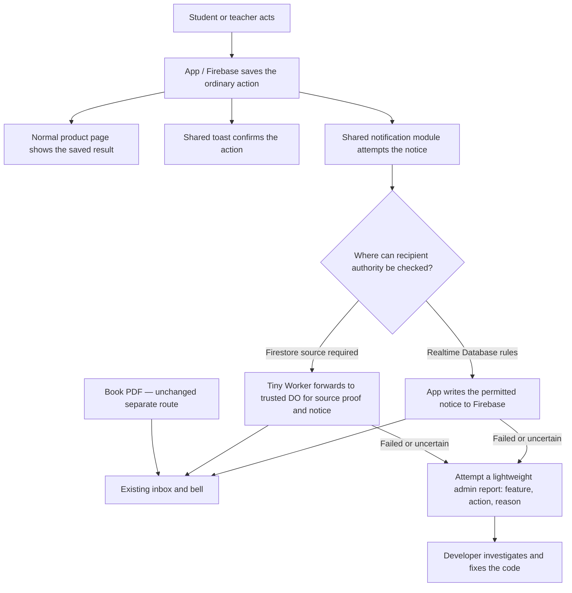

# Notification upgrade — historical evidence

Current work: [active plan](notification-system-upgrade-plan.md), [technical reference](notification-firestore-architecture-decision-2026-09-27.md) and [single family-status table](notification-upgrade-active-producers-2026-09-27.md). This file preserves dated evidence and superseded contracts; it is not an active checklist or routine reading set. Versions, hashes, source counts and statuses below describe their observation time, not today's live state.

Use standalone tool receipts/logs as proof and link them from the affected family row. Append here only unique decision/release provenance that has no owning artifact; do not duplicate routine progress. Consult a historical section only to answer a specific unresolved question.

## Teacher-index parent-read hold release — 2026-09-30

The immediate narrow RTDB Rules hold was released to `temp-a1437-default-rtdb` at 13:00 UTC. Fresh accepted/live semantic SHA `cce5e74…` changed by exactly `/test_results_by_teacher/$teacherId/.read=false`; two OAuth readbacks match released candidate `ecaec50…`. Teacher history/discovery is temporarily denied at its parent index read while rich leaves remain; super-admin ancestor reads and keyed canonical result policy are unchanged. No data writes or app/Hosting/Firestore/Worker deploy occurred. Exact command, hashes, timestamps, scoped proof and readbacks: `output/notification-upgrade-verification/teacher-index-parent-read-hold-release-receipt-20260930.md`. The boolean-key conversion and served-client gate remain open.

At 14:00 UTC the [finite read-only conversion preview](../../output/notification-upgrade-verification/teacher-index-conversion-preview-20260930.md) found no independently sealed historical authority: approved exclusion proposes 169 teacher-key deletes and zero additions, preserving canonical student/admin records and leaving discovery empty. No migration occurred; current served chunks still produce rich rows, and the separate conditional writer/cutover gate remains open (latest Hosting metadata `3d919d7f5ea66aac`, released 12:23 UTC).

At 14:15 UTC the [backend writer addendum](../../output/notification-upgrade-verification/teacher-index-backend-writer-followup-20260930.md) confirmed that active Reading V2 Worker `9f3e98a7-bcff-4e16-9f22-47dd5504dbc5` reaches the rich teacher-index builder; the boolean cutover must coordinate its replacement. Cloud Functions v1/v2 inventories are empty; Cloud Run remains unknown because its API is disabled. No remote mutation occurred.

<details><summary>Original journal preamble (historical)</summary>

````markdown
# Notification upgrade execution record — 2026-09-27

Active authority: `notification-system-upgrade-plan.md`, including section 10.
Overall upgrade remains incomplete. Current execution order is the plan's 2026-09-30 class release slice, then reference Writing and independent later families. Each release requires its own exact authority, browser and remote evidence; the ordinary Worker failures do not reopen the provisionally demonstrated DO architecture.
````

</details>

## Source and verification boundary

- Source: `C:/Users/The Lord/.codex/worktrees/notification-upgrade/luyentap-prd0062`, HEAD `2e1342c0e5198bc3ba1bd3105b18deba146c86e2`.
- Retired checkout disappeared during initial inspection. Tracked patch and relevant untracked files were saved in `C:/Users/The Lord/.codex/notification-upgrade-prechange-2026-09-27` and restored into the attached managed checkout. Restored changes are not wholesale release approval.
- Canonical checkout retains unrelated concurrent changes. No broad staging/reset/merge or dependency installation performed.
- Checks use SHA-matched source copies in canonical `output/notification-upgrade-verification` and existing dependencies. Browser uses that snapshot at teacher `http://localhost:5173` and student `http://localhost:5174`.

## Foundation implementation and local proof

- Class membership saves use the app RTDB path; notification dispatch starts after commit and is not awaited by the product action. Class owner/admin authority, saved occurrence identities and immutable templates drive notices.
- Ordinary homework submits through its existing Firestore transaction without new notification intent/delivery fields, then starts the shared domain notice entry. Reset and Book paths remain separate.
- Lightweight notice failures reuse existing warning reports, with bounded context and no diagnostic upload. Burst proof: 100 failures, 4 updates, less than 8 KiB, final duplicate count 100.
- RTDB emulator: 7/7 passed, no skips. Proof covers current source authority, safe missing/false/true read transitions, sender replay, ancestor/content/recipient attacks and 30-recipient atomic patch plus poisoned rollback. Rules SHA256 `07243E18526ECED9E60E8FE4A5A767F3CB9D48FFDBE1ED74EE432BE0E563C3E3`; test SHA256 `A581F096972AA557C383FBBC9855A65581BD67DE701FB363EE58FCABFB28E7E4`.
- Firestore emulator: 9/9 passed. Ordinary submission requires no outbox and rejects new retired envelopes; source/result identities remain immutable. Homework service: 17/17 passed including existing reset/Book behavior.
- Class manager and enrollment inheritance: 44 tests passed; reporting: 12 tests passed. Focused lint/diff checks passed on agent-owned slices.
- Worker Node logic: 18 tests passed across committed homework and conditional-write repository tests. This does not prove deployed CPU/workerd behavior.
- Shared producer deadline/active-send correction and Worker candidate preparation are still underway; earlier test totals do not qualify those later edits.

## Current remote evidence and rollback artifacts

- Google CLI: account `iamhuwng@gmail.com`, project `temp-a1437`.
- Existing notification Worker active version `be0c3e4e-338e-4771-b06a-368b5306b4f6`, deployed 2026-09-26T18:09:22.597Z, 100%. Current schedule `*/2 * * * *`; undeployed DO configuration is absent remotely.
- Cloudflare dashboard confirms Workers Free: 100,000 inbound/day, 10 ms CPU, 50 subrequests. Read-only snapshot showed 430/100,000 requests that day. GraphQL OAuth reads work; old notification version's 296 invocations, p50 0.950 ms and p99 3.495 ms are historical running-traffic evidence, not replacement qualification.
- Live RTDB rules, Worker source multipart/settings/schedules/deployments and Firestore release/ruleset were backed up in `C:/Users/The Lord/.codex/notification-upgrade-remote-backup-2026-09-27` before remote changes. Firestore release points to ruleset `f2b8e6ad-a28e-495a-9198-56522d612075`. The first Firestore read lacked a quota project; read-only `x-goog-user-project: temp-a1437` fixed it.
- No replacement Worker deployment, rules release or Hosting release has occurred at this checkpoint.
- Inactive candidate version `cef011f7-2057-4f0d-9323-23f17010b349` was uploaded, then superseded by audience-checked inactive version `da041a59-7c01-43f2-868c-87567dc6cb33`. Active traffic remained 100% on `be0c3e4e-338e-4771-b06a-368b5306b4f6`. Preview URLs were enabled only for the probe and then disabled again. No new service, Durable Object, migration or Cron was installed.

## Real browser foundation: product save while notice denied

- Created isolated class `KRRTPH`, “Notification foundation QA 2026-09-27”, through teacher UI.
- Student dev account requested membership through student UI. Teacher displayed the saved pending roster entry with Approve/Reject controls. Privileged keyed read confirmed `pending_approval`, `joinedAt=1790503762092`, student `x3hDfjYVN7cJtSbwq0ChIjl1Bk62`.
- Currently deployed notice rules deny client notice content. Browser logged permission_denied for the notice patch. Both recipient keyed inbox reads returned null for `ordinary_class_join-pending_KRRTPH_x3hDfjYVN7cJtSbwq0ChIjl1Bk62_1790503762092`.
- Firebase optimistic local events briefly displayed the unsaved notice; after student reload it disappeared. Do not treat local listener visibility as acknowledgement.
- Live warning report persisted with feature/action `studentDashboard/submitJoinClass`, code `notification_write_failed`, delivered 0, failed 2, unknown 0, unattempted 0. Screenshot: canonical snapshot `class-join-saved.png`.

## Security correction and first Worker probe

- Independent review rejected shipping the restored full `database.rules.json`: it included unrelated THCS read and Writing lock regressions. A remote-based narrow RTDB candidate now sets root admin write false, adds only explicit grants for five root-only admin workflows, and adds the class/notification rules. Candidate emulator **9/9 passed**, including admin behavior before/after populated inbox; normalized Book/media trees are unchanged. SHA256 `70382f172f14fc0479574beefc4f9fdf2e597aa56e6c409651a7260a54ba0d0a`; log `class-foundation-proof.log`.
- Remote-based narrow Firestore candidate adds the coupled homework and Writing source identity/occurrence guards. Emulator **9/9 passed**; SHA256 `e7ead1a5491ff23915ef26ee54c87c4ec3ecc9f97c80e840be89ec0d4c9355e0`; log `writing-foundation-proof.log`. Neither rules candidate is live.
- Worker reviewer found an audience forgery: a student could create a submitted source against an unrelated assignment. Corrected inactive version validates explicit/group membership from masked target fields, or keyed active class membership and matching owner; malformed and unsupported course targets deny. **20/20** focused tests and x64 Wrangler dry-run pass; bundled SHA256 `15EBA651A68844E0E2E961902BD03BDC22610D3FF3A616AA1E5E317AE0C63778`.
- Isolated QA Firestore assignment/submission IDs `qa_notice_foundation_20260927` and `qa_notice_foundation_20260927_001` were created for test accounts and recorded in canonical `worker-qa-manifest.json`.
- On corrected inactive version `da041a59`, a real authenticated POST on 2026-09-27T10:23:20Z returned one confirmed teacher notice. One-request Cloudflare GraphQL by exact script version/time measured **11,820 µs CPU**, 5 subrequests, zero errors. This exceeds the plan's ≤8 ms cold target and the 10 ms Free ceiling; wall time 3,076 ms is not CPU. Evidence: `worker-probe-002.json` and `worker-probe-002-analytics.json`. This is a failed qualification, not permission to broaden migration. The preliminary URL/error and GET/405 did not exercise delivery.
- Follow-up CPU diagnosis is underway. First source review found eager legacy initialization already preceded the measured POST (GET/405 at 10:22:59Z, 1,356 µs). JWKS and OAuth token caches already exist; a new private-key cache could help refresh but not first import/sign. No second qualified candidate or 140-invocation sample exists yet.
- Follow-up review found no evidence-backed local cold-cost reduction. Required first verification/token/source/write calls remain; the planner received a one-pass material decision request under section 10. Worker preview URLs were disabled again after the probe. Active deployment recheck remained 100% `be0c3e4e`; the candidate version was inactive. Analytics `isPreview=0` conflicts with the version URL usage, so cold/cache classification remains unverified.
- Narrow account deletion compatibility: the candidate permits an admin to remove an inbox only while that user has both `deletionRequested=true` and a pending deletion record. `hardDelete` removes the inbox before removing the user authority so an inbox denial cannot leave the account already deleted. The explicit account-deletion permission is an exception to ordinary content immutability; RTDB ancestor grants mean an admin with a pending deletion can also remove a descendant notice, which is limited to that account deletion state. Updated candidate SHA256 `C1688BF5E3C60E7856F6256E30FFAB102EB1D4FD4DFB27FBB0211E90BDEEBE67`, RTDB emulator **10/10** pass, `account-deletion-foundation-proof.log`; account deletion service **21/21** unit tests pass. This new candidate is not live and supersedes the earlier RTDB candidate hash.

## Earlier next gates (superseded by the CPU decision and class release below)

1. Verify final bounded shared producer and exact release rule diff against live backups.
2. Upload an inactive version of the existing Worker, preserve Book/legacy routes, and run one-recipient fail-fast probes with actual provider cache-miss and CPU evidence.
3. Complete the plan's 140-invocation matrix on one exact passing candidate, or stop dependent migration and escalate material failure under section 10.
4. Only after foundation passes, migrate remaining producers and implement inbox/history; release and finite historical recovery remain outstanding.

## 2026-09-27 class release correction

- A first live RTDB rules release of the narrow candidate allowed teacher approval and stored the student notice, but denied a fresh student join to QA class `3ERFTH`. The live rules were immediately restored from the prechange backup. The source candidate and remote state differed during that rollback; no class foundation was claimed released.
- The real browser join timestamp ran slightly ahead of RTDB `now`. The prior emulator case used a past timestamp and missed the failure. An exact atomic roster + `student_classes` test with a timestamp 500 ms ahead reproduced `PERMISSION_DENIED`. Three client-generated class guards (roster join, projection join, reject decision) now permit at most five seconds of clock skew. Candidate/source SHA256 `8CE719B2C8549175B016275103F6ED2B7D64079DFB46918794CFB8137960A299`; complete class rules emulator **8/8** passed in `class-clock-skew-final-proof.log`.
- The corrected candidate was released through RTDB Rules REST after confirming live rules equaled the saved prechange backup. PUT returned HTTP 200 and readback matched the candidate. This is the **current live RTDB rules state**. Firestore rules remain at the backed-up release; the inactive Worker candidate remains off active traffic.
- Real teacher UI created QA class `DD3PAU`. Real student UI joined it under the corrected rules. Privileged keyed reads confirmed the pending roster and projection plus both student and owner `ordinary_class_join-pending` rows. The student notice remained visible after browser reload. Teacher UI approved the request; keyed reads confirmed active roster/projection and a stored `ordinary_class_approve` student row, which also remained visible after student reload. Screenshot: canonical `output/notification-upgrade-verification/class-clock-skew-live.png`.
- The first QA class `3ERFTH` was joined during diagnosis while original rules were restored; its product save succeeded but its notice was denied. That class remains a QA artifact. No user data was silently removed.
- The planner confirmed the 11.82 ms Free CPU failure holds the Firestore-source Worker and dependent migrations. Continue independent App/RTDB families and reader/UI work. The system-wide upgrade remains incomplete; existing Firestore-family delivery is unresolved, not qualified.
- Explicit manual homework reminder is a material unresolved Firestore gate. Both single and bulk UI paths save an intent and increment `reminderCount`/`lastRemindedAt` before dispatch. Firestore rules require that increment at intent creation and deny client reversal; the existing Worker can return HTTP 200 with `failed` or `retry_scheduled`, while the old dispatcher currently treats every 200 as success and the UI ignores its result. A UI wording change cannot ensure a failed/unavailable notice leaves the allowance unspent. No reminder source or remote Firestore state was changed; the planner was given the exact source/rules/response evidence for the next architecture decision.

## Assignment approval App/RTDB candidate — source only

- In the isolated worktree, `approveStudentRequest` now commits the approved request and assignment without `notificationIntent`, then starts a separate two-recipient `notifyCommittedEvent` attempt. Notice failure cannot change the saved approval result. The saved request and active assignment authorize fixed teacher/student recipients, content, links, ID and `reviewedAt` occurrence in RTDB Rules. Content replay leaves the recipient `read` state intact. The old assignment HTTP dispatch call was removed from this producer; other specialized routes remain for their own migrations.
- Exact source snapshot: `C:/Users/The Lord/repos/luyentap-prd0062/output/notification-upgrade-verification/assignment-producer`. Focused service tests passed **59/59**, and the changed admin action registry passed **15/15**. Assignment and class RTDB emulator tests passed **11/11** together, and the renamed assignment rule test passed **3/3** after the final file move. Rules SHA256 `FD6EFFFDBD1926DECC33F9CE97861A33FE377F0316749894086C59510AF7A016`; assignment rule test SHA256 `0D55458DE93B5E2045D9132DD23A4D8DFA7C37F389799DF233D16926A32A5259`. The emulator used existing canonical dependencies with `JAVA_TOOL_OPTIONS=-Djava.io.tmpdir=C:/Temp/firebase-assignment -Djdk.net.unixdomain.tmpdir=C:/Temp/firebase-assignment`; no worktree dependency installation. A whole-app typecheck of the partial snapshot had pre-existing Book/material errors and lacked Vite ambient declarations; it is not a release typecheck.
- This candidate is **not deployed**. Current live rules and app behavior remain the class foundation/old assignment route described above. Real admin/teacher/student browser approval, keyed recipient storage and reload, exact release diff, and coordinated retirement of the old assignment Worker retry state remain open before any release claim.

## Inbox and teacher history candidate — source only

- Shared inbox reads now use the indexed `createdAt` query with `(createdAt, id)` cursors. The bell listens to the latest 10, loads older items in explicit 10-item pages capped at 30, counts unread only in the latest 10, and marks only shown items through its bulk read action. Existing student feed pagination remains 20 per page and uses the corrected service cursor.
- The teacher avatar menu opens a 20-item paginated notification history dialog; the mobile teacher drawer exposes the same entry. History reuses the existing notice panel, destination resolver and per-item read path. The teacher bell no longer links to grading as a fake full feed.
- Focused UI/service checks passed **74/74** across five files; `git diff --check` passed on the nine implementation/test files. Whole-app TypeScript still reports 393 pre-existing/partial-checkout errors, with no new inbox/header errors in the filtered output (`featureRegistry.ts` retains its unrelated `ImportMetaEnv.DEV` error).
- Six modified source files were copied into the ignored canonical `output/notification-upgrade-verification` snapshot for browser QA. Both snapshot Vite servers returned HTTP 200 at `http://localhost:5173/lobby` and `http://localhost:5174/lobby`, but Edge computer-use navigation timed out and an existing teacher tab failed CDP focus attachment. Thus no real teacher/student flow was verified. The temporary snapshot dependency junction was removed, its original `.vite` cache restored, and both temporary servers stopped. No canonical source, deployment or remote state was changed.

### Inbox live browser follow-up — 2026-09-27

- The canonical QA snapshot served source-identical inbox files on isolated `http://localhost:5173` (teacher) and `http://localhost:5174` (student) Vite servers. Both returned HTTP 200 for the transformed `NotificationBell.tsx`; snapshot and worktree SHA256 matched for `NotificationBell.tsx` (`79C9FD5C2D65E681D3444ECCFC825044153929591C18BEE8A27672908177458B`), `TeacherNavigation.tsx` (`80CB281F1BDEE496223C272C8CA5E6EEEC05B470919E6301A774A3D1481F3419`), and `notificationService.ts` (`4147B33429B9721089A28C4993F72C521F0AEC8859507346590C931906C77EDF`). The earlier failed browser attempt above is superseded for these observed flows.
- In the real in-app browser, the teacher dev session at `/lobby` displayed 10 bell rows and accessible text `7 unread among latest 10 notifications`. `Load more` expanded to 20 rows, with no further page because this account had 20 notifications. Profile menu → `Notification history` showed 20 rows in the dialog; Escape closed it and restored focus to the profile button. There was no live data to prove the bell's 30 cap or history beyond 20; those paths remain covered by focused component tests, not browser evidence.
- In the real in-app browser, the student dev session at `/student` showed 20 dashboard feed articles and `Load More Activities`; clicking expanded to 40 articles, then no further page. The current student route uses `StudentLayout` and the dashboard feed. Its legacy `StudentHeader`/`StudentNavigation` bell is not rendered in this routed shell, so student history QA applies to the feed, not to a bell.
- Source-matched snapshot tests rerun: 49/49 passed across `NotificationBell.test.tsx`, `TeacherNavigation.test.tsx`, `notificationService.test.ts`, `StudentDashboardPage.navigation.test.jsx`, and `StudentDashboardFeedView.test.jsx`. The first three test files were copied from the worktree into the ignored QA snapshot before this run; their SHA256 matched. `git diff --check` passed on the nine inbox implementation/test paths. Linked-notification navigation, read mutation and mark-shown behavior were not part of this browser observation and are not claimed as live verified here.

### Assignment release preparation after security review

- The independent security audit found a shared producer loss case: a global active-send lock dropped a second distinct approval during a pending first notice. The shared port now deduplicates by event identity, permits distinct RTDB notices concurrently, and limits ordinary homework Worker POSTs to two in flight while retaining its 20-starts-per-minute limit and 15-second deadline. Focused assignment/producer unit tests passed **60/60** after a distinct overlapping-event and Worker budget test. Exact `notificationProducerClient.ts` SHA256: `6324EF8223F600C9F8D923775C8A40B7D23A0A8DD1C17331CE00C15BBC90F6EB`.
- A fresh read-only live RTDB rules backup is `C:/Users/The Lord/.codex/notification-upgrade-remote-backup-2026-09-27/database.rules.before-assignment-20260927.json`, SHA256 `8CE719B2C8549175B016275103F6ED2B7D64079DFB46918794CFB8137960A299`. Parsed comparison against the worktree candidate changes exactly ten paths, all under `notifications` or `student_requests`. The candidate rules SHA256 remains `FD6EFFFDBD1926DECC33F9CE97861A33FE377F0316749894086C59510AF7A016`.
- **No assignment rules deployment or browser approval occurred.** The localhost admin route at `http://localhost:5173` refused connections, ports 5173/5174 had no listeners, and the built-in login shortcut offers teacher, teacher2 and student only. Assignment approval requires a real signed-in `super_admin`; broadening roles or changing authentication is outside this release. A viable admin session plus exact candidate browser build and live approval QA are required before deployment/release proof.

## Ordinary course request App/RTDB candidate — source only

- `processCourseRequest` now saves an approved or denied decision without `notificationIntent`, then starts an independent one-recipient `notifyCommittedEvent` attempt. A notice failure or pending notice cannot turn the saved decision into a failed action. The shared producer checks the committed request, processing actor, course owner and occurrence before writing fixed student content. The old course request Worker route remains in source but this producer no longer calls it.
- A course-only overlay was built from the saved live RTDB rules base at `output/notification-upgrade-verification/course-producer/database.rules.json`, SHA256 `A24770B52937361485EDA7E33DE65BECD31C84868DBD9129F048B623B24A0DC0`. Parsed comparison changes only eight paths under `course_requests` and `notifications`; it contains no assignment notice grant. The class notice branch is gated by `eventKind` before reading class metadata so course notices can reach their own branch. Course/class emulator proof: **12/12** passed, no skips, exit 0 (`course-emulator-proof.log`). Course service/shared producer proof: **34/34** passed (`course-services-proof.log`). The tested snapshot hashes match the current worktree course service, shared producer and course/class rule tests; `git diff --check` passed for course-touched paths.
- Independent source-only security review **passed** at course overlay SHA256 `A24770B52937361485EDA7E33DE65BECD31C84868DBD9129F048B623B24A0DC0`: source actor/owner/occurrence and recipient/content/replay/read-state guards were checked, including RTDB ancestor writes. Fresh live RTDB Rules REST readback was HTTP 200, SHA256 `8CE719B2C8549175B016275103F6ED2B7D64079DFB46918794CFB8137960A299`, equal to the saved class foundation base. The worktree `database.rules.json` also contains assignment changes and is not this course-only release candidate.
- This candidate is **not deployed**. Ports 5173/5174 had no listeners at verification time, so no real teacher/student browser approval, inbox storage or reload was proven. Before release, recheck the live rules hash, reconcile course and assignment notification-rule collisions against that base, run the three rule suites together on the exact combined candidate, review its normalized diff, and perform teacher/student browser approval, inbox storage and reload on the released version.

### Assignment admin QA checkpoint — 2026-09-27

- The canonical port 5175 QA snapshot had stale assignment files. It now serves the saved assignment candidate: `assignmentManager.ts` SHA256 `2CAA16060995B3C95182DFF1BDD2A77858C1B10A69A9EE28AD658B8857E9084F`, `notificationProducerClient.ts` `6324EF8223F600C9F8D923775C8A40B7D23A0A8DD1C17331CE00C15BBC90F6EB`, and assignment types `83BE1C39209BD644942DA325869B6FBF060981DAB4FF31D88C9B0EFB940E3B71`. This snapshot intentionally excludes the unfinished course producer. The assignment-only rules candidate remains `FD6EFFFDBD1926DECC33F9CE97861A33FE377F0316749894086C59510AF7A016`; the live class rules were `8CE719B2C8549175B016275103F6ED2B7D64079DFB46918794CFB8137960A299` at the last read-only review.
- Fresh exact-candidate emulator run passed class plus assignment **11/11** with no skips, and assignment manager plus shared producer tests passed **60/60**. A first emulator command failed only because an unquoted path containing spaces split the Vitest executable; the corrected relative-path command ran successfully. Independent security review passed the assignment-only overlay and identified exactly ten changed rule leaves under `student_requests` and `notifications`.
- The separate in-app browser tab displayed the signed-in `Super Admin` dashboard for Hưng Nguyễn. `Users` then failed to load because Vite returned HTTP 504 for optimized `@mantine/notifications`; direct page module HTTP 200 did not establish a usable page. The port 5175 QA Vite server was restarted with forced dependency optimization; the previously failing optimized dependency subsequently returned HTTP 200. After task continuation the in-app browser became unavailable to this subagent, and the root task's existing error-page tab rejected attachment, so no approval click or recipient reload has been observed.
- Read-only live data shows the three documented dev accounts exist. The dev student has an active teacher1 assignment but none with teacher2; two older pending requests target other student emails and were left untouched. The clean real-UI fixture path is admin `Users` → `Students` → teacher2 filter → `Add Student` for `student@test.com`, then `Requests` → approve that new row. No QA request, assignment approval, notification or rules write occurred at this checkpoint. The combined course/assignment rules candidate and browser availability are release gates.

### Combined App/RTDB rules release — 2026-09-27

- The reconciled class, assignment and course candidate at `output/notification-upgrade-verification/combined-course-assignment/database.rules.json` passed the exact three-suite RTDB emulator **15/15** (class 8, assignment 3, course 4), no skips. Security comparison against the class live base changed 15 rule leaves only under `notifications`, `student_requests` and `course_requests`; no Book subtree changed. Candidate SHA256 `960343E51A88CC9A75F357664ED8807F57630FCC0FE4016370125FB22E0539C0`.
- Before release, a fresh Rules REST GET returned HTTP 200 and SHA256 `8CE719B2C8549175B016275103F6ED2B7D64079DFB46918794CFB8137960A299`. An exact backup was saved at `C:/Users/The Lord/.codex/notification-upgrade-remote-backup-2026-09-27/database.rules.before-combined-20260927.json` with the same hash. A second compare immediately before PUT still matched that base. PUT returned HTTP 200; REST readback returned HTTP 200 and the exact candidate SHA256 `960343E51A88CC9A75F357664ED8807F57630FCC0FE4016370125FB22E0539C0`. This is the observed live RTDB rules state at release.
- No Firestore rules, Book data, Worker or Hosting release was changed. Assignment and course product saves, recipient rows and browser reload remain unverified. Do not treat the rules readback as end-to-end delivery proof.

## Inactive Firestore Durable Object candidate — 2026-09-28

- Added `cloudflare/notification-firestore-do.ts` and an isolated Wrangler configuration. The public entry validates path, method, origin, authorization shape and declared size, handles preflight, then forwards one request to a fixed SQLite-backed DO. The DO invokes the existing actor-only Writing bridge, which repeats validation and retains the verified-actor limiter, OAuth and `If-Match: null_etag` write. No DO storage, alarm, timer, socket or retry path was added. This is source-only; no app producer or Book route uses it.
- SHA-matched copies in canonical `cloudflare/output/notification-do-check` passed **7/7** focused Node tests (two files) using the repo-owned x64 Vitest. Wrangler 4.103.0 `deploy --dry-run` exited 0 and listed the DO, limiter and Firebase variable bindings. The first test invocation found zero tests because the canonical default include excludes `output`; a narrow Node config then ran all seven. These are local and dry-run checks, not Free-account CPU, duration or live delivery proof.
- The Cloudflare credential boundary currently blocks the real gate. The active Worker holds a per-script `NOTIFICATION_COMMAND_GOOGLE_SA_KEY` secret, but a different candidate script cannot inherit or read it. Cloudflare's version URLs are unavailable for a Worker exporting a DO; Worker Previews also do not inherit production secrets. The account Secrets Store contains no matching reusable Workers-scoped SA secret. The existing user-managed SA key has no located local copy. No new key was created/exported, no secret was copied, and the DO candidate was **not deployed**.
- Fresh read-only Wrangler status still shows active notification Worker version `be0c3e4e-338e-4771-b06a-368b5306b4f6` at 100%. The isolated DO candidate script does not exist remotely (`10007`). Thus outer Worker cold CPU, DO CPU/duration, real Writing, cold key import, OAuth refresh, cross-database authority, replay/collision and 30-observation gates remain unmeasured. Stop the dependent Firestore lane until an approved existing credential binding is supplied; do not infer feasibility from 7/7 or the dry run.
- Read-only Deno fallback audit: the local Deno 2.9.6 binary and a Windows Credential Manager entry named `Deno Deploy Token` exist, but `deno deploy switch` and `deno deploy env list` fail in CLI parsing before an account lookup; no Deno browser surface is available in this task. No current organization, card verification, Free limits, app inventory or usage was observed. There is no Deno configuration in this repo. Current [Free pricing](https://deno.com/deploy/pricing) advertises 1M requests/month, 10 active CPU hours and 150 GiB-hours memory-time; [Deno's changelog](https://docs.deno.com/deploy/changelog/) says an unverified organization has restricted Free limits. At the advertised 768 MiB allocation, 900 cold calls/day with 20–30 seconds loaded per call model to 112.5–168.75 GiB-hours/month before other use. The [runtime documentation](https://docs.deno.com/deploy/reference/runtime/) gives a broader 5-second to 10-minute idle shutdown range, so this is not a measured forecast. [Deno Cloud Connections](https://docs.deno.com/deploy/reference/cloud_connections/) could avoid an SA key but requires a new GCP workload identity pool/provider and IAM binding; `gcloud` currently lists no pool or service-account IAM binding. No Deno deployment, token disclosure, GCP IAM change or card action occurred. Deno is not yet qualified as a genuinely usable free fallback for this account.

### Assignment admin browser QA follow-up — 2026-09-28

- Port 5175 returned HTTP 200 for `/admin/users`. Its snapshot assignment manager, producer and assignment type files still match the saved candidate hashes `2CAA1606`, `6324EF82` and `83BE1C39`; the worktree producer has since changed, so browser QA must remain on the snapshot. A fresh read-only RTDB Rules REST GET returned HTTP 200 and exact combined candidate SHA256 `960343E51A88CC9A75F357664ED8807F57630FCC0FE4016370125FB22E0539C0`.
- Keyed live user reads confirm `teacher2@test.com` is `J5Llx96V9BePuw7aF0EME9ukII83` (`Teacher 2`) and `student@test.com` is `x3hDfjYVN7cJtSbwq0ChIjl1Bk62`. The other teacher UID `AkwZW3CT4AUvkMpJfgg9FwUh3ug2` belongs to `hungnguyenzim@gmail.com`, correcting the initial assignment-row inference. The snapshot and worktree `AdminTabsContainer.tsx` hashes match; its Teacher Filter option value is the teacher UID, with display name/email as label.
- Read-only baseline: four `student_requests` rows, including one old approved request for `student@test.com`/teacher1 and two unrelated pending requests; no pending dev-student/teacher2 request. The dev student has no active teacher2 assignment. Teacher2 has one existing inbox row, the dev student 230; neither has an `ordinary_assignment_approved_*` row. The unrelated pending rows were untouched.
- The snapshot's hidden mobile admin navigation drawer fix was applied to worktree `src/components/navigation/AdminLayout.tsx`, so the closed `role="dialog"` drawer is unmounted. Snapshot and worktree file hashes now match (`68A63EEA`); `git diff --check` passed and canonical ESLint passed on the byte-identical snapshot file. Direct worktree ESLint could not resolve `@eslint/js` because this managed worktree has no dependency installation.
- The browser control tool disappeared from both this QA task and the main task before the request was sent. No new request, approval, assignment or notice was created during this follow-up. Real admin approval, keyed two-recipient storage and teacher/student browser reload remain open.

## Firestore DO finite solo Writing QA — 2026-09-28

- Fresh live Firestore release `1a3afec8-f7c4-493f-8097-1b9e4d48a7cb` had removed `writing_notification_intents` while tightening `settings/api_keys`. A candidate based on those exact live bytes added only the solo student intent's atomic source/actor/occurrence create rule and actor-only keyed GET. The exact candidate passed the Firestore emulator **2/2** with valid atomic create and forged actor/source/key/occurrence, list, update and delete denials. Two fresh remote comparisons preceded a narrow Rules REST release. Current readback is ruleset `e11822de-df82-488a-804b-f479dc7fb29d`, candidate SHA256 `D3B96E1761AF466E52CFCF3BC0B6478F1A10DC54F4A51405B5D484CFD9FF0789`; all other live rule content, including the API-key denial, was preserved.
- A single isolated QA solo Writing submission and canonical-shape intent were committed atomically with the dev student's Firebase ID token; keyed readback matched actor, source ID and `submittedAt`. The student token could GET the intent (200) but not LIST (403); a teacher token could neither GET nor LIST (403). No deleted homework-assignment fixture was recreated. This was an API-created QA source, not a browser submission.
- An inactive host version changed only the QA event binding to this one ID and retained identical script etag, handlers, migration, limiter, secrets and other bindings. After temporary 100% activation, the separate public QA caller returned `created` (200, 4.388-second client wall time). Privileged RTDB readback found the fixed notice. The student marked it read; replay returned `replayed` (200) and retained `read=true`. An ETag-conditional change to this QA inbox row produced a `conflict` (409) on the next call without overwrite. An unrelated teacher token produced `actor_denied` (403). The original QA row was restored, then the host returned to version `ccbec080-95c7-4feb-bce0-a6317bbc55fd` at 100% with `NOTIFICATION_BRIDGE_QA_EVENT_ID=disabled`. The QA source and intent now return 404, and the inbox row is null.
- Cloudflare GraphQL for exact host version `9b2fd8ed-16b7-4ba5-a260-7f2dc606649e` recorded four successful DO invocations, zero errors, **1.517–7.863 ms DO CPU**, **0.037279–0.418083 GB-s billable duration each**, four/one subrequests and zero storage writes. Four public caller requests on exact version `d7259b87-5591-4de1-a5a6-8c328d4c914e` used **1.255–2.568 ms CPU** each with zero errors. These are one-recipient observations, not a populated-class forecast. Whole-account same-day GraphQL reported 938 Worker requests, five DO requests and 1.034 GB-s DO duration against the documented Free ceilings of 100,000 Worker/DO requests and 13,000 GB-s/day.
- Fresh Cloudflare schedules API still listed only `*/2 * * * *`; unauthenticated GET reached Book command and class action routes with 405, while the reviewed-result action remained batch-inactive (503). GET does not prove committed POST behavior. Cloudflare Workers Observability telemetry returned API `10000 Authentication error` for the current Wrangler credential, so cold key import and OAuth refresh profiles were not recovered. The bridge currently implements only solo `writing-submitted-student`; cross-Firestore/RTDB audience proof, a refresh observation and a measured DO invocation above 10 ms remain open. App producers stay **off**; do not infer broad release qualification from this solo QA pass.

### Keyed cross-database Writing bridge QA — 2026-09-29

- Local bridge now derives the selected teacher from the Firestore source and requires a matching keyed RTDB canonical Writing result and student index before either solo notice. It compares result ID, student ID, occurrence time, Writing skill and `writingData.submissionId`; teacher delivery additionally requires the selected class's matching owner, active class and active student roster status. Solo dispatch occurs only after RTDB materialization succeeds. The Writing UI checks the Firestore source/intent commit result before materialization. Focused bridge tests **8/8**, UI/service tests **27/27**, and the live-based narrow Firestore overlay emulator tests **2/2** passed; the existing broader worktree Firestore rules test previously passed **9/9**. The deployed app producer remains off; browser UI and bell behavior were not verified here.
- The exact pre-change active host JS was read back with script ETag `6366648946a9799aa7911e04af388b7969bcd914c965f33bceb39c5a84772429`. A source-preserving bundle changed only its bridge module span; prefix and suffix were byte identical, Node syntax/import and mocked early/solo/teacher checks passed, and Book/class GET responses matched the original bundle. Independent review passed the replay classification and byte comparison. The new host candidate `b532cb25-8845-460a-b29c-5ec078cc5a7a` retained the DO namespace, SQLite migration, both secrets, limiter, fetch/scheduled handlers and variables with the QA event disabled. Cloudflare version URLs are unavailable for a Worker exporting a DO, so a controlled temporary 100% activation provided the real route proof.
- Fresh live Firestore release `e11822de-df82-488a-804b-f479dc7fb29d` and source SHA256 `d3b96e1761af466e52cfcf3bc0b6478f1a10dc54f4a51405b5d484cfd9ff0789` were backed up. Independent review passed the three-hunk teacher intent/authority immutability overlay. After a fresh compare, ruleset `65ab2c6c-d79d-4132-8b01-551cad5df18a` was released and independently read back with exact candidate SHA256 `ea47158d767cf8f06f0297435995cc3b637a02e51e764a5dbdbfa7e4034fcbae`.
- With one exact QA actor/event bound at a time, direct student call **before** RTDB result/index materialization returned `403 result_invalid` with cold OAuth tail; after keyed materialization it returned `200 created` and replay `200`. Recipient `read=true` survived replay. ETag-conditional changed title returned `409 conflict` without overwrite. The teacher event selected existing active class `DD3PAU` and its active roster; it returned `200 created` and `200 replayed`, with the teacher inbox row and route read back. QA RTDB result/index were synthetic keyed rows rather than a browser-generated academic submission, so the app materialization/browser gate remains open. No class/roster data was mutated.
- Cloudflare GraphQL for this finite window showed nine public QA caller rows at **1.153–1.949 ms CPU**, zero errors; DO minutes: cold student early **11.345 ms CPU, 11 subrequests, 0.49 GB-s**, teacher cold **13.924 ms CPU, 15 subrequests, 0.31 GB-s**, teacher replay **6.951 ms CPU, 15 subrequests, 0.40 GB-s**. The DO had zero storage writes. Tail identified `cache:cold` for early student and teacher creation, and `cache:cached` for replay; key import/sign timing in tail was quantized to zero. Cloudflare's current Durable Objects documentation gives a distinct default 30-second CPU limit per DO invocation; the public Free HTTP limit remains 10 ms. A real OAuth **refresh** after token expiry was not observed. Same-day account totals after QA: **1,048 Worker requests / 100,000**, **16 DO requests / 100,000**, **4.342 GB-s / 13,000 GB-s**; unrelated account Worker errors are included in the 37 aggregate errors.
- The host returned to disabled-gate candidate `b532cb25-8845-460a-b29c-5ec078cc5a7a` at 100% (deployment `e134e6f9-29f3-4c0c-9a7a-0b07ec07462b`). Both exact event POSTs returned `403 qa_event_denied`. The QA source, both intents, canonical result, student index and both inbox rows were deleted and each read back absent. Book/class/reviewed-result GET statuses still matched `405/405/503`, and Cloudflare schedules still showed only `*/2 * * * *`. App producers remain **off** pending refresh, browser, and whole-family qualification.
- A subsequent local-only review against the active plan found the bridge still fetched the full Firestore Writing source and launched eight result leaf reads together. The local bridge now uses Firestore field masks for proof/source and reads RTDB leaves in groups of at most three. A focused concurrency/mask check increased its isolated suite to **9/9**; syntax/import, mocked early/solo/teacher delivery and old Book/class route parity passed in a source-preserving rebuilt bundle SHA256 `fa293b75aa110ef52144ba7dc59b48333b418b16f335564becaf999a348a7409`. The **deployed** disabled candidate remains the earlier bundle SHA256 `41f02bba4bb840c0525cbe58100c89c0da3337f66fa20a9f8ea8b01da1ec1ac2`, preserved separately as `output/notification-upgrade-verification/notification-command-b532cb25.js`; the masked/concurrency-bounded local revision has **not** been uploaded or live qualified. Do not enable the app producer against that older host version.

### Writing product recovery checkpoint — 2026-09-29

- A local candidate now saves a scoped Writing submission snapshot through platform storage before the Firestore commit and retries the same source ID after a server-only Firestore source comparison. It permits a committed homework attempt to repair after its deadline, preserves an existing graded RTDB canonical result and student index, and recognizes the same homework `resultId` on a post-commit retry. Focused UI/Writing/homework service checks are **53/53** and changed-path `git diff --check` passes. A canonical-dependency typecheck of the broader dirty tree has unrelated errors but none naming these changed source files. These mocked checks do not establish RTDB Rules access for the repair path.
- Independent review exposed a **provider-rules blocker** in the local RTDB repair implementation despite mocked tests: the student cannot GET a missing `test_results/{id}` under current RTDB Rules, and cannot read its own keyed teacher/session index. SDK transactions require read authority. The exact live RTDB rules snapshot is `output/notification-upgrade-verification/combined-course-assignment/database.rules.live-readback.json`, compact SHA256 `cd9d885ff48998912487409ca3f2908c69933785228b07c0f0e7995f8ffda538`. Student-auth emulator tests and a rule-safe conditional-create design are pending. **The local app recovery candidate is not release-qualified.** No app producer, Worker gate, or remote rules were changed for this checkpoint.
- Fresh read-only Cloudflare deployment status still shows disabled-gate version `b532cb25-8845-460a-b29c-5ec078cc5a7a` at 100%, deployment `e134e6f9-29f3-4c0c-9a7a-0b07ec07462b`; Cron remains `*/2 * * * *`. Same-day account totals at readback were 1,101 Worker requests, 18 DO requests and 4.342 GB-s DO duration. The offline masked bundle rebuilt byte-identically with x64 Node at SHA256 `fa293b75aa110ef52144ba7dc59b48333b418b16f335564becaf999a348a7409` and passed a no-bundle Wrangler dry-run with the QA event disabled; it has not been uploaded.


### Class RTDB rules release and Hosting source boundary — 2026-09-30

- Rebased class Rules candidate SHA-256 `2999ab1956f3b3b7f23eb6a8b5cab3ece6bf4e4dfcab96f5580bb6b632aa52e0` (normalized JSON); semantic SHA-256 `10154c494adf3267f80ddd0e8793bd0799078e8eaa2034ae0ea5ef986aa24db3`. Exact emulator proof passed class authority 31 positive/26 negative, class notification Rules 8/8 and `classManager.test.ts` 44/44. Rebased browser QA passed teacher/student class creation, join, approval, notification destinations and persisted read state. Class `ED4VP4` membership and notice rows were read back in the app RTDB emulator.
- RTDB Rules were deployed database-only to `temp-a1437`. Fresh post-deploy OAuth readback matches the candidate semantic SHA exactly; artifact: `output/notification-upgrade-verification/class-release-live-readback-postdeploy-20260930.json`. Book root subtrees were identical in the reviewed pre-deploy diff. App source/Hosting deployment remains separate.
- Hosting provenance audit found the target `kahut1` live version `d5f4d21d977afbb7` (2026-09-30 04:11:26 UTC) and preview version `7cc16d56db4d847a` have identical 441-file manifests and only the `cli-firebase` deployment-tool label. No source commit/artifact identifier is recorded. No local Firebase debug log or task record contains those version IDs, and the repository has no Hosting deploy workflow. GitHub's latest 50 runs ended on 2026-09-26. The live assets have no source maps.
- The browser QA source snapshot is from branch HEAD `2e1342c0e5198bc3ba1bd3105b18deba146c86e2`, 79 commits ahead of canonical HEAD `77bcf94c13bde79d5bfd74b76a1088652aebdded`. Its source delta includes 65 changed paths, among them unrelated Academic Record, feedback, Writing and result UI. It also enables homework, assignment and course request notification call sites that have not passed their family gates. The existing canonical `dist` is not a matching baseline: 440 files, 76 paths shared with the live manifest, and zero matching local SHA-256 hashes. No worktree contains the live `classManager-C4uMtPtN.js` build artifact.
- **Hosting deployment held:** the exact source/build artifact for the current live version is unavailable in this checkout. Publishing the QA snapshot would replace the whole SPA with a divergent 79-commit tree and activate unqualified producer families. Recover the d5f4/7cc16 source snapshot or build artifact, then apply only the reviewed class source changes, keep non-class producer callers off, run focused tests and browser proof on that exact artifact, and deploy it as a complete Hosting version. No Hosting change was made during this audit.

### RTDB deletion-order compatibility containment — 2026-09-30

- A fresh OAuth GET of `temp-a1437-default-rtdb/.settings/rules.json` returned HTTP 200 and semantic SHA-256 `10154c494adf3267f80ddd0e8793bd0799078e8eaa2034ae0ea5ef986aa24db3`, exactly matching the class Rules release readback baseline. The guarded candidate starts from that live snapshot and changes only `notifications/$userId/.write`: a super-admin may remove the recipient inbox while the deletion record is still `pending` when the user is either marked `deletionRequested === true` or the user row has already been removed. All other authorization and deletion-only predicates remain.
- Exact-candidate emulator proof passed the full legacy users-first hard-delete order through test results, academic records, badges, inbox removal and the completed marker. Negative cases denied non-admin, missing/cancelled/completed deletion records, and an existing user without `deletionRequested`. The class notification Rules suite passed **8/8** on this candidate.
- Final predeploy live readback again matched the baseline SHA. Database-only Firebase deployment completed successfully; fresh postdeploy OAuth readback matches the tested candidate at semantic SHA-256 `bbe08c1442afcd726e7d40e73b52a70ee687b26dfddc0dfa1e48bdea0dfb7145`. Before/after evidence is in `output/notification-upgrade-verification/class-deletion-containment-live-readback-predeploy-final-20260930.json` and `...postdeploy-20260930.json`; exact deployed rules are represented by `class-deletion-containment-candidate-20260930.json`.
- This is RTDB Rules compatibility containment only. The earlier emulator teacher/student class browser pass remains the browser proof for class creation, join, approval and notice read persistence; it was not rerun after this deletion-only predicate change. No account was deleted in live data. No Hosting or app source deployment occurred; the Hosting source provenance boundary above still applies.

### Bounded 77bc class-notification source candidate — 2026-09-30

- Preserved a reviewable isolated checkout at `C:/Users/The Lord/.codex/worktrees/class-notification-source-candidate-20260930`, detached at `77bcf94c13bde79d5bfd74b76a1088652aebdded`. The class source delta is limited to `src/services/classManager.ts` plus new `src/services/classNotificationProducer.ts`; focused coverage is in `src/__tests__/services/classManager.test.ts` and `src/__tests__/security/classNotificationRules.emulator.test.ts`. `classManager.test.ts` passes **36/36**. The class notification Rules suite passed **8/8** on the deployed class candidate. Production Vite build passed: **9,512 modules**, **381 JS**, **42 CSS**, **438 files**. Build output is `output/class-candidate-build/final-dist`; `classManager` bundle SHA-256 `FDDCCBF44DC33C8605CB548E24527AFF4203301963A3FCD3F5D1A74AC81A42D5`.
- Browser QA used teacher/student at `http://localhost:5186` and `http://localhost:5187`, connected to emulator `localhost:19001` loaded from the exact live postdeploy Rules readback at semantic SHA `bbe08c1442afcd726e7d40e73b52a70ee687b26ddc0dfa1e48bdea0dfb7145`. Test profiles are scoped to the emulator namespace `temp-a1437-default-rtdb`. The Firebase browser API key restrictions gained only `http://localhost:5186/*` and `http://localhost:5187/*`; prior referrers and API targets were preserved.
- Teacher created `Bounded Class QA 2026-09-30` / `PWJ6Q3`; student joined, teacher approved, both student notices rendered and persisted read after reload. Emulator readback confirms active membership with `approvedAt`/`approvedBy`, teacher `New class request` linked to `/teacher/classes/PWJ6Q3` and unread, and student `Class request approved` plus `Class request pending` both read. Teacher bell was not opened because the 493px viewport uses the documented mobile hamburger shell, which omits the desktop notification controls. `DESIGN.md`, `ui-design-standards.md`, `teacher-lobby-authoring-and-navigation.md`, and `TeacherHeader.tsx` agree this is intentional; no shared-shell UI change was included.
- **Hosting remains held.** This is a full SPA build from 77bc, not a narrow class-only deploy artifact. Its baseline includes existing generic producer call paths in 34 source files, including unqualified non-class families. Current live Hosting version `d5f4d21d...` still has no exact source/build provenance in the available records; the public 159-chunk map is not source provenance. Do not publish this broad build or infer source release from Rules/emulator/browser proof. No Hosting change was made. Canonical checkout state was not changed.

### Shared notification port correction and fresh bounded class QA — 2026-09-30

- The bounded `77bcf94c13bde79d5bfd74b76a1088652aebdded` candidate now routes class membership events through the existing `notifyCommittedEvent(event)` port in `src/services/notificationProducerClient.ts`. Class payload construction stays private to that module; no homework, assignment, or course producer call sites were added. `classManager.ts` no longer imports a class-specific producer module.
- The port returns a delivery result with status and delivered/failed/unknown/unattempted counts. A focused two-recipient atomic join-notice failure test verifies `failed: 2`, `recipientCount: 2`, and the registered Classes action `notification_delivery_failed`; `reportingService.test.ts` confirms the shared report-event path used by the admin reports reader. A notification failure remains independent of the committed class operation.
- Post-correction focused checks passed **65/65** across producer, feature registry, class manager and reporting-service tests. Production Vite build passed (9,512 modules; 381 JS, 42 CSS, 438 files). Current output is `output/class-candidate-build/final-dist`; `classManager-B8oOa_1U.js` SHA-256 `E61B6619C5311E96B94C1154965690BE532C8ACD3328AEE5131375E0AFDE9B28`, `index.html` SHA-256 `B112B6D831C2577FA2EEF6FBF4E1D2723BDFE1845A903D36EAF670CC589148A3`. Source SHA-256: `classManager.ts` `D329CC6B7839799B0F63CE3289EAFF537D73F9D0F11337C3B08C55C49BBE0D87`; `notificationProducerClient.ts` `D759D1AD45462D98B112C358D48E86F7F15928E7F67CC28B813789A8DC5A0CAE`.
- A fresh shared-port browser pass used teacher/student QA origins `http://localhost:5186` and `http://localhost:5187`, because the user confirmed canonical ports 5173/5174 were already occupied. Both used the exact live RTDB Rules semantic SHA `bbe08c1442afcd726e7d40e73b52a70ee687b26ddc0dfa1e48bdea0dfb7145` in emulator `localhost:19001`, app namespace `temp-a1437-default-rtdb`. Teacher created `Shared Port QA 2026-09-30` / `QT8WHE`; student joined, teacher approved, student received both notices and saw class membership, marked both student notices read and reloaded with unread count 0. No browser errors were reported.
- Emulator readback confirms the active student membership and `approvedBy`/`approvedAt`; teacher `New class request` notice links to `/teacher/classes/QT8WHE` and remains unread because approval was performed in Manage Class, not from the notification. Student `Class request approved` and `Class request pending` records persist with `read: true`. At the observed 493px teacher viewport, the shared TeacherHeader intentionally shows the mobile menu instead of the desktop bell; shell design documentation confirms this behavior.
- The current source candidate remains an isolated, reviewable checkout at `C:/Users/The Lord/.codex/worktrees/class-notification-source-candidate-20260930`; canonical checkout files were not changed. **Hosting remains held**: current live Hosting source/build provenance is still unavailable, and this is a complete SPA artifact from `77bc`, not a safe class-only Hosting deployment. No Hosting deployment occurred; browser/emulator proof is not a live Hosting release claim.
- **Latest Hosting provenance check:** [read-only receipt](../../output/notification-upgrade-verification/hosting-provenance-diff-3d919d7f-vs-4702-class-candidate-20260930.json) records live version `3d919d7f5ea66aac` (released `2026-09-30T12:23:17Z`) and byte-matches all 441 deployable files from `lobby-footer-release-20260930/dist`, plus two generated Firebase init files. It is a newer teacher-lobby pagination build, not identical to 4702 or the 439-file class candidate; Hosting metadata provides no source commit. The earlier class Vite browser flow remains candidate-source-only, the built-dist preview only rendered login, and its temporary QA origin has been removed. No Hosting deployment occurred.

### Standalone result identity Rules containment release — 2026-09-30

- The original three-read Writing recovery overlay was rejected because existing broad authenticated writes could change the `studentId` used by result ownership reads. The separate containment candidate changes only `.validate` at `test_results/$resultId`, `test_results_by_teacher/$teacherId/$resultId`, and `test_results_by_session/$sessionCode/$resultId`. Existing rows must retain `resultId` and `studentId` on updates; row validation also applies to parent replacement and root multipath writes. No read or write grant changed; Book, class, material and all unrelated Rules are preserved.
- The legitimate writer trace and independent review found normal create, grade, full replay, guest promotion, metadata repair and deletion paths compatible. Final exact standalone emulator proof passed **4/4**, no skips, exit 0 (`writing-identity-containment-final-predeploy-proof-20260930.log`). The combined recovery candidate separately passed **9/9** locally and remains undeployed.
- Guarded OAuth readback immediately before release matched baseline semantic SHA-256 `bbe08c1442afcd726e7d40e73b52a70ee687b26dfddc0dfa1e48bdea0dfb7145`; provider Rules dry-run returned HTTP 200, and the subsequent fresh readback still matched. The release verified six source/test fingerprints and the exact three-leaf diff. The Rules endpoint returned no ETag; fresh comparisons preceded the one database-only PUT.
- PUT returned HTTP 200 at **2026-09-30 07:47:33.839 UTC**. A new OAuth token readback at **07:47:49.038 UTC** exactly matches the tested candidate semantic SHA-256 `cce5e74db4da762d01c223632e6b5eb1f6317c17aa641983a898c4870d86f84e`. Evidence is in `output/notification-upgrade-verification/writing-identity-containment-release-receipt-20260930.json`, `writing-identity-containment-live-readback-predeploy-20260930.json`, and `writing-identity-containment-live-readback-postdeploy-20260930.json`; the deployed candidate is `writing-identity-containment-candidate-20260930.json`.
- This release prevents identity edits while a row exists. Whole-row delete/recreate remains allowed by the existing broad writes, and malformed rows with missing/wrong identities require explicit recreation rather than in-place repair. It is not complete result write authorization. No live user data was modified, no recovery read overlay was released, and no app, Hosting or Worker change or producer enablement occurred. Writing browser setup remains paused pending the remaining authority and bridge gates.

### Local Writing recovery overlay rebase after containment — 2026-09-30

- Rebased the three-read recovery overlay directly from fresh live containment `cce5e74db4da762d01c223632e6b5eb1f6317c17aa641983a898c4870d86f84e`. The local candidate `writing-recovery-rebased-candidate-20260930.json` has semantic SHA `607e4fe03031f0470c6940013ff6c379337fb693c06cb2e041e6af666507c7a9`; exact diff is the canonical, teacher-index and session-index row `.read` leaves only. Existing validations and Book/class/material/unrelated Rules remain identical to live.
- Exact recovery/security/Firebase SDK-provider checks passed **9/9**, no skips, exit 0. Eight source/test fingerprints remained unchanged. Final post-test OAuth comparisons at receipt time **2026-09-30 07:55:20.298 UTC** matched the containment baseline; provider Rules dry-run returned HTTP 200 without changing live Rules. Evidence: `writing-recovery-rebased-receipt-20260930.json`, `writing-recovery-rebased-proof-20260930.log`, and `writing-recovery-rebased-security-review-20260930.md` under `output/notification-upgrade-verification`.
- Static assessment finds the added student branches constrained for intact existing canonical/index identities; the earlier update-based identity forgery is blocked. Broad create/delete/recreate and mutable teacher visibility/payload permissions remain baseline limitations, so complete result authority is not established. The parent independently reviewed standalone containment; exact rebased overlay authority signoff remains open. The overlay is **not deployed**. Browser setup remains paused under the shared Hosting/source gate, and app/Hosting/Worker changes and producer activation remain absent.

### Isolated Writing browser QA environment held — 2026-09-30

- Preserved `output/notification-upgrade-verification/writing-browser-qa-20260930` from the notification worktree with 2,274 source files; source manifest SHA-256 `da8e1c8e1887dcae81c854dc2e66f3ceff83dcbcd47006e5753bba112bb6551d`. Exactly two QA bootstrap edits connect Auth/Firestore emulators; existing test mode disables analytics, fake demo Firebase configuration targets only local emulators, and the notification command target is `https://qa-writing.invalid`. Product source was not changed. Exact snapshot hashes/delta are in `writing-browser-source-receipt-20260930.json`.
- Intended emulator Rules were the local RTDB three-read candidate `607e4fe03031f0470c6940013ff6c379337fb693c06cb2e041e6af666507c7a9` and freshly read live Firestore ruleset `4c7932f4-181d-4544-a520-8fa3a064bf95`, file SHA-256 `67bbb9ea628421dfbf895f6e430a9649d1edcec98af77a6673be6f95369224de`. Initial gcloud OAuth Rules API read returned 403; the existing Firebase CLI OAuth read succeeded without credential disclosure or remote mutation.
- Both isolated Vites started and HTTP smoke checks returned 200 on teacher/student ports 5196/5197. Firebase CLI emulator startup on Auth/Firestore/RTDB ports 9400/9401/9402 exited **1**: Java 21 Firestore failed to create its child event loop, with `Unable to establish loopback connection` and `UnixDomainSockets Invalid argument: connect`. This is a QA harness startup failure before any fixture seed or browser flow, not product behavior. Full stack is preserved in `writing-browser-qa-20260930/firestore-debug.log`.
- The snapshot package and lockfile also differ byte-for-byte from canonical. Therefore the shared dependency junction does not meet `local-tooling-layout.md` compatibility guidance; it was removed, and preparation now checks manifest equality before creating it. No dependency installation, manifest substitution or emulator retry occurred. The parent directed stopping at this environment boundary while result-authority repair remains open.
- Only our Vites were stopped: port 5196/PID 35236 and port 5197/PID 37444, after matching each process command. The emulator CLI had already stopped its failed emulator group. Snapshot, Rules, logs and receipts are preserved. No fixture was seeded, no real browser submission/reload/read occurred, no read overlay was deployed, no live data/app/Hosting/Worker changed, and all other servers were left untouched. Exact commands, runtime, package hashes and state are in `writing-browser-blocker-receipt-20260930.json`.

### Temporary browser-key origin cleanup — 2026-09-30

- `gcloud auth list` and active project `temp-a1437` were checked before the key operation. No listener remained on the retired QA ports 5176, 5177, 5186 or 5187; the Writing QA servers on 5196/5197 were already stopped and those origins were never present in the key.
- The Firebase browser API key was described immediately before the change. Removed only `http://localhost:5176/*`, `http://localhost:5177/*`, `http://localhost:5186/*` and `http://localhost:5187/*`. Readback confirmed 26 remaining referrers (30 before), exact expected set, and the same five API targets. Canonical role origins 5173/5174 and admin origin 5175 remain allowed. No key string was read or changed.
- Readback update time: `2026-09-30T11:35:44.603619Z`. Receipt: `output/notification-upgrade-verification/browser-key-qa-origin-cleanup-20260930.json`. Any renewed isolated browser QA on the removed ports will require a scoped temporary allowlist change.

### Served Writing consumer compatibility finding — 2026-09-30

- Independent read-only review fetched current live RTDB Rules and verified the three containment leaves still match saved semantic baseline `cce5e74db4da762d01c223632e6b5eb1f6317c17aa641983a898c4870d86f84e`. Active Hosting release was `sites/kahut1/releases/1790763058060000`, version `4702a2f834935893`, at the reviewer’s readback. This version differs from the older Hosting baseline previously investigated; its exact source/build provenance remains under separate read-only investigation.
- Served `TeacherTestResultsPage-VGyqQoz0.js` directly sets question/overall feedback and pushes feedback history. Served `testResults.service-zdSVytJB.js` directly marks a result reviewed and includes full re-mark/delete operations. The interim authority candidate denies some of these served shapes and had removed three cce5 identity `.validate` leaves. This is a source/Rules compatibility finding, not a browser PermissionDenied replay; no shared Rules release is qualified. The authority candidate must retain containment guards and pass exact live-versus-candidate emulator replays of served writes before a guarded release. The old direct feedback shape lacks the new atomic revision/occurrence proof, so it cannot be treated as the new feedback notice authority without a coordinated App cutover.
- Latest local boundary proof also failed before running its 16 tests because generated RTDB Rules used unsupported `numChildren()` at three feedback-notice expressions. The implementer owns a supported-method correction preserving exact metadata shape; no passing proof is claimed from that log. No Hosting, RTDB recovery/authority Rules, Worker or Writing producer release occurred in this checkpoint.

### Independent homework verifier review — 2026-09-30

- Independent read-only review recommends **no-go** for the local Firestore source seals/DO receipt candidate. Main integration gap: until the exact new RTDB canonical/index Rules are proven, existing authenticated writes can rewrite a source-less result’s identity/context to match a fresh post-cutover Firestore chain. Firestore create-time seals alone do not prove canonical RTDB provenance. The authority agent owns exact rule-enforced binding and forged-existing-row emulator proof.
- The verifier also accepted client-controlled submission timestamps without a trusted-time bound and ran its limiter only after an initial Firestore GET, allowing invalid IDs to consume unmetered first reads. The DO agent owns bounded fixes and checks. Source documents’ broad authenticated direct-read grants are a preexisting confidentiality exposure; a separate read-only compatibility trace is underway before changing shared Firestore Rules.
- Local source-seal and Worker tests remain preparation evidence only. Exact DO runtime/bindings, live OAuth/cold CPU/bytes, deployed source/rules/cutover and role-browser product→RTDB→notice/read proof are still required. No activation or Rules release occurred.

### Archived plan execution notes — 2026-09-30

Moved verbatim from the plan during its execution review. These notes record earlier observations and instructions; they do not establish current remote state or require another class release or DO lifecycle migration. Follow the active plan's section 8 roadmap and fresh release evidence. Older inbox-before-user assumptions were superseded by the recorded narrow users-first deletion compatibility repair; do not revive a blanket root grant.

**Current release boundary — 2026-09-30 planner review:** The work record now documents the rebased class Rules deployment and matching remote readback (`10154c…` semantic hash). Its browser proof used candidate app source; Hosting remains incomplete. The current public app's source/build provenance is unavailable, and the candidate worktree includes unrelated changes and unqualified producers. Preparing a class-only build from canonical source is permitted, but a small canonical-source diff alone does not prove compatibility with the live SPA. Before further rollout, verify live legacy product/admin callers against the newly released Rules. In particular, the narrow inbox deletion grant depends on the user record still existing: the previously audited canonical deletion order removed that record first. Inspect the live bundle and reproduce any incompatible order against exact Rules without destructive live QA; escalate a verified mismatch for narrow containment or compatibility repair. Keep Hosting held until its baseline compatibility is demonstrated or the planner decides an explicit bounded compromise. Keep the safe class rule split and DO architecture; preserve concurrent Book/material changes.

**Status:** Implementation authorized by the user's 2026-09-27 request to appoint a new GPT-6 Sol/High implementer with responsibility for implementation decisions and execution. This is the active plan, replacing the retired [recovery plan](notification-system-recovery-plan.md), not the unfinished Book PDF design. The implementer follows the operating agreement in section 10; older planning-only holds and two-attempt escalation wording are superseded by that user instruction. Numerical estimates remain planning assumptions and the full DO bridge remains an open stop/go gate; one solo Writing QA pass is not broad qualification. Releases still require the target, source, quota and verification evidence below.

**Execution state — 2026-09-29:** Continue independent App/RTDB work. The ordinary-Worker Firestore bridge failed its Free CPU gate twice. A clean dedicated DO class is deployed in the secret-bearing host; app producers remain off. Finite live QA now proves early solo Writing denial before RTDB result/index materialization, later student create/replay without resetting `read`, conflict without overwrite, and selected-teacher create/replay through an active class and roster. Nine public caller observations used **1.153–1.949 ms CPU**; observed cold DO cases used **11.345–13.924 ms CPU**, below the separately documented 30-second DO allowance. The QA event gate was disabled again and synthetic QA rows were deleted. OAuth refresh after expiry, browser-created Writing and recipient bell behavior, remaining event families, and release-scale Free-tier use remain unproved. Do not activate Firestore notices on this partial qualification; see the [work record](notification-upgrade-work-record-2026-09-27.md).

**Planner execution direction — 2026-09-30:** Converge on one complete class release slice first. The latest isolated `class-authority-repeat-candidate-20260929.json` includes the scoped pending-deletion grant and newer-occurrence rejection replacement, but it contains no ordinary class notification grant or Writing recovery read overlay. Conversely, worktree `database.rules.json` contains those notice/read changes but still permits existing-class parent writes that bypass the Book lock leaf. Neither file is a complete release candidate. Build from a fresh live snapshot; integrate the reviewed class authority, student-only profile boundary, concrete admin grants and narrow shared class notice rule. Preserve unrelated/Book configuration and existing unrelated notice behavior. Do not copy the entire dirty worktree rules file or release the standalone authority artifact.

Before qualification, close two source-consistency seams found in independent review: a later pending join must have an occurrence that can replace its prior rejection without accepting a stale/reused occurrence; and a committed rejection marker must coincide with removal of that pending canonical roster row. The existing service already reads the class and performs an atomic rejection update; reuse those paths and platform Rules rather than adding a service. The ordinary reject notice must also require the canonical roster row to remain absent, so an old marker cannot authorize a decline notice after rejoin. Prove repeated join/reject, stale/equal occurrence denial, standalone rejection-marker denial, legitimate atomic rejection, stale decline-notice denial after rejoin, and truthful notice delivery. These are focused corrections within the selected architecture, not a new architecture gate.

Use one exact candidate and app source for the class authority/notice tests, affected root/admin/Book regressions, and teacher/student browser proof. Security tests that read worktree `database.rules.json` do not qualify a different saved JSON artifact. Record the candidate identity, accepted→fresh-live and fresh-live→candidate diffs, tested source, actual browser outcome and remote readback together. Once those gates pass, release the class slice under the existing deployment authorization without another routine planner handshake. Carry its accepted rules forward as the next baseline. Then qualify Writing's narrow read overlay and durable recovery, exact masked/≤3-concurrent bridge, OAuth refresh and browser delivery. Writing preparation and later family preparation can continue independently; class delivery does not wait for all Firestore families, unrelated onboarding repair or unrelated whole-app type errors. Overall completion still requires all intended active families and the finite historical-recovery disposition.

**Planner review — 2026-09-29:** The observed DO execution makes a runtime redesign unwarranted now; qualify the exact newer masked/≤3-concurrent bytes and OAuth refresh before activation. A local Writing candidate now persists the scoped submission identity before Firestore commit and recovers that same source after reload; focused mocked checks passed. It is not release-qualified because its RTDB transactions fail under the saved live Rules snapshot. The implementer owns the smallest rule-safe product recovery and verification under section 4. A passed homework deadline may block a new source, but not repair an already committed source. After the reference Writing family passes its own authority, Free-tier and browser gates, later Firestore families may qualify and release separately. Keep system-wide completion tied to all intended active families.

**Writing RTDB recovery rule decision — 2026-09-29:** The local durable-ID candidate is not release safe under the exact live RTDB rules: SDK transactions cannot read an absent `test_results/{id}` row or the student's keyed teacher/session indexes. Do not use REST `If-Match: null_etag` on unreadable product paths: the emulator returned an existing row in a 412 response despite a denied GET, and the genuine-token path behaved differently. Keep this as an **app/Firebase product repair**, not notification bridge work. Make a narrow rule overlay allowing a signed-in student to read an **absent exact result child** for an opaque Firebase push ID; an existing row remains readable only to its existing authorized owner/teacher/admin. Add read access only to the student's exact teacher/session index leaf when the canonical result proves that student and the matching teacher/session, and an existing index row also belongs to that student. Keep parent index reads closed and add no write privilege. Then use the existing SDK transaction's insert-only `current ?? expected` behavior, fail closed on mismatches, and retain the saved Firestore source ID. This exposes at most an existence bit for an unguessable result ID; no other student's result body is readable. If exact-rules tests cannot prove that boundary, stop this candidate and escalate a trusted product writer rather than deploying conditional REST. Test the narrow overlay against the exact live rules, including absent/own/other result, missing/matching/forged indexes and existing graded data, before remote release or browser qualification. App producers remain off.

The read overlay is a **provisional minimum**, not permission to expose result lists. A no-read `set`/update repair was considered: surviving a lost acknowledgement without overwriting graded or foreign rows would require create-only enforcement at the actual existing root/index write grants and compatibility proof for normal result updates. That is not yet a smaller proven change. The three keyed read leaves passed a focused emulator denial suite and independent source review, but the overlay has not passed reconciliation against fresh remote Rules or a real browser repair. Keep that distinction in release claims.

**Direct RTDB authority decision — 2026-09-29:** The fetched live-rules snapshot and populated-ancestor emulator expose separate source weaknesses: any teacher can rewrite another class's owner, a student can activate their own roster entry, and any authenticated user can rewrite `student_requests` or `course_requests`. The snapshot admits only assignment notices, so class/course notification failures against it also show missing release coverage. Re-read the remote rules before editing because a later admin overlay may have changed them. Build the smallest source-rule correction at each **actual ancestor write boundary**: class creation/owner immutability and pending-to-active/decision authority first; request create/cancel/decision authority and immutable source/occurrence separately for assignment and course. Preserve ordinary product writes, presence/progress and admin workflows through focused positive tests. A child denial cannot override an ancestor grant. Qualify notification leaves only after their own saved source cannot be forged, with fixed recipients/content, read-state/replay and ancestor-shaped attack tests. The protected class owner/roster is also a prerequisite for **selected-teacher Writing** notices; assignment/course notification grants are not. Treat the stale-baseline 5/15 run as an inventory of gaps, not a single all-family gate or a reason to change fixtures until they pass. Keep each family off until its current-source rules, browser action and notice are verified.

**Rules lineage gate — 2026-09-29:** The documented 2026-09-27 combined release read back as `960343…`; the saved 2026-09-28 fetched snapshot normalizes to `cd9d885…`. An independent comparison found 228 differing rule leaves across 27 top-level groups, including Book/unrelated paths. This counts differences, not regressions. The available records do not prove the intervening release sequence or actor. Do not infer that every difference should be restored. Before another notification-related RTDB Rules release, fetch current remote bytes, identify the relevant source/notice regressions and preserve unrelated or unresolved concurrent work. Review both accepted `960343…` → fresh current and fresh current → candidate normalized diffs; test the changed ancestor paths plus the affected class/assignment/course and Writing-recovery permissions. Hold the affected Rules release and selected-teacher Writing activation until the source authority is proven; independent app work, student Writing preparation and bridge QA may continue. Do not restore `960343…` wholesale.

**Class-authority escalation decision — 2026-09-29:** Keep RTDB root `.write:false` and the class rule split: a teacher or admin may create a class without privileged Book descendants; existing-class mutations use explicit child grants, while `book_locks` keeps its existing token-gated leaf. The owner-scoped parent-write candidate passed ordinary class checks but let its owner bypass the Book lock rule; a parent-value equality guard also blocked a legitimate rename. Do not revive either approach or move ordinary class actions to the notification DO. Rebuild the release candidate from a fresh remote snapshot, preserving unrelated/Book leaves. The saved 31-leaf class candidate is stale: it has `notifications/$userId/.write:false`, whereas the current local rules and accepted `960343…` include a narrow super-admin inbox-delete grant only while the user has a pending deletion record. Preserve that exact grant and the current `hardDelete` order (inbox before user); prove successful and denied deletion in the emulator. Keep root-level admin privileges explicit only for concrete call sites found by the caller audit, including multi-path writes. No blanket admin root grant.

Public profile creation must yield `student` only and self-updates must preserve role/status; an authenticated user must not create a teacher profile to obtain class or cross-user notice authority. Existing teacher accounts remain usable, and a super-admin can assign teacher role through the existing secured user path. The current `registerWithEmail(..., role)` public API should not claim teacher self-registration is supported. The visible teacher-invitation flow is not a trusted shortcut: its client redemption writes are denied by current Rules, and the parent invitation read is broad. Treat it as a separate onboarding defect to fix with admin-authorized provisioning or a narrowly trusted redemption path; do not widen profile/invitation rules or add notification Worker responsibility to make it work. Before class/selected-teacher release, prove student-only signup, self-promotion denial, admin promotion, owner and pending-roster authority, Book-lock bypass denial, and the pending-deletion admin flow against the exact candidate. Keep the affected producer off until browser and remote readback gates pass.

### Firestore foundation decision — 2026-09-27

**2026-09-28 qualification correction:** The separate DO script passed local checks but cannot inherit the existing per-script service-account secret. Direct remote inspection now shows the active `luyentap-notification-command` version `be0c3e4e-338e-4771-b06a-368b5306b4f6` has no DO binding or migration; `NotificationRetryExecutor` exists only in unreleased source. The proposed existing-class/no-migration probe is withdrawn. Use one clean `NotificationBridgeObject` in the secret-bearing host. First upload its class code/export **without** a lifecycle declaration from the exact active source/config; prefer a [0%-traffic deployment and verified version override](https://developers.cloudflare.com/workers/versions-and-deployments/version-overrides/) to smoke-test unchanged HTTP routes/startup while the old version stays at 100%. This cannot test Cron or the DO. Then make a separate controlled SQLite class lifecycle deployment with a compatible rollback artifact and verify Cron. The [lifecycle deployment itself cannot use a 0%-traffic version upload](https://developers.cloudflare.com/workers/versions-and-deployments/deployment-management/). Bind a tiny public QA Worker cross-script, keep all app producers off it, and measure the real security/CPU/cost gates. No new key, legacy retry-class vessel, paid service or loosened proof is needed. The linked architecture decision gives the release gates.

The broad Worker candidate consumed **11.82 ms CPU**; the later isolated Worker successfully created one authorized Writing notice but consumed **12.823 ms CPU** on its exact inactive version. Both exceed Cloudflare Workers Free's **10 ms/request** limit and neither was activated. The planner's [Firestore architecture decision](notification-firestore-architecture-decision-2026-09-27.md) selects a tiny public Worker forwarding to a compute-only DO for one finite qualification with no app producer traffic. It supplies the event/authority matrix, unchanged bridge contract, separate outer/DO resource gates and Deno fallback. It supersedes this plan wherever earlier ordinary-Worker CPU targets, 140-call sampling, ten-recipient Worker batches, a ban on DOs, or successful-send reminder allowance conflict with the decision.

Continue the app/RTDB families and bounded verified releases independently. Reuse the isolated bridge handler behind a **tiny public Worker and compute-only DO**; keep app traffic off the new route while measuring cold/auth-refresh, security and whole-account free-tier gates. Do not broaden Firestore producer migration, backfill those families, or switch live bridge traffic before the replacement qualifies. Book PDF remains separate. The system-wide upgrade is incomplete while any active Firestore family lacks proven delivery. If the dedicated DO architecture fails its gates, compare the same bridge on Deno rather than freezing or relaxing security.

### Teacher result-history parent-list authority hold — 2026-09-30

- The planner resolved discovery by reusing the existing teacher index as exactly `true` keys. Canonical keyed reads retain source/owner proof; stale keys expose no result payload. Canonical, Writing, re-mark and admin writers are updated; Reading V2's independent writer tests are included in the integrated proof. Teacher session retrieval uses the same keys, preserving earlier/non-Writing results instead of restricting retrieval to current participant Writing pointers.
- Activation remains held for the coordinated App/Rules/index cutover. The live aggregate audit found 169 rich leaves and zero boolean leaves; old payload/visibility agreement is not reconstruction authority. The finite admin rebuild accepts independently audited result IDs, revalidates existing strict keys, removes rich/orphan keys, and keeps ambiguous rows private. Source changes cannot transfer a preserved owner. The immediate parent-read hold, strict Rules with parent still held, and post-conversion keys-read candidates are prepared locally; stale writers must be drained before conversion and a zero-rich audit must precede reopening discovery. No deployment occurred.

### Writing authority local gates — 2026-09-30

- Fresh live read at `2026-09-30T12:48:04Z` remains semantic `cce5e74…`. Main authority+recovery candidate is `50a87fb…`; strict teacher-read-held phase is `ae35124…`. [Exact candidate receipt](../../output/notification-upgrade-verification/writing-authority-receipt-20260930.json) and [57-leaf live-to-candidate diff](../../output/notification-upgrade-verification/writing-authority-fresh-live-diff-20260930.json) preserve all unrelated roots, class/Book rules, root write denial, inbox deletion grant and the three explicit deployed identity containment conjuncts. Unsupported `numChildren()` checks are removed; existing notice metadata families retain their child validators and unknown-field rejection.
- Current-source/provider proof passed **272/272 tests across 16 files**, zero skips, exit 0, with all 35 source/artifact fingerprints still matching. [Receipt](../../output/notification-upgrade-verification/writing-authority-final-proof-receipt-20260930.json), [raw log](../../output/notification-upgrade-verification/writing-authority-final-proof-20260930.log). Actual SDK flows cover insert-only recovery, private guest import/collision/replay/grade preservation, selected solo/session authority, teacher discovery/re-mark/delete, finite admin conversion, atomic feedback/history/revision and notice replay preserving read state. Saved homework survives optional verification/read failure; missing/reclaimed source and forged parent/root/metadata/history writes deny.
- Byte-pinned served consumer replay covers Hosting `4702a2f834935893` against cce5 and the exact candidate. Old direct feedback sets/history push, full re-mark replacement and teacher percentage-index updates pass cce5 and deny the candidate; served Mark Reviewed and atomic delete pass both. These denials are explicit coordinated App release dependencies. Immediate parent-read containment separately passed four provider checks ([receipt](../../output/notification-upgrade-verification/writing-teacher-immediate-read-hold-receipt-20260930.json)); its legacy rich writes remain possible until the controlled drain. Do not deploy the worktree `database.rules.json` or claim old served writers are compatible.
- Scoped source type checking reports no errors in the owned authority services, but exits 2 for transitive existing `classManager`/material taxonomy/API-key typing errors; [raw diagnostics](../../output/notification-upgrade-verification/writing-authority-typecheck-focused-20260930.log). Diff whitespace checks pass. Exact Hosting transplantation, independent final security review, stale-client/index cutover, real teacher/student browser gates and the separate homework DO/source/cost gates remain open. No release or producer activation occurred.

### Graded-result boundary review correction — 2026-09-30

- Reviewer reproduced student-owned existing grade mutation through nested question fields, top-level grading/review fields and Writing band fields. The common existing-row grant now allows students only generated feedback, its metadata, display metadata and receipt-qualified visibility; question/Writing payload and grading mutations require the proven teacher/admin. Student whole-canonical deletion is denied. Own submit and insert-only recovery remain valid; traced teacher session/homework reset and admin reset remain authorized. Student deletion of a graded feedback-bearing row was also allowed by cce5, so that closure fixes a retained live vulnerability rather than a new regression. The eight actual writer families and permission/write shapes are recorded in the [current proof receipt](../../output/notification-upgrade-verification/writing-authority-final-proof-receipt-20260930.json).
- Finite admin rebuild now requires its independently audited `verifiedResultIds` manifest on **every** run, including an empty audited list. It cannot infer reconstruction authority from old true keys or retry without the manifest. A focused failure/retry case proves missing-manifest rejection occurs before any reads/writes after interrupted key recreation; canonical ownership and grading remain intact.
- Fresh live source is the deployed immediate parent-read hold, semantic `ecaec50a…`, fetched `2026-09-30T13:11:59Z`. Updated authority+recovery candidate is `afcffaf…`; strict parent-held phase is `775fa69…`. **274/274 tests across 16 files passed**, zero skips, with 35 current matching source/artifact fingerprints. New direct-leaf/root-multipath grade/delete negatives and student generated-feedback/metadata, teacher regrade/reset and admin repair positives pass. The [58-leaf fresh-live diff](../../output/notification-upgrade-verification/writing-authority-fresh-live-diff-20260930.json) preserves class/Book/unrelated roots, inbox deletion and all three live identity conjuncts. The post-conversion parent-read reopening is explicit; the held variant retains the hold. No deployment or App activation occurred.

### Homework verifier chronology and authenticated-attempt bounds — 2026-09-30

- Fixed the bounded Firestore-only homework verifier: Writing occurrence must be post-cutover, at or before trusted request time, and within five minutes of provider Writing creation. Homework occurrence must follow the Writing occurrence and its attempt creation minus that allowance, and be at or before request time. Already committed source projection remains recoverable after delay. Receipt stays v2/13 keys; no RTDB Rules, grade/payload, roster/course, notification or retry state was added.
- Reused shared Firebase JWT verification inside the compute-only DO before the native actor limiter and first source GET. Missing/unrelated source candidates now consume the authenticated actor's limit; exhausted actors return 429 without a Firestore read. Invalid tokens cannot charge a decoded victim UID. Cold/refreshed JWKS adds at most one external fetch to the prior envelope (33 total), plus unmeasured crypto/duration cost; the three-verifier-GET/up-to-five-Rules-read budget is unchanged.
- Focused current-source proof: 19 tests in three Worker/bridge files passed, zero skips, exit 0, 1.82 seconds. Seven forged chronology shapes fail before RTDB I/O; a seven-day committed projection delay still creates/replays. Missing-source rate exhaustion and adapter 429 are covered. Exact-handler Wrangler 4.103.0 dry-run passed at 104.63 KiB upload / 22.74 KiB gzip; no bindings means bundling proof only. Source hashes and limits: `output/notification-upgrade-verification/homework-authority-p2-receipt-20260930.json`.
- Read-only current Worker proof: deployment/version readbacks show `luyentap-notification-command` at 100% version `b532cb25-8845-460a-b29c-5ec078cc5a7a`, `NOTIFICATION_BRIDGE_OBJECT (NotificationBridgeObject)`, limiter 30 requests/60 seconds, QA event disabled. The class body exists in canonical captured `output/notification-upgrade-verification/active-notification-command-script.js:8467`; exact current bundle equality/new-handler host integration and live CPU/auth-refresh remain unproved. No deployment or activation occurred.
- Confidentiality hold: exact candidate Firestore submission reads remain broad authenticated reads. The existing unscoped pending-grading, session-code and homework-ID queries need coordinated actor/owner/teacher/admin query authorization before a safe read-rule release. Verifier field masks do not protect direct browser GET/list. Complete RTDB canonical/receipt security and browser gates remain with the authority candidate. Detailed bounds, current-runtime evidence and cost correction are in `output/notification-upgrade-verification/homework-authority-candidate-20260930.md`.
- Firebase's [RTDB core syntax documentation](https://firebase.google.com/docs/database/security/core-syntax) confirms that `.read` grants cascade and Rules are not filters: a parent read exposes all descendants, while child denials cannot revoke it. Query constraints may narrow known indexed values but do not establish source authority for historical mutable rows.

### Homework verifier P2 containment — 2026-09-30

- The DO candidate now meters every JWT-authenticated attempt before the first Firestore source GET, including invalid/missing/unrelated result IDs. Client occurrence timestamps are bounded by post-cutover provider create time, five-minute clock skew, saved Writing/homework order and request time. The v2 13-key receipt is unchanged. Exact focused tests passed **19/19**, zero skips; Wrangler 4.103.0 dry-run passed (104.63 KiB, 22.74 KiB gzip). Receipt: `output/notification-upgrade-verification/homework-authority-p2-receipt-20260930.json`.
- The maximum external fetch envelope is now 33 when cold/refresh JWKS discovery occurs, at most three concurrent. Fresh readback identifies active command host version `b532cb25-8845-460a-b29c-5ec078cc5a7a` with existing `NOTIFICATION_BRIDGE_OBJECT:NotificationBridgeObject` binding and disabled QA event. This is binding presence, not new-handler runtime/CPU proof. The new verifier remains unconfigured/unactivated; complete RTDB canonical/receipt authority, source cutover, live CPU/bytes/cost and role-browser gates remain open. No deploy occurred.

### Exact active Hosting baseline recovered — 2026-09-30

- Fresh Firebase Hosting release `sites/kahut1/releases/1790763058060000` / version `4702a2f834935893` has 443 manifest entries. The untouched `C:\tmp\reading-v2-release-candidate-20260930\dist` matches all 441 deployable asset hashes using Firebase CLI uploader gzip(level 9); the only remote-only paths are Firebase-generated `/__/firebase/init.js` and `.json`. Served critical chunks also match raw local bytes.
- A separate isolated source copy at `C:\tmp\reading-v2-release-repro-20260930` reproduced **441/441 exact current Hosting assets**, with zero missing/mismatched/raw-byte differences, by running the documented `release-build.ps1` body and including the one auxiliary Tailwind-scanned `output/stitch-book-editor-tabs/book-editor-tabs-stitch.html` input. Its receipt `output/repro-source-receipt.json` records 2,659 source file hashes (manifest SHA `af0d1fa94f24c7ee818d1e884b1ca2b1dd310254cd4a234d3998b6192f352c98`), detached HEAD `42ac23f8...`, dirty-path snapshot, public env/build hashes, canonical dependency junction and exact comparison. The proven original source/dist were not edited, and no deploy occurred.
- This resolves the missing-source baseline gate for preparation. Hosting remains held until a narrow class/Writing candidate from the verified source is reviewed, built, tested with exact Rules/served consumers and browser flows, and a fresh remote comparison precedes release. The class App/RTDB replacement is assigned to a separate isolated candidate copy; the live Worker route stays untouched until callers are switched.

### Homework verifier exact-host and local runtime gate — 2026-09-30

- Fresh Cloudflare readback at 12:21 UTC confirmed 100% active command host `b532cb25-8845-460a-b29c-5ec078cc5a7a`; exact source SHA-256 `41f02bba4bb840c0525cbe58100c89c0da3337f66fa20a9f8ea8b01da1ec1ac2` matches its captured version. The candidate replaces only the bridge constructor/import; the existing `NotificationBridgeObject` class, Book/class router, scheduled handler, DO binding/migration and limiter remain exact. Host Wrangler dry-run passed at 510.74 KiB / 96.35 KiB gzip. Source/version/diff receipt: `output/notification-upgrade-verification/homework-authority-host-source-receipt-20260930.json`.
- Local workerd behavior passed with real RSA/JWT verification, native 30/minute limiter and intercepted providers: cold replay 33 external fetches, warm replay 31, cold create 32, OAuth refresh 32; peak concurrency 3. Three masked Firestore response bodies were 534/412/552 bytes (1,498 total), with no essay/feedback/grade fields. Wrong-audience JWT caused zero provider reads; current assignment target/material changes failed before RTDB I/O; immutable conflict returned 409. Five earlier authenticated attempts plus 25 missing-source GETs exhausted the native quota; seven further attempts returned 429 with zero source GETs. Ten Book/class preflight/method/auth/invalid-body response contracts matched the active host exactly. These are synthetic body-byte and wall-time observations, not live cost or successful product workflow proof.
- Exact release-date runtime remains blocked: installed Miniflare 4.20260617.1 / workerd 1.20260617.1 refuses compatibility date `2026-09-19` (newest supported `2026-06-24`). The unchanged candidate bytes passed only the explicitly scoped `2026-06-24` probe. Receipt: `output/notification-upgrade-verification/homework-authority-workerd-receipt-20260930.json`. Public Free CPU, billed DO CPU/duration/hibernation, real payload/latency/JWKS rotation, Firestore Rules dependency reads and browser gates remain unmeasured. No remote writes, deployment or activation occurred; verified source seal/cutover and App gates remain absent.
- Product verification budget remains conservatively eight Firestore reads per attempt/result including failed attempts and replays until provider proof: separate 7,000/day homework allocation plus retained 5,000/day notification allowance. At 630 new results, 5,040 product reads fit the allocation; combined full reservations require other routine traffic at or below 23,000/day for the <35,000/day project target. Review around 700 new results or >5,600 product reads. The local 33-fetch count includes RTDB/JWKS/OAuth and does not change that Firestore billing forecast.

## Full pre-consolidation contracts — 2026-09-30

Preserved verbatim as text before consolidation. These snapshots retain detailed lessons, rejected approaches and numerical assumptions; they are not instructions to repeat old deployments or maintain parallel checklists. Current decisions live in the compact active contract and owning references. Unique evidence is retained, not deleted.

<details><summary>notification-system-upgrade-plan.md — pre-consolidation snapshot</summary>

````markdown
# Notification system upgrade — implementation plan

**Teacher result discovery decision — 2026-09-30 optimization:** Reuse `test_results_by_teacher/{teacherId}/{resultId}` as a **keys-only product index**, with each entry exactly `true`; do not add a second catalogue or a Worker lookup. The teacher history service already extracts these keys and fetches canonical results individually. An index entry locates a candidate; it never authorizes result access. Parent list reads may expose only opaque result IDs, with no student identity, scores, titles, feedback, source fields or other payload. Keyed canonical reads retain the proven source/recipient policy, including reclaimed-source denial. A stale key cannot grant data access.

All actual teacher-index writers, grading updates, Writing insert-only recovery, Reading V2 callers, admin reindex and cleanup must use this one representation coherently. Creation/recovery must match the authoritative canonical relationship; Firestore-only homework uses only its approved product receipt. Validate boolean-only children at every granting ancestor and deny arbitrary or metadata-bearing key writes. The student/session/course/class indexes retain their own existing scope and authority checks; do not blindly convert unrelated read models. Unshared/unresolved guest or solo results gain no teacher key. Preserve explicitly shared selected-teacher Writing through its proved class/roster relationship.

Use a finite source-verified conversion/rebuild of the **teacher index only**, through the existing admin reindex/maintenance path. Preserve canonical results, student history, grades, inbox/read flags and Book data. Old client-editable ownership labels or old teacher-index contents are not evidence for reconstruction; classify ambiguous rows as unresolved, not newly authorized. Retire raw-owner legacy backfill instead of converting it into a new authority publisher. A deleted source remains eligible only with independently trustworthy historical ownership proof; immutable-looking legacy flags alone are insufficient. Keep canonical rows private to their existing authorized student/admin when teacher proof is absent.

This is a coordinated App/Rules/index-schema cutover, not permission to deploy strict boolean Rules while served full-row writers still depend on them. Stage the known source/artifact and exact candidate together, prove affected live/candidate writer compatibility, and choose a controlled pre-launch cutover with a clear disposition for stale clients. Do not expose a mixed payload/key namespace through a teacher parent read; keep that read held until conversion and boolean-only enforcement agree. Require legitimate teacher discovery/read/grade/reset/recovery/admin positives, forged/stale key and reclaimed-source data denials, metadata injection via leaf/parent/root, no legacy-payload parent leak, bounded read/write cost and actual teacher-browser history. Other independent lanes continue. If the coordinated cutover cannot preserve a concrete product caller safely, escalate that exact seam once.

**Explicit authority-mirror supersession — 2026-09-30:** The earlier prohibition on copying Firestore authority into RTDB is superseded **only for Firestore-only homework teacher/result relationships that cannot be safely proved inside RTDB**. This is a product-authority exception, not a redesign of notification delivery. `result_notification_authority/{resultId}` appeared in archived work; that path and its code are donors, not an accepted live foundation. Reusing their name or implementation does not establish deployed provenance, safe Rules or a qualified publisher.

The receipt must be immutable, conditionally created and fully server-derived from verified committed sources. A client supplies only a candidate source identity, never trusted teacher/recipient authority. It authorizes only the minimum proven teacher/result relationship for that homework result; it grants no general teacher/student, roster, course or unrelated-result authority. Verification failure cannot invalidate or remove the saved product result. The receipt contains no notification or retry state, delivery event ledger or generic authority-bus contract. Source identity/occurrence fields exist only to bind the relationship, reject mismatches and classify identical replays without changing authority. Extending receipt authority to another family requires a new planner-level authority decision; downstream uses already approved for the same homework relationship do not broaden its scope. Product-verification costs remain separate from notification costs.

Keep implementation choices with the implementer. Release evidence must prove source and recipient provenance, conditional-create/replay/conflict behavior, immutable and narrowly scoped client permissions including ancestor attacks, saved-product survival on verifier failure, exact remote candidate identity, measured free-tier costs and real role-browser behavior. Archived evidence and notification-only DO measurements cannot qualify this product exception. Hosting stays held; independent result-authority/recovery work may continue under its gates, and the existing DO notification architecture remains selected.

**Feedback product/notice separation decision — 2026-09-30:** Remove the separate `feedback_notification_intents` write and replay dependency from ordinary feedback saves. Commit canonical feedback, its product history occurrence and revision atomically; then call `notifyCommittedEvent({ eventKind: 'feedback-saved', resultId, eventId })`. Use a private App/RTDB adapter, deriving the recipient from canonical `studentId` and the actor/time from the keyed saved history. A fixed notice with deterministic identity, validated result route and source timestamp goes into the existing inbox. Delivery failure/unknown is reported through the shared port and must never reject the committed feedback save or claim the student was notified. No feedback Worker, intent queue, retry or extra delivery receipt is required. Temporary dispatch containment is allowed during qualification, but complete feedback notices remain the release objective.

The current authority candidate's student-self row grant does not yet protect this source: a student can forge teacher-attributed history. Narrow the actual canonical replacement/field grants before accepting that history as notice proof. Preserve source-proven CREATE and whole-result reset/delete exceptions; deny teacher-feedback/history injection on CREATE. Ordinary students cannot mutate feedback history, revision/mutation, attribution or nested question `teacherFeedback`. Verified teachers append immutable occurrences with actor/result/student, exact feedback target and revision agreement; ordinary history replacement/deletion is denied. Retain legitimate feedback deletion/revision behavior, source-verified admin repair and whole-result reset. Child denials alone cannot override ancestor grants. Insert-only recovery must recognize an existing matching row without rewriting it under the narrower permissions. Do not widen authority or adjust tests to hide a broken caller.

Add only the narrow ordinary-feedback notice authorization/schema grant: sealed history plus shared source authority (protected RTDB session/class, or qualified homework receipt), exact recipient/actor/identity/content/link/time, and identical replay preserving recipient read state. A history entry is not a substitute for missing source authority. Required checks use the actual feedback service and exact Rules: question/overall save and deletion, revision conflict/replay, CREATE and parent/root history forgeries, student nested-feedback edits, wrong-source/recipient notice denial, read preservation, and a notification failure after a successful product commit. Fix the affected failing service/provider checks before release; no live qualification follows merely from older grade/delete tests. Other independently proven families keep their own gates.

**Product-verification budget decision — 2026-09-30:** Retain the 5,000/day additional notification-read allocation and add a provisional **7,000/day homework product-authority/read allocation**, subordinate to the existing whole-project 70% operating target and action before 80%. The reported eight reads/result comprise **three verifier document GETs plus up to five Rules dependency reads on the product writes**, not eight verifier GETs. Count each once in project totals, including failures/replays and any additional source-read Rules evaluations; do not assume caching. At 630 new results/day the conservative eight-read model uses 5,040 reads/day, **10.08% of the published 50,000 free reads**, and 72% of the new allocation. The two allocations total 12,000/day (24%); the 35,000/day routine whole-project ceiling leaves at most 23,000/day for other traffic under this envelope. These are planning allocations, not deployed hard counters or proof of current headroom. [Firestore quota and dependent-read billing](https://firebase.google.com/docs/firestore/pricing).

Before activation, obtain fresh whole-project usage and a peak-day forecast, count the actual new request/dependency mix, and measure RTDB bytes, DO duration/CPU and account traffic. Review capacity at approximately 700 new results/day or measured product-verification use above 5,600/day; do not activate a forecast exceeding 35,000 total reads/day. Existing operational controls should suppress optional new verification/notice attempts if forecast approaches 40,000/day, preserving security and truthful core saves within available quota. Disabling optional verification does not eliminate mandatory product Rules reads or guarantee unlimited saves. No per-student polling, new distributed daily counter, automatic retry or paid rescue. Never weaken source authentication to fit the estimate. Earlier measurements and the eight-read model do not qualify the new operation; optimize only evidenced redundant requests, not necessary proof.

**Named guest-promotion disposition — 2026-09-30:** Accept promotion as a private import into the authenticated claimant's own canonical result and student-owned index, with unresolved/no-teacher authority. Publicly writable guest rows and a guest name do not prove a guest-to-registered-UID relationship or historical session participation. No protected identity mapping was identified in the traced claim flow. Do not manufacture roster membership, infer teacher ownership from guest metadata, or add a trusted bridge for this exception. Imported source identifiers may remain descriptive metadata, but must not authorize disclosure, grading rights or source-proven notices.

Suppress every shared fanout for this unresolved import: teacher, session, class and course indexes, not only the teacher index. Preserve existing student/admin access and guest-origin metadata without treating the import as a verified registered submission. Do not use these rows for historical notification recovery without independent source/recipient proof. Claim/create collision handling must preserve an existing canonical result, its grades and indexes; a matching completed import can be recognized without replacing newer data, and foreign/native/conflicting records must be rejected. Remove guest rows only after the safe import succeeds. Keep privileged historical repair separate and source-verified, not an automatic route to restored teacher visibility.

Qualify the actual service fanout against exact candidate Rules with a guest-only source roster and no registered UID membership. Require successful private import/student read, denied teacher/source index fanout and forged ownership, unchanged roster, canonical collision/replay preservation and foreign-result overwrite denial. The prior synthetic test with a preseeded registered UID proves a different relationship and cannot qualify guest promotion. First visibility repair of retained rows and missing-source/legacy resolved assertions also remain fail-closed unless their authority is independently proven. Continue the other authorized branches; this disposition is a limited privacy/compatibility decision, not approval of the existing public guest-store security or a release claim.

**Named Writing authority decision — 2026-09-30:** Separate the two escalated teacher-visibility branches. **Selected-teacher solo Writing stays App/RTDB.** Preserve the student's explicit selected-teacher/class binding on their own canonical result; Rules must prove the selected teacher is the protected class owner and the student is actively enrolled when creating that binding. Seal it against ordinary redirection, require preserved owner/source correspondence for later teacher access, and deny transfer through a reclaimed class key. Qualify read, index, grading, recovery and deletion callers together. Keep solo classification separate from explicitly shared-result authority; unshared solo remains private. The current mapper drops the selection and the solo resolver returns no teacher owner, so this requires implementation. Notification delivery independently proves the actual Firestore occurrence through the selected DO.

**Student-targeted Firestore homework uses narrow trusted product verification.** Fresh shallow RTDB checks at 08:39:29–31 UTC found six safe-homework projections, no recipient-access root and no result-authority root; the active publisher is unverified. The old authority capture requires notification-intent fields forbidden by current local homework Rules. Do not revive that contract or wait indefinitely for an unproven publisher. Qualify a small verification operation in the existing compute-only DO: an authenticated source-owning student or proven assignment-owner teacher requests exact Writing source, homework submission, assignment and canonical result verification; the verifier conditionally creates a minimal immutable RTDB authority receipt. Reuse the protected receipt location and replace its retired consumers atomically. Rules match the receipt to result/student/source/assignment/teacher/test/occurrence; browser receipt writes are denied and actor/recipient reads are keyed. The app retains responsibility for result visibility and indexes.

The source and student-owned result save first. Verification failure leaves them intact and reports teacher sharing/projection as incomplete. This operation performs no grade/product payload writes, notification send, retry, queue, scheduler or second inbox; keep it separate from `notifyCommittedEvent(event)`. It adds one application verification attempt per new homework result, bounded keyed reads and one conditional receipt write. Measure the new operation's CPU, duration and account cost; notification-only measurements do not qualify it.

Qualify the actual remote Firestore identity/owner/recipient seals before trusting new sources. Assignment owner is immutable locally, but material/target can change: verify current correspondence and reject mismatches instead of inferring historical authority. Pre-cutover sources need separately audited provenance. A fixed verified ruleset/cutover avoids a release lookup on every request. Required gates: selected-teacher sharing/read/grade/recovery positives and owner/redirection/reclaimed-key negatives; homework unauthorized actor, wrong source/recipient/test/occurrence, changed assignment, receipt replay/conflict and pre-cutover denial; canonical/index ancestor attacks; exact remote Rules/DO identity, cold/auth-refresh Free headroom and real teacher/student browser save/projection/notice/read behavior. Book remains separate. Continue other same-database authority repair and class source work independently; unresolved teacher coverage is containment, not completion.

**Result-authority decision — 2026-09-30:** Qualify the narrow recovery reads independently of the larger write-authority repair. The three keyed recovery reads may continue through isolated provider/browser checks: independent review found no new access to retained foreign-identity rows, including the reported delete/recreate shapes. This does not qualify existing result writes or teacher visibility. Do not activate the Writing teacher path or claim complete result confidentiality while canonical/index authorization still trusts freely editable visibility or source selectors. Keep the recovery overlay and the authority repair as separately identified candidates; combine/rebase only when their release checks agree on the same fresh baseline. Class Hosting and unrelated preparation retain their own gates.

The selected repair is a focused App/RTDB authority boundary, not a new result store or Worker responsibility. Narrow writes at the canonical row and actual granting index ancestors: an unrelated actor must not update or delete another student's result, repoint its teacher/source context, or write a disclosure-bearing index for it. Creation must bind the key/result identity and student to the authorized actor or a proven product-source exception. Student submission, own guest promotion, same-source recovery and admin creation remain distinct from the existing teacher-monitor auto-submit exception: teacher auto-submit for another student requires proven source-session owner, participant and test binding. Do not reduce creation to student-self/admin only and break that caller.

Protect the authorization projection against ordinary rewrites: result/student identity, teacher owner, visibility resolved/context state and the source selectors used by canonical/index reads must retain their proven binding. This is not a freeze of scores, feedback, grading state or display labels. A proven grading teacher may update grading fields; trusted admin resolver/reindex repair may correct authorization only from verified source evidence and then rebuild matching indexes. The client ownership resolver and its `result.teacherId` fallback are not security authority. Initial client assertions do not become trusted merely because later updates are immutable. Teacher reads and index visibility must derive from the preserved, authoritatively proven binding; a reclaimed session key must not transfer access, and a teacher's self-written `student_teacher_links` row is not independent authority. Unsupported/unresolved ownership remains denied rather than guessed.

Keep this finite: inventory the security fields and concrete writer exceptions from the existing submit, Writing materialization, monitor auto-submit, grade/feedback, guest claim, reset/delete and admin reindex callers. Use Rules for authority provable in the same database. If a particular Firestore-only family lacks a trustworthy RTDB proof, hold only that family's authority-changing branch and report the exact relationship for a planner decision. The approved homework product verifier above is the sole existing exception; another family cannot reuse it as generic authority. Do not broaden permissions or redesign product storage to avoid a missing proof. Continue safe overlay QA and other families. The recovery-read qualification does not excuse the existing vulnerability or require an unrelated whole-app security audit.

Release order: qualify the narrow actor/projection/index authority repair against exact current Rules, preserving class/Book/material configuration and concrete legacy callers; obtain reviewed live-to-candidate and accepted-to-live diffs and remote readback for that security repair. Then rebase/qualify the recovery reads on its accepted baseline and complete exact-source Writing browser/bridge gates before activation. Required cases are foreign visibility repoint and foreign delete/recreate denial, malicious parent/root index writes, teacher/source redirection and reclaimed-source denial, plus real authorized submit/recovery, source-owner auto-submit, grade, admin reindex and reset/delete positives. Reuse existing focused suites. If the minimum source-proof invariant cannot preserve a named legitimate caller, escalate that precise exception instead of making three attempts at an impossible cross-database Rules check.

**Authorization and evidence:** Implementation remains authorized under section 10. The historical behavior baseline is not a source checkout to restore. Class Rules, deletion compatibility and the dedicated notification DO have recorded release evidence; app/Hosting cutover and complete family qualification remain unfinished. Use fresh remote readback for each release, not any version or hash in historical notes. The result-authority/recovery candidates and the homework product verifier remain unactivated pending their own gates.

**Current execution order — 2026-09-30 plan optimization:** Section 8 is the single remaining-work roadmap. Earlier class-first instructions and first-time DO lifecycle steps are preserved as [historical execution notes](notification-upgrade-work-record-2026-09-27.md#archived-plan-execution-notes--2026-09-30), not commands to repeat completed work. The product and security invariants in this plan remain binding.

## 1. Starting point and purpose

Use **`213a51175c89d8311998b391705c7166b22a5302`** as the historical **behavior baseline**. At this checkpoint ordinary features saved their actions in Firebase and then called the shared `notificationService`; bulk notices used one RTDB multi-location update. The commit also introduced an unused trusted command seam. That seam and the subsequent Worker migrations are not requirements of this upgrade.

The notification tells a teacher or student that something needs their attention. The product record is the truth. Its save, visibility, authorization, and success toast must work independently of notification delivery or failure reporting.

The baseline is not a branch to restore wholesale. Keep unrelated product improvements and Book work. Reuse later notification code only when it serves this plan. In particular, do not restore the historical rule that let any signed-in user write any inbox.

## 2. Decisions resolved from the discussion

The batch-grill-me decision tree was resolved from the user's latest brief, the saved discussion, and source history. The user has now assigned execution and ordinary implementation decisions to the successor. Follow the latest user priorities and section 10 when an implementation choice or a necessary plan compromise arises.

| Decision | Direction |
| --- | --- |
| Priority | Security and truthful action outcomes, within free service plans; then responsive delivery and simplicity. Do not introduce a paid dependency. |
| Coverage | Existing intended ordinary in-app notices and a shared contract for future features. Do not invent a notice for every save or activate dormant reminder jobs. |
| Product action owner | App/Firebase for ordinary actions, including class membership. The notification module never performs the product mutation. |
| Shared integration | One ordinary producer module, existing inbox/bell/read handling, shared toast, existing admin reporting. |
| Normal delivery | App to RTDB, protected by Firebase rules. |
| Exceptional delivery | A small trusted check/write bridge only when authority is in Firestore and RTDB Rules cannot inspect it. The isolated ordinary Worker failed Free CPU; next qualify the same contract in a compute-only Cloudflare DO behind a tiny public Worker. If DO fails its Free gates, compare Deno before any inbox/data migration. No per-feature notification hosts. |
| Delivery attempts | One immediate application attempt; no scheduled retry, browser retry loop, durable delivery queue, family circuit state, or closed-app delivery guarantee. This is the selected cost-first change from the former retry plan, not a claim that the earlier discussion had already approved it. |
| Admin outcome | Attempt a lightweight failure/unknown report by feature/action through existing reports. Reporting is best-effort if the app closes or Firebase is unavailable. Developers fix the cause; no new admin repair/resume console. |
| Book PDF | Leave its current action, Worker, metadata and notification route alone. Preserve its use of the existing inbox. |
| Existing data | Keep readable inbox records and read flags. After the upgrade, recover all provable missed notices in a bounded, one-time operation; never infer missing history. |
| Bell list / older history | Show the newest 10. Each Load more adds 10, up to 30 in the scrollable dropdown only. Preserve the student's existing 20-item history pages. Add simple teacher history, in pages of 20, through **Notification history in the top-right teacher avatar menu**, as explicitly requested. |

The deliberate reliability tradeoff is that a failed bell notice may remain missing after the immediate attempt. The saved class request, homework or other action still appears on its normal page. The plan does not promise automatic delivery or failure reporting after the app closes.

## 3. Architecture



The two delivery implementations are private to the shared module. Feature code supplies a committed event and source identity; it does not choose Firebase versus Worker, a URL, recipients supplied without context, or arbitrary notification text.

### Route assignment

| Existing event group | Notification route and authority |
| --- | --- |
| Class pending request, direct add, approval, rejection | App/RTDB. Verify the canonical class owner, requesting student, and saved membership or decision. Both pending-request notices use this route. |
| Teacher assignment decisions, course join/leave decisions, course-type decisions | App/RTDB. Verify the saved request, decision-maker role/ownership, and recorded recipient. |
| Course announcements and session opened/started/ended | App/RTDB bulk write. Verify the owned source and each recipient's class membership or keyed course enrollment. Reuse the action's existing audience lookup. |
| Feedback, review, ordinary result completion, RTDB THCS result/grade notices | App/RTDB. Verify the canonical result/session, permitted actor, student identity, and relevant saved update. A client-editable teacher label is not authority. |
| Homework assignment/reminder/submission/reset and IELTS Writing events whose authoritative record is in Firestore | Small trusted bridge. Read an actor-only Rules-bound Firestore proof, verify event-specific source and any keyed RTDB relationship, then conditionally create only inbox content. The action still saves directly through its existing Firebase path. Teacher-ended Writing notices announce the teacher's saved session/grade action, never claim the student authored the essay. |
| Book PDF | Existing Book route; excluded from the changes above. |

For course announcements, pass the existing enrollment record ID within the module so Rules can check a keyed enrollment; do not add a new recipient index just for notices. A teacher's course-wide communication authority does not require an immutable snapshot of the selected audience. Client tests must still prove that the selected audience receives the actual send.

Use the historical [20-producer inventory](https://github.com/iamhuwng/autoresync/blob/213a51175c89d8311998b391705c7166b22a5302/documentation/tasks/PRD0062/evidence/notification-producer-inventory.md) to trace callers, not its later migration instructions. Reconcile legitimate subsequent product additions explicitly. The retired [35-row matrix](notification-recovery-event-matrix.md) is a coverage cross-check, not an architecture or completion claim. A source action that is dormant, absent, or denied is not a successful event to notify.

## 4. Shared module contract

Reuse `src/services/notificationProducerClient.ts` as the single ordinary entry and `notificationService.ts` for inbox access. Replace the former dispatch machinery inside that entry rather than layering a second framework over it.

The feature-facing contract is **`notifyCommittedEvent(event): Promise<DeliveryResult>`**. Feature callers supply domain identity and receive domain delivery outcomes, with no `workerOrigin`, `fetchImpl`, HTTP status, token provider, URL, or Firebase write option in this public signature. The existing event mapping selects the private RTDB or Worker branch. Keep transport configuration and test injection inside the service/test boundary; use ordinary functions, not an adapter/plugin framework. Update the shared signature and all its source callers coherently; do not keep old Worker-shaped public options as compatibility aliases. Source/API consistency is not an all-family activation gate: release each family independently after its own proof, keeping unqualified producers off. Book callers retain their own existing route.

**Writing product recovery invariant:** One submission attempt keeps one stable source ID across Firestore commit, RTDB result/index materialization, reload/crash and a later repair. Persist the ID before the Firestore commit using the existing scoped Writing progress/resume storage or an equally small product idempotency mechanism. On resume, read the exact Firestore source and verify the current student and material/scope before deciding whether to create or repair; an uncertain source read must never cause a second ID/create. If the source exists, finish only the missing product projection and homework transition, without overwriting a newer canonical result. Draft autosaves, ordinary 72-hour expiry, Start New and the expired-homework screen must not erase or hide a committed occurrence awaiting repair. Only a genuinely new submission is blocked by the deadline. Clear recovery state after the product outcome completes, independently of notification success. This is product consistency, not a notification queue. The implementer chooses the smallest mechanism and proves reload, deadline and duplicate behavior in focused checks and a real browser flow.


- **Input:** event kind, saved source ID, the child identity needed to locate it, and its existing occurrence/revision identity. Reuse an already loaded committed source in the app where practical; server rules remain authoritative.
- **Ordering:** call only after the owning save commits. Return the action's success and shared toast independently; a slow or rejected notification must not keep the action form pending.
- **Lifetime:** the shared app service owns the pending promise through ordinary route navigation, with one terminal outcome and a caught error. Component unmount must not cancel it. Logout stops new pages for that actor; hard app/tab closure can interrupt delivery. No browser-persistent queue.
- **Output:** confirmed written/already present, failed, unknown, or intentionally skipped with a reason. Bulk results also count unattempted recipients. A bare HTTP 200, queued SDK operation, or restore guard is not proof of complete delivery. Database acknowledgement plus verified response counts proves storage, not that a person has read it.
- **Content:** short, fixed event templates and registered destination routes. Prefer “Feedback is available” to copying grades, essays, private notes, or mutable display names into the inbox. A notice is a prompt to inspect the current record, not a signed historical audit.
- **Occurrence:** use existing IDs and persisted timestamps/revisions, such as class membership `joinedAt`, a submission ID, or feedback `updatedAt`. Repeated real actions get different occurrences; duplicate callbacks for one occurrence do not. Add a small domain timestamp only where the action actually lacks an occurrence identity; no generic event ledger.
- **Future features:** plug into this module, the shared toast, and admin reporting where relevant. Add one mapping and the relevant authority test; no new delivery service.

An explicit **Send reminder** button is itself a delivery request: its toast may say “sent” only after confirmed delivery. The existing Firestore batch records the request and consumes one of the three allowed requests before delivery; a failure must be labeled failed or unconfirmed, not sent. This differs from a class join or homework save, whose product outcome is independent. Reuse the existing per-student `lastRemindedAt` occurrence and request limit. Remind All uses the shared bounded fan-out, with one small Worker request per recipient and truthful partial counts, as specified in the linked Firestore decision.

### Storage, deduplication and reads

Keep `notifications/{recipientId}/{notificationId}`. Derive the new ordinary ID deterministically from event kind, source identity and occurrence. Keep its content and `createdAt` stable; do not use delivery time or mutable names when rebuilding the same event.

For the **app/RTDB route**, build each bounded patch in memory and submit one atomic multi-location update of **content fields**, never separate per-field requests or an unconditional replacement of the inbox row. The producer does not write `read`. For new ordinary records, an absent read flag means unread; the existing `adaptStoredNotification` already uses `source.read === true`. Existing true/false flags and Book records remain untouched. Only the recipient changes read state.

**Recipient-rule invariant:** the historical `notifications/$userId/$notificationId/read` rule requires `data.exists()` and `data.val() === false`, which rejects a new ordinary record's absent read flag. Permit the authenticated recipient to set **absent → true** or **false → true**, and allow an idempotent **true → true**, only while the parent notice already exists. Deny true → false, read deletion, and creating an otherwise nonexistent notice through `/read`. Keep sender content-write rules separate and reject attempts to combine a content replay with a read reset, including ancestor-shaped writes. Do not solve this by letting the sender initialize or replace existing read state. Verify both individual and Mark shown updates against absent, false and true flags.

This permits one class-sized bulk write without reading other users' inboxes, running per-recipient transactions, or resetting read flags. Rules allow initial creation and an identical content replay, while rejecting changes to existing content. Different content for the same occurrence is an error, not permission to overwrite. Reserve a distinct ID form for these new ordinary records so the new writer cannot overwrite records from older formats.

For the **privileged DO bridge route**, Rules do not protect an unconditional PATCH. Use one conditional create per recipient with Firebase REST `if-match: null_etag`. A successful create may initialize `read: false`. On 412, inspect the returned current record where supported, otherwise make at most one GET; identical stable content means already present. Compare the occurrence-derived `createdAt` too, ignoring only recipient-owned read state. Different content is a conflict; missing/undecidable content is unknown. Never overwrite, issue another PUT, or inherit the existing five-iteration transaction loop. This is a single delivery attempt plus collision classification, not a retry. Reuse the existing REST helper without changing Book's contract. See [Firebase conditional requests](https://firebase.google.com/docs/reference/rest/database#section-conditional-requests).

### Bell and feed read budget

- The shared bell data owner keeps **one indexed live query for the latest 10**, using `createdAt`; it does not subscribe to all history and then slice the display. Reuse the existing Firebase connection. Do not add a listener per item or remount the owner for each page navigation.
- Opening the bell shows those 10. Each explicit Load more fetches the next 10 once, deduplicates by ID, and appends to a scrollable list capped at 30. Older pages are snapshots refreshed on the next explicit opening/load, not additional live listeners. A new notice must not make the list exceed 30.
- **Student history:** preserve `StudentDashboardPage`'s existing **20-item** initial/history pagination and its feed entry. The 10/20/30 limit belongs only to the bell, not the full feed. Share already loaded records where the feed and bell overlap. Preserve old records and flags, including Book notices; no content migration or automatic deletion.
- **Teacher history — user confirmed:** add **Notification history to the top-right teacher avatar menu** owned by `TeacherNavigation`/`TeacherHeader`. It opens a lightweight history panel, reusing the shared notice list, destination resolver, read handlers and paginated service, with **20 items per explicit load**. Keep the bell's maximum at 30. Remove the teacher bell's misleading See all link to `TEACHER_GRADING`; that page reads `state.tab` for grading and has no notification feed. Preserve the student's working See all entry. No new backend, grading tab, dashboard or top-level route; use the repository's accessible overlay pattern and register open/load/read/close actions. Loading happens only when opened/requested. Where mobile replaces the avatar with the existing account/navigation drawer, expose the same history entry there without adding another header. Check keyboard focus, Escape/close and access to a record older than the newest 30.
- **Badge implementation default:** count unread within the latest 10 and label that meaning accessibly. Loading older pages does not change that definition. This avoids an all-history read or a new server-maintained unread counter. The user expressly selected the 10/20/30 list and has delegated routine implementation decisions; this recent-window count is the planner's recommended default, not an assertion of a separate explicit badge approval. Older unread items remain marked unread when loaded. Do not silently present this count as all unread history.
- Scope the dropdown read action to loaded notices and label it "Mark shown as read". Do not quietly mark unseen history read or fetch the whole inbox for the old Mark all implementation. Preserve per-notice marking. Any all-history operation in the full feed must be explicit and paged.

Use `createdAt` plus ID as the pagination cursor, not lexicographic ID order; add/verify its RTDB index. Test equal timestamps, deterministic and old IDs together, new arrivals while paging, read updates and deletion. Keep route-registry resolution, session-entry prerequisites and stale-destination handling. The shell owns live summaries; detail is fetched only when opening the linked feature. Follow the existing student single-owner and teacher-header contracts, without redesigning shell chrome.

## 5. Security work required for this design

“Inside the app” means the Firebase SDK plus **server-enforced Firebase rules**, never browser-only authorization.

1. **Protect the trust roots.** Verify role assignment cannot be changed by an ordinary user, including profile deletion/recreation. A self-written role, teacher label, or `student_teacher_links` entry alone must not authorize a cross-user notice.
2. **Replace broad inbox grants.** At the actual writable ancestor and child paths, enforce the sender, allowed event kind, canonical source, exact recipient, bounded fields, valid internal destination, deterministic identity, and content/read separation. Sender rules must explicitly preserve the existing read value and forbid content deletion or alteration; an app convention to omit `read` is insufficient against a modified client. Test parent-shaped writes as well as individual children. Ordinary browser writes cannot create Book notices.
3. **Constrain source fields used as authority.** Actor, owner, student and context identities must be assigned by the owning workflow and immutable to unauthorized callers. A Worker reading a forgeable source would not solve the problem. Fix only the source permissions required for these notification paths; report unrelated security work separately.
4. **Check current action state, not a new audit history.** The saved source proves the notice may be sent now. If a later action supersedes it before delivery, skip the obsolete notice rather than reconstructing history or inventing a recipient.
5. **DO bridge exception:** authenticate each recipient request through its actor-only Firestore proof, read only required source/owner/audience records, validate the event, and conditionally create the permitted notice. Privileged database access bypasses client RTDB Rules, so derive and validate every recipient and field. A requested candidate ID is not authority: check it against saved source relationships. Reject arbitrary recipients, content and URLs. Reuse existing authentication and token caching. Do not mint event-specific credentials, sign result snapshots, query deployed rule definitions, or copy Firestore authority into new RTDB tables except the explicitly approved, narrowly scoped Firestore-only homework product receipt defined in the 2026-09-30 supersession above. Source reads use field masks/keyed relationships; do not fetch essays or scan whole collections to authorize a small notice. For solo Writing submitted notices, the Firestore source proves actor/recipient, while a keyed RTDB canonical result **and** student index check proves that the Academic Record destination is ready. App call order alone cannot enforce this against a direct bridge call. Missing/mismatched projection denies delivery; it does not undo the Firestore submission or become a new authority mirror or retry job. Keep the selected-teacher class/roster check separate. Measure the added keyed reads and DO duration before activating the producer.

Firebase parent write grants cannot be revoked by a child denial; the effective ancestor permissions must be tested. See [Firebase rule behavior](https://firebase.google.com/docs/database/security/core-syntax).

### Class membership decision

Class join/add/approve/reject stays in the app. The class roster is canonical; `student_classes` remains a projection. Narrow the broad teacher grant to the class owner/admin and allow a student to create only their own pending request. Preserve permitted presence/progress updates without letting them alter membership authority or self-approve.

At the historical checkpoint, `rejectClassStudent` deletes the roster, projection and game shadow before sending the notice. Those deleted records cannot authorize a subsequent inbox write. For that specific gap, retain one **latest domain decision** at `classes/{classId}/membershipDecisions/{studentId}` while removing the pending roster entry and membership projection. Record only rejected status, student identity, original `joinedAt`, deciding owner and decision time. Validate the prior pending request and owner. This is class action data, with no notification ID, delivery status, queue or retry fields; no notification-module call is part of the save. It lets Rules verify the recipient after deletion, without a generic event ledger or permission for teachers to message arbitrary students. It is not an immutable audit history. No decision record is added for class actions whose existing roster already proves the outcome.

Keep the canonical roster and relevant membership projection changes coherent. Do not revive the historical `game_sessions/{classId}` compatibility shadow as a prerequisite for membership success; any necessary legacy cleanup follows the existing lifecycle contract.

The historical `maxStudents` check is advisory under concurrency, and the later Worker did not establish a strict capacity guarantee either. Preserve the existing check; do not turn notification work into a capacity-accounting redesign.

Homework reset has a deletion issue: the current reset transaction already creates an immutable Firestore reset intent while deleting the source submission. Reuse that protected proof and allow actor-only GET for the small bridge; do not add a second `lastResetAt` marker. Complete the required RTDB result cleanup before requesting the notice. A failed notice must not reverse a successful reset, and an absent submission alone is not proof of a reset.

## 6. Failure handling and free-plan budget

### Failure reporting

Add **one `reportNotificationFailure(...)` entry** in the existing `reportingService`, using its existing errors-channel queue, five-second/batch flush, circuit and 60-second message/path duplicate handling. Reuse the Admin Reports reader. Record event ID, registered feature/action, route, failure/unknown code, occurrence/attempt time and affected counts; cap notification-specific context at 1 KiB and keep the complete lightweight record within a measured 2 KiB budget. Do not attach essays, notification bodies, diagnostic ZIPs, screenshots, stacks/breadcrumb dumps or full inbox payloads.

Make the minimal shared-service change to support a lightweight warning through the errors channel; current `reportError` always chooses error/crash severity and therefore can start a diagnostic upload. A notification wrapper around that unchanged method is insufficient. Verify persistence in errors-only mode without diagnostic uploads. A logical bulk send calls the reporting entry at most once, with delivered, failed/unknown and unattempted counts. Build a stable message from feature/action/code and retain the existing pathname suffix in the shared duplicate key; put individual event IDs in context, not the message. This reuses the existing key mechanism; cross-route grouping for admins comes from report fields, not a new global dedupe key. No notification-specific suppression map, five-minute timer, flush policy or circuit is added.

**Existing behavior to retain honestly:** duplicate counting reduces new rows, but after its threshold it can still write the first row's count for each repeat. The shared circuit protects failed reporting writes; it is not a strict notification quota. A focused failure-burst check must count actual writes/bytes and diagnostic calls. If that exposes excess work, make the smallest correction in the existing shared dedupe/flush path; do not add a parallel notification reporting subsystem. Group by registered feature/action/code in the current admin surface, and never log every successful notice.

An admin report identifies the failing path for a developer; it does not fix code. Verify a repair with a fresh successful workflow. No automatic retry means there is no retry stream to suppress after three failures.

**Honest limits:** if Firebase/reporting is unavailable or the app closes before a report persists, the report can also be lost. A timeout is unknown, since the write may have completed. A producer that never calls the shared module cannot report its own absence; inventory and integration checks catch that omission. Guaranteed closed-app reporting would require more infrastructure and is excluded.

### Bounded work per send

These are engineering limits for this upgrade, not a claim that Firebase allows only ten notices.

| Work | Planned bound | Larger audience / failure behavior |
| --- | --- | --- |
| Notice content | At most 1 KiB UTF-8 encoded per new ordinary item; fixed templates and short IDs/links | Validate before starting a send; oversized input is reported, never silently truncated into an invalid notice. |
| App/RTDB send | Up to **50 recipients or 128 KiB encoded patch**, whichever comes first; one atomic content-field update per batch | 30 students = one update; 100 = two. Send sequentially, at least 200 ms between batches. A failed batch is not split and resent. |
| Firestore bridge exception | **One recipient per DO request** for qualification; app pages at most **10 recipients**, with at most **2 concurrent requests** | 30 recipients = 30 calls; 100 = 100. These are first attempts for different recipients, not retries. Return unattempted counts rather than silently truncating a large audience. |
| Bridge source reads | Actor-only Firestore proof GET plus only the keyed source documents that event needs; bounded keyed RTDB authority reads | Count proof creation, Rules access reads, masked source reads and each recipient's keyed checks. No source or roster scan. |
| Pending attempt | App observation deadline **15 seconds per recipient/page**; trusted bridge network-work deadline **10 seconds** | On timeout, label unknown and stop starting later pages. Already submitted writes can finish; do not cancel the product action or resend. A late acknowledgement may settle that attempt, without a new write. |
| Request pacing | One active send loop per signed-in app instance. Bridge POSTs paced to at most **20 recipients/minute per actor in that instance**, within the existing 30/minute verified-actor rate limit | Short sends proceed immediately. Longer sends wait for the next local allowance while the app stays open. A 429 stops that send and is reported; do not retry its page automatically. |

Keep the loop and results in memory in the existing shared module; no generic scheduler or queue. On the first failed/unknown page, stop later pages and report the partial result, including unattempted recipients. An app page may partially succeed; return actual per-recipient outcomes. A permission, quota or provider failure never produces a whole-send success toast. The explicit Send reminder action shows partial/failed status when applicable.

No idle Cron, Queue, background scanner, delivery-state polling, DO storage writes/alarms/timers, or new paid Firebase Function. The DO candidate is only a trusted compute host for the Firestore bridge. Native Firebase SDK reconnect/retransmission is not an application retry loop and cannot be described as exactly one physical request. Reuse connections, token caches and the existing native rate limiter **inside the trusted DO**. Its key must be the verified actor, not a shared classroom IP; the [native limiter is local/eventually consistent](https://developers.cloudflare.com/workers/runtime-apis/bindings/rate-limit/), so it is abuse protection, not an exact global daily quota.

### Service ceilings and operating budgets

Published limits verified 2026-09-27. Plan routine **whole-project/account** usage below 70% of renewable quotas and storage/connection ceilings, with action before 80%; per-request limits use the explicit gates below. These percentages are operating policy, not a new distributed quota service. Allocations for notifications shrink if other features consume the headroom.

| Resource | Published free limit | Planned notification allowance / release target |
| --- | --- | --- |
| RTDB concurrent connections | **100** | Reuse the existing app connection; target at most **70 total active connections**, including extra tabs, teachers and admins. Notifications should add zero extra SDK connections. |
| RTDB downloaded data | **10 GB/month** | Budget up to **2 GB/month** for all notification reads, REST overhead and reports, within a **7 GB total** monthly forecast. |
| RTDB stored data | **1 GB** | Initial notification allocation **200 MB**, within **700 MB total**. This is accumulated storage, not a monthly allowance. |
| RTDB write size / rate | **16 MB per SDK write; about 1,000 writes/second sustained** | The 128 KiB patch cap is under 1% of the size ceiling. Small sequential batches limit one app's burst; they do not enforce an aggregate limit across every user. |
| Public Worker invocations | **100,000/day** across the account | Initial notification allocation **10,000/day**, including preflight and failed requests. Direct RTDB families use **zero** notification Worker calls. |
| Public Worker CPU | **10 ms/invocation** | Forwarding must be **≤8 ms on every observed cold/warm/preflight path** for margin, with no resource-limit errors. Firebase proof, crypto and write run only in the DO. |
| DO invocations | **100,000/day** on Workers Free | At most one DO request per Firestore notice recipient; preflight and obvious invalid requests stop at the public Worker. Reserve headroom for other account DO use. |
| DO billable duration | **13,000 GB-s/day** on Workers Free, billed at **128 MB while active** | One one-recipient call at 3 seconds costs about 0.375 GB-s; monitor actual daily billable duration and hibernation. No timers/sockets or storage operations. A continuously active single DO costs about 10,800 GB-s/day and would be too close to the account cap. |
| DO CPU | **30 seconds/request default**, subject to live Free-account proof | The isolated 12.823 ms result is a reason to test, not proof that DO CPU is available. Observe cold/refresh CPU and resource errors directly; no reliance on tolerance. |
| Bridge subrequests / concurrency | **50 external subrequests/invocation on Free; 6 simultaneous outgoing connections** | Require **≤40 total external subrequests** and **≤3 concurrent fetches** in one recipient's worst cold/collision DO path. The public Worker makes one DO binding call. |
| Worker/DO memory | **128 MB per isolate** | No full-inbox/source scans or large bodies. Check memory under the supported burst. |
| Firestore document reads | **50,000/day** | Notification allowance **5,000 additional reads/day**, plus provisional **7,000/day** homework product-authority/source-rule reads. Count each once, including failures/replays; combined with all other traffic stay below the whole-project 70% operating target. See the 2026-09-30 budget decision. |
| Firestore writes / deletes | **20,000/day each** | Assignment and ordinary submission add one post-commit immutable proof write per event, not per recipient. Existing reminder/reset/Writing intents are reused. Count these writes and any Rules access reads; no delivery ledger. |
| Firestore storage / outbound | **1 GiB / 10 GiB per month outbound** | No notification bodies stored here; source metadata only. Budget up to **1 GiB/month additional outbound**, using masked source reads. |
| Firebase Hosting | **10 GB stored; 360 MB/day transferred** | No per-notice Hosting request. Existing app downloads still share this ceiling; verify compressed bundle and deployment-day cache misses before release. |

Sources: [Firebase plan quotas](https://firebase.google.com/pricing), [RTDB request limits](https://firebase.google.com/docs/database/usage/limits), [Workers limits](https://developers.cloudflare.com/workers/platform/limits/), [DO limits](https://developers.cloudflare.com/durable-objects/platform/limits/), [DO pricing](https://developers.cloudflare.com/durable-objects/platform/pricing/), and [Firestore quotas](https://firebase.google.com/docs/firestore/quotas). RTDB downloaded bytes include protocol/encryption overhead; SDK connections are reused and REST requests do not consume the RTDB simultaneous SDK connection count ([RTDB billing details](https://firebase.google.com/docs/database/usage/billing)). The DO is a Free-tier compute dependency only for Firestore-authoritative notifications and the approved homework product-verification exception; this upgrade adds no DO domain storage, R2, Queue, cron or paid dependency. Book's usage still shares account/project budgets.

### Account snapshot — observed, not projected

Read-only Google Cloud Monitoring queries at approximately **2026-09-27 08:00 UTC**, project `temp-a1437`; billing query returned `billingEnabled: false`. RTDB instance: `temp-a1437-default-rtdb`.

| Resource | Observation | Approximate share of free ceiling |
| --- | --- | --- |
| RTDB stored bytes | **56,087,701 bytes** | **5.6%** of 1 GB |
| RTDB outbound, September 1 to snapshot | **2,286,232,009 bytes** | **22.9%** of 10 GB; linear 30-day forecast about **2.60 GB / 26%** |
| RTDB connections, preceding 24 hours | Highest reported hourly maximum **6**; latest hourly maximum **2** | Observed peak **6%**; not evidence of a populated classroom load |
| Firestore operations, preceding rolling 24 hours | **896 reads, 97 writes, 6 deletes** reported | About **1.8%, 0.49%, 0.03%** of daily ceilings respectively |
| Firestore data + index storage | **14,457,626 bytes** | About **1.35%** of 1 GiB |
| Cloudflare account usage / plan | Implementer later confirmed **Workers Free** and observed **721 of 100,000 Worker requests** on the probe day; exact isolated version used **12.823 ms CPU** | The ordinary Worker is disqualified. DO account usage, separate CPU and duration were **unmeasured at this snapshot**. Later finite measurements are recorded in the linked decision/work record; use fresh account evidence for activation. |

Metric sources were `firebasedatabase.googleapis.com/{storage/total_bytes,network/sent_bytes_count,network/active_connections}` and `firestore.googleapis.com/{document/read_count,document/write_count,document/delete_count,storage/data_and_index_storage_bytes}` through Cloud Monitoring. Metrics can lag, and the Firestore window is rolling rather than its quota-reset day; this is operational evidence, not a billing reconciliation. The existing traffic includes development, current notices and other features; do not call it pure non-notification baseline or a production forecast. Hosting transfer and Firestore monthly egress were not read back in this snapshot.

### Usage estimates for populated classes

**Assumptions:** 30 active days/month; **10 recipient notices per daily active person/day**; 1 KiB/item; 20% of notices need the Firestore bridge. Each exception recipient has one public Worker POST, one DO request and at most one browser preflight. Source/proof reads use a provisional four-document ceiling per recipient. Proof writes are at most one per assignment/submission event, not recipient. The DO duration row assumes **3 billable seconds per call**; the one isolated Worker probe took about 3.1 wall seconds, but this initial scenario predates the recorded DO measurements. Replace scenario assumptions with current observed costs before activation. These are scenarios, not a measured traffic mix.

For RTDB downloads, reserve **100 KiB per active person/day**: two initial latest-10 loads (20 KiB), one additional 20-item history load (20 KiB), ten incoming items (10 KiB), read updates (up to 10 KiB conservatively), plus 40 KiB for protocol, small authority reads, Worker REST traffic and sampled failure reports. More reconnects, concurrent tabs, heavy history browsing, larger existing Book notices or a larger Worker share must be measured and added. Keep existing Book content intact even if it exceeds the new ordinary-item cap.

| Scenario | 30 students + 2 teachers | 100 students + 5 teachers | 300 students + 15 teachers |
| --- | ---: | ---: | ---: |
| Notices/day | 320 | 1,050 | 3,150 |
| Worker requests/day, including preflight | ≤128 (**0.13%**) | ≤420 (**0.42%**) | ≤1,260 (**1.26%**) |
| DO requests/day | ≤64 (**0.064%**) | ≤210 (**0.21%**) | ≤630 (**0.63%**) |
| DO duration/day at 3 billable seconds/call | ≤24 GB-s (**0.18%**) | ≤79 GB-s (**0.61%**) | ≤236 GB-s (**1.82%**) |
| Extra Firestore reads/day | ≤256 (**0.51%**) | ≤840 (**1.68%**) | ≤2,520 (**5.04%**) |
| Extra Firestore proof writes/day, worst case | ≤64 (**0.32%**) | ≤210 (**1.05%**) | ≤630 (**3.15%**) |
| Extra Firestore outbound/month at 8 KiB/document | ≤0.063 GB | ≤0.206 GB | ≤0.619 GB |
| Notification RTDB downloads/month | **0.10 GB (1.0%)** | **0.32 GB (3.2%)** | **0.97 GB (9.7%)** |
| Added raw inbox storage/month | **9.8 MB** | **32.3 MB** | **96.8 MB** |
| Storage planning reserve/month, allowing 2× for overhead/uncertainty | **19.7 MB** | **64.5 MB** | **193.5 MB** |
| Connections if everyone is online in one tab | **32 — within 70 target** | **105 — exceeds 100 ceiling** | **315 — exceeds 100 ceiling** |

The 2× storage reserve is a budgeting assumption, not a claim that Firebase always doubles item size. Storage accumulates: the 200 MB notice allocation lasts roughly three months in the middle scenario at that reserve. Keeping every notice forever cannot stay free indefinitely. Reassess actual growth before the allocation is exhausted; retention/export/deletion requires a separate user decision, not silent cleanup.

For the middle scenario, adding the modeled 0.32 GB to the current whole-app 2.60 GB monthly projection gives a conservative **2.92 GB total / 29%** (some double counting), still below 7 GB. This does not project future homework, Book, media or other product traffic. If all notices needed the bridge instead of 20%, its requests, DO duration and source reads in this table would be **five times higher**: the largest scenario would use 6,300 public Worker requests/day, 3,150 DO calls/day and 12,600 Firestore reads/day, exceeding the notification read allocation. Small pages do not remove that cost.

### What happens near a limit

1. **Per-request limit:** the isolated ordinary Worker already failed at 12.823 ms, so stop that route. Qualify the tiny public Worker and compute-only DO separately with one recipient, actor-only Firestore proof, cold OAuth, refreshed credentials, collision handling and each distinct RTDB-crossing authority shape. The outer Worker must remain below 10 ms with an observed ≤8 ms margin; the DO must demonstrate its separate Free CPU allowance, measured duration and no resource-limit errors. If this fails, follow the linked Deno comparison.
2. **Daily/monthly total:** at 70% actual usage or forecast, stop one-time backfill and optional broad sends, investigate the leading feature, and lower optional activity. At 80%, operator disables new notification sends for the affected transport through a small app/Worker release or an existing suitable control, preserving ordinary actions and inbox reading as far as remaining service capacity allows. No new real-time global quota counter. Once the provider itself rejects the database, product actions using it can also fail; notification separation cannot override a service outage.
3. **Connection pressure:** plan live classroom groups around at most 70 total connections. Closing duplicate tabs and staggering classes helps. Reducing notice batches or unsubscribing the bell alone does not disconnect Firebase when the rest of the app uses it. Supporting more concurrent users needs an app-wide capacity decision; do not promise it through this notification upgrade.
4. **Storage growth:** review monthly growth and history/report size. Pause bulk historical recovery first. Present retention/export choices before sustained growth consumes the budget; do not delete preserved inbox history without approval.
5. **Monitoring:** use existing provider usage views at the foundation/release gates and normal operational reviews; read the actual reset windows and other-feature usage. No notification Worker scheduled just to monitor quotas. Estimates and local rate limits are not a guarantee against a cross-user burst or abuse.

**Foundation stop rule:** qualify each source and notice family before activating its producer. Selected-teacher Writing additionally depends on protected canonical class owner/roster transitions; unrelated assignment/course notice grants do not gate Writing. The DO runtime has passed finite observed Writing paths; the exact final masked/≤3-concurrent bytes, OAuth refresh, browser action/notice flow and whole-account headroom remain open. The broad Worker used **11.82 ms CPU** and the isolated Worker **12.823 ms** for one recipient; neither qualifies on Workers Free. Compare a genuinely free alternative runtime only if the DO fails a material security or Free-tier gate; do not begin Deno or a data migration from the current evidence. After reference Writing qualifies, gate later Firestore families by their own distinct authority, cost and browser behavior, without delaying already qualified families. Do not rescue a failed gate with paid services or background machinery.

### DO bridge qualification sample

The dedicated `NotificationBridgeObject` has recorded deployment and finite runtime qualification. This section qualifies changed handlers and remaining event paths; it does **not** authorize another class lifecycle creation or retry-executor probe. Verify fresh active host/caller versions, class binding and configuration before using that infrastructure. Preserve the credential host's Book/public routes and any still-used scheduler until its actual consumers migrate. The [architecture decision's dated provisioning recipe](notification-firestore-architecture-decision-2026-09-27.md#credential-and-probe-decision--2026-09-28) is historical; reuse it only after a new, explicit lifecycle decision.

Use **one exact public candidate with no app producer traffic** and isolated QA records. First run a real one-recipient actor-only Writing creation, reading the public Worker and DO metrics separately. Stop immediately if the outer Worker exceeds **10 ms**, the DO does not receive a distinct higher Free CPU allowance, a security check fails, or the account cannot expose DO requests/duration. A response of `created` alone is insufficient.

If the first gate passes, use no more than **30 one-recipient calls per candidate family**, stopping once the needed distinct shapes have passed or a gate fails. For reference Writing, qualify the exact masked/≤3-concurrent bridge bytes, fresh/hibernated key import, OAuth refresh, early result/index denial, selected-teacher class/roster authority, replay, collision and invalid actor/source against real provider I/O. Class-target homework, session owner/roster and other distinct shapes are gates **for those families**, not prerequisites for reference Writing. Keep representative two-concurrent-request pacing and no automatic retry. An unobservable refresh state remains unproved; do not add a production cache-reset or authentication bypass endpoint just to simulate it. If the DO fails a security or Free gate, keep the affected family off the bridge and compare the same contract on a genuinely free runtime; leave the class idle rather than casually deleting its namespace. No family points to the bridge until its exact route qualifies.

For every call, record exact public and DO versions, source hashes, runtime bindings, HTTP/result, outer CPU, DO CPU, DO billable duration, end-to-end wall time, subrequests and resource errors. Require **outer CPU ≤8 ms on every observed path**, **≤40 external DO subrequests**, **≤3 concurrent fetches**, no DO resource-limit error and a measured whole-account duration projection below the 70% operating target. Check that the DO is hibernateable after completion and uses no storage writes/alarms/timers. A 30-call family sample with at most one preflight each costs at most 60 public Worker requests and 30 DO requests; calculate Firestore reads from that family's actual proof/source shape rather than assuming four documents for every event. These are QA ceilings, not evidence of live usage. Test meaningful security cases in the emulator and one verified live path per authority shape before that family's release. Read back the active versions and remove only the run's known QA fixtures. Do not present this small sample as a statistical reliability guarantee; inspect early live traffic for cost and failures.

## 7. Reuse and cleanup

| Reuse after inspection | Remove when replacement is verified |
| --- | --- |
| Historical post-save action flow, shared notification helpers and bulk update pattern | Notification-owned ordinary product actions and prerequisite notification intents |
| Existing inbox adapter, bell, read state, routes, toast and admin reporting | Unrestricted cross-user inbox writes and bypass callers |
| Useful deterministic identity logic and small source validators | Per-feature notification URLs and duplicated delivery clients |
| Focused source/rules/browser checks that test real user outcomes | Retry scheduler, notification queues, family gates, retry-state schemas, and obsolete tests |
| Book route and unrelated current product improvements | Uncommitted feedback/review authority machinery that exists only for the retired retry design |

Preserve the current dirty work before selective reuse. Do not merge the whole recovery branch, reset the canonical checkout to the historical commit, delete user work, or activate a migration as cleanup. Remove only notification-specific configuration and credentials proven unused by Book or another feature.

Keep old release/CPU records as dated evidence. Mark old proposals, handoffs and backfill directions historical. This file is the replacement direction; update the shared integration rule and developer handoff to match it during implementation.

### Finite historical recovery

The earlier request to recover **all verified missed notices**, including resolved events, remains in scope. It is a one-time maintenance operation after ordinary delivery is verified, with this execution contract:

1. **Freeze the candidate scope before scanning.** For each event family, derive a UTC `[start, end)` candidate interval from last-working/first-affected/restored deployment evidence and durable failure records. The July 29 notice migration (`fb9fc8df`) and September 24 fixes (`07be1679`, `f29935cd`) are investigation anchors, not proof of deployment or a continuous outage. Record the evidence and uncertainty; do not expand to all database history to compensate for a missing bound.
2. **Preview into a finite local manifest.** List source/occurrence, intended recipient, event time, proof and duplicate disposition. Count scanned, verified-missing, already present, conflicting and unprovable by family. Include resolved events when their historical recipient and occurrence are provable. Check older random as well as deterministic inbox IDs within the relevant interval; an incomplete duplicate scan is not proof of absence.
3. **Bound the preview itself.** Use keyed/indexed reads or a scoped existing export, with source pages of at most **100 records**; no live root export or full-collection archaeology. One run stops after **1,000 source records or 10 MiB of returned data**, checking the budget before each next page (record any final-page overrun). Save the local cursor and continue only within the frozen interval until its disposition is complete. Use source field masks where available. Record ambiguous/unbounded families as unresolved within the agreed contract; do not repeatedly explore without new evidence. Contact the planner only if section 10's severity threshold is met, such as a necessary change to the agreed recovery scope.
4. **Set the write envelope from the preview.** Calculate conditional-write attempts, collision reads, source verification reads, downloaded bytes and added storage, and compare with section 6 headroom. Review that concrete manifest before writing. Default: **50 candidate notices per local batch**, at most **5 conditional-create attempts/second** and **500 new notices per run**, with no automatic retry. A larger finite manifest can continue in later bounded runs; these caps do not silently discard eligible recipients. Use a one-time local maintenance command and the same write-once/content validation contract; do not send the backlog through Worker calls or install a backfill service.
5. **Record actual results and stop safely.** Revalidate the required evidence, conditionally create only manifest-approved missing IDs, preserve content/read flags, and read back the created IDs. On failure/unknown or exhausted headroom, stop new writes and record the remaining cursor; do not blind-resend. A resumed run rechecks presence first. Keep a before-state/created-ID record sufficient for targeted review. Close with per-family delivered/already-present/skipped/unresolved counts; unproved history is not claimed recovered.

The existing partial class/homework preview script can be reused after inspection; its retired intent model and coverage claims do not define the new recovery. The complete interval/manifest and exact budget are execution evidence to produce later, not facts this plan claims already established.

### Stale product wording gate

During producer migration, sweep ordinary notification callers, shared return/status types, rendered copy, active help text and relevant assertions for `retry`, `queued`, `background`, `recovery queue`, and equivalent localized text. Source anchors include `TeacherCourseProfilePage.tsx`'s background-delivery claim and `TeacherHomeworkDetailPage.tsx`'s retry/recovery/reminder-queued messages. Replace ordinary action copy with its actual saved outcome (for example, "Announcement saved"); explicit reminder sends reflect confirmed, partial, failed or unknown delivery. Use the shared toast and current reporting actions. Classify matches rather than deleting every occurrence: Book-specific behavior, historical evidence and unrelated legitimate background work are excluded. Release evidence must show no remaining ordinary UI promises of a removed delivery queue/retry, and verify representative success/partial/failure messages in the browser.

## 8. Remaining work and release gates

This is the current execution roadmap. Earlier dated notes do not require repeating completed releases. Priorities remain genuinely free infrastructure, secure source/recipient proof, independent truthful product actions and a simple implementation. The implementer chooses local details within these invariants.

| Slice | Next work and dependencies | Evidence required to finish |
| --- | --- | --- |
| A. Result authority and feedback | Correct generated Rules, retain accepted identity containment, and finish canonical/index grants plus independent feedback save/notice handling. Bound the caller inventory to submit, materialization/recovery, monitor auto-submit, feedback/grade, private guest import, reset/delete and admin repair. | Load/compile the exact candidate before broader QA; skipped checks are not a pass. Prove affected valid service/served-client writes and create/update/delete/ancestor forgeries. Review accepted→fresh-live and fresh-live→candidate diffs, preserve class/Book/unrelated work, and verify remote readback after an authorized compatible release. |
| B. Writing and the named homework exception | Rebase recovery reads on proven authority. Qualify solo/selected-teacher Writing independently of homework-only receipt work. The homework verifier needs its sealed Firestore chain and rule-enforced canonical/index binding, not matching client-editable claims. | Stable committed source identity across reload, uncertain acknowledgement and deadline; missing-only repair without grade overwrite; real student/teacher product→RTDB→notice→read flow. Exact bridge bytes, OAuth refresh and Free headroom. Homework additionally needs its own receipt security, cold/resource/cost and browser proof; notification-only DO evidence does not cover it. |
| C. Other families and inbox UI | Continue independent App/RTDB families and bell/history preparation in parallel. Qualify later Firestore families by their distinct authority shape. Keep each unqualified producer off. | A current producer inventory separates source preparation, test/browser qualification and actual release. Each intended active family has secure source/recipient proof, truthful failure reporting and a real role flow. Bell10/+10/max30; student history20; teacher history20 through avatar/mobile account menu; absent/read/replay, older-than30 access and destinations work. Dormant actions are listed separately. |
| D. Hosting and compatible activation | Run one bounded provenance/compatibility investigation against the freshly served app alongside A–C. Do not publish the divergent whole worktree or stall all work behind missing provenance. | Coherent known source/artifact baseline, reviewed whole-SPA changes and preserved concurrent Book/product work; affected served-client compatibility under exact Rules; candidate browser checks; only qualified producers enabled. Exact original-source recovery is desirable, not a permanent prerequisite. If it remains unavailable, the implementer may select a known coherent replacement baseline under the criteria below and proceed through normal release gates. Escalate only an actual preservation/security compromise, not missing provenance by itself. |
| E. Cleanup, verified history and closure | After ordinary delivery is verified, retire obsolete delivery machinery as consumers migrate; execute the finite historical manifest and reconcile active docs. | No ordinary queue/retry UI or accidentally removed live consumer; inbox/read flags retained; finite per-family recovery disposition and cost recorded. Exact remote versions, role-browser outcomes, failure reporting and intended active coverage agree. No overall completion while Hosting or active coverage remains unresolved. |

Qualified slices may release under existing authorization without a routine planner handshake. Shared Rules must remain compatible with currently served callers. If secure authority and those callers cannot coexist, escalate the precise coordinated App/Rules cutover rather than breaking product behavior or weakening permissions. A hold applies to the operation depending on missing proof, not all preparation or independent families.

**Bounded Hosting resolution:** Use the already completed provenance search and the current served-consumer review; repeat remote discovery only when the observed release changes. The alternative is one identified source checkout with reproducible artifact/hash, not another speculative reconstruction. Review its whole-SPA delta, preserve identifiable concurrent Book and accepted product work, turn off unqualified new producers, and prove affected served workflows under the exact candidate Rules. Test representative login/role routing, class action/notices, result/feedback, Writing/homework, admin and Book behavior where the candidate differs or shared permissions apply. Retain a verified deployable prior artifact/version as rollback reference, noting any Rules compatibility limits. The implementer may release that known candidate under existing authorization once these gates pass; byte-for-byte recovery of the prior source is not required. Unknown changes that cannot be dispositioned or an incompatible secure App/Rules cutover warrant one evidence-backed planner escalation. Do not publish the dirty whole worktree, silently restore an older SPA, or waive user-visible/security checks.

**Finite verification and evidence reuse:** Maintain one current per-family status/evidence table in the existing work record or inventory: source/candidate identity, authority proof, affected service tests, browser result, remote release and remaining gate. No new taskbox or reporting subsystem. Reuse exact evidence when relevant code, Rules, bindings, authority and tested caller behavior are unchanged; identify its artifact. A changed candidate cannot inherit PASS from a similar snapshot. Retest the changed boundary and affected callers, perform a representative remote release canary, and retain unchanged evidence instead of rerunning unrelated suites. Qualify shared authentication/refresh once per relevant credential/runtime path and each distinct authority shape once; additional families test their new mapping/source/recipient behavior. The 30-call cap is a maximum, not a target. The new homework product operation needs separate cost proof. Stop optional testing once required evidence is sufficient.

**Work completion discipline:** Fix ordinary failures locally, collect/apply delegated results and continue the next eligible gate. Delegating a compile fix or reporting passing preparation is not completion. For a genuine external dependency, record affected scope and resumable checkpoint; use the existing authorized review heartbeat rather than inventing monitoring or repeated wake requests. Escalation remains section10, not a new permission gate.

Use built-in dev login and `http://localhost:5173` for teacher checks, `http://localhost:5174` for students, unless a different scoped QA origin is already authorized. Follow existing UI/data-loading contracts; no shell redesign. The implementer owns coding, tests, browser QA, authorized deployment and documentation through verified completion.

## 9. Lessons carried forward and recommendations

| Evidence from prior work/discussion | Consequence in this plan |
| --- | --- |
| A teacher saw the saved join request while the bell was broken. | Preserve the existing action/notice separation; do not present it as a newly invented feature. |
| `fb9fc8df` moved notices; `f29935cd` later moved the class action too. | Undo notification-driven action coupling selectively; a failed notice does not justify a new action backend. |
| The historical inbox grant was `auth != null`. | Reuse historical behavior, not historical insecure rules. |
| Both broad and isolated ordinary Worker probes exceeded 10 ms on Free. | Remove the retry requirement and qualify the separate DO compute host before expanding Firestore notice coverage. |
| Several later families depended on a scheduler after ten recipients. | Direct Firebase uses a class-sized bulk patch. The privileged exception uses bounded first-pass pages in the app, with complete counts; ten is an app-page ceiling; the privileged bridge handles one recipient per request. Neither is a total-audience limit or a reason to add a scheduler. |
| A privileged writer bypasses the Rules protecting direct app writes. | Use actor-only Rules proof, recipient authority checks and conditional creation with stable occurrence content; never assume a deterministic ID alone prevents overwrite. |
| The bell fetched every inbox row before showing five. | Query only the latest ten, load older pages on demand, and disclose the recent-window badge tradeoff. |
| Success responses and green tests sometimes outpaced actual browser/deployment evidence. | Confirm database acknowledgement, recipient visibility, read handling, and deployed configuration. |
| User wanted pattern visibility for developers, not an admin repair workflow. | Reuse concise failure reports; no pause/resume or recovery console. |
| Repeated refinements expanded the plan beyond its purpose. | No generic event bus, durable outbox, audit attestation, notification-specific recipient projection or autonomous recovery framework. The narrow homework product-authority receipt is the only approved authority-copy exception. |

Adopted in this plan: stable event identity, write-once trusted bridge delivery, safe links, immutable content/read separation with readable absent flags, explicit partial/unknown outcomes, lightweight shared failure reports, numeric budgets, finite recovery and measured early stop gates. The user requested the 10/20/30 bell list and teacher history through the avatar menu; student history stays at 20 per page. Use the disclosed recent-window badge default above. Email, push, new preferences, automatic catch-up and a new admin dashboard remain outside the upgrade.

**Evidence scope:** the architecture above is grounded in historical source and current platform capabilities. It is not a claim that the replacement has passed emulator, browser, quota or live-release checks. Those are the early execution gates above.

## 10. Implementer ownership and exceptional escalation

### Minimum documentation procedure — 2026-09-30

- Work from section 8 and the current named decision for the affected lane; consult detailed contracts/history only when that boundary is relevant. Do not reread or rewrite the full plan, architecture decision and journal on every iteration. Applicable repository rule lookups remain required.
- Keep one current family-status table in the existing work record or inventory. Record a material decision, qualified milestone, release or real blocker once, with brief rationale and links to its exact artifact. Do not maintain parallel ledgers/taskboxes, per-command narratives or a new handoff after each fix. Handoffs are for actual implementer rotation.
- Preserve raw test/runtime logs and the minimal source/Rules/version/usage receipt needed to reproduce a security or release claim. Generate those facts from tools where practical; do not manually copy their contents across documents. A local test result, browser qualification and remote release remain distinct states.
- Update the owning architecture/schema contract when behavior changes; other documents link to it instead of restating the rule. Historical notes are retained but are not routine execution input. No deletion of unique release or authority evidence merely to shorten docs.
- At the next stable milestone, consolidate the active working contract toward 1,500–2,500 words, retaining the current priorities, named exceptions, dependency gates and links to detailed contracts. Treat this as a readability target, not a reason to omit a security invariant or stop coding for a documentation project. Keep detailed budgets/authority matrices once in their owning reference and preserve superseded history. Further active prose must resolve a decision or remove ambiguity, not narrate work already captured by artifacts.

Current implementer: **Implement notification upgrade — rotation 3**, chat `01a0e23c-2d4e-7a42-a63c-fb2b294cb8d1`. Previous implementer `01a0dc11-397e-7a40-b59f-01940d8e685c` is archived; its unfinished checkout is retained for selective reuse.

The user's 2026-09-27 delegation controls this operating agreement. The new implementer uses **GPT-6 Sol / High** and owns all ordinary decisions and work needed to implement this plan through verified completion: source tracing, selective reuse/cleanup, coding, tests, security and quota checks, browser verification, release preparation, authorized deployment, live verification and accurate documentation. It must resolve ordinary implementation choices independently and continue through the gates without sending routine progress, approval requests, test reports or minor difficulties to the planner. Keep those updates/evidence in the implementer chat and task documents for independent review.

**Contact this planner/reviewer only when:**

1. The implementation process or architectural direction does not make sense given verified source/runtime evidence.
2. A substantive problem remains after **three focused attempts with materially different approaches**. Repeating a command is not another approach; do not burn attempts after impossibility is established.
3. Further implementation requires changing the plan to compromise an agreed decision or requirement. Propose the smallest compromise that retains the highest priorities: free-tier operation, secure authorization, truthful independent action outcomes and a simple design. Reduce scope/reliability before adding paid services or a delivery framework.

Send **one comprehensive escalation**, including the exact failing workflow/error; current source, dirty paths and deployed/configuration state; the three hypotheses/attempts and results where applicable; relevant logs/tests/browser/quota evidence; side effects; ruled-out causes; remaining uncertainty; and the recommended one-pass decision with tradeoffs. Contact the planner chat `01a0ce28-2c56-7c52-b758-340e83143402`; the user explicitly authorizes this limited coordination. Hold only affected dependent work and continue independent authorized tasks. After a reply, execute the agreed direction with up to three materially different attempts before another complete escalation.

Straightforward coding, tool usage, expected test fixes, reversible implementation choices and routine documentation work do not warrant a planner message. Resolve missing operational input in the implementer chat when genuinely required, without turning it into a planner design escalation. Do not invent a monitoring heartbeat or resume the retired plan. Record final evidence and completion in the implementer chat; normal completion does not require a cross-thread progress message.

## References

- Historical [notification helper](https://github.com/iamhuwng/autoresync/blob/213a51175c89d8311998b391705c7166b22a5302/src/services/notificationService.ts), [class action](https://github.com/iamhuwng/autoresync/blob/213a51175c89d8311998b391705c7166b22a5302/src/services/classManager.ts), and [rules](https://github.com/iamhuwng/autoresync/blob/213a51175c89d8311998b391705c7166b22a5302/database.rules.json).
- Saved planner discussion: `rollout-2026-09-23T19-05-34-01a0ce28-2c56-7c52-b758-340e83143402.jsonl`; especially 2026-09-27 01:41–03:14 UTC and the subsequent historical-baseline/app-first clarifications. Earlier retry choices are superseded by the replacement recommendation, not erased from history.
- Repository [class lifecycle contract](../architecture/teacher-class-management-lifecycle.md), [announcements](../rules/announcements.md), [navigation](../rules/navigation.md), [infrastructure](../rules/infrastructure.md), and [observability](../rules/observability.md).
- Bell/feed work also follows [student data loading](../rules/student-data-loading.md), [student shell ownership](../architecture/student-shell-right-rail-architecture.md), [UI standards](../architecture/ui-design-standards.md), and [teacher header ownership](../architecture/teacher-lobby-authoring-and-navigation.md).
- Historical [CPU evidence](notification-recovery-cpu-escalation.md) and [capacity decision](notification-retry-capacity-go-no-go-2026-09-27.md); neither is proof of the replacement's live performance.
- Source checked for the eight-point review: [inbox rules](../../database.rules.json), [bell routing](../../src/components/notifications/NotificationBell.tsx), [teacher grading entry](../../src/pages/TeacherGradingPage.tsx), [student history pagination](../../src/pages/StudentDashboardPage.jsx), [teacher avatar menu](../../src/components/navigation/TeacherNavigation.tsx), [producer interface](../../src/services/notificationProducerClient.ts), and [shared reporting](../../src/services/reportingService.ts). These files describe current starting-state gaps; this plan edit does not implement their corrections.
````

</details>

<details><summary>notification-firestore-architecture-decision-2026-09-27.md — pre-consolidation snapshot</summary>

````markdown
# Firestore notification lane — architecture decision, 2026-09-27

**Teacher discovery supplement — 2026-09-30:** The active plan selects keys-only entries in the existing teacher result index, not another catalogue or trusted service. Teacher parent reads expose only opaque candidate IDs; keyed canonical reads enforce source authority, and the approved homework receipt remains the sole Firestore-only product exception. This requires a coordinated known App/Rules/index conversion and real writer/history compatibility proof. No notification contract, inbox, retry or runtime redesign is introduced.

**Current execution authority — 2026-09-30 optimization:** Follow section 8 of the [active plan](notification-system-upgrade-plan.md#8-remaining-work-and-release-gates) for remaining work, evidence reuse and bounded Hosting resolution. The dedicated DO already has recorded deployment/finite runtime evidence; the dated credential/provisioning recipe below is historical, not an instruction to create another class. Refresh current remote identity and qualify changed bytes, new authority paths, OAuth refresh and real browser/cost behavior. Reuse unchanged evidence with explicit artifact/binding/Rules correspondence; notification measurements never qualify the new homework product verifier. No new runtime or database redesign is selected.

**Explicit supersession and exception boundary — 2026-09-30:** The previous no-Firestore-authority-copy rule has one approved product exception: a server-derived, immutable, conditionally created RTDB receipt for the minimum Firestore-only homework teacher/result relationship that RTDB cannot safely prove itself. The archived `result_notification_authority/{resultId}` path is a donor, not an accepted deployed foundation. Receipt failure leaves the saved product result intact. No notification/retry state, delivery event ledger, generic authority bus or broader teacher/student permissions belong here. Another family needs a new planner-level authority decision; the same approved homework relationship may support its already approved product consumers without enlarging authority. Product-verification cost is accounted separately. Release requires fresh source/recipient provenance, immutable scoped permissions, conflict/replay and failure-independence proof, exact remote identity, measured free-tier fit and actual browser evidence. The implementer chooses implementation details within these invariants. This does not lift Hosting or activation holds or change the selected notification DO architecture.

**2026-09-30 feedback/cost supplement:** Ordinary RTDB feedback notices use the committed, protected canonical feedback-history occurrence through the shared producer's RTDB adapter; remove their separate intent/Worker dependency. Protect actual canonical/history granting boundaries before enabling this proof. Firestore homework receipt authority may be a prerequisite for its teacher's product access, but feedback delivery does not create a second receipt. Product verification has a separate provisional 7,000-read/day allocation from the 5,000/day notification allocation. The eight-read new-result model is three verifier GETs plus up to five product Rules dependency reads; count these once, verify actual costs and fresh whole-project headroom, and preserve the 70% operating/80% intervention policy. The [active plan](notification-system-upgrade-plan.md) supplies the named release/security and capacity gates; no candidate is activated by this decision.

**2026-09-30 named product-authority supplement:** The active plan separates selected-teacher solo result sharing (App/RTDB, explicit student sharing proved by protected class owner and active roster) from Firestore-only homework result sharing (a narrowly qualified verification operation in the existing compute-only DO, creating an immutable keyed RTDB authority receipt). The app owns result/index projection; the verifier performs only security checks and receipt creation. Product save and notification delivery remain independent. The old notification-intent-dependent authority capture is not the selected product contract. New-source provenance, exact source/assignment/recipient correspondence, replay/conflict, Rules, caller/browser compatibility and incremental Free resource cost must qualify before activation. This supplements the notification event matrix; it does not turn all result writes into bridge work or qualify a new operation using earlier notification-only measurements. See the first decision in the [active plan](notification-system-upgrade-plan.md).

**Decision:** Keep one RTDB inbox and the domain-only `notifyCommittedEvent(event)` interface. Ordinary RTDB-authoritative events use app writes under RTDB Rules. Firestore-authoritative events use a small, event-specific trusted check and conditional RTDB create. The isolated ordinary Worker returned HTTP 200 and created an authorized Writing notice, but exact inactive version `78ad5df2-0ad5-4019-9fcc-5f42c4bcb654` used **12.823 ms CPU** for that one request on Workers Free, above its **10 ms** limit. The earlier broad Worker used 11.82 ms. Stop ordinary-Worker qualification. **Selected host:** a tiny public Worker forwards to a compute-only, SQLite-backed Durable Object (DO) running the same trusted bridge contract. Book PDF keeps its separate route; independent app/RTDB work continues.

**Current qualification — 2026-09-29:** The dedicated DO class is deployed in the secret-bearing host, with app producers off. Earlier solo QA passed actor-only proof, conditional create, read-preserving replay, conflict and wrong-actor denial. A later finite live cross-database probe denied a direct call before the RTDB result/index existed, then created and replayed student and selected-teacher notices after keyed materialization and active class/roster proof. Nine public Worker observations used **1.153–1.949 ms CPU** with zero errors; cold student and teacher DO observations used **11.345 ms** and **13.924 ms CPU**, with no DO storage writes. Same-day account totals after QA were **1,048/100,000 Worker requests**, **16/100,000 DO requests**, and **4.342/13,000 GB-s**. The source/result rows were synthetic keyed QA data, not a browser submission; the QA gate is disabled again and QA rows were deleted/read back absent. OAuth refresh, browser bells, other event families and release-scale cost remain open. Do not switch app producers on this evidence alone. Exact versions, ruleset and readbacks are in the [work record](notification-upgrade-work-record-2026-09-27.md).

The isolated probe at 2026-09-27 15:04:25 UTC had four subrequests, one Cloudflare analytics row for the exact version, and a `created` response. The implementer verified the former active version remained at 100% and restored preview URLs to disabled after the probe. These are **one-request observations**, not cold/refresh or cross-database qualification. Preserve the sanitized probe and analytics evidence in the work record before release.

Free-tier operation, recipient/source security, complete intended coverage, and independent product actions are requirements. A failed notice may leave a saved product action visible without an inbox row. The bridge must not perform ordinary product mutations. The app owns bounded dispatch after the domain commit; no retry scheduler, queue, prewarming, paid service, or CPU-limit tolerance is part of this design.

## Event and authority matrix

The table describes required authority paths, not proof that current remote rules enforce every invariant. The implementer reported a narrow actor-only Writing proof GET rule release for the one-request probe; broader Firestore source/recipient hardening remains unverified for release. Before each release, compare actual remote rules and source. Detailed producer paths are in [the active producer inventory](notification-upgrade-active-producers-2026-09-27.md).

| Intended event | Committed event authority | Recipient/audience authority | Same-store proof; cross-store check |
| --- | --- | --- | --- |
| THCS homework assigned | Firestore `homework_assignments/{id}` creation, `createdBy`, `createdAt`, creation-only intent; `homeworkManager.createHomework` | Saved `target.studentIds` for explicit students/group. Class roster and class owner are RTDB `classes/{classId}`. | Assignment reads are broad, so add one post-commit actor-only proof; its failure must not fail the assignment. Class fan-out must verify keyed RTDB owner and active roster members. Course targeting is not an active authoring path; do not invent enrollment keys or claim it covered. |
| Manual reminder / Remind All | Firestore assignment override `lastRemindedAt`/`reminderCount` and `homework_manual_reminder_intents/{id}`; `recordManualHomeworkReminder` | Assignment owner and explicit target in Firestore; class/course membership in RTDB where those target types are supported | Firestore proves owner, occurrence and current attempt cap. Worker checks a keyed RTDB relationship for class/course. The existing UI treats an HTTP 200 wake as sent and must be corrected. |
| Ordinary homework submitted | Firestore `homework_submissions/{id}` transition to submitted; immutable student/homework/teacher identity; assignment `createdBy` | Teacher recipient is assignment owner. Explicit student/group target is stored in Firestore; class/course eligibility is in RTDB. | Submission reads are broad and there is no current intent, so add one post-commit actor-only proof. The teacher ID is already in Firestore; class/course-target source validity still needs keyed RTDB membership/enrollment because current Firestore rules accept non-explicit targets without that proof. |
| Homework reset | Firestore deletion transaction plus immutable reset receipt/intent with prior submission, owner and student; RTDB result cleanup follows | Teacher/target student from verified predelete source and assignment; class/course eligibility can require RTDB | Firestore `get`/`existsAfter` can prove the deleted submission and owner. Deliver after required cleanup; do not infer a reset solely from an absent document. |
| Solo Writing submitted, student notice | Firestore `writing_submissions/{id}` and submission occurrence | Saved `studentId` is the self recipient | Firestore proves the actor and self recipient. The Academic Record link also requires the matching RTDB `test_results/{id}` row **and** `test_results_by_student/{studentId}/{id}` index to exist before delivery. Those records prove destination readiness, not recipient authority. |
| Solo Writing submitted, selected-teacher notice | Student-created Firestore source and intent; saved `context.selectedTeacherId` is immutable | Student-selected teacher plus actual RTDB class/assignment relationship | The student's teacher selection is source-bound. Current `student_teacher_links` cannot independently authorize the teacher because a teacher can set that link true. Verify a keyed active class owned by the selected teacher or a genuinely protected assignment record. Require the same completed result projection before announcing a finished submission; the teacher detail itself reads Firestore. |
| Class-session Writing auto-submit, student notice | Teacher can create Firestore live-session submission/intent; RTDB result/session materialization follows | Student named in Firestore; session owner, roster, class relationship, ended state and saved result are RTDB facts | The session owner is the actor authorized to end and auto-submit the session. Verify that owner, the actual roster/class student, the ended occurrence and materialized result before notifying. The teacher-writable session records do **not** prove the student authored the essay; use wording such as “Your writing session ended; review the saved result,” not “You submitted.” No new essay-storage system is required for an announcement of the teacher's saved action. |
| Writing grade published/regraded | Firestore `publishedGrading`, audit version and immutable grade intent in one batch | Submission's student ID; grader relationship depends on selected teacher, homework assignment or RTDB session | Grade notice announces a teacher-published grade, not student essay authorship. Verify the grade actor against the saved selected teacher or live-session owner and the source student against the actual class/session relationship. A saved grade remains successful if its later notice fails. |

Book notices and dormant due-soon jobs are outside this lane. Ordinary RTDB result/feedback/class/session notices remain app/RTDB; no Firestore Worker call is needed for those.

**Writing trust boundary:** The live Writing autosave row currently sits beneath teacher-writable `game_sessions/{code}`. That is enough to describe a teacher-ended session action after owner/roster/result checks; it is not evidence that the student authored the saved essay bytes. If the product later needs an authorship guarantee, it needs a separate student-only, round-keyed canonical draft and durable submission version. Do not add that storage redesign merely to word an announcement; do not claim authorship from the existing row.

**Solo Writing completion gate — 2026-09-29:** The Firestore submission and intent commit before the app materializes the RTDB academic result and student index. Moving the app's notification call after materialization is necessary for normal operation, but a direct caller can invoke the public bridge in that interval. The trusted bridge must therefore read the keyed canonical result and student index before either solo submitted notice. Match the saved Firestore source and occurrence to the result ID, student ID, submitted time and Writing submission identity; confirm the student index points to that result. Read only the small keyed fields needed for this check, not the essay or a collection scan. Missing or mismatched projection means **no notice write** and a classified delivery failure/unknown for the shared admin report. A later ordinary app call may succeed; do not add a retry queue, receipt, cross-database flag, or second inbox. Existing client-writable RTDB result fields are a readiness check only: they must never replace the Firestore actor proof or the separate selected-teacher class/roster authority. Verify this gate and its Free-tier read/duration cost on the exact candidate before producer activation.

**Product recovery and release sequencing — 2026-09-29:** The Writing page currently holds a committed source ID only in memory, while normal scoped draft progress expires after 72 hours. The product action must recover the same Firestore submission after reload/crash and finish its missing RTDB projection without another source create; an expired homework deadline cannot block repair of a committed occurrence. The active plan states the invariant without requiring a new notification queue or a particular storage schema. Finite DO CPU/quota and cross-database observations support this host for the tested path; the exact newer masked/≤3-concurrent bridge bytes, OAuth refresh, browser Writing flow and release-scale use remain gates. Qualify reference Writing first, then release later Firestore families separately after their own authority, cost and browser checks. The direct-RTDB class/assignment/course regression and admin approval browser proof remain a separate slice unless a shared rule affects Writing. No Deno/data-model redesign is indicated by present evidence.

**Recovery authorization boundary — 2026-09-29:** The local Writing repair implementation cannot use SDK transactions under the exact live RTDB rules because an absent canonical result and the student's keyed teacher/session indexes are unreadable. A REST conditional PUT is not the fallback: Firebase documents that 412 includes the current value, and the emulator exposed an existing unreadable teacher-index row in that response. Select the narrower Firebase Rules change: let an authenticated student read an absent exact `test_results/{pushId}` child only, while existing rows keep their current owner/teacher/admin restriction; let that student read an exact teacher/session index leaf only when the canonical result proves the same student and matching teacher/session, and existing index content is also student-owned. No parent list reads or write grants. The absent-key case discloses one existence bit for an opaque push ID, not row contents; source identity remains Firestore and notice delivery authority remains the bridge. Use the SDK's insert-only transactions after the overlay qualifies. Keep the bridge compute-only and product action independent. The local candidate and any rules overlay remain unqualified until exact-live-base emulator security/regression, remote diff/readback and browser repair tests pass.

**Independent comparison:** A no-read `set`/update repair still needs create-only guards at the currently permissive root/index write boundaries to survive an uncertain acknowledgement without replacing graded or foreign data; it also needs compatibility proof for normal result updates. No smaller safe version is established. The three keyed read leaves have passed focused emulator denial tests and source review, but remain a provisional choice pending fresh remote Rules reconciliation and real browser recovery. The product recovery now persists the scoped Firestore submission identity locally; the remaining issue is RTDB permission and idempotent materialization, not a memory-only `pendingSubmissionRef`.

**Selected-teacher dependency:** A Writing student's chosen teacher plus a keyed RTDB class/roster lookup is secure only if the canonical class owner cannot be reassigned by another teacher and the student cannot mark their own pending roster row active. The fetched direct-RTDB rules snapshot failed those source-authority cases. Fix and prove those class transitions before selected-teacher Writing activation; class notice delivery itself and unrelated assignment/course notices can qualify separately.


## Alternatives tested against the requirements

| Alternative | Result |
| --- | --- |
| Direct client write to the existing RTDB inbox using Firestore source fields | **Reject.** RTDB Rules cannot inspect Firestore. A copied event/recipient claim can be invented or survive a failed Firestore commit. The historical `auth != null` inbox grant was forgeable. |
| Direct Firestore notice for every Firestore event, with a merged RTDB + Firestore reader | **Not the smallest complete solution today.** Firestore-only source/recipient cases can work, but class roster, course enrollment, selected-teacher and session proof remain in RTDB. It adds a second listener, read-state writer and two pagination cursors without eliminating all trusted checks. It also adds Firestore reads/writes to every bell session. |
| Copy RTDB membership/session authority into Firestore | **Reject as a client-written mirror.** Rules cannot verify its RTDB origin, and two independent commits can leave stale or phantom authority. Making Firestore canonical for these relationships entails a broader product-data migration, not a notification-only patch. |
| Move canonical homework/Writing actions into RTDB | **Reject for this upgrade.** It rewrites product storage, readers and rules solely to let inbox Rules see the action, increasing migration risk and quota uncertainty. |
| Broad or isolated ordinary Worker, looser CPU target, prewarm, paid tier or legacy database secret | **Reject as execution host.** Exact-version one-recipient CPU was 11.82 ms in the broad candidate and 12.823 ms in the isolated candidate. A successful response is not a guaranteed allowance above Free's 10 ms limit. Prewarm hides cold failures; a legacy RTDB secret broadens credential risk. |
| **Selected candidate:** the same small trusted bridge in a compute-only DO behind a tiny public Worker | Preserves Firestore and RTDB authority checks, conditional create, one inbox and the current producer contract. [Cloudflare documents DOs on Free, a default 30-second DO CPU allowance and separate daily request/duration quotas](https://developers.cloudflare.com/durable-objects/platform/limits/). Qualify the actual account and both invocations before activation. No DO storage, alarms, queue or retry state. |
| Worker-side JWT/JWKS verification or Firebase Auth `accounts:lookup` for every call | **Not the first candidate.** Existing or narrow actor-only Firestore intent reads can make Firebase verify the ID token and Rules authorize that specific proof. `accounts:lookup` validates a token but still needs separate source authorization and another Auth service call; local JWT verification costs CPU. Reconsider only if the Rules proof is infeasible for a concrete family. |

## Selected bridge contract

### Credential and probe decision — 2026-09-28

**Historical provisioning decision:** this sequence describes the original lifecycle deployment, now recorded in the qualification evidence above. It is retained for provenance and rollback lessons. Do not execute it again merely to qualify another family; any new lifecycle change needs its own explicit decision.

The separate DO-candidate script passed seven focused local checks and Wrangler dry-run, but it cannot inherit the active notification Worker's per-script `NOTIFICATION_COMMAND_GOOGLE_SA_KEY` secret. The key is not readable from Cloudflare; no approved local copy was found. DO-exporting Workers do not receive Version URLs, and Worker Previews do not inherit production secrets. This blocks that **separate-script credential arrangement**, not the DO compute design. No new service-account key or weaker RTDB credential is justified by this evidence.

**Corrected active baseline:** direct `wrangler deployments status` and `versions view` show `luyentap-notification-command` version `be0c3e4e-338e-4771-b06a-368b5306b4f6` at 100%, with the service-account secret but **no DO binding or lifecycle migration**. Its scheduled handler runs retries directly. `NotificationRetryExecutor`, `first-batch`, its binding and migration appear only in the unreleased worktree. The proposed no-migration probe through that class is therefore impossible and withdrawn. Do not release the dirty retry-executor configuration to manufacture a temporary vessel. For any future reuse of supposedly existing infrastructure, verify the active remote version and bindings before selecting the architecture.

**Selected qualification path:** put the clean, compute-only `NotificationBridgeObject` in that existing secret-bearing script; do not copy retry machinery into it. Build from the exact active host source and configuration, preserving its public routes, Book behavior, direct Cron handler, limiter and secrets. First add only the bridge class export and handler code, with **no DO binding or lifecycle declaration**. Cloudflare's [class lifecycle documentation](https://developers.cloudflare.com/durable-objects/reference/durable-objects-migrations/) says a class present only in code is ignored until declared. Run focused local checks and dry-run. Prefer `wrangler versions upload`, then [include the candidate at 0% and invoke it by version override](https://developers.cloudflare.com/workers/versions-and-deployments/version-overrides/) for safe, nonmutating HTTP route/startup checks while the old version stays at 100%. Read the invoked version from observability or a version metadata binding; an unverified override can silently fall back to the active version. Check the candidate's secret/bindings. Version override does **not** exercise Cron or DO execution; keep the direct scheduled handler source unchanged and verify Cron after the lifecycle deploy. Keep the prior active version as the rollback reference. If 0% overrides are unavailable, a reversible code-only release with immediate route verification is the narrower fallback; record why it was needed. If exact active source or candidate-version proof cannot be established, stop before the lifecycle change and report that specific gap.

Second, from the verified staged code, add **one SQLite-backed new-class lifecycle declaration and binding** for `NotificationBridgeObject` in a configuration-focused `wrangler deploy`. [Cloudflare does not support a class lifecycle change in `wrangler versions upload` or a 0%-traffic version rollout](https://developers.cloudflare.com/workers/versions-and-deployments/deployment-management/). Before deployment, review the exact source/config diff and prepare a *compatible rollback* artifact that retains the new class declaration while restoring the prior public handler behavior; the pre-migration version cannot simply be restored across the lifecycle change. Verify the active version, secret, binding, public routes and direct Cron after deployment. A separate tiny public QA Worker then binds cross-script to the dedicated class, holds no service-account secret and forwards only fixed QA traffic. No app producer points to it yet.

Run the finite real Writing, cold OAuth, RTDB conditional-create and cross-database authority gates, measuring public Worker CPU and DO CPU/duration separately. A security, credential, Free-quota or CPU failure blocks app activation; disable the QA caller and leave the new class idle while deciding the next runtime. Do not delete or rename the new namespace as a casual rollback. A failure of this **clean dedicated class** justifies the linked genuinely free runtime comparison. No new service-account key, weakened proof, paid service or database redesign is warranted by the present evidence.

1. The app saves the ordinary action by its existing Firebase path. After a confirmed commit it calls `notifyCommittedEvent(event)` with kind and stable source/occurrence ID, never a message, arbitrary recipient, transport URL or privileged token. A failed notice does not reverse or delay the saved action.
2. **Use Firestore Rules as the caller-authentication gate.** The DO passes the caller's Firebase ID token to a keyed Firestore REST GET of an immutable event intent/proof. The GET must be allowed **only** for `request.auth.uid == resource.data.actorUid`, and its create rule must bind actor, source and occurrence to committed product data. Existing manual-reminder intent already has actor-only GET. Reset and Writing intents need actor-only GET added; assignment and ordinary submission need one separate immutable proof created **after** their product commit, so failed proof creation cannot fail the action. Current broad assignment/submission reads do not qualify as proofs. A denied proof GET ends delivery. No local unsigned JWT decoding, JWKS work or Auth lookup is needed in the first candidate.
3. Derive actor and recipient from the Rules-bound proof plus only the event's required source documents. For genuine cross-database cases, read only keyed RTDB class membership, enrollment, teacher relationship or session/result records. A teacher-writable `student_teacher_links` alone does not prove a student's choice; pair it with the student-created immutable selected-teacher source and require the product's actual class/assignment relationship. For teacher-ended Writing, the source action belongs to the session owner: verify owner, class/roster recipient, ended occurrence and saved result. Do not treat teacher-writable session rows as proof of student essay authorship or phrase the notice as a student submission. Reject unsupported audience forms instead of scanning. Existing Firestore rules must be hardened where a student can create a source for an unrelated class/course assignment. Build fixed, bounded notice content and destination from verified records.
4. Use the existing service-account OAuth route for a **conditional create** at `notifications/{recipientId}/{deterministicId}` with `If-Match: null_etag`; classify identical replay without replacing content or recipient-owned `read`. One recipient per first candidate request keeps CPU and subrequests observable. For fan-out, process at most 10 recipients per app page, two requests concurrently and 20 recipients per minute per verified actor, below the existing 30/minute Worker limiter. Do not silently truncate the audience: show delivered, failed, unknown and unattempted counts. A closed app has no background completion guarantee; never label unattempted recipients as sent. No automatic retry.
5. The **final route** uses a tiny public Worker and one dedicated compute-only DO class, with the existing isolated bridge handler behind the DO binding. The public Worker handles preflight, rejects obviously invalid path/method/size/Authorization shape, forwards the request, and returns the response; it performs no Firebase crypto, source lookup or inbox write. The DO repeats trust-boundary validation, performs the actor-only Firestore proof/source check, optional keyed RTDB authority check, verified-actor rate limit, conditional RTDB create and response. A DO cannot be called directly from the Internet; only a Worker with its binding can call it. Start with one fixed DO instance and no storage API use, timers, sockets or alarms; shard only if measured contention requires it. The final class must be SQLite-backed on Free. Keep the public entry in its separate script and measure its CPU independently. Preserve Book and verify the credential host after each release. Do not add an inbox, event bus, mirror or background job.

Firestore REST with a Firebase ID token applies Firestore Rules; a successful **actor-only** proof GET authenticates the actor, while an ordinary broad source GET does not. Preserve the existing limiter **inside the trusted DO**, keyed by the verified actor; prove the binding works there and fail closed if missing. The privileged RTDB write still needs service-account OAuth. Reuse one imported `CryptoKey` and access token per live instance when safe, and profile cold key import, signing and token exchange separately. The installed `jose` already uses native `crypto.subtle`; hand-written crypto is not the next attempt. Cold starts after DO hibernation must work without cached keys or tokens.

Keep event proofs as immutable **domain authority receipts**: kind, source ID, actor, occurrence, and only the recipient identity or version that Rules can prove at creation. For existing reminder/reset/Writing intents, reuse their saved occurrence and Rules binding; remove obsolete `state`, `attempts`, `dueAt`, worker ownership and retry lifecycle fields from ordinary producer/rules code as part of the release cleanup. Do not add a second delivery outbox. A receipt may make the bridge read fewer source documents only when its recipient and occurrence were verified by Rules at creation; a copied client claim is not enough. A post-commit assignment/submission receipt is allowed to fail without changing the already successful product action.

### Explicit Send reminder

The current Firestore batch increments `reminderCount` **before** any inbox acknowledgement; the previous dispatcher treats any HTTP 200 as success. Fix the response interpretation and UI. For Free-tier protection, the **three-reminder cap counts recorded teacher requests**, not attempted or successful sends: once the Firestore batch commits, a failed or unknown delivery may consume one slot. Do not record a reminder while the route is intentionally disabled. A success toast says sent only after confirmed inbox creation or identical replay; otherwise say the request was recorded but delivery is unconfirmed or failed, and send the existing lightweight admin report. The cap and cooldown continue to bound cost without a cross-database reservation/compensation protocol. Apply the same semantics and the bounded audience pacing to Remind All, whose current `Promise.all` dispatch is unbounded. Do not add a retry queue.

## Free-tier and security gates

Published ceilings: [Workers Free: 10 ms CPU/request and 100,000 requests/day](https://developers.cloudflare.com/workers/platform/limits/); [SQLite-backed DOs on Free: 30-second default CPU allowance](https://developers.cloudflare.com/durable-objects/platform/limits/), [100,000 requests/day and 13,000 GB-s/day duration](https://developers.cloudflare.com/durable-objects/platform/pricing/); [Firestore Spark: 50,000 reads, 20,000 writes/day, 1 GiB storage, 10 GiB/month outbound](https://firebase.google.com/docs/firestore/pricing); [RTDB Spark: 1 GiB storage, 10 GiB/month downloads and 100 concurrent connections](https://firebase.google.com/pricing). [Firestore REST with an ID token](https://firebase.google.com/docs/firestore/use-rest-api) applies Firestore Rules; [RTDB conditional requests](https://firebase.google.com/docs/reference/rest/database#section-conditional-requests) prevent overwriting an inbox row. Published DO documentation also says Workers limits apply by plan, so the **actual Free-account outer and DO CPU behavior is a release gate**, not an assumption that the 12.823 ms bridge now qualifies.

1. **Authority gate by family:** before a family's activation, emulator tests cover its valid and forged actor/source/owner, recipient relationship, source mutation/replay and relevant ancestor-shaped RTDB writes. Reference Writing needs selected-teacher class/roster and result/index readiness; class-target homework and teacher-ended live-session paths need their distinct checks before their own release. A teacher-created live-session source must not be mistaken for a student-authored essay. Tighten source rules first; a bridge cannot make an unauthorized committed source truthful. Keep domain action success independent of delivery denial. Validate the exact source and rules intended for that release, not an older worktree snapshot.
2. **Finite DO qualification without app producer traffic:** use a tiny public QA caller for the exact bridge version proposed for release. Measure **outer Worker CPU separately from DO CPU**, plus DO billable duration, end-to-end wall time, request/subrequest counts, storage writes and errors. The outer Worker must remain below 10 ms on every observed path, with an **8 ms observed ceiling** for release margin. The DO must demonstrably receive the advertised higher CPU allowance on this Free account; no resource-limit errors or observed CPU near its 30-second ceiling. Use no storage writes. Before reference Writing activation, cover its actor-only and selected-teacher authority, result/index readiness, verified cold instance/key import, OAuth refresh, invalid actor/source, identical replay and conflicting collision. Test class-target and session authority before those families activate. Stop at the first platform/security failure. Permit at most **30 one-recipient observations per candidate family** across its relevant warm, spaced/cold, refresh, cross-database and collision shapes before expansion; save exact version and each measured result. This replaces the old 140-call ordinary-Worker CPU sample. A synthetic mocked success, unverified cache state or successful HTTP 200 alone does not pass.
3. **Whole-account usage gate:** model **one public Worker request and one DO request per recipient**, plus browser preflight to the public Worker, post-commit proof writes, Firestore proof/source/Rules reads and keyed RTDB checks. Example: 30 class assignments/day × 30 recipients = 900 DO requests and about 1,800 public Worker requests if each has a preflight; 30 proof writes and roughly 1,800 Firestore proof/source reads before Rules reads. The DO requests use 0.9% of its 100,000/day cap, and the public Worker requests use 1.8% of its account cap, before other traffic. At **three seconds billable DO activity per call**, 900 calls use about **338 GB-s/day (2.6%)**; at ten seconds, about **1,125 GB-s/day (8.7%)**. These are stress assumptions, not measured forecasts. A non-hibernateable DO resident all day would use about **10,800 GB-s/day (83%)**, so avoid timers and open sockets and verify actual billable duration and all other account DO use. Ordinary `fetch()` after a completed request does not keep the DO alive; idle hibernateable time is not billed. Preserve the plan's <70% routine whole-account target and 80% intervention threshold.
4. **Release gate by family:** back up and diff live RTDB/Firestore rules, Worker configuration and Hosting; deploy only source/rules that passed the gates. Confirm active versions, remote rules, recipient inbox rows after reload, read flags, relevant teacher/student bell/history, admin failure reports, truthful action/reminder toasts and unchanged Book behavior. Reference Writing additionally requires durable product recovery, exact masked/≤3-concurrent bridge qualification, OAuth refresh and a real browser submission through RTDB materialization to both notices. Release RTDB-only and later Firestore families independently after their respective authority, cost and browser checks. Historical recovery follows verified delivery for its family within the finite manifest envelope; system-wide completion waits for all intended active families.

**Finite fallback order:** (1) The broad and then isolated **ordinary Worker** candidates have failed the 10 ms Free limit; do not spend another ordinary-Worker or `jose` micro-optimization attempt. (2) Qualify the **compute-only DO** with the same actor proof, audience checks and conditional-write contract under the gates above. (3) If DO CPU, security, account eligibility or measured daily duration cannot meet Free limits, qualify the **same contract** on one genuinely free alternative runtime before changing inbox storage. [Deno Deploy advertises Free 1M requests/month, 10 active CPU hours and 150 GiB-hours memory time](https://deno.com/deploy/pricing), and [Cloud Connections can federate a Deno app to a narrow GCP service account](https://docs.deno.com/deploy/reference/cloud_connections/). Neither is a current account guarantee. The repository search found no Deno Deploy configuration or deployment evidence; the claim that this project already has Deno infrastructure remains **unverified**. [Unverified organizations have restricted Free limits and Free apps pause at the included ceiling](https://docs.deno.com/deploy/changelog/). Verify the actual organization/card requirement, existing app use, outbound access, credentials and measured request/**memory-time** workload before selection. At the [default 768 MiB allocation and documented 20–30-second idle shutdown](https://docs.deno.com/deploy/reference/runtime/), a hypothetical fresh runtime for each of 900 recipient calls/day could use roughly **113–169 GiB-hours/month**, near or over the advertised 150 GiB-hour allowance. This is a stress model, not a measured forecast. A bounded ≤10-recipient Deno batch is a cost option only if qualified; OIDC federation is optional after runtime fit is proven.

(4) If neither the DO nor a second genuinely free runtime qualifies, the secure fallback changes the **simplicity/one-inbox preference**: add a Firestore inbox for Firestore-proven events and migrate the actual class/teacher/session authority needed by the remaining events into Firestore as canonical product data, with a separate migration/reader/quota plan. Present that specific larger tradeoff to the user before implementation. Paid infrastructure, forged proof and silently missing notices are not fallback designs.
````

</details>

<details><summary>notification-upgrade-active-producers-2026-09-27.md — pre-consolidation snapshot</summary>

````markdown
# Active notification producers — 2026-09-27

Source inventory for stage 3 of the [active upgrade plan](notification-system-upgrade-plan.md). Inspected the `notification-upgrade` worktree at HEAD `2e1342c0e5198bc3ba1bd3105b18deba146c86e2`, including its uncommitted foundation changes. The table records source behavior; live evidence is identified separately below. Other migration checklist items remain pending.

Update: the narrow class rules foundation is live and class join/approval notices passed real browser and keyed storage checks (see the work record). The Firestore-source Worker candidate failed the Free CPU gate at 11.82 ms; all Firestore-family replacement deliveries below remain **unresolved** and their migration is held. This inventory is not a system-wide completion claim.

## Current entry points

- Five `notifyCommittedEvent` calls in three files: class membership (three calls covering four actions), assignment approval, and ordinary homework submission. Assignment approval is an unshipped local App/RTDB candidate; integration and release gates remain open.
- Twenty-one `dispatchCommittedNotification` calls in twelve caller files retain the previous specialized Worker routes. Two feedback calls and two review calls include replay branches; three Writing calls may dispatch several recipient events.
- Course announcements and individual THCS manual grades still use separate Worker action clients that perform the product mutation.
- `homeworkManager.ts` saves THCS assignment and manual reminder intents; the dialog/page wakes delivery. Together these make 17 producer paths, excluding transport adapters and inbox readers.
- `notificationService.ts` still exports generic writers/helpers, but its only external application imports are inbox/read-state consumers. No active feature imports its content-producing helpers. Account deletion and historical migration are not notice producers.

Search boundary: `src`, excluding `**/*.test.*` and `**/__tests__/**`. Do not exclude `**/*test*`: that accidentally drops the active `testResults.service.ts` producer.

## Saved source and route inventory

The required route column follows the active plan. Current Worker usage alone is not evidence that a Worker is necessary. Matrix numbers reference the retired [35-row matrix](notification-recovery-event-matrix.md) for event coverage only.

| Events / matrix rows | Active caller paths | Committed source, recipient authority and occurrence | Current delivery / required route |
| --- | --- | --- | --- |
| Assignment approved: teacher + student (1–2) | `src/services/assignmentManager.ts` → `approveStudentRequest` | RTDB `student_requests/{requestId}` approved decision, saved teacher/student, assignment/link/history. `reviewedAt` is the occurrence. | Local source candidate saves without an intent and starts the direct App/RTDB notice after commit. Current deployed application still uses the old awaited Worker dispatch; release and browser checks remain. |
| Class pending: student + owner; direct add; approve; reject (3–7) | `src/services/classManager.ts` → `enrollStudent`, `approveClassStudent`, `rejectClassStudent` | RTDB canonical roster + `student_classes` projection. Pending/direct add uses `joinedAt`; approve uses `approvedAt`; reject stores latest `membershipDecisions/{studentId}` with original join and owner decision time. | New shared port, detached after atomic save. **App/RTDB** foundation candidate. Admin direct-add must retain its permitted actor and student notice. |
| Course join/leave request approved or denied (8–9) | `src/components/course/RequestReviewList.tsx` → `src/services/courseRequestManager.ts` | RequestReviewList first enrolls/unenrolls, then saves RTDB `course_requests/{requestId}` status/processed actor/time; recipient is request student. Occurrence `processedAt`. | Awaited shared old dispatch. **App/RTDB**; preserve product enrollment/request ordering. |
| Course type approved/rejected (12–13) | `src/services/courseManager.ts` → `approveCourseType`, `rejectCourseType` | RTDB `course_type_requests/{requestId}` and new course type on approval; requesting `teacherId`; authenticated admin decision. Occurrence `approvedAt` / `handledAt`. | Awaited shared old dispatch. **App/RTDB**. |
| Course announcement (14) | `src/services/courseAnnouncementService.ts` → `src/services/courseAnnouncementActionClient.ts` | Worker currently creates RTDB `course_announcements/{actionId}`, resolves owned course + active enrollments, records `sentToStudentIds` and signed intent. UUID action ID and saved `createdAt` identify occurrence. | Worker product action and delivery remain coupled. **App/RTDB bulk** is required; retain actual enrollment record IDs from the existing audience lookup for keyed Rules checks. |
| Manual homework reminder / Remind All (17) | `src/pages/TeacherHomeworkDetailPage.tsx` → `src/services/homeworkManager.ts` → `recordManualHomeworkReminder` | Firestore assignment override saves `reminderCount`, `lastRemindedAt`; batch creates `homework_manual_reminder_intents/{UUID}` with homework/student/owner actor. Existing `lastRemindedAt` identifies the domain occurrence. | Awaited old dispatch; page ignores its returned success and reports “queued.” **Shared Worker check/write** is necessary for Firestore authority. Explicit send must count confirmed notices; Remind All currently invokes one call per student. |
| Ordinary homework submitted (18) | `src/services/homeworkSubmissionService.ts` → `submitHomework`; runtimes: `src/pages/StudentPracticePage.tsx`, `src/components/writing-practice/WritingPracticeView.tsx`, `src/components/practice/THCSPracticeView.tsx`, `src/hooks/solo/useSoloSubmission.ts` | Firestore `homework_submissions/{submissionId}` commits result/status/time/integrity; immutable id/student/homework/teacher bindings and assignment `createdBy` prove owner. Submission ID + persisted `submittedAt` identify occurrence. | New shared port, detached after transaction; no new outbox fields. **Shared Worker check/write** foundation candidate. Current Worker supports students/group/class targets; course remains denied. |
| Homework reset (19) | `src/services/homeworkSubmissionService.ts` → `resetStudentHomework` | Firestore transaction deletes attempts and creates `homework_reset_notification_intents/{UUID}` with verified prior submission/student/assignment owner; RTDB result cleanup follows. | Awaited old dispatch and retry-shaped status; separate deferred migration. **Shared Worker check/write** required. Active plan calls for existing target authority + latest override `lastResetAt` after required reset work. |
| Question / overall feedback (20–21) | `src/components/results/TeacherFeedbackManager.tsx` → `src/services/feedbackService.ts` | App writes RTDB canonical result feedback/history/revision and `feedback_notification_intents/{UUID}`. UUID + saved `feedbackUpdatedAt`/revision identify occurrence. Existing access helper requires assigned teacher, active link, protected `result_notification_authority` capture and exact Writing homework provenance. | Shared old dispatch is awaited. **App/RTDB** notices required. Existing `result-authority` dispatch captures provenance before the action; it is not a notice. Writing-only access currently blocks generic session/Reading/Listening contexts and cannot represent those as supported producers. |
| Ordinary test completion (22) | `src/services/testResults.service.ts` → result save | RTDB `test_results/{resultId}` + persistence indexes; student/authorized session teacher actor, saved context/session and `submittedAt`. Completion intent is omitted for guest/THCS paths. | Detached old dispatch. **App/RTDB**; qualify canonical actor/context authority, not mutable teacher labels. |
| Result reviewed (23) | `src/services/testResults.service.ts` → `markAsReviewed` | App saves RTDB marking status, `reviewedBy`, `reviewedAt`, UUID `reviewNotificationEventId` and separate review intent. Uses the same narrow access helper as feedback. | Awaited old dispatch, including replay. **App/RTDB**; generic pending-review workflow remains unqualified. |
| Individual THCS manual question grade (24) | `src/components/thcs-grading/InlineWritingGrader.tsx` → `src/services/manualThcsGradeClient.ts` | Worker currently verifies session owner + saved question/student and commits `game_sessions/{sessionCode}/results/{studentId}/questionResults/{questionNumber}` plus grade intent. UUID event + saved `occurredAt`. | Separate Worker product mutation. **App/RTDB** save and notice required; preserve grading authority and repeat-grade occurrence. |
| Writing grade published (25) | `src/services/writingSubmissionService.ts` → publish grading | Firestore writing submission `publishedGrading`, audit trail and `writing_notification_intents/{eventId}` commit together; assigned teacher and student. Stable `writing-{submissionId}-graded-{auditVersion}`, saved grade update time. RTDB result projection and homework grade update follow. | Awaited old dispatch after projections. **Shared Worker check/write** required for Firestore grade authority; notice latency must not change action success. |
| Solo Writing submitted: student + selected teacher (26, 28) | `src/components/writing-practice/WritingPracticeView.tsx` → `src/services/writingSubmissionService.ts` → create submission | Firestore writing submission + student/teacher intents; authenticated student and saved selected teacher, subject to authority verification. `writing-{submissionId}-submitted-{student|teacher}`, persisted `submittedAt`. | Detached old dispatch for each saved intent. **Shared Worker check/write** required. Homework submission teacher notice is separately owned by `submitHomework`. |
| Class-session Writing auto-submit (27) | `src/services/writingSubmissionService.ts` → `autoSubmitFromRTDB` | Firestore writing submission + student intent, then canonical RTDB result materialization and session writing/player fields. Session/student/owner source, submission ID and persisted submit time. | Detached old dispatch after source saves. **Shared Worker check/write** required for Writing authority; preserve current permitted actor boundary. |
| THCS homework assigned (29) | `src/components/thcs-editor/THCSHomeworkAssignDialog.tsx` → `src/services/homeworkManager.ts` | Firestore `homework_assignments/{homeworkId}` with owner/target/create time and THCS-only assignment intent. Source ID + `createdAt`. | Awaited old dispatch inside dialog, failure logged. **Shared Worker check/write bulk** required for Firestore target authority. |
| THCS fully graded from practice/layout (30–31) | `src/components/practice/THCSPracticeView.tsx`, `src/components/thcs-student/THCSTestLayout.tsx` → `src/services/testResults.service.ts` | Canonical RTDB fully-graded result and result-owned intent; saved result student/context. Result ID + persisted submitted/grade occurrence; both views currently converge on the same result event. | Detached old dispatch. **App/RTDB**; retain duplicate convergence and prove actor/grade authority. |
| Session opened (33) | `src/services/sessionManager.js` | RTDB session + class active-session linkage, source `notificationEvents/{eventId}` and separate session intent; class roster selected by session owner. | Detached old dispatch. **App/RTDB bulk**; occurrence derives from kind/session/created-time marker. |
| Test started/ended (34–35) | `src/hooks/monitor/useMonitorControls.ts` | RTDB session transition + event/intent; class recipients and owned session. Deterministic event UUID derives from kind/session/`startTime` or end-time marker. | Detached old dispatch. **App/RTDB bulk**; preserve actual selected audience and repeated session rounds. |

## Dormant, unsupported and Book boundaries

- Retired matrix row 10: `sendExpirationWarning` is absent; `enrollmentManager.ts` has no content-notification caller. Expiration maintenance is not a new producer.
- Row 11: `archiveCourse` refuses active enrollments, so the historical archive notice has no active recipient path.
- Rows 15–16: `deadlineReminderService.ts` / `processStudentReminders` have no active replacement caller. Do not activate scheduled due-soon notices.
- Row 32: `thcsWritingGrading.service.ts` attempts student-side session question updates and catches failures; it has no notice call. The historical denied-source finding is not a successful committed notification event. Runtime/rules qualification is required before claiming such a source exists.
- Generic homework-assigned/graded and Writing partial-grade/reopen/regrade helpers remain unreferenced exports in `notificationService.ts`. Current ordinary creation only stores a THCS assignment intent. Do not infer active coverage from helper names.
- Book remains separate: `cloudflare/src/upload-worker/book-updates/update-notification-emitter.ts` and `cloudflare/src/upload-worker/book-homework/notification.ts` use existing Book action/operation authority and the existing inbox. Ordinary homework foundation rejects Book assignments. No Book routing, Worker, metadata, retry or notification contract changes belong to this migration inventory.

## Course-target homework: unsupported authority

`HomeworkTargetCourse` in `src/types/homework.types.ts` stores only course ID/name. It stores no persisted enrollment record ID. Current submission rows likewise supply no keyed course enrollment identity.

`src/services/enrollmentManager.ts` creates real rows at `course_enrollments/{pushId}` through `generateId(ENROLLMENTS_REF)`. IDs are random, not `courseId_studentId`. `_getRawEnrollments` queries by student ID; `getEnrollmentsByCourse` queries by course ID. Each real row already contains its exact `id`, student/course, status, expiry and optional source class. `getEnrollmentsByStudent` additionally fabricates `auto-{classCourseLinkId}` display rows when class-linked course visibility lacks an explicit enrollment. Those synthetic rows do not prove a persisted keyed enrollment and cannot authorize an inbox write.

Actual homework authoring (`HomeworkCreateModal`, `THCSHomeworkAssignDialog`) currently exposes class/students targets. `getHomeworkForStudent` queries `target.studentIds` and `target.classId`, with no course-target lookup. Cards/list labels can display course targets, which proves rendering support only. Firestore `isHomeworkSubmissionAssignmentBound` binds owner and explicit student targets; it does not establish RTDB course membership.

The foundation `committed-homework-worker.ts` reads only students/group/class target fields and rejects every other target. Keep course homework notification delivery denied until actual usage, a real exact enrollment key, active/unexpired student-course binding, course ownership and bounded lookup are verified together. Do not guess a composite enrollment ID, trust display enrichment, add an index, or broaden to a database scan in this stage. For course announcements, the existing course audience query already returns real enrollment rows: preserve those keys inside the shared module as the active plan requires.

## Historical 20-path reconciliation

The immutable 20-path source inventory at `213a51175c89d8311998b391705c7166b22a5302` is the baseline; the checked-in later producer inventory contains superseded routing directions.

| Historical paths | Current disposition |
| --- | --- |
| `RequestReviewList.tsx` | Product enrollment/request caller; notice now emitted in `courseRequestManager.ts`. |
| `assignmentManager.ts`, `classManager.ts`, `courseAnnouncementService.ts`, `courseManager.ts` | Active sources listed above. Class foundation now saves in app. Announcement still uses Worker product action. |
| `deadlineReminderService.ts`, `enrollmentManager.ts` | Dormant/removed warning producers; no active notices. |
| `TeacherHomeworkDetailPage.tsx` | Active reminder caller; new supporting source writer `homeworkManager.ts`. |
| `TeacherFeedbackManager.tsx` | Active UI caller; source/notice moved into `feedbackService.ts`, with narrow current authority limitation. |
| `InlineWritingGrader.tsx`, `homeworkSubmissionService.ts`, `testResults.service.ts` | Active grade/homework/result sources above. |
| `THCSPracticeView.tsx`, `THCSHomeworkAssignDialog.tsx`, `THCSTestLayout.tsx` | Active THCS sources above. |
| `WritingPracticeView.tsx` | Calls Writing source service and homework source service; no direct notice helper. |
| `useMonitorControls.ts`, `sessionManager.js`, `writingSubmissionService.ts` | Active session/Writing sources above. |
| `thcsWritingGrading.service.ts` | No committed notice producer; unsupported source case retained explicitly. |

## Pending migration checklist

Every item remains open until its release and browser qualification. Source candidates alone do not close an item.

- [x] Qualify the class join/approval foundation with real teacher/student clients, keyed recipient rows, action saves and reload. Other class actions still need real-client release checks.
- [ ] Qualify ordinary homework recipient delivery and shared failure reporting; replacement Worker CPU gate failed, so Firestore-family delivery is unresolved.
- [ ] Migrate assignment, course request and course-type decisions to App/RTDB occurrence notices; remove their obsolete dispatch/outbox dependencies. Assignment approval has a local source/rules candidate with focused emulator proof; it is not live.
- [ ] Restore announcement product save to app, reuse actual enrollment keys/audience lookup and perform shared RTDB bulk delivery.
- [ ] Qualify feedback/review source permissions for real generic result contexts, then migrate their notices to App/RTDB without weakening provenance.
- [ ] Migrate ordinary completion, RTDB THCS full-grade and manual-grade saves/notices; preserve duplicate convergence and repeat-grade occurrence.
- [ ] Migrate session opened/started/ended to shared RTDB bulk delivery; preserve selected recipients and ordinary session save success.
- [ ] Resolve Firestore homework assignment/reminder/reset delivery after the planner's next architecture decision; keep product saves independent and explicit-send outcomes truthful.
- [ ] Resolve Firestore Writing submission/grade delivery after the planner's next architecture decision; keep product saves/projections independent.
- [ ] Keep unsupported course homework delivery denied until exact bounded authority is verified; verify the existing real enrollment keys for announcements separately.
- [ ] Retire ordinary specialized action/dispatch/retry state after coordinated caller/rule cutover; retain readable inbox/read flags and Book contracts.
- [ ] Verify per-family stored recipient rows, selected bulk audience, replay/read preservation, failure/unknown counts and browser action outcomes before release; leave dormant events dormant.
````

</details>


## Archived family-status snapshots before final2026-10-02 release reconciliation

These are historical observation-time statements; the current family table owns release status.

## Coverage boundaries

Current announcement migration uses the shared status/alert system. `src/pages/TeacherClassDetailPage.tsx` retains Mantine core Tabs/Table/Badge/Modal/Loader/Group/Tooltip/ActionIcon presentation outside the changed announcement path; replacement is deferred under Rule15 because replacing the whole class page would broaden this release. Its Mantine notifications import and calls were removed. No full Mantine-free page claim.

Provider receipts report observed headroom with reporting lag, not a launch forecast. Google billing is disabled. The [authenticated Cloudflare subscription view](../../output/notification-upgrade-verification/successor-integrated-20261001/cloudflare-free-plan-ui.json) confirms Workers Free Active despite subscription API403. [Current gated telemetry](../../output/notification-upgrade-verification/successor-integrated-20261001/runtime-cost-qualification-20261002.json) records three real DO requests (8,430µs aggregate CPU,1.280413184GB·s aggregate duration); this is not per-operation positive delivery proof or a population forecast. Existing container namespace has no current objects and the provider rejects Containers access on Workers Free ([read-only evidence](../../output/notification-upgrade-verification/successor-integrated-20261001/existing-container-readonly.json)); no plan change was made. The [gated changed-artifact release](../../output/notification-upgrade-verification/successor-integrated-20261001/runtime-session-proof-release.json) read back host version 2fb5ba26-f070-4dc3-99d4-30c60a103325 with exact module SHA e33bcb62… and unchanged cron/bindings. Its two real denial smoke requests made no product writes; 6 of the initial 30 qualification requests are used. [Post-release telemetry](../../output/notification-upgrade-verification/successor-integrated-20261001/runtime-session-proof-telemetry.json) records one DO request, 5,264µs aggregate CPU and 0.640137216GB·s duration. The remaining 5-second active interval is consistent with the existing cold-JWKS timeout but is not causal or per-operation positive proof. Combined activation forecast and new Firestore family activation remain held.

### Historical successor checkpoint — 2026-10-01 (before integrated browser QA)

Usage limit interrupted the independent agents; no agents remain active. Plan section10 now names successor `01a0f750-d006-7fd1-896a-419270736ff3`. No source/Rules/Hosting/Worker release or browser qualification occurred. Preserved source freezes remain separate.

- Ordinary integrated candidate: `C:/tmp/notification-successor-ordinary-20261001`, seal `ba48624a5c4dda8284197d43a7d0dcafec9306bacfa97e37d4d0369edfb3911a`; [manifest/build/checks](../../output/notification-upgrade-verification/integrated-app-source-20261001/successor-ordinary/manifest.json). Build exit0 and before/after/fresh seals agree. Recorded affected checks337 plus Admin/registry29; browser/remote gates remain open. It includes keyed session reads, completion, Assignment/CourseType/Admin UI and account history, latest10 badge correction; Writing/DO/homework activation stays held. Portable overlay `b7a4d362360e1aa88fb38fa5c815b606384b4a074405e3816607a73b90eb5f79`.
- [Final composed Rules proof](../../output/notification-upgrade-verification/qualified-rules-composition-20261001/receipt.md): exact `3b3b24…` and generated fragment unchanged,62 checks/zero final failures or skips,61 real emulator cases plus fragment. Actual isolated deleteTestResult executed; source ownership mocks are explicit. No browser/release claim.
- Unfinished isolated sources: `C:/tmp/session-notice-candidate-20261001`, `C:/tmp/notification-thcs-grade-candidate-20261001`, `C:/tmp/notification-homework-bridge-20261001`, `C:/tmp/notification-writing-qualified-20261001`. Do not integrate their partial edits without completing portable packaging and affected proof. Session reports28 local checks, no completed emulator proof; THCS/homework unfinished. Writing service results48 checks and emulator attempts are preserved under writing-security-r3-20261001/qualified-successor; inspect exact final executed counts before claims.
- Planner resolved Writing crossDB product authority through the named existing-DO boundary in plan section5/technical reference; implementation is still pending. No ACL mirror/token broker/new store authorized. Shared product-read allocation7000/day includes homework and Writing.
- Fresh Cloudflare API readback12:07UTC retains active host `b532cb25…`/source `41f02bba…`; account subscription API403 and empty DO metrics are missing proof. Browser account Workers plans visibly showed Free/current plan; screenshot capture failed, so no saved screenshot proof. Firestore usage read12:08UTC has historical peak2833 reads/day, latest reported read endpoint Sept30 14:08UTC and no production forecast. [Raw remote receipts](../../output/notification-upgrade-verification/successor-remote-20261001/cloudflare-readback.json) preserve lag/headroom limitations.
- Root stopped only identity-checked inherited task QA process trees on5183/5184/5185/9490/9491/9492. Latest inspection has no listeners on those or Writing9115/8195/4425/4525. Canonical role servers5173/5174/5175 were preserved. Resume candidate browser QA on required role ports with source isolation and valid authority; no alternate-origin permission inferred.
### Rotation checkpoint — 2026-10-01

Planner requested retirement of this implementer. All three active agents (browser QA, Rules composition and session notices) were interrupted; completed keyed-results and result-completion packets are preserved. No deployment or staging occurred. This is a stop checkpoint, not release qualification.

- Frozen ordinary App remains at `C:/tmp/notification-ordinary-release-20261001`, previously sealed `76aabec10e05686917a220ab7d797865d4ffbffeece0a80207da6d2a4c0d1fe0`. Separate keyed-results candidate is `C:/tmp/notification-ordinary-results-keyed-20261001`, seal `f02f6c82c05d386336b795d4cb44141558da959e7eafae7fb3179d250e3abd38`; [portable overlay/18-test receipt](../../output/notification-upgrade-verification/teacher-results-keyed-20261001/receipt.md) is ready. Real browser gate remains pending.
- [Ordinary completion packet](../../output/notification-upgrade-verification/result-completion-20261001/receipt.md): four-file App patch `7062c009b3a7960109721a33f7746b42b533bf8122284a69777684131f370af9`; corrected lifecycle Rules `3a2e99206f24220f84cd46a081f67fbbcaba06e401d8e236d3e47eb593dfa157`; 134 tests and 11 emulator scenarios passed. Browser/integrated release gates remain pending.
- Interrupted combined Rules composition preserved [manifest](../../output/notification-upgrade-verification/qualified-rules-composition-20261001/manifest.json), candidate `3b3b24cdbbe568456102a95bea8495a985fece1de2e53288b837321cb0a476e6` and fragment `1ee6ae6d8249eb8d90f45eba2937b47bbdae7a2b78a8519dcbcc0518d4f8ed59`. It combines corrected key lifecycle, Assignment/Course Type and ordinary completion. No completed affected emulator qualification was collected for this composition.
- Session lane captured exact Hosting source in `output/notification-upgrade-verification/session-notice-baseline-20261001` and an unfinished isolated copy in `session-notice-overlay-20261001`. Exact baseline uses detached `createTrustedBulkNotifications` with live roster; dirty-worktree post-state event validation is not qualified authority. Next session gate is source transition/immutable occurrence/exact roster Rules proof.
- At stop, QA Vite listeners remain on 5183/5184/5185 (PIDs 25740/30156/21572); emulator listeners 9490/9491/9492 (PIDs 3872/19100/9416). Bounded Playwright harness PID 28816 and its descendants were stopped. User ports 5173/5174/5175 were untouched. QA origins 5183/5184/5185 were never added to the browser key; prior restriction readback is preserved in `integrated-app-source-20261001/browser-qa-key-readback-20261001.json`.
- Successor must compose a new ordinary release copy from preserved packets: keyed results, ordinary completion, Assignment/Course Type plus Admin UI, and bell/history account entry. Keep future Writing recovery and homework receipt activation held. Then run candidate-linked browser/Book/Admin, affected build/Rules gates, fresh-live diff/readback and coordinated release. Historical finite population remains zero qualified additions; Free/security gates remain unresolved.

- Historical `213a51175c89d8311998b391705c7166b22a5302` producer inventory and retired35-row matrix are coverage cross-checks only. Reconcile later legitimate additions from current callers; no routing rule is inherited from archived Worker usage.
- Dormant due-soon/expiration and unreferenced homework/Writing helper exports are not active coverage. The formerly denied student-side THCS grade source is not a successful event unless its real producer/action is now qualified.
- Course-target homework had no verified persisted enrollment-key authority or active authoring route in the last audit. Rendering/type support and synthetic `auto-*` enrollments do not prove it. Keep unsupported delivery denied; if current source has an actual intended producer, qualify its exact owner/recipient relationship rather than silently excluding it.
- Recovery covers all provable misses including resolved actions, after normal family delivery passes; finite preview/write disposition remains required. Do not infer missing historical relationships.
- Search real caller paths including `testResults.service.ts`; excluding all filenames containing “test” falsely drops production callers. Track actual shared port use and obsolete bypass consumers; a helper name alone is not an active event.

### Integrated successor checkpoint — 2026-10-01 15:10 UTC

[Current source and proof receipt](../../output/notification-upgrade-verification/successor-integrated-20261001/receipt.md) records homework caller migration, real Result/Admin/Writing/disabled-reminder browser outcomes and the updated build. Integration remains mutable and unreleased; Other Firestore notice families, real student Writing projection and cold/refresh DO cost remain gates. Earlier checkpoint statements describe their observation time.

### Current qualification correction — 2026-10-02

The existing [cost receipt](../../output/notification-upgrade-verification/successor-integrated-20261001/runtime-cost-qualification-20261002.json) now records the owning plan’s routine operating ceiling below70% total Free quota usage, with30% unused reserve and intervention before80%. Earlier30%-usage/70%-reserve fields were inverted and are retained as superseded history. Hosting’s reported4,083,600,231 bytes against10GiB is38.03% used and passes this observed storage threshold; incremental retained-version storage and complete transfer are still unqualified. No deletion is required by that snapshot. The whole-account DO duration envelope is9100GB-s/day, subject to other use and narrower allocations. The50 daily Course-approval planning scenario is32.012GB-s/day (0.352% of that envelope), not a complete population forecast. New producers remain gated for their genuinely missing proofs.

The current reduced Firestore slice is969e91d6… and preserves the released Writing product/access and Book blocks. Local emulator startup failed before any test ran; its qualification remains open. Fresh Rules API readback at2026-10-02T00:10:43Z proves deployed ruleset4c7932f4-181d-4544-a520-8fa3a064bf95, raw source67bbb9ea…, matches the reduced-slice baseline. The prior composition receipt’s4c7932f2 ruleset spelling was inaccurate; source bytes match. Browser control is restored: the normal student Library solo Writing page opens and its submission modal offers Teacher Test; no new attempt or notice delivery is claimed.

Current preparation update — 2026-10-02: the reduced Rules969e91d6… now passed14 selected cases across3 files (8 intentionally name-filtered out), including Homework source/proof/reminder/reset and existing Book compatibility. The JDK21 process-local temp-directory fix resolved emulator startup; the emulator was stopped. Root copied those exact qualified Rules into the isolated candidate after checking prior86e02d23… unchanged. Selected-teacher solo notice now targets registered student history; its existing recipient-proof case passed with exact destination assertion. Only local source/test preparation is claimed; remote frozen module/Rules and producer gates remain unchanged. The two src test-only Rules-path overrides mean the prior broad app source seal is historical; defer the final candidate seal/build until the coordinated release candidate is otherwise ready.

Current cost readback — 2026-10-02: one bounded Cloudflare read after its stated cooldown returned200/no GraphQL errors for Oct1 UTC:1048 reported Worker requests,11 DO requests and5.255716096GB-s DO duration. The prior rate-limit error is retained as history. Firebase Monitoring remains sparse with absent billable-unit series; complete daily/egress/transfer upper bounds, incremental retained artifact cost and genuine per-family refresh/duration remain open. No missing series was counted as zero and no new producer was activated.

## Current continuation — 2026-10-02T02:22Z

Student Test normal solo Submit to Teacher accepted source-P2uODuSKFmAlHR18PhP, selectedTeacher glMHCrzMnyS6AqFcb9I0nlOqQ6X2/class DD3PAU; dashboard Pending Reviews and owned source/canonical/student/solo index readback agree. Writing notice URL remains absent; recipient delivery is pending. Exact reduced Firestore Rules released after fresh baseline compare; direct readback ruleset8fcf3e1c-1a56-4138-8e4c-24cc594c5316/source969e91d6633707574ed0e56425ac8724e5829967519458fb9b2934cf5bf57208;14 selected emulator cases passed,8 excluded filtered. Worker and App were not released in this continuation. Prepared runtime route-only module isb406cb6c…26df/main unchanged; non-secret issuance/expiry metadata and exact artifact proof are being prepared before restricted QA freeze.

Current recommended pilot is100 active students,50 Course approvals,100 solo Writing submissions,300 Homework submissions and100 manual reminders/day. Rules source-get dependencies make the original200-Writing scenario5100 notification reads/day before reserve, above5000 allocation. Reduced scenario4500 core+500 uncertainty reserve fits allocation; account core7333 uses14.666% of50000 provider quota and20.9514% of35000 routine ceiling. This is a planning model, not an enforced usage cap or overall qualification. Material duration/transfer and recipient/canary proof remain open; no complete billing ledger requirement. Actual Firebase console/current-window and all-site Hosting observations are recorded in existing runtime-cost-qualification-20261002.json.


## Current continuation — 2026-10-02T03:10Z

Restricted selected-teacher Writing QA is deployed as notification-command version0a51d135-810a-4bc8-8d4b-863ef9311fd5. Direct readback preserves entry eabe49bf…c4213b, active module46ba903c…70562 and exact actor/event gate for writing--P2uODuSKFmAlHR18PhP-submitted-teacher; no broad producer activation. Two finite ordinary authenticated canary requests returned200 created/replayed. Teacher-owned notice readback agrees with the selected teacher and history URL; the real teacher Bell Open now navigates to Student History with the accepted Writing entry after adding the registered history route to the shared resolver's internal and teacher allowlists. One new resolver case and four affected boundary cases passed; App Hosting has not received this local fix.

The guarded current app build passed with matching before/after source hashbb9cae23509189d5503fb4043107943d0fcc04ee6c5b2d0a1c641df7c3a243e4 (SHA256 of JSON array of sorted path and per-file SHA256). Bundle budget passed. Earlier first build passed but its hash helper invocation lacked the output argument; the corrected guarded rerun supplies the source seal.

Both finite DO invocations logged cold OAuth issuance on the same exact version/object; cache retention or natural refresh is not proven. Latest actual issuance02:56:53.788Z, expiry03:56:52.788Z, one ordinary replay eligible03:57:52.788Z (10:57:52 Bangkok). Exact gates/version remain frozen with no keepalive. Existing heartbeat review-notification-upgrade-implementation owns the external wait; first expiry observation is retained as history.

One bounded restricted-window analytics query returned200: two Writing DO calls, no DO errors, namespace periodic0.819801984GB-s. Periodic duration is namespace/time correlated, without a version dimension; adaptive values are observations rather than upper bounds. One unchanged delegated scheduled Class retry threw RTDB GET400 and is being traced separately; it is not a Writing canary failure. Hosting's existing deployed entry was directly served gzip79,550 bytes versus255,978 identity bytes; current candidate route transfer remains a conservative modeled graph, not a measured whole-account wire ledger. Material family cost/activation and the post-expiry replay remain open. Teacher sessions and grading remain excluded.

Current Class retry correction — 2026-10-02T03:20Z: exact admin ordered query confirmed missing dueAt index at notification_intents. Index-only RTDB Rules release preserves every access/validation leaf and the reduced live Course slice; direct readback semantic hashf56587a2…61347. Affected query reran200/1row; whole scheduled retry delivery is not yet claimed. Candidate's other unreleased rule deltas remain distinct from the reduced live source. Worker version and exact Writing actor/event gates did not change.

Current pilot planning models now quantify Hosting5.318GB/month, RTDB3.271GB/month transfer, Worker5136requests/day and DO2283requests/4211.845GB-s/day, including stated observations and reserves. Relevant mathematical envelopes fit the recommended volumes; extrapolated memory/duration and traffic assumptions are explicit and not enforced caps. Family runtime/browser/CPU and one ordinary natural-expiry replay still hold their dependent activation. Existing two-hour heartbeat remains the sole external-wait monitor.


Current continuation — 2026-10-02T06:51:34.807Z: one natural post-expiry teacher replay returned200/replayed on frozen0a51 with fresh cold issuance; teacher-owned notice still has the same ID/link/read=true. Planner accepted expiry equivalence from actual post-expiry cold signing/exchange plus corresponding expired-cache branch test; retained cache/live warm refresh remains UNOBSERVED and no further expiry cycle is planned. Exact narrow student gate then deployed asda9a3d7b-1c97-4efb-9107-184eb2006cf8, preserving both module hashes/bindings/Cron except the one student event. Same accepted source produced student200created/replayed; the real student feed card opened Academic Record, accepted UK-emission entry survived reload, and owned readback preservedread=true/same ID. App Hosting remainsb60780470dc023d4.

Academic Record's actual asset graph raises conservative Hosting pilot transfer to6,457,605,000bytes/month (64.58% of10GB hard quota,92.25% of7GB routine ceiling), with stated gzip/25% reserve assumptions; earlier5.318GB model is superseded. Cold duration forecast is being refreshed to latest5098ms observation. No complete billing-ledger or enforced-population-cap claim.

The private THCS Homework sourcehomework-0351e4d1-4384-4440-bf1c-789394dda348 committed and one student attempt started, then its three raw-private-test readers received RTDBpermission_denied. This is a separate product-access defect; its started attempt/private source remain untouched. Planner chose a genuine separately authored public disposable THCS fixture for normal Homework notice qualification, without ACL/projection/grading redesign. Homework assigned/submitted/reminder/reset delivery remains pending. Exact oldest Class intent585f9497-3d17-43d1-9745-f601eebe4107 isdone/attempts2, not pending; no recovery write. Unprovable historical teacher hash rows remain skipped as authorized.

Current Homework submission/reset/reminder qualification — 2026-10-02: the original public attempt accepted original result-P2vOtvgXx1Vn6A5Ueku through normal expired-timer submission after user restored its exact local recovery record. Teacher submitted notice opened the exact assignment and persisted read after reload. Genuine Teacher Reset and RemindAll emitted source-derived student notices; both opened exact detail, survived reload and retained read:true. Two bounded same-intent replays returned200/replayed. Post-reset owner reads confirm Firestore attempt404 while private canonical and own index remain200; the reset notice certifies only named attempt deletion. The brief partial-cleanup announcement was not captured; single reminder was not separately clicked. [Current proof](../../output/notification-upgrade-verification/successor-integrated-20261001/homework-notice-activation.json). Latest derived daily DO duration6122.199844096GB-s fits9100 routine ceiling; provider alias duplication and4-observed/5-known-call discrepancy remain explicit in the [cost receipt](../../output/notification-upgrade-verification/successor-integrated-20261001/runtime-cost-qualification-20261002.json). Final App build/cutover and remaining family retirement remain open.

## Canonical integration checkpoint — 2026-10-03

The recorded 2026-10-02 release and finite historical investigation are completed owner-packet history. Canonical source integration and its verification limits are recorded in [the local integration note](notification-canonical-integration-2026-10-03.md) and the accompanying local commit. This checkpoint claims no new deployment, current remote readback, authenticated local runtime completion or PR. Historical artifact links remain provenance references; private raw QA, source snapshots, inbox records and tokens are not copied with these documents.

Local configuration inspection on 2026-10-03 found all three activation keys absent from the canonical checkout's sole `.env.local`: `VITE_HOMEWORK_NOTIFICATION_URL`, `VITE_WRITING_NOTIFICATION_URL` and `VITE_COURSE_ENROLLMENT_APPROVAL_URL`. Their respective Homework notification, Writing notification and trusted Course approval callers therefore remain locally configuration-gated. The prior released application's activation and evidence do not establish activation of this local checkout. Resolve these local endpoints and verify the actual configured role flows before claiming canonical runtime parity; do not equate their absence with an unreleased or failed historical deployment.
